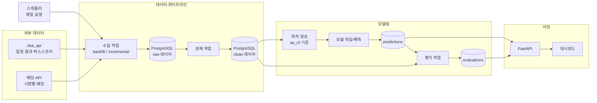

# Presagio — 프로젝트 개요

> *Leyendo las señales del juego* — 경기의 신호를 읽다

이 문서는 Presagio 프로젝트의 전체 그림이다. 작업을 시작하기 전, 그리고 각 단계를 시작할 때마다 이 문서를 다시 읽고 방향을 확인한다.

---

## 1. 프로젝트 요약

Presagio는 **매일 자동으로 NBA 경기 데이터를 수집하고, 경기 시작 전에 모든 경기의 승패 확률과 총점(언더/오버)을 예측하고, 시장 배당과 비교해 우위(edge)가 있는 가치 베팅을 가상 자금으로 추천하며, 경기 후 실제 결과로 예측과 추천의 성과를 정직하게 검증하는 시스템**이다. (2026-10-22 D-033으로 방향 확정)

- 만든 사람: CS 4학년, 백엔드 개발자 지망생
- 목적: 포트폴리오용 개인 프로젝트 (취업 면접에서 설계와 결정 과정을 설명할 수 있어야 함)
- 시즌: 2026-27 NBA 정규시즌 동안 실제로 매일 돌아가는 시스템을 목표로 한다

### 목표 (Goals)
1. 외부 데이터를 안정적으로 수집하는 **프로덕션 수준의 데이터 파이프라인**
2. 시점 관리가 엄격한 **피처 생성과 예측 모델**
3. 정확도에만 의존하지 않는 **정직한 검증 체계** (확률 품질, 보정, 시장 대비 성능)
4. 경기 전 **전 경기 승패·총점 예측과 가치 베팅 추천(가상 자금 시뮬레이터)**, 그리고 그 성과를 보여주는 **API와 대시보드**
5. 사람 손 없이 매일 돌아가는 **자동화와 모니터링**

### 비목표 (Non-goals)
- **실제 베팅 실행, 북메이커 계정 연동, 결제 기능은 만들지 않는다.** 추천은 가상 자금(시뮬레이터) 안에서만 하고 "이 경기, 이 쪽, 이만큼"을 표시하는 데서 끝난다(D-033). 배당 데이터는 평가 기준점이자 가치 베팅 판단의 입력이다.
- 시장을 이긴다고 가정하지 않는다. 우위가 없으면 "추천 없음"이 정답이고, 시장보다 못하더라도 그 차이를 정확히 측정하고 설명하는 것이 목표다. 좋은 결과만 골라 보여주지 않는다.
- 처음부터 모든 기능을 만들지 않는다. 단계별로 완성된 상태를 만들고 다음 단계로 넘어간다.

---

## 2. 핵심 원칙 (모든 단계에 적용)

1. **시점 관리와 데이터 누수 방지 (가장 중요)**
   - 어떤 경기의 예측에는 그 경기 시작 전에 알 수 있었던 정보만 사용한다.
   - 모든 데이터에 "언제 수집했는지 / 언제 기준의 정보인지"를 기록한다.
   - 피처 생성 코드는 기준 시각(as_of)을 입력받아 그 이전 데이터만 쓰도록 설계한다.
   - 누수를 잡는 테스트를 별도로 작성한다.
2. **멱등성과 재현성**
   - 같은 작업을 여러 번 실행해도 결과가 같아야 한다 (upsert, 결정적 처리).
   - 원본 응답(raw)을 보관해서 언제든 재처리할 수 있게 한다.
   - 모델 학습은 시드 고정, 학습 데이터 범위와 피처 버전을 기록한다.
3. **정직한 평가**
   - 평가는 항상 시간 순서를 지키는 walk-forward 방식으로 한다. 무작위 train/test 분할 금지.
   - 좋은 결과만 골라서 보여주지 않는다. 실패한 실험도 기록한다.
4. **외부 서비스 존중**
   - API 이용 약관과 요청 한도를 지킨다. 요청 간 딜레이, 지수 백오프 재시도, 타임아웃을 항상 적용한다.
   - API 키 같은 비밀값은 .env로 관리하고 커밋하지 않는다.
5. **설명 가능한 설계**
   - 중요한 설계 결정은 `docs/decisions.md`에 "무엇을 / 왜 / 다른 선택지는 무엇이었는지" 형식으로 짧게 기록한다.

---

## 3. 시스템 아키텍처



### 매일 돌아가는 흐름 (한국시간 기준 오전, 미국 경기 종료 후)
1. 전날 경기 결과와 박스스코어 수집
2. 전날 경기들의 마감 배당 확정 기록
3. 전날 예측·추천에 대한 평가 실행 (예측 지표 + 추천 정산 → 가상 자금 갱신)
4. 오늘 경기 일정과 현재 배당 수집
5. 오늘 경기 피처 생성 → 전 경기 예측(승패 확률, 예상 총점) 저장 → 시장 확률과 비교해 가치 베팅 추천 생성(가상 자금 기준 금액 포함)
6. 실행 결과 기록, 실패 시 알림

예측·추천을 내는 시각은 단계 2~4에서 정한다. 라인업·부상 발표로 예측이 바뀔 수 있으므로 한 경기에 예측 스냅숏을 여러 번(기준 시각 `as_of`별) 저장할 수 있게 설계하고, "추천의 기준 시각"은 그중 하나로 명시한다. 라인업·부상 정보 반영은 단계 7이다.

---

## 4. 기술 스택 (기본안)

| 영역 | 선택 | 비고 |
| --- | --- | --- |
| 언어 | Python 3.12 | |
| 패키지 관리 | uv | |
| DB | PostgreSQL | 로컬은 Docker Compose |
| ORM / 마이그레이션 | SQLAlchemy 2.x, Alembic | |
| 데이터 수집 | nba_api, httpx | |
| 데이터 처리 | pandas 또는 polars | |
| 모델 | scikit-learn, LightGBM | |
| API | FastAPI | |
| 대시보드 | 단계 5에서 결정 (Streamlit / 간단한 React 중 제안) | |
| 테스트 / 린트 | pytest, ruff | |
| 스케줄링 | 초기 cron 또는 GitHub Actions → 필요 시 Prefect | |
| 배포 | Docker, 소형 클라우드 VM 또는 PaaS | 단계 6에서 결정 |

- 더 나은 선택지가 있으면 이유와 함께 제안하고, 사람의 확인을 받은 뒤 바꾼다.
- 라이브러리 버전과 API 동작은 추측하지 말고 작업 시점에 직접 확인한다.

---

## 5. 데이터 소스

- **경기 일정, 결과, 박스스코어:** `nba_api` (stats.nba.com 비공식 래퍼)
  - 비공식이라 차단, 응답 지연, 스키마 변경이 생길 수 있다. 수집 레이어를 소스별 어댑터로 분리해서 나중에 다른 소스로 바꾸기 쉽게 만든다.
- **배당:** The Odds API 등 후보를 조사해서 무료 한도, 과거 데이터 제공 여부, 약관을 정리한 뒤 선택한다.
  - 경기별로 여러 시점의 배당을 저장한다. 최소한 "예측 시점 배당"과 "마감 배당"은 구분한다.
- **부상자 정보 (단계 7, 선택):** 신뢰할 만한 소스를 조사한 뒤 결정한다.
- 대상 범위: 2023-24 ~ 2025-26 시즌 (정규시즌 + 플레이오프) 백필, 그리고 진행 중인 2026-27 시즌.

---

## 6. 데이터 모델 (개요)

세부 스키마는 단계 1에서 설계안을 먼저 제시하고 확인받는다.

**raw 레이어**
- `raw_api_responses`: 소스, 엔드포인트, 요청 파라미터, 응답 원문(JSON), 수집 시각

**clean 레이어**
- `teams`: 팀 기본 정보
- `games`: 경기 ID, 시즌, 경기 유형(정규/플레이오프), 일시(UTC), 홈/원정 팀, 최종 점수, 상태
- `team_game_stats`: 팀 단위 박스스코어 (득점, 슈팅, 리바운드, 턴오버, 포제션 추정 등)
- `odds_snapshots`: 경기, 북메이커, 마켓(머니라인/스프레드/토탈), 가격, 기록 시각
- `ingestion_runs`: 작업 종류, 시작/종료 시각, 상태, 처리 건수, 에러 메시지

**모델링 레이어**
- `features`: 경기, 기준 시각(as_of), 피처 버전, 피처 값
- `model_versions`: 모델 이름, 버전, 학습 데이터 범위, 하이퍼파라미터, 피처 버전, 생성 시각
- `predictions`: 경기, 모델 버전, 기준 시각(as_of)·예측 시각, 홈팀 승률, 예상 총점, 그때 참조한 배당 스냅숏. 한 경기에 여러 스냅숏 허용
- `recommendations`(D-033 추가 초안): 예측, 마켓(머니라인/토탈), 방향, 모델 확률 vs 시장 확률, 우위(edge), 스테이크(가상 자금 비율·금액), 추천 시각. 단계 4에서 승인
- `bankroll_ledger`(D-033 추가 초안): 가상 자금 원장. 추천별 정산 결과와 잔액 추이. 단계 4에서 승인
- `evaluations`: 예측별 결과, 지표 값, 시장 확률과의 비교, 추천 정산(적중, 손익, CLV)

---

## 7. 단계별 로드맵

각 단계는 "완료 기준"을 모두 만족해야 다음 단계로 넘어간다. 각 단계를 시작할 때 세부 계획을 먼저 제시하고 확인받는다.

### 단계 0. 프로젝트 셋업
- 레포 구조, uv 프로젝트, ruff, pytest, pre-commit 설정
- Docker Compose로 PostgreSQL 실행
- .env.example, 기본 README, docs/decisions.md 생성
- **완료 기준:** `docker compose up`과 테스트 실행 명령이 동작한다.

### 단계 1. 데이터 파이프라인
- nba_api 엔드포인트 동작 확인
- raw/clean 스키마 설계 → 확인 → Alembic 마이그레이션
- 백필 CLI: 시즌/날짜 범위 지정, 재실행 시 중복 없음
- 증분 수집 CLI: 전날 결과 + 오늘 일정
- 배당 수집 인터페이스와 테이블 (실제 연결은 선택)
- 재시도, 타임아웃, 요청 간 딜레이, ingestion_runs 기록
- 데이터 품질 체크: 경기당 두 팀 레코드 존재, 팀 득점 합과 최종 점수 일치 등
- **완료 기준:** 3시즌 + 현재 시즌 백필 완료, 재실행 시 중복 없음, 증분 수집 동작, 테스트 통과, 확인 쿼리(시즌별 경기 수, 홈팀 승률) 결과 제시.

### 단계 2. 피처 생성 + 베이스라인 모델
- as_of 기준 피처 생성 모듈
  - 최근 N경기(5/10/20) 공격·수비 효율, 순득실, 페이스
  - 휴식일, 백투백 여부, 홈/원정
  - 시즌 누적 성적
- **Elo 레이팅** 직접 구현 (홈 어드밴티지, 시즌 간 평균 회귀 포함)
- 단순 기준선도 함께 만든다: "항상 홈팀 승", "시즌 승률 높은 팀 승"
- 누수 방지 테스트: 피처가 기준 시각 이후 데이터를 쓰지 않는지 검증
- **완료 기준:** 과거 시즌에 대해 Elo 예측과 기준선 예측이 생성되고, 기본 지표가 계산된다.

### 단계 3. 머신러닝 모델
- 승패 모델: 로지스틱 회귀 → LightGBM
- 총점 모델: 회귀 모델 (페이스와 효율 기반)
- 모델 버전 관리: model_versions 테이블에 학습 범위, 피처 버전, 파라미터 기록
- 확률 보정 필요 시 적용 (Platt scaling, isotonic 등)
- **완료 기준:** walk-forward 방식으로 학습/예측한 결과가 저장되고, Elo보다 나은지 아닌지 수치로 비교된다.

### 단계 4. 평가와 백테스트
- walk-forward 백테스트: 시즌을 날짜 순으로 진행하며, 각 날짜에는 그 이전 데이터만으로 학습한 모델로 예측
- 지표
  - 승패: 정확도, log loss, Brier score
  - 보정: 구간별 예측 확률 대비 실제 승률 (reliability diagram)
  - 총점: MAE, RMSE
- 시장 비교
  - 배당을 확률로 변환하고 마진을 제거한 "시장 확률"을 계산
  - 같은 경기들에 대해 내 모델 vs 시장 확률의 log loss, Brier 비교
  - 예측 시점 확률과 마감 시점 시장 확률의 차이 분석
- 가치 베팅 추천과 가상 자금 시뮬레이터 (D-033, 핵심)
  - 우위(edge) 계산: 모델 확률 − 마진 제거한 시장 확률. 추천 임계값은 실험으로 정한다
  - 스테이킹 규칙: 정액과 분수 Kelly를 비교. 가상 자금(예: 1,000 단위)에서 시작
  - 백테스트: walk-forward로 "그 시각에 알 수 있던 배당"만 써서 추천을 생성하고 ROI, 적중률, 최대 낙폭, CLV(마감 배당 대비 유리함)를 계산
  - 실제 베팅 연동 없음. 추천 목록과 가상 자금 곡선까지만
- 실험 결과를 `docs/experiments.md`에 정리 (실패한 실험 포함. 우위가 없다는 결과도 그대로 적는다)
- **완료 기준:** 한 명령으로 백테스트 리포트(예측 지표 표 + 보정 그래프 + 시장 비교 + 추천 전략별 ROI/CLV/낙폭)를 생성할 수 있다.

### 단계 5. 서빙 (API + 대시보드)
- FastAPI 엔드포인트 예시
  - `GET /games?date=` : 날짜별 경기
  - `GET /predictions/today` : 오늘 예측
  - `GET /predictions/{game_id}` : 경기별 예측 상세
  - `GET /recommendations/today` : 오늘의 가치 베팅 추천(마켓, 방향, edge, 가상 스테이크). 우위가 없으면 빈 목록
  - `GET /performance` : 누적 성능 지표, 모델 vs 시장, 가상 자금 곡선·ROI·CLV
  - `GET /health` : 파이프라인 최근 실행 상태
- API 테스트, OpenAPI 문서
- 대시보드: 오늘의 예측과 추천, 가상 자금 곡선, 누적 성적 추이, 보정 그래프, 모델 vs 시장 비교
- **완료 기준:** 로컬에서 API와 대시보드가 실제 DB 데이터로 동작한다.

### 단계 6. 자동화, 배포, 모니터링
- 매일 흐름(3장)을 하나의 스케줄 작업으로 묶기
- Docker 이미지로 패키징, 클라우드 배포 (선택지와 비용 비교 후 결정)
- 실패 알림 (Discord 또는 Slack 웹훅)
- 데이터 신선도 체크: 전날 경기 데이터가 들어오지 않으면 알림
- **완료 기준:** 사람이 손대지 않아도 7일 연속으로 수집 → 예측 → 평가가 돌아가고, 대시보드에 반영된다.

### 단계 7. 확장 (선택)
- 부상자/결장·라인업 정보 반영 (발표 후 예측·추천 재계산)
- 선수 단위 피처 (주전 결장 시 전력 조정)
- 실험 추적 도구 (MLflow 등)
- 모델 성능 드리프트 감지

---

## 8. 디렉토리 구조 (제안)

```
presagio/
├── README.md
├── PRESAGIO_OVERVIEW.md
├── docker-compose.yml
├── pyproject.toml
├── .env.example
├── alembic/
├── docs/
│   ├── decisions.md
│   └── experiments.md
├── src/presagio/
│   ├── config.py
│   ├── db/            # 모델, 세션, 리포지토리
│   ├── ingestion/     # 소스별 어댑터, 백필/증분 작업
│   ├── quality/       # 데이터 품질 체크
│   ├── features/      # as_of 기준 피처 생성
│   ├── models/        # Elo, ML 모델, 학습/예측
│   ├── evaluation/    # 지표, 백테스트, 시장 비교
│   ├── api/           # FastAPI
│   └── cli.py         # 진입점 명령
├── dashboard/
├── scripts/
└── tests/
```

---

## 9. 작업 방식 (Claude Code 지침)

1. **계획 먼저.** 각 단계를 시작할 때 세부 작업 목록, 변경할 파일, 설계안을 먼저 보여주고 확인받은 뒤 코드를 작성한다.
2. **확인이 필요한 결정.** DB 스키마, 기술 스택 변경, 외부 서비스 선택, 비용이 드는 결정은 반드시 사람에게 묻는다.
3. **작은 단위로 진행.** 작업 단위마다 무엇을 했고 어떻게 확인할 수 있는지(실행 명령, 예상 결과) 알려준다.
4. **커밋.** 기능 단위로 커밋하고, 메시지는 명확하게 쓴다.
5. **테스트.** 핵심 로직, 특히 시점 관리와 멱등성은 반드시 테스트한다. 외부 네트워크는 mock 처리한다.
6. **추측 금지.** 라이브러리 동작, API 응답 형식, 데이터 의미를 모르면 직접 확인하거나 묻는다.
7. **설명 가능성.** 사람이 면접에서 설명할 수 있도록, 중요한 결정마다 `docs/decisions.md`에 이유를 남기고, 단계가 끝날 때 무엇을 왜 그렇게 만들었는지 짧게 요약해준다.

---

## 10. 리스크와 대응

| 리스크 | 대응 |
| --- | --- |
| nba_api 차단, 속도 제한, 스키마 변경 | 요청 딜레이와 재시도, raw 보관, 소스 어댑터 분리 |
| 배당 데이터 무료 한도 부족 | 수집 빈도 조절, 과거 데이터는 가능한 범위만, 대체 소스 조사 |
| 데이터 누수로 성능 과대평가 | as_of 설계, 누수 테스트, walk-forward 평가만 사용 |
| 과적합 | 단순 모델과 항상 비교, 피처 수 관리, 시즌 단위 검증 |
| 추천 성과 과대평가 (시장 이긴 것처럼 보임) | 예측 시점 배당만 사용, CLV로 교차 검증, 수수료·마진 반영, "우위 없음" 결과도 기록 |
| 결측/이상 데이터 | 품질 체크, 실패 기록, 재처리 가능 구조 |
| 범위 확장으로 미완성 | 단계별 완료 기준을 지키고 확장은 단계 7로 미룬다 |

---

## 11. 최종 산출물

- 매일 자동으로 돌아가는 배포된 시스템과 대시보드 (경기 전 예측·추천, 가상 자금 성과)
- README: 프로젝트 소개, 아키텍처, 실행 방법, 결과 요약, 한계
- `docs/decisions.md`: 설계 결정 기록
- `docs/experiments.md`: 실험과 결과 (실패 포함)
- 시즌 중간 결과를 정리한 회고 글 (블로그 또는 README 섹션)

---

## 12. 작업 방식에 대한 메모 (2026-10-21 추가)

원래 이 문서의 12장은 "단계 0과 1을 지금 시작하라"는 지시였다.
그 지시는 한 세션이 아니라 **역할을 나눈 여러 세션(회사 구조)** 으로 수행하기로 결정했다.
회사 구조와 일하는 방식은 [CLAUDE.md](CLAUDE.md)와 [docs/team/](docs/team/)에 있고, 실제 할 일은 [docs/backlog.md](docs/backlog.md)에 티켓으로 쪼개져 있다.
