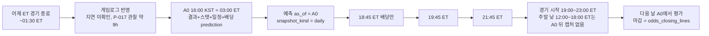
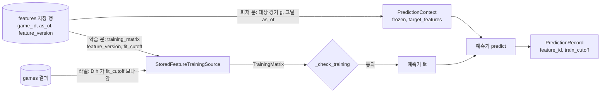

# 모델링 설계안 v1 + 실험 계획 (P-030)

- **작성:** ML Engineer, 2026-10-23. **v1.1** 리뷰 1차 반영, **v1.2** 리뷰 2차 반영(바뀐 곳은 13장). **v1.3** 2026-11-19 단계 3 설계 보완(P-047. 새 내용은 14장, 바뀐 곳은 13장).
- **상태:** v1.2는 2026-10-23 사람 승인(D-049). **v1.3(14장)은 🧑 사람 승인 대기** — 승인 전에는 P-048(첫 학습 모델)을 시작하지 않는다. 사람이 답할 것은 14-10의 M-12~M-22다.
- **이 문서가 정하는 것:** 무엇을 예측하는지(1장), 어느 시각 기준으로 어떤 데이터를 쓰는지(2장), 피처 후보(3장), 시장 기준선(4장), 단순 기준선과 Elo(5장), 지표와 walk-forward 프로토콜과 보류 시즌(6장), 가설 목록과 실험 등록 양식(7장), P-031에 넘길 모델링 레이어 요구 사항(8장), 누수 자기 점검(9장), 사람이 결정할 지점 M-1~M-11(10장).
- **정하지 않는 것:** DDL(P-031), 코드(P-032~P-035), 실험 결과(P-037), 배당 과거 백필 결제(사람, P-033 때, D-045).
- **확인 방법:** 문서의 모든 사실 숫자는 개발 DB(`presagio`, 마이그레이션 `0001`)에서 12장의 쿼리로 직접 뽑았다(v1.1: 2026-10-23 01:18~01:19 UTC에 전부 다시 실행해 갱신). 문헌 값은 12-2에 출처와 확인 상태가 있고, 1차 출처를 열지 못한 값은 "(2차 출처)" 또는 "(미확인)"으로 표시했다. 외부 API 호출은 0회다.
- **사실 숫자와 제안값의 구분:** 쿼리·문헌에서 나온 값에는 출처가 붙는다. 임계값, Δ, 허용치, 재학습 주기, 부트스트랩 횟수처럼 내가 정한 값은 **(제안)**으로 표시한다. 7-1 판정 기준의 숫자는 전부 제안값이다.
- **보류 시즌 미접촉 선언:** 이 문서를 쓰면서 2025-26 시즌의 **결과(승패·점수) 관련 집계는 하지 않았고, 2025-26 결과 숫자는 인용도 하지 않는다**(v1.1에서 단계 1 보고서 인용도 뺐다). 일정 구조(시작 시각 분포) 집계에는 전 시즌이 들어간다(결과 정보 없음).
- **v1.3 (2026-11-19, P-047 단계 3 설계 보완):** 14장이 학습 경로, 재학습과 모델 산출물, 실시간 as_of, 피처 fv2, 탐색 범위, 보정, 판정 문장, 보류 시즌 개봉 절차, 사람이 결정할 지점 M-12~M-22를 정한다. 1~11장의 문장은 그대로 두고 14장이 구체화하거나 대체하는 자리에 `(v1.3: 14-N)` 표시만 붙였다. 14장의 숫자는 12-5의 쿼리(개발 DB, 2026-11-19)와 `docs/decisions.md`·`docs/experiments.md`에서 왔고 라이브러리 동작의 근거는 12-6에 있다. 모델 학습·실험 실행·외부 API 호출·DB 쓰기는 0회이고, 2025-26은 일정만 읽었으며 결과 숫자는 없다.

---

## 0. 쉬운 말 요약 (사람용)

1. 우리는 매일 한국시간 16:00, 어제 미국 경기가 다 끝나고 오늘 경기는 하나도 시작하기 전인 시각에 그날 모든 경기의 홈팀 승률과 예상 총점을 낸다.
2. 예측에는 그 시각까지 알 수 있던 것만 쓴다: 어제까지의 팀 기록, 휴식일, 홈/원정, Elo 점수, 그 시각의 배당이며, 같은 날 다른 경기 결과는 절대 섞지 않는다.
3. 가장 센 비교 상대는 모델이 아니라 시장(배당)이라서, 배당을 확률로 바꾸고 수수료를 걷어낸 "시장 확률"보다 우리가 나은지를 log loss와 Brier로 잰다.
4. 시장과 비교할 수 있는 경기는 지금 2026-27 시즌에 쌓이는 것뿐이고, 배당이 없는 지난 세 시즌은 "시장 비교 불가"로 정직하게 표시한다($59 백필은 P-033 때 네가 결정).
5. 단순 기준선(항상 홈, 시즌 승률, Elo)을 먼저 만들고 복잡한 모델은 그다음이며, 기준선을 못 이기면 그것도 결과로 기록한다.
6. 평가는 항상 시간 순서대로 하고(walk-forward), 2023-24로 배우고 2024-25로 확인하며, 2025-26은 끝까지 열어보지 않는 보류 시즌으로 두어 좋은 모델을 사후에 고르는 일을 구조로 막는다.
7. 가설 12개를 번호 붙여 미리 등록하고 성공 판정 숫자도 실험 전에 적어 두었으며, 시뮬레이션 모델·전략 토너먼트·다폴더는 단계 3·4 가설로 자리를 잡았다.
8. 누수(미래 정보 섞임)가 생길 수 있는 길을 9장에 전부 적고 막는 테스트 14개를 제안했지만, "누수 없음"은 내가 선언하지 않고 감사관(P-036)이 판정한다.
9. 네가 답할 결정 11개가 10장에 있고, 가장 중요한 셋은 M-1(예측 시각), M-2(보류 시즌), M-9(주말 낮 경기의 마감 배당을 잡기 위한 캡처를 몇 회 더할지)다.
10. 승인되면 PM이 D-번호로 기록하고 P-031부터 구현이 시작된다.

### 새 용어 풀이

| 용어 | 뜻 |
| --- | --- |
| **as_of (기준 시각)** | "이 시각까지 알 수 있던 정보만 쓴다"의 그 시각. 예측 한 건마다 하나씩 붙는다. 같은 경기에 as_of가 다른 예측이 여러 개 있을 수 있다(스냅숏). |
| **가용 시각(available_at)** | 어떤 경기 결과가 "우리가 알 수 있게 된" 시각. 경기 시작 + 지연(Δ)으로 흉내 낸다(2-3). |
| **동부 날짜(ET date)** | 경기 시작 시각을 미국 동부 시간으로 바꾼 날짜. NBA 일정과 우리 매일 수집이 이 날짜로 돈다. |
| **시장 암시 확률 / 마진 제거** | 배당 2.0 → 1/2.0 = 50%. 양쪽 합이 100%를 넘는 만큼이 북메이커 마진. 그것을 걷어내 합이 100%가 되게 하는 방법이 여러 가지다(비례, Shin, power). |
| **예측 시점 배당 / 마감 배당** | 예측 시점 배당 = as_of 이전 마지막 스냅숏(피처·추천용). 마감 배당 = 경기 시작 전 마지막 스냅숏(평가·CLV 전용). 둘을 섞으면 누수다. |
| **lead_time** | 마감 배당이 경기 시작 몇 시간 전 것인지. 뷰 `odds_closing_lines`가 준다. 너무 오래된 것은 마감으로 치지 않는다(허용치, M-9). |
| **CLV (Closing Line Value)** | 내가 본 가격이 마감 가격보다 유리했는가. 꾸준히 양수면 진짜 우위. |
| **log loss / Brier** | 확률 예측의 품질 점수. 낮을수록 좋다. 둘 다 "정직한 확률"에 보상을 주는 적절한 점수 규칙(proper scoring rule)이다. |
| **보정(calibration) / ECE** | "70%라고 한 경기들이 실제로 70% 이겼나". ECE는 그 차이의 가중 평균. |
| **walk-forward / 재학습 주기** | 시간 순서대로 "여기까지로 학습 → 다음 구간 예측"을 반복. 재학습 주기는 모델을 다시 맞추는 간격(일·주·시즌). |
| **보류 시즌(holdout)** | 개발 중 절대 보지 않는 시즌. 마지막에 한 번만 평가한다. |
| **네스티드 튜닝** | 하이퍼파라미터(Elo K 등)를 고르는 데이터와 성능을 보고하는 데이터를 분리하는 것. 고르는 데는 학습 기간 안쪽만 쓴다. |
| **Elo (K, 홈 어드밴티지, 회귀율)** | 이기면 오르고 지면 내리는 실력 점수. K는 한 경기에 얼마나 움직이는지, 홈 어드밴티지는 홈팀에 더해 주는 점수, 회귀율은 시즌이 바뀔 때 평균 쪽으로 얼마나 되돌리는지. |
| **포제션 / 효율 / 페이스** | 포제션 = 공격권 횟수(추정식). 공격 효율 = 100포제션당 득점, 수비 효율 = 100포제션당 실점, 페이스 = 48분당 포제션. |
| **Four Factors** | 경기를 결정하는 네 요소(Oliver): 슈팅(eFG%), 턴오버(TOV%), 리바운드(ORB%), 자유투(FT/FGA). 기본 박스스코어로 전부 계산된다. |
| **사전 등록(pre-registration)** | 실험 전에 가설·비교 대상·성공 기준 숫자를 적어 두는 것. 결과를 본 뒤 기준을 바꾸지 못하게 한다. |
| **시간 여행 테스트 / 미래 주입 테스트** | 전자: as_of 이후 데이터를 더 넣어도 피처가 안 변하는지. 후자: 미래 결과를 극단값으로 바꿔도 과거 예측이 안 변하는지. 감사관의 검증 방법 2·3. |
| **스냅숏 종류(snapshot_kind)** | 같은 경기의 예측이 어느 시각 규칙으로 만들어졌는지 표시(`daily`=16:00 KST 본 실행, `pre_tip_1845` 등). |
### 단계 3 보완 요약 (v1.3, 사람용)

1. 단계 3에서는 처음으로 "과거 경기로 배우는 모델"(로지스틱 회귀, LightGBM, 총점 회귀)을 올리고, 지금 가장 좋은 Elo(2024-25 log loss 0.6183)보다 나은지를 같은 경기에서 숫자로 비교한다.
2. 모델이 배울 때 보는 과거 경기의 피처는 그 경기 날 기준 시각으로 저장해 둔 값만 쓰고, 나중 시각으로 다시 계산하지 않는다(다시 계산하면 그 경기의 결과가 섞인다).
3. 모델은 7일마다 다시 맞추고, 2023-24 한 시즌을 다 배운 뒤 2024-25 개막부터 예측한다(지금 규칙 그대로).
4. 올 시즌(2026-27)부터 매일 예측의 기준 시각을 한국 16:15로 옮기며, 수집이 늦게 끝난 날은 끝난 시각으로 남기고 실패한 날은 "빠진 날"로 둔다. 과거 시즌은 16:00 그대로이고 저장한 것을 다시 만들지 않는다.
5. 새 피처 묶음 fv2에는 상대 성향별 성적, 일정 강도, 새 Elo 상수를 넣고, 배당 피처는 과거 배당을 산 뒤 다음 묶음(fv3)으로 미룬다.
6. 모델 설정은 작은 후보 표 안에서 2023-24만 보고 고르고, 2024-25는 판정에만 쓴다.
7. 확률이 한쪽으로 치우쳐 보정 조건을 못 넘으면 그때만 Platt 보정을 한 새 버전을 만들어 따로 판정한다.
8. 보류 시즌 2025-26은 최종 설정을 문서로 고정한 뒤 네가 "열어"라고 하면 한 번만 열고, 결과가 나빠도 그대로 적는다.
9. 누수가 새로 생길 수 있는 길 15가지와 막는 테스트 15개(T8·T14의 실제 구현과 T15~T27)를 적었지만, "누수 없음"은 내가 선언하지 않고 감사관(P-049)이 판정한다.
10. 네가 답할 결정은 14-10의 M-12~M-22 열한 개이고, DB 스키마는 바꾸지 않는다.

### 새 용어 풀이 (v1.3)

| 용어 | 뜻 |
| --- | --- |
| **학습 모델 / 재학습** | 과거 경기의 (피처, 결과) 쌍으로 계수를 맞추는 모델. 재학습은 새로 쌓인 경기까지 넣어 다시 맞추는 것 |
| **로지스틱 회귀** | 피처의 가중합을 0~1 사이 확률로 바꾸는 가장 단순한 분류 모델 |
| **LightGBM** | 작은 결정 트리를 수백 개 이어 붙이는 모델. 복잡한 관계를 잡지만 과적합하기 쉽다 |
| **릿지 회귀** | 계수가 커지지 않게 벌점을 주는 선형 회귀. 총점 예측에 쓴다 |
| **정규화(L2, C, alpha)** | 계수에 벌점을 줘 과적합을 줄이는 것. C가 작을수록, alpha가 클수록 벌점이 세다 |
| **격자(grid)** | 설정 후보를 늘어놓은 표. 칸마다 돌려 보고 하나를 고른다 |
| **조기 종료** | 검증 점수가 나아지지 않으면 트리를 더 붙이지 않고 멈추는 것 |
| **전처리(표준화, 결측 대치)** | 피처의 단위를 맞추고(평균 0, 표준편차 1) 빈칸을 채우는 것. 그 통계도 학습 데이터에서만 구해야 한다 |
| **Platt / isotonic 보정** | 모델 확률을 실제 빈도에 맞게 다시 눌러 주는 것. Platt는 S자 곡선 하나, isotonic은 계단 함수 |
| **모델 산출물(artifact)** | 맞춘 모델을 파일로 남긴 것(계수, 트리, 전처리 통계) |
| **학습 문 / 피처 문** | 예측기에 데이터가 들어가는 두 통로. 학습 문은 재학습 때의 과거 경기, 피처 문은 그날 예측할 경기의 피처다. 그 밖의 길은 없다 |
| **규칙 as_of / 실시간(live) 행 / 재현 실행** | 규칙 as_of는 날짜만으로 정해지는 기준 시각. live 행은 경기 전에 실제로 저장한 행. 재현 실행은 나중에 같은 규칙으로 다시 계산하는 것 |
| **결정성** | 같은 명령을 두 번 돌리면 같은 값이 나오는 성질 |
| **다중 비교** | 같은 데이터로 여러 가설을 판정하면 우연히 "충족"이 나올 가능성이 커지는 문제 |

---

## 1. 예측 대상과 대상 경기 (완료 기준 1)

### 1-1. 예측 대상

| 대상 | 입력 | 출력 | 단위 | 정답(평가 라벨) | 단계 |
| --- | --- | --- | --- | --- | --- |
| **T1 승패** | 경기 1개(`game_id`, 홈·원정 팀, `start_time_utc`, `is_neutral`) + `as_of` + 그 시각까지의 피처 | `p_home` = 홈팀(일정상 홈) 승리 확률 | 확률 (0, 1), 소수 4자리 | `home_score > away_score` (NBA는 무승부 없음) | 2 |
| **T2 총점** | 같음 | `total_mean` = 예상 총점. 단계 3부터 `total_sd`(분산) 추가 | 점(소수 1자리) | `home_score + away_score` | 2 (평균), 3 (분산) |
| **T3 오버 확률** | T2 + 기준 라인 `L`(토탈 `point`, 4-3의 기준 북메이커, as_of 이전 마지막 스냅숏) | `over_prob` = P(총점 > L) | 확률 | 총점 > L이면 1, < L이면 0, = L(정수 라인)이면 **push**로 평가 제외 | 2 (정규 근사), 3 (직접 모델·시뮬레이션) |
| (단계 4) 스프레드 커버 확률 | T2의 점수 차 분포 + 스프레드 `point` | P(홈 점수 차 > −spread) | 확률 | 점수 차 vs 스프레드 | 4 |

- 단계 2의 T3는 T2의 정규 근사로 낸다: `over_prob = 1 − Φ((L − total_mean) / σ)`, σ는 학습 기간 잔차 표준편차(출발값은 리그 총점 표준편차, 12-1 Q-D: 2023-24 정규 20.3점, 2024-25 19.8점). 단계 3의 H-10(시뮬레이션)이 분포를 직접 만든다. (v1.3: 14-5)
- 확률은 항상 홈팀 기준 하나만 저장한다. 원정 승률은 `1 − p_home`.
- 중립 경기(`is_neutral = true`)도 "일정상 홈"을 홈으로 둔다(D-042). 홈 어드밴티지 피처만 0이 된다(3-1 F-09).

### 1-2. 대상 경기 필터

| 조건 | 규칙 | 근거 |
| --- | --- | --- |
| 경기 유형 | 학습·예측·평가 기본 대상 = `game_type IN ('regular', 'playin', 'playoffs')` | D-028 A-4 |
| `cup_final` (006) | **기본: 스탯·Elo·학습·예측·평가에서 제외. 일정 피처(F-08 휴식·백투백)에는 포함**(결승에 나간 두 팀은 실제로 뛰었으므로 다음 경기 휴식일이 틀리지 않게). 팀 스탯이 없고(게임로그 밖, D-023) 시즌당 1경기 | **M-3** |
| `playin` (005) | **기본: 포함**(학습·예측·평가). 시즌당 6경기라 지표는 `playoffs`와 합쳐 "포스트시즌" 구간으로 보고 | **M-3** |
| 팀·시각 미정 | `home_team_id IS NOT NULL AND NOT is_time_tbd`인 경기만 예측 | D-028 A-5 |
| 시작 전 | 예측 시점에 `start_time_utc > as_of`. 저장 시 CHECK 대상(8장) | 원칙 1 |
| 연기·시각 변경 | 예측 당시 `start_time_utc`를 `predictions`에 함께 저장. 실제 시작 시각과 1시간 넘게 다르면 `rescheduled = true`로 표시하고 **시장 비교에서 제외**(마감 배당 규칙 A-8의 1시간과 같은 기준). 모델 지표에는 포함 | A-8 |
| NBA컵 조별·녹아웃 (`game_subtype`) | `regular`에 포함되므로 그대로 포함. 녹아웃 준결승·결승(라스베이거스)은 `is_neutral` | 12-1 Q-B |
| 플레이오프 | 포함하되 **지표는 정규·포스트시즌을 따로** 보고(정규 대비 플레이오프 평균 총점이 2023-24 17.2점, 2024-25 10.2점 낮고 홈 승률은 0.585·0.571로 높다, 12-1 Q-D) | Q-D |

대상 경기 수(개발 DB, 12-1 Q-A): 2023-24 1,318 / 2024-25 1,320 / 2025-26 1,321(보류) / 2026-27 예정 1,192 + 종료 14. 전부 `cup_final` 제외 수다.

### 1-3. 예측 기준 시각(as_of) 후보와 D-038 수집 시각의 관계

D-038의 하루 4회 수집과 경기 시작 시각 분포(12-1 Q-M: 정규·플레이인·플레이오프 종료 경기 3,973개의 동부 시작 시각)는 이렇다.

| 수집 시각(D-038) | 동부 시각 | 무엇이 새로 들어오나 | 그 시각에 시작 전인 오늘 경기 |
| --- | --- | --- | --- |
| **A0** 본 실행 16:00 KST | 03:00 EDT / 02:00 EST(2026-11-01부터) | 어제 결과 + 팀 스탯(게임로그) + 오늘 일정 + 배당(`capture_label = prediction`) | **전부**(가장 이른 시작 12:00 ET, 9시간 뒤) |
| **A1** 18:45 ET | 18:45 | 배당만(`closing`), nba_api 0회 | 87.6% (18:45 이후 시작 3,481경기) |
| **A2** 19:45 ET | 19:45 | 배당만 | 51.2% (2,034경기) |
| **A3** 21:45 ET | 21:45 | 배당만 | 15.1% (598경기) |

| 후보 | 정의 | 장점 | 단점 | 추천 |
| --- | --- | --- | --- | --- |
| **A0 일일 스냅숏(`daily`)** | as_of = 본 실행의 `prediction` 배당 수집 `captured_at`(실제 시각). 배당 단계가 `skipped`·실패면 본 실행 부모 run의 `finished_at`을 as_of로 쓴다(제안). 시장 피처와 `market_status`는 그 as_of에 R3를 그대로 적용한다(전날 21:45 ET 캡처가 24시간 안이면 그것을 쓰고, 24시간 안 스냅숏이 없을 때만 `no_snapshot_at_as_of`). 백테스트에서는 그 동부 날짜의 **07:00 UTC**(= 16:00 KST, 서머타임 무관) (v1.3: 14-3) | 스탯이 완전하고 오늘 경기가 전부 시작 전. 하루 1회라 단순. 사람이 오후에 "오늘 예측"을 볼 수 있다 | 배당이 9~20시간 전 값이라 라인업·부상 반영이 덜 됨 | **단계 2의 유일한 as_of. 추천 기준 시각(D-033 5항)도 A0** (**M-1**) |
| A1~A3 경기 전 스냅숏(`pre_tip_*`) | as_of = 그 캡처의 `captured_at`. 스탯 피처는 A0과 같고 시장 피처만 바뀜 | 시장을 피처로 쓸 때(H-09) 가장 신선한 가격. 추천의 CLV가 좋아짐 | 하루 4개 예측 행. 사람이 보기엔 늦은 시각(한국 새벽) | 단계 3(시장 피처 도입)부터 추가 저장. 추천 기준 시각을 "경기 전 마지막"으로 옮길지는 단계 4에서 재결정 (v1.3: 14-4) |
| 경기별 "시작 X시간 전" | as_of = `start_time_utc − X` | 경기마다 같은 정보 나이 | 수집 시각과 안 맞아 실제로는 그 시각의 배당이 없다(가장 가까운 이전 스냅숏을 써야 함) | 안 고름(11장) |

- as_of는 **UTC timestamptz 하나**다. "그 시각까지 우리 DB에 있던 정보"가 정의다. 백테스트에서는 2-3의 가용 시각 규칙으로 흉내 낸다.
- 같은 날의 모든 경기는 같은 as_of를 갖는다(실행 단위). 경기별 as_of가 아니라 **실행별 as_of**다.
- 2026-27 실시간에서 as_of는 "배당 수집이 끝난 시각"이다. 예측 단계는 수집 단계 뒤에 실행된다(OVERVIEW 3장 4→5단계). 따라서 `odds_snapshots.captured_at ≤ as_of`가 그날 `prediction` 캡처를 포함한다(등호 포함, T6). (v1.3: 14-3)
- 예측 단계가 재시도나 지연으로 as_of보다 늦게 돌아도 **as_of 뒤에 들어온 행은 쓰지 않는다.** 보장 장치(제안): `input_fingerprint.max_stats_fetched_at ≤ as_of`를 품질 체크로, **실시간(`origin = live`) 행에만** `computed_at − as_of ≤ 2시간`을 상한으로(넘으면 그날 `daily` 스냅숏을 만들지 않고 결손으로 기록). 백테스트 행과 결손 날을 나중에 채우는 행은 as_of가 과거라 상한을 걸지 않는다(R4, 8-1). (v1.3: 14-3)



---

## 2. 데이터와 시점(as_of) (완료 기준 1·7)

### 2-1. 읽는 표·뷰 (전부 읽기 전용, D-004)

| 표/뷰 | 쓰는 곳 | 쓰는 컬럼 | 안 쓰는 것 |
| --- | --- | --- | --- |
| `games` | 대상 경기, 결과 라벨, 일정 피처, Elo | `game_id`, `season`, `game_type`, `game_subtype`, `start_time_utc`, `is_time_tbd`, `status_code`, `home_team_id`, `away_team_id`, `home_score`, `away_score`, `is_neutral`, `fetched_at`, `created_at` | `status_text`, `postponed_status`(해석 미확인), `source` |
| `team_game_stats_primary` (뷰) | 롤링·누적·Four Factors·포제션 | 전 스탯 컬럼 + `is_home`, `opponent_team_id`, `fetched_at` | 원본 표 `team_game_stats`는 직접 읽지 않는다(D-028 A-6) |
| `odds_snapshots` + `odds_events` | 예측 시점 시장 피처(4-3), 기준 라인 | `captured_at`, `bookmaker_key`, `market_key`, `outcome_side`, `price_decimal`, `point`, `bookmaker_last_update`, `odds_events.game_id` | `capture_label`(참고용, 로직에 쓰지 않음, 7-2) |
| `odds_closing_lines` (뷰) | **평가와 CLV 전용**(P-032 `evaluation/`). 피처·모델 코드는 이 뷰를 읽지 않는다(9장 Q4) | `price_decimal`, `point`, `lead_time`, `event_commence_time`, `game_id` | |
| `raw_api_responses`, `ingestion_runs` | 읽지 않는다 | | 피처가 raw에 결합되면 소스 형식에 묶인다(D-044 대안 기각 이유와 같음) |

`is_neutral`은 컬럼이 있고(D-046) 2023-24 값은 P-025(PR #21, 2026-10-23 `f77b691`로 main 머지)가 채웠다. 개발 DB 2023-24 중립 5경기가 true이고 main 코드로 다시 받은 뒤에도 유지된다(12-1 Q-A, Q-R3).

### 2-2. 시각 규칙 (수식)

기호: 예측 대상 경기 g, 후보 입력 경기 h, 동부 날짜 `D(x) = (start_time_utc(x) AT TIME ZONE 'America/New_York')::date`.

**규칙 R1 (동부 날짜 엄격 부등호).** 경기 h의 결과·스탯을 g의 피처에 쓰려면 `D(h) < D(g)`. 같은 동부 날짜의 다른 경기는 그 시각에 끝났더라도 쓰지 않는다. 이유: (a) 16:00 KST 본 실행이 "어제 날짜 전체"를 단위로 받으므로(D-039) 정규 스케줄에서는 실시간 DB에 같은 날짜 경기 결과가 없다(손으로 돌린 백필이 넣었더라도 R1이 막는다). 백테스트도 같은 정보량이어야 한다. (b) off-by-one(당일 결과 포함)을 날짜 하나로 막는다.

**규칙 R2 (가용 시각).** `available_at(h) = start_time_utc(h) + Δ`, `available_at(h) ≤ as_of`, `status_code(h) = 3`, 그리고 h의 팀 행 2개가 `team_game_stats_primary`에 있어야 한다. 출발값 **Δ = 3시간(제안, M-10)**. 경기 종료 시각은 DB에 없고(schema 1-5) "경기 길이 약 2.5시간"은 일반 상식이라 **(미확인)**이다. Δ는 그 상식에 여유를 더한 제안값이고 운영 측정(2-3)으로 바꾼다. A0에서는 R1이 R2를 거의 항상 함의한다(어제 23:00 ET 시작 경기도 EST면 04:00 UTC + 3h = 07:00 UTC ≤ as_of, EDT면 06:00 UTC). R2가 따로 필요한 곳은 백테스트의 가정을 **명시**하는 것과, 단계 3의 경기 전 스냅숏(A1~A3)이다. A1~A3에서도 R1이 같은 날짜 경기를 막으므로 "19:00 경기가 끝난 뒤 21:45 스냅숏에 그 결과가 섞이는" 경로는 없다.

**규칙 R3 (배당).** 예측 시점 시장 = `(odds_event_id, bookmaker_key, market_key, outcome_side)`마다 `captured_at ≤ as_of`인 마지막 스냅숏. 기준은 `captured_at`(우리가 받은 시각)이고 `bookmaker_last_update`는 기록만 한다(4-3). 마감 배당은 뷰 `odds_closing_lines`이며 평가에서만 읽는다.

**규칙 R4 (저장 시 검사).** `features.as_of < games.start_time_utc`, `predictions.as_of < games.start_time_utc`, `predictions.train_cutoff ≤ predictions.as_of`, `features.as_of ≤ features.computed_at`, 그리고 **`origin = 'live'` 행에만** `computed_at ≤ as_of + 2시간(제안)`(백테스트 행은 as_of가 과거이고 계산은 지금이라 상한이 없다. 저장은 두 origin 모두 한다 — 6-2의 "저장 행만 읽는다"가 성립하려면 백테스트 피처도 저장돼야 한다). 표를 넘는 조건은 DB CHECK로 못 거니 로더와 품질 체크가 막는다(8장). `computed_at`과 `as_of`는 **같은 시계**(파이썬, raw `fetched_at`과 같은 시계)로 찍는다. DB `now()` 기본값을 섞으면 Docker Desktop VM 시계 차이(약 1ms)로 경계 테스트가 간헐적으로 실패한다(D-030 교훈).

### 2-3. 실시간(2026-27)과 백테스트(과거 시즌)의 정보량 차이 (누수 질문 1)

| 항목 | 실시간 2026-27 | 백테스트 2023-24~2024-25 | 다루는 법 |
| --- | --- | --- | --- |
| 어제 결과가 DB에 있나 | 게임로그 반영이 늦으면 `partial`(D-039)이라 그날 피처가 어제 경기를 못 본다 | 전부 있다(백필) | (1) R1·R2로 백테스트의 정보 경계를 명시. (2) 실시간은 `features.input_completeness`에 "두 팀의 어제 경기 중 스탯이 있는 수 / 있어야 할 수"를 기록. 평가는 완전/불완전 구간을 나눠 보고. (3) 운영 첫 2주 partial 일수(D-039)를 보고 Δ 또는 본 실행 시각을 조정 |
| 스탯 정정 | 처음 받은 값 | 2026-10-22에 받은(정정 뒤) 값 | `features`는 계산 당시 값을 저장(D-030). 정정 빈도는 2026-27 raw 버전 수로 측정(데이터 요구 DR-2). 과거 시즌의 정정은 한계로 적는다(schema 1-5) |
| 배당 | `live` 스냅숏 하루 4회, `captured_at` = 수신 시각 | 없음(D-026). $59 백필 시 `historical`, `captured_at` = 스냅숏 `timestamp`. API에는 5~10분 간격 스냅숏이 있지만(odds_api.md 2.1) 우리가 사는 것은 **하루 최대 5개**(odds_api.md 3.2) | 같은 R3. 마감 `lead_time`은 live(하루 4회)와 historical(하루 5회) 모두 "시간 단위"다(4-4). `evaluations.closing_lead_time`을 저장해 구간별 보고 |
| 일정 변경 | 예측 뒤 시각이 바뀔 수 있음 | 최종 일정만 | 1-2 `rescheduled` 규칙 |
| `is_neutral` | 일정 플래그 | 2023-24는 P-025 보완 | 전제 명시(2-1) |

백테스트는 "그 당시 DB"가 아니라 "현재 DB에 R1·R2를 적용한 것"이다. 이것이 누수 질문 1의 답이다: **지연을 무시하지 않고 Δ로 흉내 내되, 실시간과의 차이(partial, 정정)는 측정 가능한 값으로 남긴다.**

### 2-4. 콜드 스타트와 시즌 경계 (누수 질문 3)

| 항목 | 규칙 |
| --- | --- |
| 시즌 경계 | `games.season` 컬럼(날짜가 아님). 시즌 첫 경기 = 그 시즌 `regular` 중 `start_time_utc` 최소 |
| 롤링 창(최근 N) | **시즌 안에서만** 센다. 이전 시즌 경기는 창에 넣지 않는다. 시즌 초 k < N 경기면 있는 k경기로 계산하고 `n_games_available = k`를 같이 저장. k = 0이면 NULL |
| 시즌 누적 | 시즌 첫 경기는 NULL(경기 0). `games_played = 0` 저장. 포스트시즌 경기도 누적에 들어간다(의도. F-06·B1의 시즌 승률에 플레이인·플레이오프가 섞인다) |
| 전 시즌 값 | 별도 피처 `prev_season_*`(전 시즌 최종 순득실·승률). 2023-24는 전 시즌 데이터가 없어 NULL → **DR-1(2022-23 수집)**로 해결 가능(**M-11**) |
| Elo | 시즌을 넘어 이어진다. 새 시즌 첫 경기 전에 `R ← carry × R + (1 − carry) × 1505`, 출발값 carry = 0.75(5-2, **M-7**). 2023-24 시작은 전 팀 1500(2022-23가 없으면). DR-1이 되면 2022-23를 워밍업으로 돌리고 2023-24 첫 예측부터 평가. **carry는 DR-1이 있을 때만 고를 수 있다**(2023-24 안에는 시즌 경계가 없어 격자가 같은 값을 낸다, 6-4) |
| 플레이인·플레이오프 | 롤링 창과 Elo 갱신에 **포함**(가장 최근 경기이므로). 정규 전용 창은 두지 않는다. `cup_final`은 스탯·Elo에서 제외, 일정 피처(F-08)에는 포함(M-3) |
| 포스트시즌 → 다음 시즌 | 플레이오프까지 반영된 Elo가 회귀한 값이 다음 시즌 출발값 |

롤링 창이 시즌을 넘지 않는 이유: 오프시즌 로스터 변화가 커서 전 시즌 마지막 20경기는 "같은 팀"이 아니다. 대신 `prev_season_*`를 따로 두어 모델이 가중치를 정하게 한다.

---

## 3. 피처 후보 (완료 기준 2)

### 3-0. 공통 규칙

- 모든 피처 함수는 `(game_id, as_of) → dict`이고, 모든 DB 조회에 2-2의 R1·R2·R3가 걸린다. 홈팀 값 `home_*`, 원정팀 값 `away_*`, 차이 `diff_* = home − away`를 함께 낸다.
- **포제션** = `presagio.ingestion.possessions.team_possessions` (D-035, `FGA − OREB + TOV + 0.44 × FTA`), 경기 단위 = 양 팀 평균 `game_possessions`. 효율의 분모는 경기 포제션(양 팀 평균)을 쓴다(양 팀 포제션은 거의 같고 평균이 한쪽 오차를 줄인다, D-035). 대안 공식은 3-3.
- **합 기반 비율.** 창 안의 비율은 "경기별 비율의 평균"이 아니라 "합의 비율"이다: `ortg_N = 100 × Σ pts / Σ poss`. 경기별 평균은 포제션이 적은 경기에 과대 가중한다.
- **버전 전략.** 피처 집합 전체에 버전 문자열 하나(`fv1`, `fv2`, …). 정의·창 길이·포제션 공식·Δ·가용 규칙 중 하나라도 바뀌면 올린다. 버전별 키 목록·파라미터(`poss_formula`, `availability_lag_hours`, 창 길이)는 코드의 매니페스트(파이썬 dict)에 두고 `model_versions.feature_version`이 가리킨다. `features` 행은 덮어쓰지 않는다(8-1).
- 12-1 Q-P의 규모(정규시즌 팀 행 평균): 포제션 101.5~102.0, 공격 효율 111.7~112.6, 3점 시도 비율 0.395~0.421, 자유투 시도 비율 0.246~0.247. 피처 값이 이 범위를 크게 벗어나면 버그다(품질 체크 후보).

### 3-1. 피처 후보 표 (`fv1` = 단계 2 P-035 대상, `fv2+` = 단계 3 후보)

| ID | 이름 | 정의 (수식 / SQL 의사코드) | 읽는 표·뷰 | as_of 규칙 | 버전 | 근거 |
| --- | --- | --- | --- | --- | --- | --- |
| F-01 | `ortg_{N}` (N=5,10,20) | `100 × Σ pts / Σ game_poss`, 최근 N경기(시즌 안, R1·R2 통과분, `ORDER BY start_time_utc DESC LIMIT N`) | `team_game_stats_primary` ⨝ `games` | R1, R2 | fv1 | OVERVIEW 단계 2. Oliver 2004(효율 = 100포제션당) |
| F-02 | `drtg_{N}` | `100 × Σ opp_pts / Σ game_poss`, 같은 창. `opp_pts`는 상대 행의 `pts` | 같음 | R1, R2 | fv1 | 같음 |
| F-03 | `net_{N}` | `ortg_N − drtg_N` | 계산값 | | fv1 | 순득실(효율 기준) |
| F-04 | `pace_{N}` | `Σ game_poss / Σ (minutes / 240)` = 48분당 포제션(연장 보정) | 같음 | R1, R2 | fv1 | bref Pace = `48 × poss / (MP/5)`(12-2) |
| F-05 | `margin_{N}` | `Σ (pts − opp_pts) / n` 원점수 차 평균 | 같음 | R1, R2 | fv1 | 효율과 다른 축(페이스 포함) |
| F-06 | `std_*` 시즌 누적 | 시즌 시작부터 R1·R2 통과 경기 전체로 F-01~F-05와 승률 `wins / games_played`, `games_played` | 같음 | R1, R2 | fv1 | OVERVIEW 단계 2 |
| F-07 | `prev_season_*` | 전 시즌 최종 `net`, 승률, 포스트시즌 진출 여부. `season`이 바로 앞 시즌인 경기 전체 | 같음 | 시즌 단위(전 시즌은 전부 as_of 이전) | fv1 | 2-4 콜드 스타트. 2023-24는 NULL(DR-1 전) |
| F-08 | `days_rest`, `is_b2b`, `games_last_7d` | `days_rest = D(g) − D(이전 경기)`(같은 시즌, **`cup_final` 포함** — 실제로 뛴 경기이므로 일정 피처에는 넣는다), `is_b2b = (days_rest = 1)`, `games_last_7d` = `D(g) − 7 ≤ D(h) < D(g)`인 경기 수. 시즌 첫 경기는 NULL | `games`만 | R1 (일정은 미리 알 수 있으므로 **이전 경기가 끝났는지와 무관**. 단, 결과는 안 씀) | fv1 | 글로서리 "백투백". 12-1 Q-O: 정규시즌 팀-경기의 17.4~18.5%가 백투백 |
| F-09 | `home_adv` | `home_adv = 0 if is_neutral else 1`. 행은 홈팀 관점 하나뿐이라 원정 값은 따로 없다 | `games` | 일정 값 | fv1 | D-042, D-046. 정규 홈 승률 0.543~0.544(Q-D) |
| F-10 | `elo_home`, `elo_away`, `elo_diff_adj`, `elo_prob` | 5-2의 경기 전 레이팅. `elo_diff_adj = elo_home + HCA × home_adv − elo_away`, `elo_prob = 1 / (1 + 10^(−elo_diff_adj / 400))` | `games`(결과 순차 처리) | R1, R2 순서로 갱신. 갱신에 쓰는 경기는 `D(h) < D(g)` | fv1 (Elo 상수는 `model_versions`) (v1.3: 14-4) | FiveThirtyEight NBA Elo(12-2) |
| F-11 | `mkt_p_home`, `mkt_total_line`, `mkt_spread_home`, `mkt_age_h`, `mkt_n_books`, `mkt_bookmaker` | 4-3 예측 시점 시장. `mkt_p_home` = 마진 제거 홈 확률(합의 또는 기준 북메이커, **M-4**), `mkt_age_h = (as_of − captured_at)`/1h, 24시간(제안) 넘으면 전부 NULL | `odds_snapshots` ⨝ `odds_events` | **R3** (`captured_at ≤ as_of`). 뷰 `odds_closing_lines` 금지 | fv1 (값은 있을 때만. 2023-24~2025-26은 NULL) (v1.3: 14-4) | 사람 메모 1 "시장을 가장 강한 피처로". 단계 2에서는 **기준선으로만** 쓰고 모델 입력으로는 단계 3(H-09) |
| F-12 | Four Factors `efg_{N}`, `tov_pct_{N}`, `orb_pct_{N}`, `ftr_{N}` (공격) + 같은 것의 수비판(`opp_*`) | `efg = (Σfgm + 0.5 Σfg3m) / Σfga`, `tov_pct = Σtov / (Σfga + 0.44 Σfta + Σtov)`, `orb_pct = Σoreb / (Σoreb + Σ opp_dreb)`, `ftr = Σftm / Σfga` | `team_game_stats_primary`(상대 행 조인) | R1, R2 | fv1 | Oliver 2004 Four Factors. bref 정의(12-2: TOV% 분모 0.44) |
| F-13 | 전술 대리 지표(가능한 것) `fg3a_rate_{N}`, `fta_rate_{N}`, `ast_rate_{N}` | `fg3a_rate = Σfg3a / Σfga`, `fta_rate = Σfta / Σfga`, `ast_rate = Σast / Σfgm`, 페이스는 F-04 | 같음 | R1, R2 | fv1 | 사람 메모 3. 기본 박스스코어로 계산 가능(Q-P) |
| F-14 | 상대 성향별 성적 | 상대를 페이스 삼분위로 나눠 각 구간의 `net`. 삼분위 경계는 **as_of 이전 리그 분포**로 | 같음 | R1, R2 + 경계도 as_of 이전 | fv2 (단계 3) (v1.3: 14-4) | 사람 메모 3 "상대 성향별 성적". 표본이 작아 단계 3 |
| F-15 | 일정 맥락 `season_day`, `game_no`, `is_playoffs`, `series_game_no` | `season_day = D(g) − 시즌 첫 날짜`, `game_no = games_played + 1`, 플레이오프 `game_id` 9~10번째 자리(nba_api.md 3-1) | `games` | 일정 값 | fv1 (`series_game_no`는 fv2) (v1.3: 14-4) | 시즌 초·플레이오프 분포 차이(1-2) |
| F-16 | `sos_{N}` 일정 강도 | 최근 N경기 상대의 경기 전 Elo 평균 | F-10 | R1, R2 | fv2 (v1.3: 14-4) | 롤링 효율의 상대 보정 |
| F-17 | 리그 기준값 `league_total_{N}`, `league_home_rate_std` | as_of 이전 리그 전체 최근 N경기 평균 총점, 시즌 누적 홈 승률 | `games` | R1, R2 | fv1 | 총점 기준선 T-B0, 승패 기준선 B0 |

**피처 함수 시그니처(요구):** `compute_features(game_id: str, as_of: datetime, version: str = "fv1") -> FeatureRow`. 내부의 모든 쿼리가 `as_of`와 `D(g)`를 바인드 파라미터로 받는다. 감사 방법 1(시그니처·조건)의 대상이다.

### 3-2. 지금 데이터로 계산할 수 없는 것 → 데이터 요구 (Data Engineer, PM이 티켓화)

| 번호 | 요구 | 왜 | 비용 추정 | 우선순위 |
| --- | --- | --- | --- | --- |
| DR-1 | **2022-23 시즌 수집**(일정 1 + 게임로그 3 = nba_api 4호출) | Elo 워밍업, `prev_season_*`(F-07), 그리고 Elo carry 탐색(H-04)의 유일한 시즌 경계. 지금은 2023-24 첫 수십 경기의 Elo가 전 팀 1500에서 출발해 노이즈가 크고, 학습 첫 시즌의 평가가 통째로 오염된다 | 호출 4(보고서 7장: 4시즌 17호출이 약 20초였으므로 시즌 하나는 몇 초) | **높음** (**M-11**) |
| DR-2 | **스탯 정정 빈도 측정**: 같은 경기·팀의 `team_game_stats` 값이 raw 버전 사이에 바뀐 횟수를 세는 품질 체크(2026-27부터) | 누수 질문 5(재현성). 정정이 잦으면 실시간과 백테스트의 입력이 체계적으로 다르다 | 품질 체크 1개 | 중간 |
| DR-3 | 경기장·시간대(`arenaCity`, 시간대) 컬럼 | 이동 거리·시차 피처(fv2 후보). raw에만 있다 | 컬럼 2개 + raw 재적재 | 낮음 (단계 3에서 재검토) |
| DR-4 | 선수 단위 박스스코어(`BoxScoreTraditionalV3.players`) | 로테이션 깊이, 주전 결장(사람 메모 3 "로테이션 깊이") | 경기당 1호출 = 시즌 약 1,320호출 | 단계 7(D-023 "다시 볼 때") |
| DR-5 | 슛 위치(림 근처 비율), 플레이바이플레이 | 사람 메모 3 "림 근처 비율" | 별도 엔드포인트 조사 필요(미확인) | 단계 7 |
| DR-6 | `cup_final` 팀 스탯(`BoxScoreTraditionalV3` 시즌당 1회) | M-3에서 "포함"을 고를 때만 | 시즌당 1호출 | M-3 결과에 따라 |
| DR-7 | 과거 3시즌 배당 백필($59) | 시장 기준선·CLV를 과거 시즌에서 평가 | $59, 하루 ≤ 5스냅숏(odds_api.md 3.2) | 사람 결정, P-033 때(D-045) |
| DR-8 | 주말(토·일) 낮 경기용 `--odds-only` 배당 캡처 추가. 1회(16:45 ET)면 `lead_time ≤ 2h` 커버 87.6% → 93.1%, 2회(14:45·16:45) 97.0%, 3회(12:15·14:45·16:45) 98.5% (4-4, 12-1 Q-U) | 4-4: 18:45 ET 전 시작 경기 492(12.4%, 주말 438)는 A0 뒤 마감 캡처가 없어 `lead_time`이 9시간 이상 | 캡처 1회당 월 약 26크레딧(주 2일 × 3크레딧 × 약 4.4주). 2회 +53 → 월 최대 425, 3회 +79 → 451 (< 500) | **M-9** (D-027·D-038·D-048 변경이라 사람 결정. PM 결정: P-024는 4회 기준으로 끝내고 M-9 승인 시 후속 티켓) |

종류: **지금 스키마로 계산할 수 없는 대리 지표** = DR-3·DR-4·DR-5(단계 3·7), **운영·수집 요청** = DR-1·DR-2·DR-6·DR-7·DR-8. "불가"로 분류한 것(림 근처 비율, 로테이션 깊이, 라인업, 부상)은 피처 표에 넣지 않았다. 단계 7(OVERVIEW)과 D-033 5항대로다. DR-3의 이동 거리는 비중립 경기라면 `teams` 도시 좌표표만으로 대부분 계산할 수 있다(리뷰어 지적).

### 3-3. 포제션 공식 비교 계획 (D-035 "다시 볼 때")

| | 공식 A (D-035, 현재 함수) | 공식 B (basketball-reference `Poss`) |
| --- | --- | --- |
| 식 | `FGA − OREB + TOV + 0.44 × FTA`, 경기 단위 = 양 팀 평균 | `0.5 × ((Tm FGA + 0.4 Tm FTA − 1.07 × (Tm ORB / (Tm ORB + Opp DRB)) × (Tm FGA − Tm FG) + Tm TOV) + (Opp 같은 식))` (12-2에서 2026-10-23 직접 확인) |
| 입력 | 자기 행 4개 | 자기 행 + 상대 행(DREB, FGM) |
| 개발 DB 규모(2023-24 정규 1,230경기, **경기 단위**, 12-1 Q-Q) | 평균 101.51 | 평균 99.05. **A − B 평균 2.47, 표준편차 0.69, 상관 0.991, A/B 비율 1.0249** |

**어디서 차이가 나고 어디서 안 나는가(설계상 결론, 리뷰 발견 3).**
- `fv1`의 효율(`100 × Σpts / Σposs`)과 페이스(`Σposs / Σ(min/240)`)는 포제션이 분모·분자에 각각 들어가고, T-B1은 둘을 곱한다: 한 팀 항은 `pace × (ortg + drtg)/100 = 240 × (Σpts + Σopp_pts) / Σmin`이라 **포제션이 약분된다.** 교차 항은 `pace_h / pace_a` 비율로만 공식에 의존하는데, B ≈ A / 1.0249(경기별 편차 0.69)라 비율 변화는 1e-3 수준이다. 그래서 **T-B1 총점에서는 두 공식의 차이가 0에 가깝다**(추정 0.05점 미만. 실험 전 추정이며 H-05(a)가 확인한다). 피처 값 자체는 다르다: F-01~F-04는 척도가 약 2.5% 움직이고(ortg·drtg ×1.025, pace ÷1.025), F-12·F-13(Four Factors, 시도 비율)은 포제션을 아예 쓰지 않는다. 척도만 바뀌는 피처는 로지스틱의 계수가 흡수하고 트리 모델의 분할에 영향이 없으므로 **모델 결과**가 0에 가깝게 같다. NBA 공식 추정식 `0.96 × (FGA + 0.44 FTA − ORB + TO)`(12-2, 2차 출처)는 A의 상수배라 정확히 같은 결과를 낸다.
- 포제션의 **수준**이 직접 들어가는 곳은 **시뮬레이션(H-10)**뿐이다: 경기당 포제션 수와 포제션당 득점 분산이 총점 분포의 폭을 정한다. 거기서만 A와 B가 다른 결과를 낼 수 있다.
- 따라서 v1 초안의 "T-B1 MAE로 비교"는 구분력이 없는 설계였고 D-035 유지가 실험 전에 정해진 셈이었다. v1.1은 **H-05를 둘로 나눈다**: (a) 약분 확인(설계 검증, 예상 결과 = 차이 없음), (b) H-10 시뮬레이션에서 A vs B. 판정 기준은 7-1 H-05. 기본은 A(단순, 입력 4개, 이미 코드·결정에 있음)이고 (b)가 기준을 넘을 때만 `fv2`에서 B로 바꾸고 D-035 갱신을 제안한다.
- 0.44의 출처는 Oliver 2004(함수 docstring, D-035).

---

## 4. 시장 기준선 (완료 기준 3)

### 4-1. 지금 배당 데이터의 상태 (12-1 Q-E~Q-L, 2026-10-23)

| 항목 | 값 |
| --- | --- |
| `odds_snapshots` | **796행 = 2026-10-22 12:39:21 UTC 호출 1회분** (`capture_kind = live`, `capture_label = p019_check`), 41이벤트 전부 2026-27 |
| `odds_events` | 41, 전부 `game_id` 매핑됨. `commence_time` 2026-10-22 23:10 ~ 2026-12-26 03:30 UTC |
| 북메이커 | 9곳 관찰: draftkings 246행(= 41이벤트 × 3마켓 × 2 = **전 이벤트 커버**), betrivers 114, betmgm 84, bovada 84, fanduel 84, betonlineag 80, lowvig 80, betus 12, mybookieag 12. `us` 지역 11곳(odds_api.md 2.1) 중 2곳은 이 응답에 없었다. **Pinnacle은 없다** |
| 마켓 | h2h 220, spreads 288, totals 288 |
| 마진(overround, 양쪽 있는 마켓) | h2h 110개: 2.98%~5.36%(평균 4.35%). spreads 144개: 2.84%~5.34%(4.55%). totals 144개: 3.63%~6.41%(4.62%) |
| `captured_at − bookmaker_last_update` | 17초~71초, 중앙값 38초 |
| 토탈 라인 북메이커 간 차이 | 41이벤트 중 16개에서 라인이 다름. 최대 6.0점(먼 경기), 평균 0.66점 |
| h2h 홈 암시 확률(마진 포함) | 0.282 ~ 0.855 |
| `odds_closing_lines` | 796행 그대로, `lead_time` 10시간 30분 ~ 64일 14시간. **지금은 "마감"의 뜻이 없다** |
| 지난 세 시즌 배당 | 0 (D-026) |

결론은 브리핑과 같다. 시장 기준선과 CLV는 **2026-27 앞으로 쌓이는 경기**로만 측정된다(P-024 launchd가 돌기 시작하면). 설계는 "있을 때/없을 때"를 모두 다룬다(4-6).

### 4-2. 암시 확률과 마진 제거

두 쪽 소수식 배당 `o_h, o_a`에서 암시 확률 `π_h = 1/o_h`, `π_a = 1/o_a`, 마진 `v = π_h + π_a − 1`(D-036, `presagio.ingestion.odds_math`).

| 방법 | 식 (2-outcome) | 성질 | 출처 |
| --- | --- | --- | --- |
| **비례 배분(basic normalization)** — 출발값 | `p_h = π_h / (π_h + π_a)` | 마진을 양쪽에 같은 비율로. 구현 있음(`remove_margin_proportional`) | D-036. Štrumbelj 2014가 "basic normalization"이라 부름(12-2) |
| **Shin** | 내부자 비율 z를 풀어 `p_i = (sqrt(z² + 4(1−z) π_i² / Σπ) − z) / (2(1−z))`, Σp = 1이 되는 z를 수치로 | 롱샷(약팀) 확률을 비례보다 더 깎는다(favorite-longshot bias 보정). Štrumbelj 2014가 축구 배당에서 basic보다 낫다고 보고(**2차 출처**로 확인, 12-2) | Shin 1993(미확인, 원문 못 열음), Štrumbelj 2014 |
| **power** | `p_i = π_i^k`, Σp = 1이 되는 k를 수치로 | Shin과 비슷하게 롱샷을 더 깎음. 파라미터 1개 | Clarke, Kovalchik & Ingram 2017(제목은 `shin` 패키지 인용으로 확인, 학술지명 미확인) |

- 단계 2 기준선은 **비례 배분**(D-036). **H-02**가 Shin·power를 "시장 확률 자체의 log loss"로 비교한다(모델 없이, 결과가 있는 경기만). 사전 판정 기준 7-1. 바뀌면 `metric_version`을 올린다(8-4).
- 추천(**M-5**): 비례 배분 유지 + H-02로 교체 여부 결정. NBA h2h는 마진이 3~5%로 작고(Q-I) 대부분의 경기가 0.3~0.85 범위(Q-L)라 방법 간 차이는 작을 것으로 본다(가설).

### 4-3. 북메이커 선택과 "예측 시점 배당"

| 쓰임 | 규칙 | 이유 |
| --- | --- | --- |
| **시장 확률 기준선·피처 `mkt_p_home`** | **합의(consensus)**: as_of 이전 마지막 스냅숏이 **같은 `captured_at`**에 양쪽 다 있는 북메이커들의 마진 제거 확률의 **중앙값**. 북메이커 ≥ 3곳(제안)일 때만. 3곳 미만이면 기준 북메이커 값, 그것도 없으면 NULL | 한 북메이커의 늦은 갱신·실수에 강하다. 9곳 중 커버리지가 고르지 않다(Q-G) |
| **기준 북메이커(라인·CLV·추천 가격)** | **DraftKings** (`draftkings`). 없으면 FanDuel → BetMGM 순서의 고정 목록 | 관찰 표본에서 유일하게 전 이벤트를 커버(246행). 라인(`point`)과 CLV는 **같은 북메이커·같은 마켓·같은 쪽**끼리 비교해야 뜻이 있다 |
| **토탈 기준 라인 `L`** | 기준 북메이커의 as_of 이전 마지막 `totals` `point` | T3 정의(1-1). 북메이커 간 라인이 다른 이벤트가 41 중 16(Q-K) |
| **예측 시점 배당** | R3: `(이벤트, 북메이커, 마켓, 쪽)`마다 `captured_at ≤ as_of` 마지막 행. `as_of − captured_at ≤ 24시간`(제안), 아니면 "시장 없음" | 하루 4회 수집이면 나이는 최대 약 5시간(A0은 직전 21:45 ET 캡처 또는 자기 `prediction` 캡처) |
| 시각 기준 | **`captured_at`**(우리가 받은 시각). `bookmaker_last_update`는 저장만(지금 데이터에서 둘의 차이 17~71초) | "알 수 있었던 시각"은 우리가 받은 시각이다. 북메이커 시계는 우리 시계와 다를 수 있다(schema 7-2) |
| Pinnacle | **없다**(`us` 지역 응답에 없음, Q-G). 문헌의 "가장 효율적인 마감"(Pinnacle 자체 자료, 12-2)을 그대로 쓸 수 없다 | **M-4** 대안 칸 |

### 4-4. 마감 배당과 `lead_time` 허용치

- 마감 = 뷰 `odds_closing_lines`(이벤트 최신 시작 시각 전 마지막 스냅숏, 일정이 1시간 넘게 바뀐 스냅숏 제외, D-028 A-8).
- **허용치(제안, M-9):** `lead_time ≤ 2시간`이면 "마감 있음". 넘으면 `market_status = pred_only`(예측 시점 시장만 있음, 4-6)로 CLV·마감 비교에서 제외(평가 행은 남기고 사유만 적음).
- 왜 2시간인가 — D-038 캡처 시각과 시작 시각 분포(12-1 Q-M)로 계산한 **기대 lead_time**:

| 시작 시각(ET) | 경기 수(3시즌+14) | 비율 | 마지막 캡처 | 기대 lead_time |
| --- | --- | --- | --- | --- |
| 18:45 이전 (12:00~18:30) | 492 | 12.4% | **A0 (03:00 EDT / 02:00 EST)** | EDT 9~15.5시간, EST 10~16.5시간 → 허용치 밖 |
| 18:45~19:44 | 1,447 | 36.4% | 18:45 | 0~59분 |
| 19:45~21:44 | 1,436 | 36.1% | 19:45 | 0~119분 |
| 21:45 이후 (~23:00) | 598 | 15.1% | 21:45 | 0~75분 |

  2시간(제안)이면 87.6%가 "마감 있음"이다. 낮 경기 492개는 **주말 438**(일요일 589경기 중 324, 토요일 521 중 114) + **평일 54**이고, 주말 낮 경기의 시작 시각은 18:00 167, 15:30 107, 13:00 51, 15:00 41, 17:00 40, 나머지 12:00~18:30 사이 32다(12-1 Q-T). 그래서 캡처 하나를 어느 시각에 두느냐에 따라 메워지는 양이 크게 다르다. 주말에만 `--odds-only` 캡처를 더할 때의 커버리지를 15분 격자로 전수 탐색한 결과(12-1 Q-U, 평일은 D-038 그대로):

| 주말 추가 캡처(ET) | 월 추가 크레딧(캡처 1회 = 주 2일 × 3 × 약 4.4주 ≈ 26) | `lead_time ≤ 2h` | `≤ 1h` | 메우지 못하는 것 |
| --- | --- | --- | --- | --- |
| 없음 (D-038) | 0 (월 최대 372) | 87.6% | 77.0% | 낮 경기 492 전부 |
| 1회 11:45 (v1 초안 DR-8) | +26 (398) | **89.1%** | 77.2% | 12:00~13:00 60경기만 메움. 15:00·15:30·17:00·18:00은 3~6시간 밖 |
| 1회 16:45 (1회 중 최선) | +26 (398) | 93.1% | 78.2% | 16:30 이전 시작(16:00 6, 16:30 1 포함) |
| 2회 14:45·16:45 (2회 중 최선) | +53 (425) | 97.0% | 81.9% | 주말 12:00~14:00 67(12:00 7, 12:30 2, 13:00 51, 14:00 7) + 평일 낮 54 = 121 |
| 3회 12:15·14:45·16:45 (3회 중 최선) | +79 (451) | 98.5% | 83.2% | 평일 낮 54(시즌당 약 18, 공휴일) + 소수 |
| 3회 11:45·13:45·16:45 (리뷰어 예) | +79 (451) | 98.5% | 78.6% | 같음 |

  v1 초안의 "1회 추가로 약 100%"는 틀렸다(리뷰 발견 2). 추천은 **M-9**. 평일 낮 54경기는 평일 캡처(주 5일, 캡처 1회당 월 약 66크레딧)가 필요해 메우지 않는다.

  **과거 백필(DR-7)의 마감 품질.** API에는 5~10분 간격 스냅숏이 있지만 $59 플랜으로 사는 것은 **하루 최대 5스냅숏**(odds_api.md 3.2)이다. 예측 시점 1회(03:00 ET) + 마감 4회를 평일·주말 따로 15분 격자로 최적화하면(12-1 Q-U, 목표 = `≤ 2h` 비율 최대): 평일 13:45·17:15·19:15·21:15 → `≤ 2h` 2,844/2,863 = 99.3%. 주말 14:45·16:45·18:45·20:45 → 1,043/1,110 = 94.0%. 합치면 `≤ 2h` 3,887/3,973 = 97.8%(`≤ 1h` 비율은 이 목표로 최적화하지 않았다). 즉 **과거 백필의 마감도 live와 같은 "시간 단위" 품질이고 "10분 이내 마감"이 아니다**(v1 초안의 "historical ≤ 10분"은 틀렸다, 리뷰 발견 9). 어느 시각을 살지는 백필 설계(P-033 후속)에서 목표(≤ 2h 비율 vs ≤ 1h 비율)를 정해 다시 계산한다(제안값). 어느 쪽이든 `evaluations.closing_lead_time`을 저장해 구간(≤ 30분 / ≤ 1h / ≤ 2h)별로 보고한다.

### 4-5. CLV 정의

예측 시점 가격 `o_pred`(기준 북메이커, 쪽 s, 토탈이면 라인 L), 마감 마진 제거 확률 `q_close(s)`(같은 북메이커·마켓·쪽, 같은 라인):

- `clv_prob = q_close(s) − p_fair_pred(s)` (마감 공정 확률 − 예측 시점 공정 확률. 양수면 시장이 우리 쪽으로 움직임)
- `clv_return = o_pred × q_close(s) − 1` (마감 공정 확률로 본 기대 수익률. Pinnacle의 정의와 같은 형태, 12-2)
- `beat_close = o_pred > o_close` (가격만 비교)
- 토탈·스프레드: 라인이 같을 때만 `clv_return`을 계산하고 `line_move = L_close − L_pred`를 따로 저장. 라인이 다르면 `clv_return` NULL + `line_move`만.
- 단위: 추천 1건(단계 4 `recommendations`)마다. 단계 2에서는 추천이 없으므로 CLV는 **"모델이 가치 있다고 본 쪽"(`p_model > p_fair_pred`인 쪽)**에 대해 계산해 분포만 본다(H-03 보조 지표).
- 집계: 평균 `clv_return`, `beat_close` 비율, 부트스트랩 90% 구간(경기 단위 재표집 1,000회, 제안).

### 4-6. 배당이 없는 경기·시즌의 처리 (D-026 "정직하게 불가로 표시")

`evaluations.market_status`(8-4) 값과 보고 규칙:

| 값 | 뜻 | 보고 |
| --- | --- | --- |
| `available` | 예측 시점 시장과 마감(허용치 안) 둘 다 있음 | 시장 비교 전 지표 |
| `pred_only` | 예측 시점 시장은 있는데 마감이 허용치 밖 | 예측 시점 시장 비교만, CLV 없음 |
| `no_snapshot_at_as_of` | 2026-27인데 as_of 이전 24시간 안 스냅숏이 없음(수집 결손, D-048 "정직한 결손") | 불가, 사유 |
| `no_odds_season` | 2023-24~2025-26 (DR-7 전) | 불가, 사유 |
| `unmatched_event` | `odds_events.game_id` NULL(D-036 매핑 실패) | 불가, 사유 |
| `rescheduled` | 1-2 연기 규칙 | 불가, 사유 |

- 모든 실험 표는 **두 줄**로 낸다: (a) 전체 경기(모델·기준선만), (b) 시장 있는 경기(모델·기준선·시장 모두, **같은 경기 집합**). (b)의 n을 항상 적는다. n < 100(제안)이면 시장 비교 숫자를 "참고(표본 부족)"로 표시한다.
- (b)의 정의는 비교 대상에 따라 다르다(리뷰 발견 15): **예측 시점 시장(B3)을 쓰는 비교**(H-02, H-03, H-09)는 `market_status IN ('available', 'pred_only')`, **마감·CLV를 쓰는 비교**(B4, H-11, H-12)는 `available`만. 마감 유무는 as_of 뒤에 정해지는 속성이라 B3 비교를 그것으로 거르면 낮 경기 12.4%가 체계적으로 빠진다.
- 시장 포함 실험군(H-02, H-03, H-09, H-11, H-12)은 (b)만 쓴다. 시장 미포함 실험군은 (a)를 쓴다.

---

## 5. 단순 기준선과 Elo (완료 기준 2·8)

### 5-1. 승패 기준선

| ID | 이름 | 확률 | 학습 | 비고 |
| --- | --- | --- | --- | --- |
| B0 | 항상 홈 | `p_home = 학습 기간 홈 승률`(F-17 `league_home_rate_std`, as_of 이전 누적. 시즌 초는 전 시즌 값). 중립이면 0.5 | 없음 | 정확도용 "항상 홈 승"도 함께(= p ≥ 0.5) |
| B1 | 시즌 승률 | 시즌 누적 승률이 높은 팀 승(동률·시즌 첫 경기는 홈). 확률판: `0.5 + 0.5 × (win%_h − win%_a)`를 [0.05, 0.95](제안)로 자름 | 없음 | 확률판은 조잡하므로 log loss는 참고. 보정판은 H-06의 로지스틱 |
| B2 | Elo | 5-2 | 상수만(네스티드, 6-4) | 단계 2의 주 기준선 |
| B3 | 시장(예측 시점) | `mkt_p_home`(4-3) | 없음 | 있을 때만. **가장 강한 기준선** |
| B4 | 시장(마감) | `odds_closing_lines` 마진 제거 확률 | 없음 | 평가 전용. 모델이 이것을 이기면 안 되는 게 정상(정보가 더 많음). 참고선 |

### 5-2. Elo 정의와 출발 상수 (M-7)

- 기대 승률: `E_h = 1 / (1 + 10^(−(R_h + HCA × home_adv − R_a) / 400))`, `home_adv = 0 if is_neutral else 1`.
- 갱신(경기 종료 후, R1 순서): `R_h ← R_h + K × m × (S_h − E_h)`, `R_a ← R_a − K × m × (S_h − E_h)`, `S_h ∈ {0, 1}`. v1은 `m = 1`(점수 차 배수 없음). H-04(b)가 점수 차 배수를 시험한다.
- 시즌 경계: `R ← carry × R + (1 − carry) × 1505`(2-4).
- 초기값: 전 팀 1500(2023-24 시작. DR-1이 되면 2022-23를 먼저 돌린다).

| 상수 | 출발값 | 출처 | 네스티드 탐색 범위(H-04) |
| --- | --- | --- | --- |
| K | **20** | FiveThirtyEight "How We Calculate NBA Elo Ratings"(Silver & Fischer-Baum, 2015). 원문 페이지가 2026-10-23 현재 리다이렉트되어 열리지 않아 검색 요약으로만 확인(12-2) | {10, 15, 20, 25, 30} |
| 홈 어드밴티지 HCA | **100** Elo점(약 3.5점, 같은 글) | 같음. 우리 데이터의 정규시즌 평균 홈 점수 차 +2.15 / +1.63(Q-D)과 방향이 맞다 | {50, 75, 100, 125} |
| 시즌 회귀 carry | **0.75** (1505 쪽으로 25% 회귀) | **2차 출처**(Harvard Sports Analysis Collective 2019가 538 방식으로 서술). 1차 원문 미확인 | {0.6, 0.75, 0.9} — **DR-1(2022-23)이 있을 때만** 2022-23 → 2023-24 경계로 탐색. 없으면 2023-24 안에 시즌 경계가 없어 격자가 전부 같은 log loss를 내므로(시작 직전 회귀는 전 팀을 똑같이 1501.25로 옮길 뿐) **0.75 고정** |
| 점수 차 배수 m | v1 없음 | 538식 `((MOV + 3)^0.8) / (7.5 + 0.006 × Elo차)`는 **기억으로 쓴 식(미확인)**. H-04(b)에서 쓰려면 원문 확인 후 | 있음/없음 |
| 평균 1505 | 538 값 | 2차 출처. 1500이어도 뜻은 같다(평균 위치) | 고정 |

### 5-3. 총점 기준선

| ID | 이름 | 식 | 학습 |
| --- | --- | --- | --- |
| T-B0 | 리그 최근 평균 | `league_total_100`(F-17): as_of 이전 리그 최근 100경기(제안) 평균 총점. 포스트시즌은 포스트시즌끼리 | 없음 |
| T-B1 | 페이스 × 효율 | `poss = (pace_h,N + pace_a,N) / 2`, `total = poss × ((ortg_h,N + drtg_a,N) / 2 + (ortg_a,N + drtg_h,N) / 2) / 100`, N = 20(제안. 시즌 초 k < 20이면 있는 만큼, k < 5면 T-B0로 대체) | 없음 (N = 20은 단계 2 출발값. H-06(단계 3)이 바꿀 수 있다) (v1.3: 14-5) |
| T-B2 | 시장 라인 | 기준 북메이커 토탈 `point`(예측 시점) | 없음. 있을 때만 |
| T-B3 | 시장 마감 라인 | `odds_closing_lines` 토탈 `point` | 평가 참고선 |

T-B1이 "P-034 총점 기준선(최근 N경기 평균)"이다. 평균 총점(2023-24 228.4, 2024-25 227.7)과 표준편차(20.3, 19.8)가 규모 점검 기준이다.

---

## 6. 지표와 walk-forward 프로토콜, 보류 시즌 (완료 기준 4)

### 6-1. 지표 정의와 계산 단위

경기 단위 값은 `evaluations`에 행마다 저장하고(8-4), 집계는 평가 실행기(P-032)가 구간별로 낸다. `y = 1[home_score > away_score]`, `p = p_home`(계산 전 `[1e-6, 1 − 1e-6]`로 자름), `T` = 실제 총점, `μ` = `total_mean`, `L` = 기준 라인.

| 지표 | 식 | 단위 | 비고 |
| --- | --- | --- | --- |
| 정확도 | `mean(1[(p ≥ 0.5) = y])` | 경기 | p = 0.5는 홈 예측. 참고 지표(확률 품질을 못 잰다) |
| log loss | `−mean(y ln p + (1 − y) ln(1 − p))` | 경기 | 자연로그. **주 지표** |
| Brier | `mean((p − y)²)` | 경기 | 보조 주 지표 |
| 보정 구간표 | p를 10개 등간격 구간(`[0, 0.1)`, …, `[0.9, 1]`)으로 나눠 구간별 n, 평균 p, 실제 홈 승률 | 구간 | reliability diagram의 표 형태 |
| ECE | `Σ_b (n_b / N) × abs(mean p_b − obs_b)` | 집계 | 보정 요약. 구간 10개 고정 |
| 총점 MAE / RMSE | `mean(abs(μ − T))`, `sqrt(mean((μ − T)²))` | 경기 | |
| 오버 확률 log loss / Brier | 위 식에 `p = over_prob`, `y = 1[T > L]`. `T = L`(push)은 제외 | 경기 | 예측할 때의 L과 평가할 때의 L이 **같은 값**(저장된 `reference_line`) |
| 시장 대비 Δlog loss, ΔBrier | `LL_model − LL_market`, `Brier_model − Brier_market`, **같은 경기 집합**(B3 비교는 `market_status IN ('available', 'pred_only')`, B4 비교는 `available`, 4-6) | 집계 | 음수면 모델이 낫다. 예측 시점 시장(B3)과 마감 시장(B4) 각각 |
| Brier 스킬 점수 | `1 − Brier_model / Brier_market` | 집계 | 양수면 모델이 낫다 |
| CLV | 4-5 | 추천(단계 4) / 경기(단계 2~3 분포) | |
| 불확실성 | 경기 단위 재표집 부트스트랩 1,000회(제안), 90% 백분위 구간(제안). 시드 고정 | 집계 | 모든 "A가 B보다 낫다"에 붙인다 |

log loss·Brier는 적절한 점수 규칙(strictly proper scoring rule)이라 정직한 확률이 기대 점수를 최대화한다(Gneiting & Raftery 2007, 12-2). 정확도는 그렇지 않아 참고로만 둔다.

### 6-2. walk-forward 프로토콜

| 요소 | 규칙 | 이유 |
| --- | --- | --- |
| 반복 단위 | **동부 날짜 d**(예측일). d마다 `as_of = d 07:00 UTC`(백테스트) 또는 그날 실제 A0 `captured_at`(실시간) (v1.3: 14-3) | 2-2. 매일 흐름과 같은 단위 |
| 학습 집합 | `D(h) < fit_cutoff`이고 R2를 통과한 경기(결과 있음). `fit_cutoff` = d 이전 가장 최근 재학습일 | 미래 결과를 학습에 쓰지 않음(감사 방법 4) |
| **학습 행의 피처** | 학습 행 h의 피처 = `features`에 **h 자신의 예측일 as_of(h)로 저장된 행** `(h, as_of(h), feature_version)`. **재학습 시점의 as_of로 다시 계산하지 않는다.** 저장 행이 없으면 as_of(h)로 계산해 저장한 뒤 읽는다(실행기는 피처 함수에 재학습 시점 as_of를 넘기지 못하게 `training_matrix(feature_version, fit_cutoff)`만 노출). 같은 경기에 `origin = live` 행과 `backtest` 행이 둘 다 있으면(2026-27) **live 행을 우선**하고 없을 때만 backtest 행을 쓴다(제안. 실제 운영이 본 정보량이 live이고, 어느 행을 썼는지 `feature_id`로 남는다) (v1.3: 14-1) | 재학습 시점 as_of로 계산하면 h 자신의 결과와 그 뒤 경기가 h의 피처에 들어가 **라벨이 샌다**(리뷰 발견 1). 저장 행을 읽으므로 재학습이 재현된다(8-2) |
| 창 | **확장(expanding)**: 학습 시작은 항상 첫 시즌 첫 날 | 표본이 2시즌뿐이라 슬라이딩은 표본을 더 줄인다 |
| 재학습 주기 | 학습이 있는 모델(로지스틱, LightGBM, 보정기)은 **7일마다**(제안, **M-6**). Elo·롤링·시즌 누적·기준선은 학습이 아니라 순차 갱신이라 **매일** (v1.3: 14-2) | 매일 재학습은 비용 ×7인데 NBA 하루 6~7경기(Q-N)로 모델이 바뀔 이유가 적다. 시즌 단위는 수개월간 낡는다 |
| 최소 학습 | 학습 모델: **2023-24 전체**가 끝난 뒤 첫 예측(2024-25 개막부터). 비학습 기준선: 2023-24 개막부터 예측하되 **2024-01-01 이후**만 보고(워밍업) (v1.3: 14-1) | 콜드 스타트 구간을 지표에서 분리 |
| 시즌 경계 | 새 시즌 첫 재학습 전까지 전 시즌까지로 맞춘 모델 사용. 피처는 2-4 규칙 (v1.3: 14-2) | 실제 운영과 같음 |
| 하이퍼파라미터 | 6-4 네스티드 | |
| 결정성 | 시드 고정, `model_versions`에 코드 커밋·피처 버전·파라미터·시드 기록. 같은 명령 두 번 → 같은 `predictions` 값(멱등 upsert가 아니라 **동일 값 검사**) (v1.3: 14-2) | 원칙 2 |
| 실행 모양(D-043) | `uv run presagio backtest run --experiment H-01 --seasons 2023-24,2024-25` 한 명령 → `predictions`·`evaluations` 저장 + 지표 표(markdown) 출력. 사람도 모델도 손으로 돌리지 않는다 | D-043 |
| 평가 보고 구간 | 시즌 × (정규 / 포스트시즌) × `snapshot_kind` × `origin`(live / backtest) × `market_status` × `input_completeness`(완전/불완전) | 1-2, 2-3, 4-6 |

### 6-3. 보류 시즌(holdout) 규칙 (M-2)

| 안 | 내용 | 장점 | 단점 |
| --- | --- | --- | --- |
| **(a) 2025-26 전체 보류** (PM 제안, **추천**) | 개발·탐색·튜닝은 2023-24(학습)·2024-25(검증)만. 2025-26은 단계 3 끝(H-08~H-10 최종 모델)과 단계 4(H-11 사전 등록 전략)에서 **각 1회** 평가 | 사후 선택을 구조로 막는다. "왜 이 숫자를 믿나"에 답이 된다. 시즌 하나가 통째로 남아 플레이오프까지 포함한 한 번의 정직한 시험이 된다 | 학습 표본 2시즌(2,638경기). 과거 배당이 없으면 보류 시즌에서도 시장 비교는 못 한다(DR-7 뒤에만) |
| (b) 보류 없이 시즌 walk-forward만 | 2025-26도 검증에 사용 | 표본 최대(3,959경기) | 수십 번 실험하면 2025-26 숫자는 사실상 튜닝된 값. 면접에서 방어 불가 |
| (c) 2025-26 후반(2026-01-15 이후)만 보류 | 전반은 개발, 후반은 보류 | 표본 절충 | 같은 시즌 안에서 전반 결과가 후반에 새는 경로가 많다(Elo 상태, 롤링, 시즌 누적). 경계 관리가 복잡 |
| (d) 2026-27 진행 시즌만 보류, 과거 3시즌 전부 개발 | 과거는 모두 쓰고 실전만 시험 | 개발 표본 최대 | 2026-27은 어차피 진짜 시험대다. 별도 보류가 없으면 "배포 전에 검증했다"고 말할 과거 시즌이 하나도 없다 |

**추천 (a)와 집행 규칙:**
1. 평가 실행기의 `--seasons`는 보류 시즌을 거부한다. `--unlock-holdout "<가설 번호와 이유>"`를 붙여야 열리고, 그 사실이 `model_versions.holdout_unlocked_reason`과 `docs/experiments.md`에 남는다. 테스트가 "플래그 없이 2025-26 요청 → 거부"를 단언한다.
2. 2025-26의 **피처·Elo 상태·전 시즌 피처 계산은 허용**한다. 이것들은 2026-27 실시간 예측의 입력이라 2025-26 결과를 **입력으로 흘려보내는** 것이지 지표를 보는 것이 아니다. 잠그는 것은 2025-26 경기를 대상으로 한 `predictions`·`evaluations`의 **저장**과 지표 집계다. 해제 전에는 보류 시즌 예측 행을 DB에 쓰지 않는다(SQL 한 줄로 지표가 나오는 상태를 만들지 않는다, 리뷰 발견 14).
3. 데이터 설명 통계(이 문서 12-1)도 2025-26 결과 집계는 하지 않았고, 이 문서는 2025-26 결과 숫자를 인용하지도 않는다.
4. 보류를 여는 시점: 단계 3 종료 시 1회(H-08·H-09·H-10의 사전 등록 최종 설정), 단계 4 H-11 1회. 결과가 나쁘더라도 그대로 기록하고 **다시 열지 않는다.** (v1.3: 14-8)
5. 2026-27은 보류가 아니라 **실시간 평가**다. 매일 쌓이며 시장 비교가 가능한 유일한 구간이다.
6. 단계 3 모델이 보류 해제 전에 2026-27 실시간 예측을 낼 때는 **2025-26을 학습에 넣어도 된다**(확장 창. 그 학습은 2025-26 지표를 드러내지 않는다). 보류 1회 평가는 고정된 설정으로 2025-26 안에서 walk-forward를 돌리는 **별도 실행**이며, 그때의 학습 범위는 각 예측일 이전까지다. (v1.3: 14-8)

### 6-4. 네스티드 튜닝 규칙 (누수 질문 6)

| 무엇 | 어디서 고르나 | 어디서 보고하나 |
| --- | --- | --- |
| Elo K·HCA | 2023-24만(2024-01-01 이후 log loss로 격자 탐색, H-04) | 2024-25 |
| Elo carry | **DR-1(2022-23)이 있을 때만** 2022-23 → 2023-24 경계로 탐색. 없으면 0.75 고정(2023-24 안에는 시즌 경계가 없어 식별 불가, 리뷰 발견 4. 첫 경계 2023-24 → 2024-25는 보고 시즌 쪽이라 쓰면 네스티드 위반) | 2024-25 |
| 롤링 창 N, 포제션 공식 | 2023-24(H-05, H-06) | 2024-25 |
| 마진 제거 방식 | 시장 있는 경기의 앞 절반(시간 순) | 뒤 절반(H-02) |
| 로지스틱 L2, LightGBM 깊이·학습률 등 | 2023-24 안에서 시간 분할(10월~1월 학습, 2월~6월 검증) (v1.3: 14-5) | 2024-25 |
| 보정기(Platt/isotonic) | 학습 기간 안 시간 분할 (v1.3: 14-6) | 2024-25 |
| 추천 임계값·스테이킹(단계 4) | 2026-27 전반(시간 순 앞 절반) 또는 DR-7 과거 배당의 2023-24·2024-25 | 보류 시즌 1회 + 2026-27 후반 |

- 2024-25는 "보고" 시즌이지만 가설마다 한 번씩 보므로 여러 가설을 거치면 약하게 튜닝된다. 그래서 가설마다 **사전 등록된 비교 하나**만 2024-25에서 판정하고, 탐색 변형은 `exploratory`로 표시해 선택 근거로 쓰지 않는다. 최종 방어선이 보류 시즌(6-3)이다.
- 하이퍼파라미터 탐색 결과(격자 전체 표)도 실험 기록에 남긴다(실패 포함).
- 시간 순서를 무시하는 교차검증 도구(`KFold`, `cross_val_score`, `GridSearchCV`, `lightgbm.cv`, `xgboost.cv` 등 교차검증 함수 전반)는 쓰지 않는다. 분할은 위 표의 시간 분할뿐이다(T9가 import 단위로 막는다).

---

## 7. 가설 목록과 실험 등록 (완료 기준 5)

### 7-1. 가설 H-01 ~ H-12

판정 기준의 숫자는 **실험 전에 정한 제안값**이다. 결과를 본 뒤 바꾸지 않는다(바꿔야 하면 새 번호로 다시 등록). log loss 0.01은 NBA 승패(기준선 약 0.62~0.69 범위로 알려짐, 미확인 — 우리 값은 P-037이 처음 낸다)에서 의미 있는 차이로 두었고, 0.002~0.003은 "차이 없음"과 구분되는 최소 단위로 두었다.

| 번호 | 가설(한 문장) | 비교 대상 | 지표 | 사전 판정 기준 | 실험군 | 단계 | 평가 데이터 |
| --- | --- | --- | --- | --- | --- | --- | --- |
| **H-01** | 문헌 출발 상수의 Elo(B2)는 항상 홈(B0)·시즌 승률(B1)보다 확률 품질이 좋다 | B2 vs B0, B1 | log loss, Brier, 정확도 | `LL_B2 ≤ LL_B0 − 0.02` **그리고** `Brier_B2 ≤ Brier_B0 − 0.005` **그리고** `acc_B2 ≥ acc_B1`. 하나라도 어기면 구현을 먼저 의심(감사) | 시장 미포함 | 2 | 2024-25 전체 + 2023-24 후반(참고) |
| **H-02** | 마진 제거 방식(Shin, power)은 비례 배분보다 시장 확률의 log loss를 낮춘다 | 비례 vs Shin vs power (모델 없음) | 시장 확률의 log loss, Brier | 대안 채택 조건: `LL_대안 ≤ LL_비례 − 0.002` **그리고** 부트스트랩 90% 구간이 0을 제외 **그리고** n ≥ 500. 아니면 비례 유지 | 시장 포함 | 2 (표본 부족이면 3에서 재판정) | 시장 있는 경기(2026-27 누적, DR-7 시 과거). 6-4 분할 |
| **H-03** | 예측 시점 시장 확률(B3)은 Elo(B2)보다 낫다 — "시장이 가장 강한 기준선"의 확인 | B3 vs B2, 그리고 B4(마감) vs B3 | log loss, Brier, Δ | 확인 조건: `LL_B3 ≤ LL_B2 − 0.01`. **거꾸로**(`LL_B2 < LL_B3`)면 승리 선언이 아니라 **누수·매핑 버그 감사 먼저**. 보조: `LL_B4 ≤ LL_B3`(마감이 더 정보가 많다) | 시장 포함 | 2 | 주 판정(B3 vs B2): `market_status IN ('available', 'pred_only')`. 보조(B4 vs B3): `available`. 각각 같은 경기 집합 안에서 비교(4-6) |
| **H-04** | 네스티드로 고른 Elo 상수(K·HCA, DR-1이 있으면 carry)와 점수 차 배수(MOV)는 538 출발값보다 2024-25에서 낫다 | (a) 격자 최적(2023-24) vs K=20/HCA=100/carry=0.75, (b) (a)의 결과 위에 MOV 유무 | log loss | (a) 채택 조건 `LL_튜닝 ≤ LL_출발 − 0.005`(2024-25), 아니면 출발값 유지. (b) MOV는 추가로 `≤ −0.005` 개선 시 채택(식은 1차 출처 확인 뒤, 5-2). carry는 DR-1 없으면 0.75 고정(6-4) | 시장 미포함 | 2 | 선택 2023-24, 판정 2024-25 |
| **H-05** | 포제션 공식(D-035 vs basketball-reference)은 비율 피처·T-B1에서는 약분되어 차이가 없고, 포제션 수가 직접 들어가는 시뮬레이션(H-10)의 총점 분포에서만 차이가 난다 | (a) 설계 검증: T-B1(d035) vs T-B1(bref), (b) H-10 시뮬레이션을 두 공식으로 | (a) 총점 MAE 차이, (b) H-10의 MAE·PIT | (a) `abs(MAE_d035 − MAE_bref) ≤ 0.05`점이면 "약분 확인"(**예상 결과**. 넘으면 구현 오류를 먼저 의심). (b) bref 채택 조건: H-10의 총점 MAE가 d035 대비 `≤ −0.3`점 **그리고** PIT 균등성 KS 통계량 `KS_bref ≤ KS_d035` **그리고** KS p > 0.05 유지. 아니면 D-035 유지 | 시장 미포함 | 3 (H-10과 함께. (a)는 P-034에서 먼저 가능) | (a) 2023-24, (b) 2024-25 (v1.3: 14-7) |
| **H-06** | 롤링 창 길이는 10(승패)·20(총점)이 5보다 낫고 20과 비슷하다 | N ∈ {5, 10, 20}, 단일 피처 로지스틱(`diff_net_N` + `home_adv`)와 T-B1(N) | log loss(승패), MAE(총점) | 2023-24 후반에서 고른 N이 2024-25에서 기본값(10/20)보다 `≥ 0.003` LL 또는 `≥ 0.15`점 MAE 나을 때만 기본값 교체 | 시장 미포함 | 3 | 선택 2023-24, 판정 2024-25 (v1.3: 14-7) |
| **H-07** | 휴식(`days_rest`, `is_b2b`)은 Elo 위에 작지만 양의 정보를 더한다 | 로지스틱 `[elo_diff_adj]` vs `[elo_diff_adj, diff_days_rest, home_b2b, away_b2b]` | log loss, 계수 부호 | `LL 개선 ≥ 0.002` **그리고** 자기 팀 백투백 계수 < 0(90% 구간이 0 제외). 개선이 0.002 미만이면 "효과 없음(이미 Elo에 흡수)"으로 기록 | 시장 미포함 | 3 | 2024-25 (v1.3: 14-7) |
| **H-08** | `fv1` 전체 피처의 로지스틱(L2)·LightGBM은 Elo보다 낫고 보정도 좋다 | 로지스틱, LightGBM vs B2 | log loss, Brier, ECE | 채택 조건: `LL ≤ LL_B2 − 0.01`(2024-25, 주 7일 재학습) **그리고** 보정: 모델 ECE가 **자기 예측 확률에서 결과를 1,000회 모의한 완전 보정 ECE 분포의 90번째 백분위 이하**이고 `ECE_model ≤ ECE_B2`. (고정 임계값 0.03은 잡음 수준이라 버렸다 — 리뷰어 모의: p ~ Beta(5.5, 4.5), n = 1,320, 10구간, 2,000회, 시드 0 → 완전 보정 예측기의 ECE 중앙값 0.0265, P(ECE > 0.03) = 0.35; n = 2,640이면 0.0189, 0.03.) 보류 시즌 1회 평가에서 `≤ −0.005` 유지. 둘 중 더 나은 모델을 **2024-25 결과로** 고정한 뒤 보류 시즌을 연다 | 시장 미포함 | 3 | 2024-25 → 보류 시즌 1회 (v1.3: 14-7) |
| **H-09** | 시장 확률에 모델을 얹으면(스태킹: 로지스틱 `[logit(mkt_p), logit(p_model)]`) 시장 단독보다 낫고, 시장이 체계적으로 틀리는 구간이 있다 | 스태킹 vs B3 | log loss, Brier, 구간별 잔차 | 개선 조건: `LL ≤ LL_B3 − 0.003`, 90% 구간 0 제외. 구간 분석은 **사전 등록 구간만**: 백투백 여부, `days_rest ≥ 3`, 포스트시즌, `season_day < 30`, `mkt_age_h > 12`, 라인 이동 `abs(line_move) ≥ 1`. 구간별 `mean(y − mkt_p)`의 90% 구간이 0을 제외하면 "체계적 오류 후보"로 기록(채택 아님) | 시장 포함 | 3 | 시장 있는 경기(2026-27 누적·DR-7) |
| **H-10** | 포제션 기반 시뮬레이션(페이스 × 효율 + 분산, 경기당 N회)은 총점 분포에서 정규 근사보다 낫다 | 시뮬레이션 vs T-B1 + 정규 근사 | 총점 MAE, CRPS(분포 점수, 라인 불필요), 분포 보정(PIT 균등성 KS) | `MAE ≤ MAE_T-B1 − 0.3`점 **그리고** `CRPS_sim ≤ CRPS_정규 − 0.1`점 **그리고** PIT 히스토그램 균등성 KS 검정 p > 0.05 (2024-25). **오버 확률 log loss는 라인이 있는 경기에서만**(2026-27 누적 또는 DR-7) 시장 포함 변형으로 따로 보고한다(2024-25는 라인이 없어 계산 불가, 리뷰 발견 5). 입력: D-035 포제션(H-05(b)에서 B도), F-01~F-04, 포제션당 득점 분산. 출력: 점수 차·총점 분포 → p_home·over_prob | 시장 미포함 (오버 LL 변형만 포함) | 3 | 2024-25 → 보류 시즌 1회 |
| **H-11** | 사전 등록된 가상 베터(전략) 중 양의 CLV를 꾸준히 내는 전략이 있다 | 전략 집합 S = {H-08/H-09 최종 모델} × 우위 임계값 {2%, 4%, 6%} × 스테이킹 {정액 1%, 1/4 Kelly} × 마켓 {h2h, totals}. **주 전략 1개를 미리 지정**(H-09 모델, 4%, 정액 1%, h2h) | 평균 `clv_return`(주), `beat_close` 비율, ROI, 최대 낙폭 | "우위 있음" 조건: 주 전략의 `mean clv_return > 0`, 90% 구간 0 제외, 베팅 ≥ 300건. 다른 전략은 보고만(사후 최고 선택 금지). ROI는 판정 기준이 아니다(분산이 큼) | 시장 포함 | 4 | 2026-27 후반 + 보류 시즌(DR-7 시) 1회 |
| **H-12** | 우위 있는 레그 2개짜리 다폴더(독립 경기)는 단일 베팅보다 자금 성장에 유리하지 않다(기본 기대: 불리) | 2레그 다폴더 정책 vs 단일, 몬테카를로 시뮬레이션(가상 자금) | 기대 로그 성장률, 최대 낙폭, 분산 | 다폴더 채택 조건: 로그 성장률 ≥ 단일 **그리고** 최대 낙폭 ≤ 단일 × 1.5. 같은 경기 조합(승패 × 토탈)은 독립 가정이 깨지므로 v1 범위 밖으로 명시 | 시장 포함 | 4 | H-11과 같음 |

- 시장 포함 가설(H-02, H-03, H-09, H-11, H-12)은 P-037 시점에 2026-27 표본이 작을 가능성이 크다(10-22 이후 하루 6~7경기). n < 100이면 "참고(표본 부족)"로 적고 판정을 미룬다(4-6). DR-7($59)이 되면 2023-24·2024-25에서 바로 판정할 수 있다.
- H-01, H-03, H-04는 P-037(실험 1차)의 범위다. H-05(a)의 약분 확인은 P-034(T-B1)에서 함께 돌릴 수 있다. H-02는 표본이 되는 대로.

### 7-2. 사람의 방향 메모 → 가설·단계 배정

| 메모 항목 | 어디에 | 지금 범위 밖인 부분과 이유 |
| --- | --- | --- |
| 1. 시장을 기준선으로, 시장 암시 확률을 가장 강한 피처로, 독립 모델은 척도 | B3·B4 기준선(5-1), H-03(확인), H-09(피처로 결합 + 틀리는 구간 탐색), CLV(4-5) | 단계 2에서는 시장을 **피처가 아니라 기준선**으로만 쓴다. 이유: 배당 표본이 2026-27 소량뿐이라 피처로 학습하면 과적합이고, 기준선이 먼저여야 "이겼다"를 말할 수 있다(D-045) |
| 2. 시뮬레이션 모델 | **H-10**(단계 3). 입력·출력·검증 방법을 적었다 | 단계 2에 넣지 않는 이유는 11장 |
| 3. 감독·전술·매치업 대리 지표 | 가능: F-04 페이스, F-12 Four Factors, F-13 3점·자유투 시도 비율·어시스트율 → `fv1`(H-08). F-14 상대 성향별 성적 → `fv2`(단계 3) | 불가: 림 근처 비율(DR-5), 로테이션 깊이(DR-4), 라인업·플레이바이플레이 → 단계 7. 데이터 요구로만 적었다(3-2) |
| 4. 전략 토너먼트 | **H-11**(단계 4). 전략 사전 등록, 주 전략 지정, 보류 시즌 1회, 사후 최고 선택 금지. `recommendations`·`bankroll_ledger`에 `strategy_id` 필요(8-5) | 단계 4 전에는 자리만 |
| 5. 다폴더 | **H-12**(단계 4). 독립 가정 곱, 상관(같은 경기 조합)은 v1 범위 밖 | 단계 4 전에는 자리만 |
| 6. 실험 방식(등록 → walk-forward → 실패 기록, 시장 포함/미포함 분리, 보류 미접촉) | 6-2, 6-3, 7-3 | — |

### 7-3. `docs/experiments.md` 양식에 추가할 항목 (제안. 수정은 P-037에서)

기존 양식(날짜, 가설, 설정, 결과 표, 결론, 다음)에 다음을 **추가**한다.

| 항목 | 내용 | 왜 |
| --- | --- | --- |
| **가설 번호** | `H-NN` (이 문서 7-1). 새 가설이면 설계안 개정 또는 PM 승인으로 번호 추가 | 사전 등록 추적 |
| **사전 판정 기준** | 7-1의 문장을 그대로 복사. 결과 뒤에 `판정: 충족 / 미충족` | 결과 보고 기준 변경 금지 |
| **실험군** | `시장 포함` / `시장 미포함` | 4-6 |
| **보류 시즌 미접촉 선언** | `보류 시즌(2025-26) 미접촉: 예` 또는 `아니오 — 해제 사유: …, 해제 번호: n회째` | 6-3 |
| **경기 집합** | 시즌, 유형, `snapshot_kind`, `market_status`, n(전체 / 시장 있음), `input_completeness` 분포 | 같은 집합 비교 |
| **재현 정보** | 코드 커밋, `feature_version`, `model_version`(이름·버전), 시드, `train_cutoff` 규칙, 실행 명령 한 줄 | 원칙 2 |
| **불확실성** | 주 지표 차이의 부트스트랩 90% 구간 | 6-1 |
| **탐색 변형** | `exploratory`로 표시한 추가 실행 목록(선택 근거 아님) | 6-4 |
| 결과 표 열 | 기존 열 + Brier, ECE, 시장 ΔLL(예측 시점/마감), n | 6-1 |

---

## 8. P-031에 넘길 모델링 레이어 요구 사항 (완료 기준 6)

DDL이 아니라 **요구**다. 컬럼 이름·타입·제약 이름은 P-031이 schema v1 규칙(D-019, D-030)에 맞춰 정한다. 네 표 모두 `created_at`(기본 `now()`)과 `code_version`(git 커밋)을 갖는다. D-004대로 이 표들은 ML ↔ Serving 계약이다.

### 8-1. `features` — 경기 1 × as_of 1 × 피처 버전 1

| 요구 | 내용 | 근거 |
| --- | --- | --- |
| 키 | `UNIQUE (game_id, as_of, feature_version)` + 대리키 `feature_id` | schema-v1 9장 |
| 값 | `values jsonb` 한 칸(키 = 3-1의 이름, `home_*`/`away_*`/`diff_*`). NULL 허용(콜드 스타트). 안정되면 자주 쓰는 열(`elo_home`, `elo_away`, `mkt_p_home`)을 일반 컬럼으로 승격 검토(마이그레이션) | 피처가 자주 바뀌는 단계 |
| 시각 | `as_of timestamptz`, `computed_at timestamptz`(실제 계산 시각, `as_of ≤ computed_at`. 상한 `≤ as_of + 2h`(제안)는 **`origin = live` 행에만**. as_of와 같은 시계로 찍는다, R4), `snapshot_kind text`(`daily`, `pre_tip_1845`, `pre_tip_1945`, `pre_tip_2145`), `origin text`(`live`, `backtest`. 백테스트의 daily와 pre_tip를 구분하기 위해 종류와 출처를 나눈다) | 1-3 |
| 입력 지문 | `input_fingerprint jsonb`: `{max_stats_fetched_at, n_prior_games_home, n_prior_games_away, input_completeness: {home: k/n, away: k/n}, odds_captured_at, odds_snapshot_count, availability_lag_hours, poss_formula}` (v1.3: 14-4) | 2-3, 누수 질문 5 |
| **덮어쓰기 금지** | 적재는 `INSERT ... ON CONFLICT DO NOTHING`. 같은 키로 다시 계산한 값이 저장값과 다르면 **갱신하지 않고** 품질 체크(`feature_drift`)가 건수와 예시를 보고한다. 정의가 바뀌면 `feature_version`을 올려 새 행 | D-030 교훈(clean 표는 최신 값만 가지므로 지난 예측의 재현성은 이 표가 맡는다) |
| 시점 CHECK | `as_of < games.start_time_utc`는 표를 넘는 조건이라 로더가 검사 + 품질 체크 `features_after_tipoff = 0`. `as_of <= computed_at`은 CHECK. 상한은 **`CHECK (origin <> 'live' OR computed_at - as_of <= interval '2 hours')`**(제안) — 백테스트 행(as_of 과거, computed_at 지금)과 결손 날을 나중에 채우는 행이 저장돼야 6-2·8-2·T11·T12·T14의 "저장 행만 읽는다"가 성립한다(리뷰 2차 N1). `daily` live 행은 품질 체크 `max_stats_fetched_at <= as_of` | R4 |
| 인덱스 | 키 인덱스, `(as_of)`, `(feature_version)` | walk-forward가 날짜 범위로 읽음 |
| 크기 | 경기당 as_of 1~4개 × 버전 수. 4시즌 5,300경기 × 4 × 3버전 ≈ 6만 행. 행당 jsonb 크기는 **미측정**(키 약 100개 × 숫자면 수 KB로 추정) → 전체 수백 MB 이내(추정) | 부담 없음 |
| 학습 입력 | 학습은 이 표의 **저장 행** `(h, as_of(h), feature_version)`만 읽는다(6-2). 재학습 시점으로 재계산하지 않는다 (v1.3: 14-1) | 리뷰 발견 1 |

### 8-2. `model_versions` — 모델 설정 1개

| 요구 | 내용 |
| --- | --- |
| 키 | `UNIQUE (model_name, version)` + `model_version_id` |
| 분류 | `model_family text`: `baseline_home`, `baseline_season_wr`, `elo`, `market`, `logistic`, `lightgbm`, `simulation`, `stacking`, `total_league_mean`, `total_pace_eff` (v1.3: 14-2) |
| 재현 정보 | `feature_version`, `hyperparameters jsonb`(Elo면 K·HCA·carry·MOV, 로지스틱이면 L2 등), `seed integer`, `code_version`, `training_window jsonb`(`{train_start, refit_every_days, min_train_rule}`), `tuning_data text`(하이퍼파라미터를 고른 데이터 범위, 6-4), `experiment_id text`(`H-01` 등) |
| 보류 시즌 | `holdout_seasons text[]`(선언, 기본 `{2025-26}`), `holdout_unlocked_reason text`(NULL이면 미접촉) |
| 재학습 | walk-forward의 주간 재학습은 **모델 버전을 늘리지 않는다.** 설정 1개 = 1행이고, 각 예측 행이 `train_cutoff`를 갖는다(8-3). **이것은 schema-v1 9장 초안의 "한 행 = 학습된 모델 1개"를 "한 행 = 설정 1개"로 바꾼 것이다**(변경 표시, 리뷰 발견 13). 재학습 산출물(계수·트리)은 파일로 두고 경로를 `artifact_path`에 적는다. 백테스트의 재학습은 저장된 `features` 행을 읽으므로 시드·코드가 같으면 재계산할 수 있지만, **실시간 2026-27 예측에 쓴 모델과 추천 기준 모델(`is_recommendation_model`)의 산출물은 필수**다(clean 표는 최신 값만 가지므로 입력이 바뀔 수 있다) (v1.3: 14-2) |
| 상태 | `is_recommendation_model boolean`(단계 4에서 추천의 기준 모델 표시), `retired_at` |

### 8-3. `predictions` — 경기 1 × 모델 버전 1 × as_of 1

| 요구 | 내용 | 근거 |
| --- | --- | --- |
| 키 | `UNIQUE (game_id, model_version_id, as_of)` + `prediction_id`. schema-v1 9장의 `predicted_at`을 `as_of`로 바꾼다(정보 경계가 기준). 실제 계산 시각은 `computed_at` | D-033 5항(경기당 여러 스냅숏) |
| 출력 | `p_home numeric(6,4)` CHECK `(0,1)`, `total_mean numeric(6,2)`, `total_sd numeric(6,2)` NULL 허용, `over_prob numeric(6,4)` NULL 허용, `reference_line numeric(6,2)`, `reference_bookmaker text`, `reference_spread numeric(6,2)`(단계 4) | 1-1 |
| 시점 | `as_of`, `snapshot_kind`, `origin`(live / backtest), `train_cutoff timestamptz`(학습에 쓴 마지막 경기 가용 시각. CHECK `train_cutoff <= as_of`), `scheduled_start_utc`(예측 당시 일정 시각. 평가 때 실제와 비교해 `rescheduled`) (v1.3: 14-1) | 1-2, 6-2 |
| 참조 | `feature_id` FK(어느 피처 행으로 냈는지), `market_reference jsonb`(`{bookmaker, captured_at, snapshot_ids: [...], method: proportional, n_books}`), `market_status text`(4-6 값) (v1.3: 14-1) | D-033 "참조 배당 스냅숏" |
| 추천 기준 | `is_recommendation_basis boolean`: 그 경기에서 추천이 기준으로 삼은 스냅숏 1개만 true(단계 2는 `daily`). 부분 유니크 `(game_id, model_version_id) WHERE is_recommendation_basis` | D-033 "추천의 기준 시각 명시" |
| 덮어쓰기 | **없음.** 같은 키 재실행은 값이 같아야 하고(결정성 검사), 다르면 적재 실패 + 보고. 수정은 새 모델 버전 | 원칙 2 |
| 시점 검사 | 로더: `as_of < games.start_time_utc`, 품질 체크 `predictions_after_tipoff = 0` | R4 |
| 인덱스 | 키, `(as_of)`, `(model_version_id, as_of)`, `(game_id)` | 평가·API 조회 |

### 8-4. `evaluations` — 예측 1개의 평가

| 요구 | 내용 |
| --- | --- |
| 키 | `UNIQUE (prediction_id, metric_version)` + `evaluation_id`. `metric_version`은 지표 정의(마진 제거 방식, 허용치, 보정 구간 수)가 바뀌면 올린다 |
| 결과 | `home_won boolean`, `actual_total integer`, `actual_margin integer`, `actual_start_utc`, `rescheduled boolean` |
| 모델 지표(경기 단위) | `log_loss`, `brier`, `correct boolean`, `abs_error_total`, `sq_error_total`, `over_outcome smallint`(1/0/NULL=push), `over_log_loss`, `over_brier` |
| 시장 지표 | `market_status text`(4-6), `market_p_home_pred`(예측 시점, 마진 제거), `market_p_home_close`, `market_log_loss_pred`, `market_log_loss_close`, `market_brier_pred`, `market_brier_close`, `market_total_line_pred`, `market_total_line_close`, `closing_lead_time interval`, `closing_bookmaker`, `line_move numeric(6,2)`. **시장 비교 불가면 전부 NULL + `market_status`에 사유**(D-026) |
| CLV(단계 2~3 분포용, 단계 4 추천용) | `clv_prob`, `clv_return`, `beat_close boolean`(4-5). 단계 4에서는 `recommendations` 쪽에 같은 열 |
| 시각 | `evaluated_at`. 평가는 경기 종료 + 결과 적재 뒤(다음 날 A0) |
| 덮어쓰기 | `metric_version`이 같으면 재평가 값이 같아야 함(결과 정정 시 raw 버전이 바뀌므로 `games.fetched_at`을 `source_fetched_at`으로 저장해 추적) |
| 읽기 규칙 | **`odds_closing_lines`를 읽는 코드는 평가 모듈뿐**(2-1, 9장 Q4). `src/presagio/features`·`models`에서 그 뷰 이름이 나오면 테스트 실패 |

### 8-5. 단계 4에서 추가될 표 (지금은 자리만, 승인 대상 아님)

`recommendations`(예측 FK, `strategy_id`, 마켓, 쪽, 모델 확률, 시장 확률, edge, 스테이크, 추천 시각 = 기준 스냅숏 `as_of`)와 `bankroll_ledger`(`strategy_id`, 추천 FK, 정산, 잔액). `strategy_id`는 H-11의 사전 등록 전략 식별자다. 설계는 단계 4 첫 티켓에서.

### 8-6. P-031이 함께 만들 것

- 마이그레이션 `0002`에 위 4표(+ 인덱스·CHECK)만. `is_neutral` 컬럼 추가 없음(D-046).
- 설계 DDL 일치 테스트 확장(D-030 4항).
- 품질 체크 3개 추가 제안: `features_after_tipoff = 0`, `predictions_after_tipoff = 0`, `feature_drift`(재계산 불일치 건수. 0이 아니어도 실패가 아니라 보고).
- 뷰 제안 1개: `predictions_recommendation_basis`(경기·모델별 `is_recommendation_basis` 행 + 평가 조인). API(단계 5)가 읽는다.

---

## 9. 누수 자기 점검 (완료 기준 7)

이 절은 "as_of 이후 정보가 섞일 수 있는 경로"와 방어책을 적는다. **누수가 없다고 선언하지 않는다.** 판정은 leakage-auditor(P-036)가 한다(D-006).

### 9-1. 경로 표 (피처·기준선·평가별)

| 어디 | 섞일 수 있는 경로 | 방어책 | 감사 방법 |
| --- | --- | --- | --- |
| 롤링·누적 피처(F-01~F-06, F-12, F-13) | 당일 경기 결과 포함(off-by-one), 같은 날 먼저 끝난 경기 포함, 아직 반영 안 된 경기를 백테스트가 "있다"고 봄 | R1 `D(h) < D(g)`, R2 `available_at ≤ as_of` + 스탯 행 존재 | 시간 여행·미래 주입 테스트, 같은 날 두 경기 테스트(9-3) |
| 휴식 피처(F-08) | 없음(일정만 씀). 단, 연기로 "이전 경기"가 바뀔 수 있고, `cup_final`을 빼면 결승 두 팀의 휴식일이 틀린다 | 일정은 as_of 당시 값이어야 하나 `games`는 최신 일정만 가진다 → 백테스트는 최종 일정 기준(한계로 기록). 실시간은 `features` 저장으로 고정. `cup_final`은 일정 피처에 포함(M-3) | 한계 기록 |
| 전 시즌 피처(F-07) | 없음(시즌 경계가 as_of보다 앞) | `season` 비교 | 코드 확인 |
| Elo(F-10, B2) | 갱신 순서가 `start_time_utc`가 아니라 `game_id`면 미래 경기가 먼저 반영됨(ID는 날짜 순이 아님, nba_api.md 3-1). 시즌 회귀를 시즌 **끝**에 하면 플레이오프가 새 시즌에 새지는 않지만 회귀 시점이 어긋남 | 정렬 `ORDER BY start_time_utc, game_id`, 갱신은 R1 통과 경기만, 회귀는 새 시즌 첫 경기 **직전** | 미래 주입 테스트(미래 결과를 바꿔도 as_of 이전 레이팅 불변) |
| 시장 피처(F-11, B3) | 마감 스냅숏을 예측 시점으로 씀, `captured_at > as_of` 스냅숏 사용, `bookmaker_last_update`로 판단해 "우리가 아직 못 받은" 가격을 씀 | R3 `captured_at ≤ as_of`, 뷰 `odds_closing_lines` 금지(모듈 경계 + grep 테스트), `bookmaker_last_update`는 기록만 | 스냅숏 경계 테스트(9-3) |
| 기준 라인 L(T3) | 평가할 때 마감 라인을 쓰면 예측과 다른 문제를 푸는 셈 | `reference_line`을 예측 행에 저장하고 평가도 그 값으로. 마감 라인은 `line_move`로만 | 코드 확인 |
| 학습 집합(6-2) | 재학습 시 `fit_cutoff` 이후 경기 포함, 무작위 분할 | `D(h) < fit_cutoff` 필터, `train_cutoff ≤ as_of` CHECK, 무작위 split 호출 금지(코드 검색) | 감사 방법 4 |
| 학습 행의 피처(6-2) | 재학습 시점의 as_of로 과거 경기 h의 피처를 다시 계산 → h 자신의 결과와 그 뒤 경기가 h의 피처에 들어감(라벨 누수) | 학습은 `features`의 저장 행 `(h, as_of(h))`만 읽음. 실행기는 피처 함수에 재학습 시점 as_of를 넘길 수 없음 (v1.3: 14-9) | T14 |
| 하이퍼파라미터(6-4) | 2024-25·보류 시즌으로 고름 | 네스티드 규칙, `tuning_data` 기록 | 기록 대조 |
| 보류 시즌(6-3) | 지표 집계에 2025-26 포함 | 실행기 거부 + 테스트 | 테스트 실행 |
| 평가(8-4) | 결과 정정 후 재평가 값 변화, 연기 경기의 옛 마감 배당 | `source_fetched_at` 기록, `rescheduled` 규칙, 뷰의 1시간 규칙(A-8) | 코드 확인 |
| 문서 자체 | 설계자가 보류 시즌 결과를 보고 가설 기준을 정함 | 12-1 쿼리는 2025-26 결과 집계 없음 | 쿼리 대조 |

### 9-2. 감사관 질문 1~8에 대한 답

**Q1. "as_of 이전"의 기준.** `fetched_at`도 종료 시각도 아니다. 기준은 **동부 날짜 R1 + 가용 시각 R2**(2-2). 실시간에서 `fetched_at ≤ as_of`는 저절로 참이고(as_of = 수집 뒤), 백테스트에서 `fetched_at`은 백필 시각(2026-10-22. 2023-24는 P-025 재수집으로 2026-10-23)이라 쓸 수 없다. 그래서 `start_time_utc + Δ`(Δ = 3시간, M-10)로 가용 시각을 흉내 내고, 실시간과의 차이(partial 날, 정정)는 `input_completeness`와 DR-2로 **측정**한다(2-3). 지연을 무시하지 않고, 흉내 내되 가정을 파라미터(`availability_lag_hours`)로 기록한다.

**Q2. off-by-one.** 수식: 경기 h가 g의 피처에 들어가려면 `D(h) < D(g)` **그리고** `start_time_utc(h) + Δ ≤ as_of` **그리고** `status_code(h) = 3` **그리고** 팀 행 2개 존재. 부등호는 날짜에 **엄격**(`<`), 가용 시각에 `≤`. g 자신은 `D(h) = D(g)`라 자동 제외. 같은 동부 날짜의 다른 경기(최대 15경기, Q-N)도 전부 제외 — 그 시각에 끝났더라도. 이것이 실시간 DB의 실제 정보량과 같다(같은 날짜 결과는 다음 날 A0에 들어온다).

**Q3. 콜드 스타트·시즌 경계.** 2-4 표. 요약: 시즌 경계 = `games.season`; 롤링은 시즌 안에서만(k < N이면 있는 만큼 + `n_games_available`, 0이면 NULL); 누적은 NULL; 전 시즌 값은 별도 피처; Elo는 새 시즌 첫 경기 직전 `0.75 × R + 0.25 × 1505`(출처 2차, M-7. carry 탐색은 DR-1이 있을 때만); 플레이인·플레이오프는 롤링 창과 Elo에 포함; `cup_final`은 스탯·Elo 제외, 일정 피처 포함(M-3).

**Q4. 시장 피처의 시점.** 예측 시점 = `captured_at ≤ as_of`인 마지막 스냅숏(R3). 마감(`odds_closing_lines`)은 평가·CLV 전용. 경계는 네 겹: (1) 모듈: `features/`·`models/`는 `odds_snapshots`만, `evaluation/`만 `odds_closing_lines`. (2) 테스트: `grep -rn odds_closing_lines src/presagio/features src/presagio/models`가 0줄이어야 통과. (3) 데이터: `features.input_fingerprint.odds_captured_at`과 `predictions.market_reference.captured_at`이 저장되므로 감사관이 `captured_at ≤ as_of`를 쿼리로 검증할 수 있다. (4) import 경계: `features/`·`models/`는 `presagio.evaluation`을 import하지 않는다(T6. 뷰 이름을 상수로 감싸 우회하는 것을 막는다). 기준 시각은 **`captured_at`**(우리가 받은 시각). `bookmaker_last_update`는 북메이커 시계이고 우리가 받기 전일 수도 있어 기준으로 쓰지 않는다(차이 17~71초, Q-J).

**Q5. 재현성.** `features`에 계산 당시 값 + `input_fingerprint`(최대 `fetched_at`, 경기 수, 완전성, 배당 `captured_at`) + `computed_at` + `code_version`을 저장하고 덮어쓰지 않는다(8-1). 이것으로 "그때 무엇을 보고 예측했나"는 재현된다. **충분하지 않은 것:** 과거 시즌 백테스트는 정정 뒤 값으로 계산되므로 "그 당시 값"이 아니다(schema 1-5가 이미 적은 한계). 보완은 DR-2(정정 빈도 측정)와, 정정이 잦으면 raw 버전으로 "as_of 당시 값"을 재구성하는 단계 7 과제. 피처 버전은 `features.feature_version`, 코드 버전은 `code_version`, 학습 범위는 `predictions.train_cutoff` + `model_versions.training_window`에 기록한다.

**Q6. 튜닝 데이터.** 6-4 표. Elo K·HCA·마진 제거·창 길이는 2023-24(또는 시장 있는 경기의 앞 절반)에서 고르고 2024-25에서 보고한다. Elo carry는 DR-1이 있을 때만 고를 수 있고 없으면 0.75 고정이다. 보류 시즌은 선택에 쓰지 않는다. 선택에 쓴 데이터 범위를 `model_versions.tuning_data`에 적는다. 재학습 주기(7일)는 비용 판단으로 정했고 데이터로 고르지 않았다(고르려면 2023-24 안에서).

**Q7. 총점 라인의 시점.** L = 기준 북메이커(DraftKings, M-4)의 **예측 시점**(R3) `totals` `point`. 예측 행에 `reference_line`으로 저장하고, 평가의 `over_outcome`도 **그 값**으로 계산한다. 마감 라인은 `market_total_line_close`·`line_move`로 따로 저장한다. 북메이커마다 라인이 다르면(41 중 16 이벤트, 최대 6점, Q-K) 기준 북메이커 하나로 고정하고, 없으면 고정 순서의 다음 북메이커, 그것도 없으면 `over_prob` NULL. 합의 라인(중앙값)은 쓰지 않는다 — 가격과 라인이 한 북메이커 것이어야 CLV가 성립한다.

**Q8. 테스트 설계.** 9-3.

### 9-3. P-035(피처)·P-032(평가 틀)에 넣을 테스트 (감사관이 그대로 실행할 수 있게)

모두 임시 DB(D-030 3항)에 작은 픽스처를 넣고 돌린다. 팀 A, B, C, D 4팀, 같은 시즌.

| 테스트 | 입력(픽스처) | 실행 | 단언 |
| --- | --- | --- | --- |
| **T1 시간 여행** | A·B의 경기 10개(동부 날짜 d1 < … < d10, 결과·스탯 있음), 대상 경기 g = A vs B at d11 **(g도 종료·점수·스탯이 있는 상태 = 백테스트와 같음)**, 같은 날짜 d11에 C vs D(종료) | `f1 = compute_features(g, as_of = d11 07:00 UTC)`. 그 뒤 (i) d12~d20 경기 10개(극단 스탯: pts 200, fga 300)를 삽입, (ii) **g 자신의 점수·스탯**과 (iii) **같은 날짜 C vs D의 스탯**을 극단값으로 바꾼다. `f2 = compute_features(g, 같은 as_of)` | `f1 == f2` (키·값·NULL까지 완전 동일). `input_fingerprint`도 동일(배당 제외) |
| **T2 미래 주입** | T1과 같음 | **g 자신을 포함해** d11 이후 모든 경기의 `home_score`를 300, 상대 0으로, 스탯도 극단값으로 바꾼 뒤 Elo 순차 계산과 `compute_features`·`p_home`(B2) 재실행 | d11 이전 모든 경기 **와 g 자신**의 경기 전 Elo·피처·`p_home`이 바뀌기 전과 동일 |
| **T3 같은 날짜 제외(리그 단위)** | d10 15:00 ET C vs D(종료, 총점 300), 대상 g = A vs B(d10 20:00 ET). 같은 팀이 같은 날 두 경기를 하는 경우는 없으므로(품질 체크 `one_game_per_team_day`, D-040) 팀 단위 피처는 이 경로가 없고, R1이 실제로 막는 것은 **리그 단위 피처**다 | `as_of = d10 19:45 ET`(C vs D는 끝났고 R2도 통과) | g의 `league_total_N`, `league_home_rate_std`(F-17)와 F-14 삼분위 경계가 C vs D를 **포함하지 않음**(C vs D 삽입 전 값과 같음) |
| **T4 가용 지연** | d10 22:30 ET 경기(h), as_of = d11 01:00 ET(`start + 2.5h`) | Δ = 3h로 계산 | h 제외. Δ = 2h로 바꾸면 포함(파라미터가 효력을 가짐) |
| **T5 스탯 미반영** | 경기 h가 `status_code = 3`인데 `team_game_stats` 행 없음 | 계산 | h 제외 + `input_completeness`에 0/1 기록 |
| **T6 스냅숏 경계와 모듈 경계** | 같은 이벤트·북메이커(`bookmaker_key = draftkings`. 기준 북메이커이고 1곳뿐이라 합의(≥ 3곳) 대신 기준 북메이커 값이 쓰인다)의 h2h **양쪽** 가격을 `captured_at = as_of − 1분`(1.90/2.00), `= as_of`(1.95/1.95), `= as_of + 1분`(2.50/1.60), 시작 10분 전(3.00/1.40)에 둔다 | `compute_features(g, as_of)` | `mkt_p_home = 0.5`(**등호 포함**: `captured_at = as_of` 스냅숏이 선택됨 — 실시간 as_of가 곧 그날 캡처 시각이므로 기본 경로다), `input_fingerprint.odds_captured_at = as_of`. 모듈 경계: `src/presagio/features`·`models`의 어느 파일도 `presagio.evaluation`을 import하지 않고 문자열 `odds_closing_lines`를 포함하지 않는다(AST로 import 검사 + grep 0줄) |
| **T7 시즌 경계** | 시즌 S의 마지막 경기 뒤 시즌 S+1 첫 경기 g | 계산 | 롤링·누적 NULL(`n_games_available = 0`), `prev_season_*`는 S 값, Elo는 `0.75 × R_S + 0.25 × 1505` |
| **T8 walk-forward 순서** | 2시즌 픽스처, 재학습 7일 | 실행기 실행 후 `predictions` 전수 검사 | 모든 행 `train_cutoff ≤ as_of < start_time_utc`. 학습에 쓴 경기 집합의 `max(available_at) ≤ train_cutoff`(실행기가 학습 집합의 지문을 로그로 남김) (v1.3: 14-9) |
| **T9 무작위 분할·교차검증 금지** | 코드(`src/presagio/features`, `models`, `evaluation`) | AST로 import와 호출을 걷는다 | `sklearn.model_selection`에서 import하는 이름은 `TimeSeriesSplit`뿐. 다음 이름은 어디에도 없음: `train_test_split`, `KFold`, `StratifiedKFold`, `GroupKFold`, `ShuffleSplit`, `cross_val_score`, `cross_validate`, `GridSearchCV`, `RandomizedSearchCV`, `lightgbm.cv`, `xgboost.cv`, `.sample(frac=1)`(데이터프레임 셔플), 키워드 인자 `shuffle=True`. `random_state`는 추정기 생성자에서 **허용**(시드 고정) — 분할 함수에서만 금지. (`lightgbm.cv`의 `shuffle`·`stratified` 기본값은 이 환경에 lightgbm이 없어 **미확인** — 구현 전 문서로 확인한다. 어느 쪽이든 교차검증 함수 자체를 금지하므로 기본값과 무관하게 막힌다) |
| **T10 보류 시즌 잠금** | 실행기 | `backtest run --seasons 2025-26` | 종료 코드 ≠ 0, 메시지에 `holdout`. `--unlock-holdout "H-08 final"`이면 실행 + `holdout_unlocked_reason` 기록 |
| **T11 덮어쓰기 금지** | `features` 행 1개 | 같은 키로 값이 다른 행 적재 시도 | 행 수 그대로, 품질 체크 `feature_drift = 1` |
| **T12 결정성** | 같은 실험 두 번 | `backtest run` 2회 | `predictions`의 `p_home`·`total_mean` 전 행 동일 |
| **T13 Elo 정렬** | 날짜 순과 `game_id` 순이 다른 경기(실제 사례: `0022300001`은 2023-11-03, 개막 `0022300061`은 2023-10-24, 12-1 Q-V) | Elo 순차 계산 | 갱신 순서가 `start_time_utc` 순 |
| **T14 학습 행 피처의 as_of** | 2시즌 픽스처, 재학습 7일 | 실행기의 `training_matrix(feature_version, fit_cutoff)`가 돌려주는 (h, feature_id) 목록을 검사. 그 뒤 학습 경기 h 하나의 점수·스탯을 극단값으로 바꾸고 다시 호출 | 모든 학습 행에서 `features.as_of = as_of(h)` **그리고** `features.as_of < start_time_utc(h)`. 변경 후에도 **피처 행렬 X가 완전히 같다**(라벨 y는 h의 점수가 바뀌었으니 바뀌는 것이 정상. 저장 행을 읽으므로 h의 X 행도, h 뒤 경기의 X 행도 불변). 2026-27 경기에 live·backtest 행이 둘 다 있으면 live 행이 선택된다(6-2). 저장 행이 없어 새로 계산되는 경우는 as_of(h) 기준이라 h의 결과를 포함하지 않는다(T1과 같은 단언) (v1.3: 14-9) |

감사관이 **실제 데이터**로 T1·T2를 돌리려면 개발 DB를 임시 DB로 복제한 뒤(D-030 3항 방식. `pg_dump presagio | psql <임시 DB>`. `CREATE DATABASE ... TEMPLATE`는 원본에 다른 접속이 있으면 — launchd 실행 중 등 — 실패한다) 그 복제본에서 한다: (1) 2024-25 경기 g를 골라 `f1 = compute_features(g, as_of(g))`, (2) **복제본에서** as_of(g) 이후 경기(2025-26 포함)의 점수·스탯을 극단값으로 바꾸거나 행을 지운 뒤 `f2`를 계산, (3) `f1 == f2` 단언. 같은 DB를 두 번 계산하는 것은 결정성 확인일 뿐 누수를 잡지 못한다(v1 초안의 절차는 그 오류였다, 리뷰 발견 6). 보류 시즌의 결과는 이 과정에서 집계하지 않는다(값을 바꾸거나 지울 뿐).

---

## 10. 사람이 결정할 지점 (완료 기준 8)

P-011 설계안의 A-1~A-11과 같은 방식이다. 번호로 답해 주면 PM이 D-번호로 기록한다. "추천대로"라고만 해도 된다.

| 번호 | 결정할 것 | 추천안 | 대안 | 영향 |
| --- | --- | --- | --- | --- |
| **M-1** | 예측 기준 시각(as_of)과 추천의 기준 시각 | **A0 일일 스냅숏**(16:00 KST 본 실행의 배당 수집 뒤, `snapshot_kind = daily`). 백테스트는 동부 날짜 07:00 UTC. 단계 2는 A0만 저장. 추천 기준 시각도 A0. 단계 3부터 A1~A3(`pre_tip_*`)를 추가 저장하고, 추천 기준을 "경기 전 마지막"으로 옮길지는 단계 4에서 재결정 | (b) 처음부터 하루 4개 스냅숏 저장(행 4배. 시장을 쓰지 않는 모델은 네 행의 값이 같고 B3만 다르다) / (c) 경기별 "시작 X시간 전"(수집 시각과 어긋남) | 1-3, 2-2, 8-3 `snapshot_kind`. 사람이 "오늘 예측"을 보는 시각 = 한국 오후 (v1.3: 14-3, M-12) |
| **M-2** | 보류 시즌 | **(a) 2025-26 전체 보류.** 개발은 2023-24(학습)·2024-25(검증). 단계 3 끝 1회, 단계 4 1회만 연다. 실행기가 플래그 없이는 거부 | (b) 보류 없음 / (c) 2025-26 후반만 / (d) 2026-27만 보류 (6-3 표) | 학습 표본 2시즌(2,638경기). 6-3 집행 규칙, T10 테스트, experiments 양식의 선언 항목 (v1.3: 14-8, M-19) |
| **M-3** | `cup_final`과 플레이인 포함 여부 | **`cup_final`은 스탯·Elo·학습·예측·평가에서 제외, 일정 피처(휴식·백투백)에는 포함.** **플레이인 포함**(학습·예측·평가, 지표는 플레이오프와 묶어 "포스트시즌") | `cup_final` 전부 포함(DR-6로 박스스코어 수집 필요, 시즌당 1경기라 이득 없음) / 일정 피처에서도 제외(결승 두 팀의 다음 경기 휴식일이 틀림) / 플레이인 제외(시즌당 6경기 손실, 2026-27 실시간 예측에서 6경기가 빠짐) | 1-2, 2-4, F-08, DR-6 |
| **M-4** | 북메이커 선택과 기준 라인 | **시장 확률 = 합의 중앙값**(같은 `captured_at`에 양쪽 있는 북메이커 ≥ 3곳, 아니면 기준 북메이커). **기준 북메이커(라인·CLV·추천 가격) = DraftKings**, 없으면 FanDuel → BetMGM. 토탈 기준 라인 L = 기준 북메이커의 예측 시점 `point` | 단일 북메이커만(한 곳의 늦은 갱신에 취약) / Pinnacle(수집 지역 `us`에 없음. `eu` 지역을 추가하면 크레딧 2배, D-027 범위 초과 — **미확인**: The Odds API `eu`에 pinnacle이 있는지) / 합의 라인(중앙값. CLV가 성립하지 않음) | 4-3, F-11, 8-3 `reference_bookmaker` |
| **M-5** | 마진 제거 방식 | **비례 배분 유지**(D-036) + **H-02**로 Shin·power 비교. 교체 조건은 7-1(ΔLL ≥ 0.002, 90% 구간 0 제외, n ≥ 500) | 처음부터 Shin(문헌상 축구에서 우세. NBA h2h는 마진 3~5%로 작아 차이가 작을 가능성) | 4-2, `metric_version` |
| **M-6** | walk-forward 단위 | **확장 창, 학습 모델은 7일마다 재학습, Elo·롤링·기준선은 매일 순차 갱신, 최소 학습 = 2023-24 전체.** 비학습 기준선은 2024-01-01 이후만 보고 | 매일 재학습(비용 ×7, 이득 적음) / 시즌 단위(수개월 낡음) / 슬라이딩 창(표본 감소) | 6-2, 8-3 `train_cutoff` (v1.3: 14-1·14-2, M-13·M-15) |
| **M-7** | Elo 출발 상수와 출처 | **K = 20, HCA = 100, carry = 0.75(1505 쪽 25% 회귀), MOV 없음, 초기 1500.** 출처: FiveThirtyEight 2015(K·HCA는 검색 요약으로 확인, carry는 2차 출처). H-04로 K·HCA 네스티드 탐색과 MOV 비교. **carry는 DR-1(M-11)이 있을 때만 탐색, 없으면 0.75 고정** | 우리 데이터로 처음부터 격자 탐색(출발값 없이. 2023-24만으로 고르면 과적합 위험) / Elo 대신 Glicko(불확실성 포함, 복잡) | 5-2, F-10, H-01·H-04, 6-4 |
| **M-8** | 시장 비교 불가 기간의 처리 | **`market_status` 6값으로 사유 표시, 시장 지표 NULL, 모든 표를 "전체 / 시장 있음(n)" 두 줄로, n < 100이면 "참고(표본 부족)".** 시장 포함 가설은 표본이 될 때까지 판정 보류. DR-7($59)은 P-033 때 사람 결정(D-045) — 되면 2023-24·2024-25에서 바로 판정 가능 | 시장 없는 경기를 평가에서 아예 제외(모델 지표까지 잃음) / 배당 없는 시즌에 "평균 마진" 가정의 가짜 시장(금지: 추측) | 4-6, 8-4, 7-1 |
| **M-9** | 마감 배당 `lead_time` 허용치와 주말 낮 경기 캡처 | **허용치 2시간(제안)**(넘으면 `pred_only`). **DR-8: 토·일 14:45·16:45 ET `--odds-only` 캡처 2회 추가**(캡처 1회당 월 약 26크레딧 → 월 최대 425 < 500). `lead_time ≤ 2h` 커버리지 87.6% → 97.0%(4-4 표). D-038·D-048 변경이라 사람 결정 + platform-engineer 소형 티켓 | 3회(12:15·14:45·16:45, +79 → 451): 98.5%, 재시도 여유 49크레딧 / 1회(16:45, +26 → 398): 93.1% / 1회 11:45(v1 초안): 89.1%로 효과 작음 / 추가 없이 낮 경기 12.4%는 마감 없음 / 허용치 24시간(낮 경기도 "마감"으로 치되 lead_time 9시간 이상이라 CLV 의미가 약함) | 4-4, 8-4 `closing_lead_time`. 평일 낮 54경기(시즌당 약 18)는 어느 안에서도 메우지 않음. **따라오는 변경:** 토·일은 하루 6회 수집이 되어 D-027("하루 최대 4회")을 개정해야 하고, 진행 중인 P-024 완료 기준 2("하루 정확히 4회")와도 어긋난다. **PM 결정(2026-10-23): P-024는 지금 기준(4회)으로 끝내고, M-9가 승인되면 DR-8을 후속 티켓으로 만든다** |
| **M-10** | 백테스트 가용 지연 Δ | **Δ = 3시간(제안)**(`availability_lag_hours = 3`, R2). R1(동부 날짜 엄격)이 주 방어이고 Δ는 가정의 명시. 경기 길이 데이터가 없어 상식(약 2.5시간, 미확인)에 여유를 더한 값. 운영 첫 2주 partial 일수(D-039)로 재검토 | Δ = 24시간(A0에서 어제 경기가 **전부** 빠진다: 어제 가장 이른 12:00 ET 시작도 `+24h`가 as_of 뒤라 `D(h) ≤ D(g) − 2`가 되어 롤링·누적·Elo가 하루 늦어진다 — 정보를 버리는 대안. v1 초안의 "R1과 같은 효과"는 틀렸다) / Δ = 0(경기 시작 = 결과 앎. 비현실) | 2-2, 2-3, T4 |
| **M-11** | 2022-23 시즌 추가 수집(DR-1) | **수집한다**(nba_api 4호출, data-engineer 소형 티켓). 용도는 Elo 워밍업, `prev_season_*`, 그리고 **Elo carry 탐색의 유일한 시즌 경계**(H-04). 학습·평가 대상에는 넣지 않음(배당 없음, 범위 밖) | 안 함(2023-24 첫 수십 경기의 Elo가 전 팀 1500에서 출발 → 학습 첫 시즌 전반이 오염, carry는 0.75 고정. 비학습 기준선 보고를 2024-01-01 이후로 미루는 것으로 일부 완화) | 2-4, 5-2, 6-4, D-023 "다시 볼 때" |

---

## 11. 다른 선택지와 안 고른 이유

| # | 결정할 것 | 고른 것 | 다른 선택지 | 안 고른 이유 |
| --- | --- | --- | --- | --- |
| 1 | 시뮬레이션 모델을 언제 | 단계 3 가설 H-10 | 단계 2에 넣기(사람 메모 2) | 시뮬레이션은 포제션당 득점 **분산** 모델과 분포 보정 검증이 필요하다. 그 전에 평균(T-B1)과 비교 틀이 있어야 "시뮬레이션이 낫다"를 말할 수 있다. D-045 순서(틀 → 기준선 → 모델)와 같다. 입력(D-035 포제션, F-01~F-04)은 단계 2에서 준비된다 |
| 2 | 보류 시즌 방식 | 2025-26 전체 | 없음 / 후반만 / 2026-27만 | 6-3 표. 핵심: 시즌 안 분할은 Elo·롤링 상태가 넘어가 경계가 새고, 보류 없음은 사후 선택을 못 막는다 |
| 3 | 시장 확률의 북메이커 | 합의 중앙값 + 기준 북메이커 | 단일 북메이커만 / Pinnacle | 단일은 그 북메이커가 늦게 갱신한 가격 하나에 흔들린다. 지금 표본에서 DraftKings 외 북메이커는 가까운 경기만 커버해(Q-G) 합의가 항상 되지는 않으므로 기준 북메이커를 보조로 둔다. Pinnacle은 수집 지역에 없다 |
| 4 | as_of를 어디에 붙이나 | 실행별(하루 1~4개) | 경기별 "시작 X시간 전" | 그 시각의 배당 스냅숏이 실제로 없다(하루 4회 수집). "가장 가까운 이전 스냅숏"을 쓰면 정보 나이가 경기마다 달라 비교가 흐려진다. 실행별이면 운영과 백테스트가 같은 모양이다 |
| 5 | 시장 확률을 단계 2 모델 입력으로 | 기준선으로만 | 처음부터 피처(사람 메모 1) | 배당 표본이 2026-27 소량뿐이라 학습하면 과적합. 과거 시즌은 NULL이라 모델이 "NULL = 과거"를 배운다. 단계 3 H-09에서 스태킹으로 결합 |
| 6 | Elo 점수 차 배수 | v1 없음 | 538식 MOV | 식을 1차 출처로 확인하지 못했다(미확인). 승패만으로 시작해 H-04(b)에서 추가 |
| 7 | 재학습 주기 | 7일 | 매일 / 시즌 | 6-2. 하루 6~7경기로 모델이 바뀔 이유가 적고 비용은 7배 |
| 8 | `features` 값 저장 형태 | `jsonb` 한 칸 + 자주 쓰는 열 승격 검토 | 피처마다 열 | 단계 2~3에서 피처 집합이 자주 바뀐다. 열이면 버전마다 마이그레이션. schema-v1 9장 초안과 같다 |
| 9 | 롤링 창의 시즌 경계 | 시즌 안에서만 | 시즌을 넘겨 이어 세기 | 오프시즌 로스터 변화. 대신 `prev_season_*`를 따로 둬 모델이 가중치를 정한다 |
| 10 | 마감 기준 | 뷰 + 허용치 2시간 | `capture_label = closing` 딱지 | 딱지는 의도일 뿐 틀릴 수 있다(schema 7-2, A-8). 시각 규칙이 과거 백필에도 같은 뜻을 준다 |

---

## 12. 확인한 방법과 확인 못 한 것

### 12-1. 개발 DB 쿼리 원문 (컨테이너 `presagio-postgres-1`, 마이그레이션 `0001`)

전부 읽기 전용이다. 레포 루트(또는 어느 worktree)에서 그대로 실행하면 같은 값이 나와야 한다(2026-27 행은 매일 수집이 돌기 시작하면 늘어난다). **실행 시각:** v1 초안 2026-10-23 00:1x UTC, **v1.1 재실행 2026-10-23 01:18~01:19 UTC**(아래 결과는 재실행 값). 두 실행 사이에 바뀐 것은 둘뿐이고 원인은 P-025의 2023-24 `--force` 백필(run 84~95, 00:23~00:24 UTC)이다: Q-A 2023-24 `neutral` 0 → **5**, Q-R 마지막 run 83 → **95**. **v1.2 재확인 2026-10-23 03:57 UTC**(Q-R3): P-025가 main에 머지된 뒤(`f77b691`, 03:53 UTC) main 코드로 2023-24를 다시 받은 run 96~101이 추가됐고 `neutral`은 5 / 6 / 6 / 4 그대로, 매일 수집(`incremental`) 마지막 run은 여전히 82.

```bash
# Q-A 시즌·유형별 경기 수, 종료·예정·미정·중립 (1-2, 2-1)
docker compose exec postgres psql -U presagio -d presagio -c "SELECT season, game_type, count(*) AS total, count(*) FILTER (WHERE status_code=3) AS final, count(*) FILTER (WHERE status_code=1) AS scheduled, count(*) FILTER (WHERE is_time_tbd) AS time_tbd, count(*) FILTER (WHERE home_team_id IS NULL) AS team_tbd, count(*) FILTER (WHERE is_neutral) AS neutral FROM games GROUP BY 1,2 ORDER BY 1,2"
# 결과(01:18 UTC): 2023-24 cup_final 1 / playin 6 / playoffs 82 / regular 1230 (neutral 1+4 = 5, P-025 뒤). 2024-25 1/6/84/1230 (neutral 1+5). 2025-26 1/6/85/1230 (1+5). 2026-27 cup_final 1(예정, 팀 미정, neutral) / regular 1206(final 14, scheduled 1192, time_tbd 6, team_tbd 6, neutral 3)

# Q-B game_subtype 분포 (1-2)
docker compose exec postgres psql -U presagio -d presagio -c "SELECT season, game_subtype, game_type, count(*) FROM games GROUP BY 1,2,3 ORDER BY 1,2,3"
# 결과: 시즌마다 in-season 60(regular), in-season-knockout 6(regular)+1(cup_final), Global Games 3(2024-25부터), 나머지 NULL

# Q-C 팀 스탯 행 수와 대표 뷰 (2-1)
docker compose exec postgres psql -U presagio -d presagio -c "SELECT (SELECT count(*) FROM team_game_stats) AS tgs, (SELECT count(*) FROM team_game_stats_primary) AS tgs_primary, (SELECT count(*) FROM team_game_stats_primary WHERE source<>'leaguegamelog') AS primary_not_gamelog"
# 결과: 7946 / 7946 / 0

# Q-D 결과 설명 통계, 2023-24·2024-25만 (1-1, 1-2, 3-0, 5-2, 5-3). 2025-26은 집계도 인용도 하지 않는다
docker compose exec postgres psql -U presagio -d presagio -c "SELECT season, CASE substr(game_id,3,1) WHEN '2' THEN 'regular' WHEN '5' THEN 'playin' WHEN '4' THEN 'playoffs' WHEN '6' THEN 'cup_final' END AS type, count(*) AS final_games, round(avg((home_score > away_score)::int), 3) AS home_win_rate, round(avg(home_score + away_score), 1) AS avg_total, round(stddev_samp(home_score + away_score), 1) AS sd_total, round(avg(home_score - away_score), 2) AS avg_margin, round(stddev_samp(home_score - away_score), 1) AS sd_margin FROM games WHERE status_code = 3 AND season IN ('2023-24','2024-25') GROUP BY 1,2 ORDER BY 1,2"
# 결과(regular): 2023-24 1230경기, 홈 승률 0.543, 총점 228.4 ± 20.3, 점수 차 +2.15 ± 15.6. 2024-25 1230, 0.544, 227.7 ± 19.8, +1.63 ± 15.9. playoffs: 0.585/211.2, 0.571/217.5 (정규 대비 −17.2, −10.2점)

# Q-E 배당 스냅숏 상태 (4-1)
docker compose exec postgres psql -U presagio -d presagio -c "SELECT capture_kind, capture_label, count(*) AS rows, count(DISTINCT odds_event_id) AS events, min(captured_at), max(captured_at) FROM odds_snapshots GROUP BY 1,2"
docker compose exec postgres psql -U presagio -d presagio -c "SELECT count(*) AS odds_events, count(game_id) AS matched, min(commence_time), max(commence_time) FROM odds_events"
# 결과: live / p019_check / 796행 / 41이벤트 / 2026-10-22 12:39:21 UTC 1회. 이벤트 41, 매핑 41, 2026-10-22 23:10 ~ 2026-12-26 03:30

# Q-F 마감 뷰 lead_time (4-1, 4-4)
docker compose exec postgres psql -U presagio -d presagio -c "SELECT count(*) AS closing_rows, min(lead_time), max(lead_time) FROM odds_closing_lines"
# 결과: 796 / 10:30:38 / 64 days 14:50:38

# Q-G 북메이커별 행 수 (4-1, 4-3)
docker compose exec postgres psql -U presagio -d presagio -c "SELECT bookmaker_key, count(*) FROM odds_snapshots GROUP BY 1 ORDER BY 1"
# 결과: betmgm 84, betonlineag 80, betrivers 114, betus 12, bovada 84, draftkings 246, fanduel 84, lowvig 80, mybookieag 12

# Q-H 마켓별 행 수
docker compose exec postgres psql -U presagio -d presagio -c "SELECT market_key, count(*) FROM odds_snapshots GROUP BY 1 ORDER BY 1"
# 결과: h2h 220, spreads 288, totals 288

# Q-I 마켓별 마진(양쪽이 모두 있는 마켓만) (4-1, 4-2)
docker compose exec postgres psql -U presagio -d presagio -c "SELECT market_key, count(*) AS markets, round(min(ov)::numeric,4) AS min_overround, round(avg(ov)::numeric,4) AS avg_overround, round(max(ov)::numeric,4) AS max_overround FROM (SELECT market_key, odds_event_id, bookmaker_key, captured_at, sum(1/price_decimal)-1 AS ov FROM odds_snapshots GROUP BY 1,2,3,4 HAVING count(*)=2) t GROUP BY 1 ORDER BY 1"
# 결과: h2h 110 / 0.0298 / 0.0435 / 0.0536. spreads 144 / 0.0284 / 0.0455 / 0.0534. totals 144 / 0.0363 / 0.0462 / 0.0641

# Q-J captured_at − bookmaker_last_update (4-3, 9-2 Q4)
docker compose exec postgres psql -U presagio -d presagio -c "SELECT min(captured_at - bookmaker_last_update) AS min_lag, max(captured_at - bookmaker_last_update) AS max_lag, percentile_cont(0.5) WITHIN GROUP (ORDER BY extract(epoch FROM captured_at - bookmaker_last_update)) AS median_lag_s FROM odds_snapshots"
# 결과: 00:00:16.99 / 00:01:10.99 / 37.99초

# Q-K 토탈 라인의 북메이커 간 차이 (4-3, 9-2 Q7)
docker compose exec postgres psql -U presagio -d presagio -c "SELECT count(*) AS events, count(*) FILTER (WHERE n_points > 1) AS events_with_differing_total_lines, max(spread) AS max_line_spread, round(avg(spread),2) AS avg_line_spread FROM (SELECT odds_event_id, count(DISTINCT point) AS n_points, max(point)-min(point) AS spread FROM odds_snapshots WHERE market_key='totals' AND outcome_side='over' GROUP BY 1) t"
# 결과: 41 / 16 / 6.00 / 0.66

# Q-L h2h 홈 암시 확률 범위 (4-2)
docker compose exec postgres psql -U presagio -d presagio -c "SELECT count(*) AS h2h_pairs, round(min(p_home)::numeric,3) AS min_home_implied, round(max(p_home)::numeric,3) AS max_home_implied FROM (SELECT odds_event_id, bookmaker_key, max(CASE WHEN outcome_side='home' THEN 1/price_decimal END) AS p_home FROM odds_snapshots WHERE market_key='h2h' GROUP BY 1,2) t"
# 결과: 110 / 0.282 / 0.855

# Q-M 동부 시작 시각 분포와 D-038 캡처 시각 대비 구간 (1-3, 4-4). 종료 경기 전 시즌(일정 구조, 결과 정보 없음)
docker compose exec postgres psql -U presagio -d presagio -c "SELECT extract(hour FROM start_time_utc AT TIME ZONE 'America/New_York')::int AS et_hour, count(*) FROM games WHERE status_code=3 AND NOT is_time_tbd AND game_type IN ('regular','playin','playoffs') GROUP BY 1 ORDER BY 1"
# 결과: 12h 14, 13h 55, 14h 19, 15h 163, 16h 7, 17h 56, 18h 178, 19h 1448, 20h 1030, 21h 406, 22h 582, 23h 15 (합 3,973)
docker compose exec postgres psql -U presagio -d presagio -c "SELECT CASE WHEN t < time '18:45' THEN '1_before_18:45_ET' WHEN t < time '19:45' THEN '2_18:45-19:44' WHEN t < time '21:45' THEN '3_19:45-21:44' ELSE '4_21:45_or_later' END AS bucket, count(*) AS games, round(100.0*count(*)/sum(count(*)) OVER (),1) AS pct FROM (SELECT (start_time_utc AT TIME ZONE 'America/New_York')::time AS t FROM games WHERE status_code=3 AND NOT is_time_tbd AND game_type IN ('regular','playin','playoffs')) x GROUP BY 1 ORDER BY 1"
# 결과: 492 (12.4%) / 1447 (36.4%) / 1436 (36.1%) / 598 (15.1%)
docker compose exec postgres psql -U presagio -d presagio -c "SELECT extract(dow FROM start_time_utc AT TIME ZONE 'America/New_York')::int AS et_dow, count(*) FILTER (WHERE (start_time_utc AT TIME ZONE 'America/New_York')::time < time '18:45') AS before_1845, count(*) AS games FROM games WHERE status_code=3 AND NOT is_time_tbd AND game_type IN ('regular','playin','playoffs') GROUP BY 1 ORDER BY 1"
# 결과(요일 0=일): 일 324/589, 월 24/567, 화 5/472, 수 9/692, 목 9/449, 금 7/683, 토 114/521

# Q-N 동부 날짜당 경기 수, 2023-24·2024-25 (6-2, 9-2 Q2)
docker compose exec postgres psql -U presagio -d presagio -c "SELECT max(n) AS max_games_per_et_date, round(avg(n),1) AS avg_games_per_et_date, count(*) AS et_dates FROM (SELECT (start_time_utc AT TIME ZONE 'America/New_York')::date AS d, count(*) AS n FROM games WHERE status_code=3 AND game_type IN ('regular','playin','playoffs') AND season IN ('2023-24','2024-25') GROUP BY 1) t"
# 결과: 15 / 6.3 / 420

# Q-O 백투백 비율과 평균 간격, 정규시즌 팀-경기, 2023-24·2024-25 (F-08)
docker compose exec postgres psql -U presagio -d presagio -c "WITH tg AS (SELECT game_id, season, game_type, home_team_id AS team_id, (start_time_utc AT TIME ZONE 'America/New_York')::date AS d FROM games WHERE status_code=3 AND game_type IN ('regular','playin','playoffs') UNION ALL SELECT game_id, season, game_type, away_team_id, (start_time_utc AT TIME ZONE 'America/New_York')::date FROM games WHERE status_code=3 AND game_type IN ('regular','playin','playoffs')), lagged AS (SELECT season, game_type, d, lag(d) OVER (PARTITION BY team_id, season ORDER BY d) AS prev_d FROM tg) SELECT season, count(*) AS team_games, round(avg((prev_d = d - 1)::int),3) AS b2b_share, round(avg(d - prev_d),2) AS avg_rest_days, count(*) FILTER (WHERE prev_d IS NULL) AS season_openers FROM lagged WHERE season IN ('2023-24','2024-25') AND game_type='regular' GROUP BY 1 ORDER BY 1"
# 결과: 2023-24 2460 / 0.174 / 2.12 / 30. 2024-25 2460 / 0.185 / 2.12 / 30

# Q-P 포제션·효율·시도 비율 규모, 정규시즌, 2023-24·2024-25 (3-0, F-13)
docker compose exec postgres psql -U presagio -d presagio -c "SELECT g.season, count(*) AS team_rows, round(avg(t.fga - t.oreb + t.tov + 0.44*t.fta),2) AS poss_d035, round(avg(100.0*t.pts/(t.fga - t.oreb + t.tov + 0.44*t.fta)),2) AS ortg_d035, round(avg(t.minutes),1) AS avg_minutes, round(avg(t.fg3a::numeric/t.fga),3) AS fg3a_rate, round(avg(t.fta::numeric/t.fga),3) AS fta_rate FROM team_game_stats_primary t JOIN games g USING (game_id) WHERE g.season IN ('2023-24','2024-25') AND g.game_type='regular' GROUP BY 1 ORDER BY 1"
# 결과: 2023-24 2460 / 101.51 / 112.57 / 241.4 / 0.395 / 0.247. 2024-25 2460 / 101.95 / 111.73 / 241.3 / 0.421 / 0.246

# Q-Q 포제션 공식 A(D-035) vs B(basketball-reference), 2023-24 정규, **경기 단위**(A = 양 팀 평균, B는 식 자체가 대칭) (3-3). v1 초안은 팀 행 단위 A와 경기 단위 B를 섞었다(리뷰 발견 3) → v1.1에서 경기 단위로 교체
docker compose exec postgres psql -U presagio -d presagio -c "WITH p AS (SELECT t.game_id, t.team_id, t.fga - t.oreb + t.tov + 0.44*t.fta AS poss_team, 0.5*((t.fga + 0.4*t.fta - 1.07*(t.oreb::numeric/NULLIF(t.oreb + o.dreb,0))*(t.fga - t.fgm) + t.tov) + (o.fga + 0.4*o.fta - 1.07*(o.oreb::numeric/NULLIF(o.oreb + t.dreb,0))*(o.fga - o.fgm) + o.tov)) AS poss_b FROM team_game_stats_primary t JOIN team_game_stats_primary o ON o.game_id = t.game_id AND o.team_id = t.opponent_team_id JOIN games g ON g.game_id = t.game_id WHERE g.season = '2023-24' AND g.game_type = 'regular'), gm AS (SELECT game_id, avg(poss_team) AS poss_a, min(poss_b) AS poss_b FROM p GROUP BY 1) SELECT count(*) AS games, round(avg(poss_a),2) AS mean_d035_game, round(avg(poss_b),2) AS mean_bref_game, round(avg(poss_a - poss_b),2) AS mean_diff, round(stddev_samp(poss_a - poss_b),2) AS sd_diff, round(corr(poss_a, poss_b)::numeric,4) AS corr, round((avg(poss_a)/avg(poss_b))::numeric,4) AS ratio FROM gm"
# 결과: 1230 / 101.51 / 99.05 / 2.47 / 0.69 / 0.9911 / 1.0249

# Q-R 최근 실행 기록 (4-1: 매일 수집은 아직 안 돌고 있음)
docker compose exec postgres psql -U presagio -d presagio -c "SELECT run_id, job_type, scope_key, status, started_at, api_calls FROM ingestion_runs ORDER BY run_id DESC LIMIT 6"
# 결과(01:19 UTC): 마지막 run 95, 2026-10-23 00:24:17 UTC = P-025의 2023-24 `--force` 백필(run 84~95, 2회 × 6단위). 매일 수집(`incremental`) 마지막 run은 82(2026-10-22 14:59) → 매일 수집 미가동(P-024 설치 전). v1 초안의 "마지막 run 83"은 커밋 시점에 이미 옛 값이었다. (03:57 UTC 재확인: 마지막 run 101, Q-R3)
# Q-R2 run 83 이후의 실행과 마지막 매일 수집 run
docker compose exec postgres psql -U presagio -d presagio -c "SELECT run_id, job_type, scope_key, status, started_at FROM ingestion_runs WHERE run_id > 83 ORDER BY run_id"
docker compose exec postgres psql -U presagio -d presagio -c "SELECT max(run_id) FILTER (WHERE job_type IN ('incremental')) AS last_daily_run, max(run_id) AS last_run FROM ingestion_runs"
# 결과: 84~95 전부 2026-10-23 00:23:53~00:24:17 UTC, scope `seasons=2023-24;...`(backfill 부모 2 + teams·schedule·gamelog 3 자식). last_daily_run 82, last_run 95
# Q-R3 (v1.2, 03:57 UTC) P-025 머지 뒤 main 코드(`f77b691`)의 2023-24 재수집과 중립 경기 수
docker compose exec postgres psql -U presagio -d presagio -c "SELECT run_id, job_type, scope_key, status, started_at, code_version FROM ingestion_runs WHERE run_id > 95 ORDER BY run_id"
docker compose exec postgres psql -U presagio -d presagio -c "SELECT season, count(*) FILTER (WHERE is_neutral) AS neutral FROM games GROUP BY 1 ORDER BY 1"
# 결과: run 96(backfill 부모)~101, 전부 2026-10-23 03:53:48~53 UTC, code_version f77b691, succeeded. neutral 2023-24 5 / 2024-25 6 / 2025-26 6 / 2026-27 4. last_daily_run 82, last_run 101

# Q-S 시즌별 첫·마지막 종료 경기 날짜 (6-2)
docker compose exec postgres psql -U presagio -d presagio -c "SELECT season, min(start_time_utc)::date AS first_game, max(start_time_utc)::date AS last_game FROM games WHERE status_code=3 GROUP BY 1 ORDER BY 1"
# 결과: 2023-24 2023-10-24 ~ 2024-06-18. 2024-25 2024-10-22 ~ 2025-06-23. 2025-26 2025-10-21 ~ 2026-06-14. 2026-27 2026-10-20 ~ 2026-10-22

# Q-T (v1.1) 동부 시작 시각(분 단위) × 주말 여부 히스토그램, 종료 경기 전 시즌(일정 구조). 4-4, Q-U의 입력
docker compose exec -T postgres psql -U presagio -d presagio -A -t -F, -c "SELECT (extract(dow FROM start_time_utc AT TIME ZONE 'America/New_York') IN (0,6))::int AS weekend, to_char((start_time_utc AT TIME ZONE 'America/New_York')::time, 'HH24:MI') AS tip_et, count(*) AS n FROM games WHERE status_code=3 AND NOT is_time_tbd AND game_type IN ('regular','playin','playoffs') GROUP BY 1,2 ORDER BY 1,2" > /tmp/presagio-tips.csv
docker compose exec postgres psql -U presagio -d presagio -c "SELECT count(*) FILTER (WHERE extract(dow FROM start_time_utc AT TIME ZONE 'America/New_York') IN (0,6)) AS weekend_daytime, count(*) FILTER (WHERE extract(dow FROM start_time_utc AT TIME ZONE 'America/New_York') NOT IN (0,6)) AS weekday_daytime FROM games WHERE status_code=3 AND NOT is_time_tbd AND game_type IN ('regular','playin','playoffs') AND (start_time_utc AT TIME ZONE 'America/New_York')::time < time '18:45'"
# 결과: 47행(평일 27 + 주말 20). 18:45 전 시작: 주말 438 / 평일 54. 주말 낮 시작 시각: 18:00 167, 15:30 107, 13:00 51, 15:00 41, 17:00 40, 12:00 7, 14:00 7, 16:00 6, 17:30 5, 18:30 4, 12:30 2, 16:30 1

# Q-V (v1.1) game_id 순서와 시작 시각 순서가 다른 실제 사례 (T13)
docker compose exec postgres psql -U presagio -d presagio -c "SELECT game_id, (start_time_utc AT TIME ZONE 'America/New_York')::date AS et_date FROM games WHERE game_id IN ('0022300001','0022300061') ORDER BY 1"
# 결과: 0022300001 → 2023-11-03, 0022300061 → 2023-10-24 (번호가 작은 경기가 더 늦다)
```

**Q-U (v1.1) 캡처 시각 후보의 마감 커버리지(4-4 표의 출처).** Q-T의 `/tmp/presagio-tips.csv`(레포 밖에 두어 실수로 커밋하지 않게)를 읽어, 예측 시점 03:00 ET(EST면 02:00이지만 늦은 쪽 03:00으로 계산 — 낮 경기에는 어차피 9시간 이상 전) + 마감 캡처 시각 집합마다 각 경기의 `lead_time = 시작 − 직전 캡처`를 구해 `≤ 2h`·`≤ 1h` 비율을 센다. 주말 추가 캡처는 11:00~17:30, 과거 백필의 마감 4회는 11:00~22:45의 15분 격자를 전수 탐색한다. 스크립트(파이썬 표준 라이브러리만):

```python
import csv
import itertools
import sys

with open(sys.argv[1]) as f:
    rows = [(int(w), t, int(n)) for w, t, n in csv.reader(f)]
hist: dict[tuple[int, int], int] = {}
for w, t, n in rows:
    h, m = t.split(":")
    hist[(w, int(h) * 60 + int(m))] = hist.get((w, int(h) * 60 + int(m)), 0) + n
total = sum(hist.values())
PRED = 3 * 60
BASE = [18 * 60 + 45, 19 * 60 + 45, 21 * 60 + 45]


def coverage(slots_by_weekend: dict[int, list[int]]) -> tuple[float, float]:
    c120 = c60 = 0
    for (w, tip), n in hist.items():
        prev = [x for x in [PRED, *slots_by_weekend[w]] if x < tip]
        lead = tip - max(prev)
        c120 += n * (lead <= 120)
        c60 += n * (lead <= 60)
    return round(100 * c120 / total, 1), round(100 * c60 / total, 1)


print("D-038:", coverage({0: BASE, 1: BASE}))
grid = range(11 * 60, 17 * 60 + 31, 15)
for k in (1, 2, 3):
    best = max(
        (coverage({0: BASE, 1: sorted(BASE + list(c))}), c) for c in itertools.combinations(grid, k)
    )
    print("weekend +", k, best)
for cand in ([11 * 60 + 45], [11 * 60 + 45, 13 * 60 + 45, 16 * 60 + 45]):
    print("candidate", cand, coverage({0: BASE, 1: sorted(BASE + cand)}))
for w in (0, 1):
    sub = {key: n for key, n in hist.items() if key[0] == w}
    best = max(
        (
            sum(
                n
                for (ww, tip), n in sub.items()
                if tip - max(x for x in [PRED, *c] if x < tip) <= 120
            ),
            c,
        )
        for c in itertools.combinations(range(11 * 60, 22 * 60 + 46, 15), 4)
    )
    print("historical 5/day", "weekend" if w else "weekday", best, sum(sub.values()))
```

결과(2026-10-23): D-038 (87.6, 77.0). 주말 +1 최선 16:45 (93.1, 78.2), +2 최선 14:45·16:45 (97.0, 81.9), +3 최선 12:15·14:45·16:45 (98.5, 83.2). 후보 11:45 1회 (89.1, 77.2), 11:45·13:45·16:45 (98.5, 78.6). 과거 백필 5/일(`≤ 2h` 경기 수 최대, 슬롯은 분 단위 출력 825·1035·1155·1275 = 13:45·17:15·19:15·21:15): 평일 2,844/2,863 = 99.3%, 주말(885·1005·1125·1245 = 14:45·16:45·18:45·20:45) 1,043/1,110 = 94.0%. 전수 탐색은 몇 초 걸린다.

문서에서 옮긴 값: 게임로그 반영 지연 "약 9시간"(D-038, P-017 관찰 1회). 2025-26 결과 숫자는 v1.1에서 인용을 뺐다(보류 시즌 위생).

### 12-2. 문헌과 확인 상태

| 값 | 출처 | 확인 상태(2026-10-23) |
| --- | --- | --- |
| 포제션 `FGA − OREB + TOV + 0.44 × FTA`, 0.44 | Dean Oliver, *Basketball on Paper* (2004). `src/presagio/ingestion/possessions.py` docstring, D-035 | 코드·결정에 기록된 값. 책 원문은 안 열어봄 |
| basketball-reference `Poss` 공식(0.4 FTA, 1.07 ORB 보정), Pace `48 × poss / (MP/5)`, TOV% 분모 `FGA + 0.44 FTA + TOV` | https://www.basketball-reference.com/about/glossary.html | **직접 확인**(WebFetch). ORtg·DRtg 정의 "100포제션당 득점/실점"도 같은 페이지 |
| NBA 공식 추정식 `0.96 × (FGA + 0.44 FTA − ORB + TO)` | APBR Metrics 포럼 글 "Why are possessions estimated using crude formulae, instead of being properly and precisely counted?" https://apbr.org/metrics/viewtopic.php?p=30026 | 2차 출처(포럼). 실험에 쓰지 않음(A의 상수배) |
| Elo K = 20, 홈 어드밴티지 100 Elo점(≈ 3.5점) | Nate Silver & Reuben Fischer-Baum, "How We Calculate NBA Elo Ratings", FiveThirtyEight, 2015 | 원문 URL이 abcnews로 리다이렉트되어 **열지 못함.** 검색 결과 요약으로 K·HCA 확인(2차) |
| Elo 시즌 회귀 25% → 1505 | Harvard Sports Analysis Collective, "A Simple Improvement to FiveThirtyEight's NBA Elo Model" (2019), https://harvardsportsanalysis.org/2019/01/a-simple-improvement-to-fivethirtyeights-nba-elo-model/ | **2차 출처**(페이지가 HTTP 500이라 본문은 못 열었고 검색 요약으로 확인) |
| Elo MOV 배수 식 | 538 같은 글 | **미확인**(기억). H-04(b) 전 확인 필요 |
| Elo 원형 | Arpad Elo, *The Rating of Chessplayers, Past and Present* (1978) | 표준 참고문헌. 온라인 미확인 |
| 마진 제거: basic normalization·Shin 비교 | Erik Štrumbelj, "On determining probability forecasts from betting odds", *International Journal of Forecasting* 30(4), 934–943 (2014), DOI 10.1016/j.ijforecast.2014.02.008 | 서지는 확인. "Shin이 basic보다 낫다"는 결론은 이를 인용한 두 논문의 검색 요약으로 확인(**2차**): *Annals of Operations Research* (Springer) 2022, DOI 10.1007/s10479-022-04722-3 (제목·저자 미확인, 열람 차단); arXiv 2604.17194 "Forecast Sports Outcomes under Efficient Market Hypothesis: Theoretical and Experimental Analysis of Odds-Only and Generalised Linear Models" |
| Shin 방법 | H. S. Shin, 1993(제목·학술지 **미확인**, 기억) | 미확인 |
| power 방법 | Clarke, Kovalchik & Ingram, "Adjusting Bookmaker's Odds to Allow for Overround" (2017) | 제목은 `shin` 파이썬 패키지와 R `implied` 패키지 글의 인용으로 확인. 학술지명 미확인 |
| CLV 정의와 "마감이 가장 효율적" | Pinnacle Betting Resources, "What is Closing Line Value (CLV) in Sports Betting?" 외(https://www.pinnacle.com/betting-resources/) | 검색 결과 요약으로 확인. **업체 자료**이므로 정의로만 쓰고 "효율성" 주장은 가정으로 둔다. Pinnacle 자체 글도 CLV가 얇은 마켓에서 덜 믿을 만하다고 적음 |
| log loss·Brier가 strictly proper scoring rule | Gneiting & Raftery, "Strictly Proper Scoring Rules, Prediction, and Estimation", *JASA* 102(477), 359–378 (2007) | 서지 확인(검색). 본문 미확인 |
| 분수 Kelly(단계 4) | J. L. Kelly Jr., 1956 | 표준 참고문헌. 온라인 미확인. 단계 4 설계에서 확인 |
| The Odds API 과거 스냅숏 간격(2022-09부터 5분), 과금, 지역 | `docs/research/odds_api.md` 2.1·3 | P-018이 2026-10-22에 확인 |

### 12-3. 확인 못 한 것

- FiveThirtyEight 글 원문(K·HCA·회귀·MOV). 구현 전(P-034) 다른 미러나 아카이브로 확인 권고. 못 하면 H-04 격자 탐색 결과가 출발값을 대체한다.
- 게임로그 반영 지연의 **분포**(관찰 1회 "약 9시간"). 운영 첫 2주 측정(D-039)이 Δ(M-10)와 본 실행 시각의 근거가 된다.
- The Odds API `us` 지역의 북메이커 전체 목록이 응답마다 같은지(이번 1회분은 9곳). `eu` 지역에 Pinnacle이 있는지.
- 과거 배당 백필 시 NBA 2023-24~2025-26 스냅숏이 실제로 5분 간격인지(연구 문서의 일반 기술 기준).
- 2026-27 매일 수집이 실제로 돌기 시작했는지(Q-R 시점에는 아직. P-024 진행 중).
- NBA 승패 log loss의 "알려진 범위"(0.62~0.69라고 적은 것은 기억이며 미확인). 판정 기준은 **차이**(Δ)로 두었으므로 절대 수준에 의존하지 않는다.
- `postponed_status` 값의 뜻(schema 6-1 미확인 그대로). 연기 판단은 1-2의 시각 비교로만 한다.
- 경기 종료 시각·경기 길이는 DB에 없다. Δ(M-10)의 근거 "약 2.5시간"은 상식이며 미확인이다.
- `features` 행의 jsonb 크기(8-1)는 미측정이다.
- 과거 백필의 마감 스냅숏 시각(4-4의 평일·주말 최적 시각)은 `≤ 2h` 비율만 최대화한 제안값이다. 백필 설계 때 목표를 정해 다시 계산한다.
- 진행 중 시즌(2026-27)에서 스코어보드 갱신이 일정의 `is_neutral = true`를 false로 덮어쓸 위험(P-025 PR #21이 후속 후보로 적음. 스코어보드 응답에 `arenaCity`가 없음). F-09·Elo 홈 어드밴티지는 "일정 기준 값"을 전제하므로, P-031 전에 Data Engineer가 확인·보완해야 한다. 2023-24 값 보완은 P-025(PR #21)가 **2026-10-23 03:53 UTC `f77b691`로 main에 머지**됐고, main 코드로 2023-24를 다시 받은 run 96~101(code_version `f77b691`)에서도 `is_neutral` true 5가 유지된다(12-1 Q-R3). 전제는 충족됐다.

### 12-4. 완료 기준 1~9가 어디에 있나

| 기준 | 위치 |
| --- | --- |
| 1 예측 대상 표 | 1-1, 1-2, 1-3 |
| 2 피처 후보 표 + 포제션 비교 + 데이터 요구 | 3-1, 3-3, 3-2 |
| 3 시장 기준선 정의 | 4-2 ~ 4-6 |
| 4 지표와 walk-forward, 콜드 스타트, 시즌 경계, 보류 시즌 | 6-1 ~ 6-4, 2-4 |
| 5 가설 8~12개 + 방향 메모 배정 + experiments 양식 제안 | 7-1 (H-01~H-12 12개. MOV 비교는 H-04의 하위 비교 (b)), 7-2, 7-3 |
| 6 P-031 요구 사항 | 8-1 ~ 8-6 |
| 7 누수 자기 점검 + 질문 8개 답 | 9-1, 9-2, 9-3 (T1~T14) |
| 8 사람이 결정할 지점 M-1~ | 10장 (M-1 ~ M-11) |
| 9 쉬운 말 요약, 용어, 숫자 출처, (미확인) 표시 | 0장, 12-1, 12-2, 12-3 |

### 12-5. (v1.3) 개발 DB 쿼리 원문과 결과 — 14장의 숫자

개발 DB는 수집 VM의 PostgreSQL이다(마이그레이션 `0002`). **읽기 전용 세션**(`default_transaction_read_only = on`. `SHOW transaction_read_only` → `on`)에서 `psql -At`로 실행했다. 쓰기 0건. **실행 시각 2026-11-19 10:44~10:52 KST(01:44~01:52 UTC)** — 같은 내용의 쿼리를 10:14~10:33 KST에 먼저 돌렸고 값이 같았다. 접속 방법은 PM 브리핑에 있고 레포가 공개라 이 문서에는 적지 않는다. 본 실행(15:45~16:30 KST)과 마감 캡처 시각은 피했다.

- 날짜 범위를 쿼리에 고정한 것(W3~W5, W12, W13)은 raw 버전이 그대로면 다시 실행해도 같은 값이 나온다. W1·W2·W11의 2026-27 행과 W7의 2026-27 줄은 매일 달라진다.
- **2025-26은 일정만 읽었다**(W6, W7, W14, W15: 경기 수, 날짜, 시작 시각). W11의 2025-26 줄은 스탯 행의 수집 시각이다. 결과(승패·점수)를 읽거나 집계한 쿼리는 없다.
- W3·W4·W5·W13은 아래 공통 CTE `C1`을 맨 앞에 붙여 실행한다. `C1`은 2026-27만 읽는다.

```sql
-- W1 모델링 표의 현재 상태 (14-0, 14-3 (4), 14-8 (6))
SELECT g.season, f.origin, f.feature_version, f.snapshot_kind, count(*),
       min((f.as_of AT TIME ZONE 'UTC')::time), max((f.as_of AT TIME ZONE 'UTC')::time)
FROM features f JOIN games g USING (game_id) GROUP BY 1, 2, 3, 4 ORDER BY 1, 2, 3, 4;
SELECT g.season, p.origin, p.snapshot_kind, count(*), count(p.feature_id) AS with_feature_id,
       min((p.as_of AT TIME ZONE 'UTC')::time), max((p.as_of AT TIME ZONE 'UTC')::time)
FROM predictions p JOIN games g USING (game_id) GROUP BY 1, 2, 3 ORDER BY 1, 2, 3;
SELECT m.model_version_id, m.model_name, m.version, m.model_family, m.feature_version, m.experiment_id,
       m.artifact_path, m.holdout_unlocked_reason IS NULL AS never_unlocked,
       m.training_window ->> 'as_of' AS as_of_text, count(p.prediction_id) AS predictions
FROM model_versions m LEFT JOIN predictions p USING (model_version_id) GROUP BY 1 ORDER BY 1;
SELECT (SELECT count(*) FROM features), (SELECT count(*) FROM predictions),
       (SELECT count(*) FROM evaluations), (SELECT count(*) FROM model_versions);
-- features: 2023-24 backtest fv1 daily 1318 (07:00~07:00) / 2024-25 backtest fv1 daily 1320 (07:00~07:00)
-- predictions: 2023-24 backtest daily 6590, feature_id 0 / 2024-25 6600, 0 / 2026-27 12, 0 (전부 as_of 07:00:00 UTC)
-- model_versions (id, name, version, family, feature_version, experiment, artifact_path, never_unlocked, as_of 문구, 예측 수):
--   1 always_home_b0 1 baseline_home - B0 - t 2638 / 3 season_win_rate_b1 1 baseline_season_wr - B1 - t 2638
--   5 market_b3 1 market - B3 - t 12 / 7 elo_b2 1 elo - B2 - t 2638 / 9 league_total_t_b0 1 total_league_mean - T-B0 - t 2638
--   11 elo_b2 1-k20-hca50-c0.9 elo - B2[k=20,hca=50,carry=0.9] - t 2638
--   여섯 행 모두 as_of 문구 = "US Eastern date 07:00 UTC (daily, backtest; D-049 M-1)", feature_version·artifact_path NULL
-- 합계: features 2638 / predictions 13202 / evaluations 13190 / model_versions 6
```
```sql
-- W2 배당 캡처 딱지별 행 수와, 본 실행 시간대(UTC 06:55~15:00) 밖의 `prediction` 캡처 (14-3 (1). `prediction` = 본 실행과 수동 보충 실행, `pre_tip` = 마감 슬롯)
SELECT capture_label, count(*), count(DISTINCT captured_at), min(captured_at), max(captured_at)
FROM odds_snapshots GROUP BY 1 ORDER BY 1;
SELECT to_char(captured_at AT TIME ZONE 'UTC', 'MM-DD HH24:MI:SS')
FROM (SELECT DISTINCT captured_at FROM odds_snapshots
      WHERE capture_label = 'prediction'
        AND NOT ((captured_at AT TIME ZONE 'UTC')::time >= time '06:55'
                 AND (captured_at AT TIME ZONE 'UTC')::time < time '15:00')) x
ORDER BY 1;
-- p019_check 796행, 캡처 1회 / pre_tip 32172행, 85회 / prediction 11426행, 27회 (2026-10-23 07:00:09 ~ 2026-11-19 00:30:39 UTC)
-- 시간대 밖의 `prediction` 캡처 5회: 11-10 02:48:39·02:48:57·02:49:15, 11-19 00:29:01·00:30:39 (PM의 수동 보충 실행 — backlog 머리말의 운영 메모). 시간대 안은 22회(21일, 11-10은 2회)
```
```sql
-- C1 공통 CTE: 2026-27 게임로그 raw 버전에서 경기별 "두 팀 줄 모두 승패가 채워진" 첫 수집 시각(D-065 5항의 방법),
-- 2026-27 대상 경기, 날짜 27일, 그날 본 실행 시간대(UTC 06:55~15:00)의 첫 `prediction` 캡처, 날짜별 대상 경기 수
WITH versions AS (
    SELECT r.fetched_at,
           ARRAY(SELECT jsonb_array_elements_text(r.response_json -> 'resultSets' -> 0 -> 'headers')) AS headers,
           r.response_json -> 'resultSets' -> 0 -> 'rowSet' AS rowset
    FROM raw_api_responses r
    WHERE r.source = 'nba_api' AND r.endpoint = 'leaguegamelog'
      AND r.http_status BETWEEN 200 AND 299 AND r.response_json IS NOT NULL
      AND r.request_params ->> 'Season' = '2026-27'
      AND jsonb_typeof(r.response_json -> 'resultSets' -> 0 -> 'headers') = 'array'
      AND jsonb_typeof(r.response_json -> 'resultSets' -> 0 -> 'rowSet') = 'array'
),
lines AS (
    SELECT v.fetched_at,
           line ->> (array_position(v.headers, 'GAME_ID') - 1) AS game_id,
           line ->> (array_position(v.headers, 'WL') - 1) AS wl
    FROM versions v CROSS JOIN LATERAL jsonb_array_elements(v.rowset) AS line
),
first_avail AS (
    SELECT game_id, min(fetched_at) AS first_final_at
    FROM (SELECT fetched_at, game_id, count(*) FILTER (WHERE wl IS NOT NULL) AS final_lines
          FROM lines GROUP BY 1, 2) p
    WHERE final_lines >= 2 GROUP BY 1
),
g AS (
    SELECT game_id, (start_time_utc AT TIME ZONE 'America/New_York')::date AS et_date,
           start_time_utc, status_code
    FROM games WHERE season = '2026-27' AND game_type IN ('regular', 'playin', 'playoffs')
),
days AS (
    SELECT d::date AS day
    FROM generate_series(date '2026-10-23', date '2026-11-18', interval '1 day') AS d
),
cap AS (
    SELECT (captured_at AT TIME ZONE 'UTC')::date AS day, min(captured_at) AS first_capture
    FROM odds_snapshots
    WHERE capture_label = 'prediction'
      AND (captured_at AT TIME ZONE 'UTC')::time >= time '06:55'
      AND (captured_at AT TIME ZONE 'UTC')::time < time '15:00'
    GROUP BY 1
),
tgt AS (SELECT et_date AS day, count(*) AS targets, min(start_time_utc) AS first_tip FROM g GROUP BY 1)
```
```sql
-- W3 날짜별 표 (C1 뒤에 붙인다): 대상 경기 수, 첫 경기 시작(UTC), 전날 경기 수, 그날 캡처, 전날 스탯이 다 도착한 시각 (14-3 (1))
, prev AS (
    SELECT (g.et_date + 1) AS day, count(*) AS prev_games, max(f.first_final_at) AS stats_ready_at
    FROM g LEFT JOIN first_avail f USING (game_id) WHERE g.status_code = 3 GROUP BY 1
)
SELECT days.day, coalesce(tgt.targets, 0) AS targets,
       to_char(tgt.first_tip AT TIME ZONE 'UTC', 'MM-DD HH24:MI') AS first_tip_utc,
       coalesce(prev.prev_games, 0) AS prev_games,
       to_char(cap.first_capture AT TIME ZONE 'UTC', 'HH24:MI:SS') AS capture_utc,
       to_char(prev.stats_ready_at AT TIME ZONE 'UTC', 'MM-DD HH24:MI:SS') AS stats_ready_utc
FROM days LEFT JOIN cap USING (day) LEFT JOIN prev USING (day) LEFT JOIN tgt USING (day)
ORDER BY days.day;
-- 날짜 | 대상 | 첫 경기(UTC) | 전날 경기 | 캡처(UTC) | 전날 스탯 전부 도착(UTC)
-- 10-23 | 12 | 10-23 20:00 | 2 | 07:00:09 | 10-23 07:00:07      10-24 | 8 | 10-24 22:00 | 12 | 07:00:09 | 10-24 07:00:07
-- 10-25 | 7 | 10-25 21:00 | 8 | 09:35:07 | 10-25 09:35:05       10-26 | 9 | 10-26 23:00 | 7 | 09:59:20 | 10-26 09:59:18
-- 10-27 | 4 | 10-27 23:30 | 9 | 07:00:09 | 10-27 07:00:07       10-28 | 12 | 10-28 23:00 | 4 | 07:00:07 | 10-28 07:00:05
-- 10-29 | 3 | 10-30 00:00 | 12 | 07:00:05 | 10-29 07:00:04      10-30 | 10 | 10-30 23:00 | 3 | 07:00:17 | 10-30 07:00:09
-- 10-31 | 7 | 10-31 19:00 | 10 | 07:01:23 | 10-31 07:01:15      11-01 | 4 | 11-01 20:30 | 7 | 07:00:23 | 11-01 07:00:15
-- 11-02 | 15 | 11-03 00:00 | 4 | 10:51:05 | 11-02 10:50:54      11-03 | 0 | - | 15 | 07:09:34 | 11-03 07:09:27
-- 11-04 | 14 | 11-05 00:00 | 0 | 11:17:32 | -                   11-05 | 2 | 11-06 02:00 | 14 | 09:19:24 | 11-05 09:19:15
-- 11-06 | 9 | 11-07 00:00 | 2 | 없음 | 11-06 07:10:12           11-07 | 7 | 11-07 22:00 | 9 | 없음 | 11-10 02:48:32
-- 11-08 | 7 | 11-08 20:30 | 7 | 없음 | 11-10 02:48:32           11-09 | 8 | 11-10 00:00 | 7 | 없음 | 11-10 02:48:32
-- 11-10 | 6 | 11-11 00:30 | 8 | 07:33:15 | 11-10 07:37:22       11-11 | 10 | 11-12 00:00 | 6 | 07:01:26 | 11-11 07:01:17
-- 11-12 | 4 | 11-13 00:00 | 10 | 없음 | 11-14 07:16:02          11-13 | 9 | 11-14 00:00 | 4 | 없음 | 11-14 07:16:02
-- 11-14 | 5 | 11-15 00:00 | 9 | 07:16:12 | 11-14 07:16:02       11-15 | 9 | 11-15 18:00 | 5 | 07:36:53 | 11-15 07:36:45
-- 11-16 | 8 | 11-17 00:00 | 9 | 10:28:21 | 11-16 10:28:04       11-17 | 5 | 11-18 00:30 | 8 | 10:28:06 | 11-17 10:27:56
-- 11-18 | 12 | 11-19 00:00 | 5 | 07:00:20 | 11-19 00:28:52
```
```sql
-- W4 후보 시각별 날 수 (C1 뒤에 붙인다). 전날 경기가 없는 날은 스탯 도착으로 센다 (14-3 (1))
, cand AS (
    SELECT t::time AS t
    FROM unnest(ARRAY['07:00:00', '07:02', '07:15', '07:30', '07:45', '08:00', '09:30', '10:00',
                      '10:30', '11:00', '11:30', '12:00']) AS t
),
grid AS (
    SELECT c.t, days.day, coalesce(tgt.targets, 0) AS targets,
           (cap.first_capture IS NOT NULL
            AND cap.first_capture <= (days.day + c.t) AT TIME ZONE 'UTC') AS cap_ok,
           (SELECT count(*) FROM g WHERE g.et_date = days.day - 1 AND g.status_code = 3) AS prev_games,
           (SELECT count(*) FROM g JOIN first_avail f USING (game_id)
             WHERE g.et_date = days.day - 1 AND g.status_code = 3
               AND f.first_final_at <= (days.day + c.t) AT TIME ZONE 'UTC') AS prev_ok
    FROM cand c CROSS JOIN days LEFT JOIN cap USING (day) LEFT JOIN tgt USING (day)
)
SELECT t, count(*) AS days, count(*) FILTER (WHERE targets > 0) AS target_days,
       count(*) FILTER (WHERE cap_ok) AS cap_days,
       count(*) FILTER (WHERE prev_ok = prev_games) AS stats_all_days,
       count(*) FILTER (WHERE cap_ok AND prev_ok = prev_games) AS both_days,
       count(*) FILTER (WHERE cap_ok AND prev_ok = prev_games AND targets > 0) AS both_target_days,
       count(*) FILTER (WHERE cap_ok AND prev_ok < prev_games AND prev_ok > 0) AS partial_days
FROM grid GROUP BY t ORDER BY t;
-- 시각 | 날 | 대상 있는 날 | 캡처 도착 | 스탯 전부 도착 | 둘 다 | 둘 다(대상 있는 날) | 캡처는 왔고 스탯 일부만
-- 07:00:00 | 27 | 26 | 0 | 1 | 0 | 0 | 0      07:02 | 27 | 26 | 10 | 10 | 9 | 9 | 1      07:15 | 27 | 26 | 11 | 12 | 10 | 9 | 1
-- 07:30 | 27 | 26 | 12 | 13 | 11 | 10 | 1     07:45 | 27 | 26 | 14 | 15 | 13 | 12 | 1    08:00 | 27 | 26 | 14 | 15 | 13 | 12 | 1
-- 09:30 | 27 | 26 | 15 | 16 | 14 | 13 | 1     10:00 | 27 | 26 | 17 | 18 | 16 | 15 | 1    10:30 | 27 | 26 | 19 | 20 | 18 | 17 | 1
-- 11:00 | 27 | 26 | 20 | 21 | 19 | 18 | 1     11:30 | 27 | 26 | 21 | 21 | 20 | 19 | 1    12:00 | 27 | 26 | 21 | 21 | 20 | 19 | 1
```
```sql
-- W5 종료된 2026-27 경기가 게임로그에 처음 나타난 시각 (C1 뒤에 붙인다) (14-3 (1))
SELECT count(*) AS final_games, count(f.first_final_at) AS seen_in_raw,
       count(*) FILTER (WHERE f.first_final_at > ((g.et_date + 1) + time '07:00') AT TIME ZONE 'UTC') AS after_0700,
       count(*) FILTER (WHERE f.first_final_at > ((g.et_date + 1) + time '07:15') AT TIME ZONE 'UTC') AS after_0715,
       (SELECT count(*) FROM versions) AS raw_versions
FROM g LEFT JOIN first_avail f USING (game_id) WHERE g.status_code = 3;
-- 종료 210 / raw에서 확인 210 / 다음 날 07:00:00 UTC 뒤 207 / 07:15 뒤 121 / 2026-27 게임로그 raw 버전 27
```
```sql
-- W6 동부 날짜의 07:15 UTC에서 가장 이른 경기 시작까지의 여유 (일정만) (14-3 (1), S5)
SELECT season, count(*) AS games,
       min(start_time_utc - ((start_time_utc AT TIME ZONE 'America/New_York')::date + time '07:15') AT TIME ZONE 'UTC') AS min_margin
FROM games WHERE game_type IN ('regular', 'playin', 'playoffs') AND NOT is_time_tbd
GROUP BY 1 ORDER BY 1;
-- 2022-23 1320경기 09:45 / 2023-24 1318 09:45 / 2024-25 1320 09:45 / 2025-26 1321 09:45 / 2026-27 1200 08:15
```
```sql
-- W7 시즌별 첫·마지막 동부 날짜와 경기 수 (일정만) (14-1 (6), 14-3 (2))
SELECT season, min((start_time_utc AT TIME ZONE 'America/New_York')::date) AS first_et_date,
       max((start_time_utc AT TIME ZONE 'America/New_York')::date) AS last_et_date,
       count(*) AS games, count(DISTINCT (start_time_utc AT TIME ZONE 'America/New_York')::date) AS et_dates
FROM games WHERE game_type IN ('regular', 'playin', 'playoffs') GROUP BY 1 ORDER BY 1;
-- 2022-23 2022-10-18 ~ 2023-06-12, 1320경기, 212일 / 2023-24 2023-10-24 ~ 2024-06-17, 1318, 207
-- 2024-25 2024-10-22 ~ 2025-06-22, 1320, 213 / 2025-26 2025-10-21 ~ 2026-06-13, 1321, 211 / 2026-27 2026-10-20 ~ 2027-04-11, 1206, 159
```
```sql
-- W8 2023-24 안의 시간 분할 (일정만) (14-5 (1), M-15)
SELECT count(*) FILTER (WHERE d < date '2024-01-01') AS before_jan,
       count(*) FILTER (WHERE d < date '2024-02-01') AS before_feb,
       count(*) FILTER (WHERE d >= date '2024-02-01') AS from_feb,
       count(DISTINCT d) FILTER (WHERE d >= date '2024-02-01') AS et_dates_from_feb, max(d) AS last_et_date
FROM (SELECT (start_time_utc AT TIME ZONE 'America/New_York')::date AS d
      FROM games WHERE season = '2023-24' AND game_type IN ('regular', 'playin', 'playoffs')) x;
-- 2024-01-01 전 480 / 2024-02-01 전 711 / 2024-02-01부터 607경기, 113일 / 마지막 날 2024-06-17
```
```sql
-- W9 플레이오프 game_id의 10번째 글자 = 시리즈 안 경기 번호 (id만) (14-4 (2))
SELECT count(*) AS series, sum(games) AS games, count(*) FILTER (WHERE games = max_game_digit) AS consistent
FROM (SELECT substr(game_id, 1, 9) AS series_key, count(*) AS games,
             max(substr(game_id, 10, 1)::int) AS max_game_digit
      FROM games WHERE game_type = 'playoffs' AND season = '2023-24' GROUP BY 1) s;
-- 시리즈 15 / 경기 82 / 시리즈의 경기 수 = 10번째 글자의 최댓값인 시리즈 15
```
```sql
-- W10 fv1의 NULL 분포 (2023-24·2024-25의 피처 값) (14-1 (5))
SELECT count(*) AS cells, count(*) FILTER (WHERE e.value = 'null'::jsonb) AS null_cells,
       round(100.0 * count(*) FILTER (WHERE e.value = 'null'::jsonb) / count(*), 2) AS null_pct,
       count(DISTINCT f.feature_id) AS feature_rows,
       count(DISTINCT f.feature_id) FILTER (WHERE e.value = 'null'::jsonb) AS rows_with_null
FROM features f CROSS JOIN LATERAL jsonb_each(f."values") AS e WHERE f.feature_version = 'fv1';
SELECT g.season, count(DISTINCT f.feature_id) FILTER (WHERE e.value = 'null'::jsonb) AS rows_with_null
FROM features f JOIN games g USING (game_id) CROSS JOIN LATERAL jsonb_each(f."values") AS e
WHERE f.feature_version = 'fv1' GROUP BY 1 ORDER BY 1;
SELECT regexp_replace(regexp_replace(e.key, '^(home|away|diff)_', ''), '_(5|10|20)$', '_N') AS key_group,
       count(*) FILTER (WHERE e.value = 'null'::jsonb) AS null_cells,
       count(DISTINCT f.feature_id) FILTER (WHERE e.value = 'null'::jsonb) AS rows_with_null
FROM features f CROSS JOIN LATERAL jsonb_each(f."values") AS e WHERE f.feature_version = 'fv1'
GROUP BY 1 HAVING count(*) FILTER (WHERE e.value = 'null'::jsonb) > 0 ORDER BY 3 DESC, 1;
SELECT least((f."values" ->> 'home_games_played')::int, (f."values" ->> 'away_games_played')::int) >= 1 AS both_played,
       count(*) AS feature_rows,
       count(*) FILTER (WHERE EXISTS (SELECT 1 FROM jsonb_each(f."values") e WHERE e.value = 'null'::jsonb)) AS rows_with_null
FROM features f WHERE f.feature_version = 'fv1' GROUP BY 1 ORDER BY 1;
-- 값 524962칸, NULL 5009칸(0.95%), 행 2638, NULL이 있는 행 31 / 2023-24 15행, 2024-25 16행
-- NULL인 키 묶음: 롤링 16종(ortg·drtg·net·pace·margin·efg·tov_pct·orb_pct·ftr·opp_efg·opp_tov_pct·opp_orb_pct·opp_ftr·fg3a_rate·fta_rate·ast_rate)은 각 273칸·31행,
--   시즌 누적 6종(ortg_std·drtg_std·net_std·pace_std·margin_std·win_pct_std)과 days_rest는 각 91칸·31행, league_home_rate_std 4칸·4행
-- 두 팀 모두 한 경기 이상: 2607행 중 NULL 있는 행 0 / 한 팀 이상이 0경기: 31행 중 31
```
```sql
-- W11 지문과 스탯 수집 시각, 피처 값의 크기 (14-3 (1), 14-4 (2)·(5))
SELECT count(DISTINCT input_fingerprint ->> 'max_stats_fetched_at') AS distinct_values,
       min(input_fingerprint ->> 'max_stats_fetched_at') FROM features;
SELECT g.season, count(*) AS stat_rows, min(s.fetched_at), max(s.fetched_at)
FROM team_game_stats s JOIN games g USING (game_id) GROUP BY 1 ORDER BY 1;
SELECT round(avg(pg_column_size(f."values"))) AS avg_values_bytes, max(pg_column_size(f."values")) AS max_values_bytes
FROM features f;
-- `max_stats_fetched_at`의 서로 다른 값 1개: 2026-10-23T11:06:13.253932+00:00
-- 스탯 행의 fetched_at(최소 ~ 최대): 2022-23 2640행 2026-10-23 11:03:23 ~ 11:06:13 / 2023-24 2636행 2026-10-23 03:53:52 ~ 03:53:54
--   2024-25 2640행 2026-10-22 14:58:27 ~ 14:58:29 / 2025-26 2642행 2026-10-22 14:58:31 ~ 14:58:34 / 2026-27 420행 전부 2026-11-19 00:28:52
-- `values` 크기: 평균 2285바이트, 최대 2413바이트
```
```sql
-- W12 본 실행(부모 run)의 시작·종료 시각, UTC 06:55~15:00 (14-3 (1))
SELECT (started_at AT TIME ZONE 'UTC')::date AS day, run_id, status,
       to_char(started_at AT TIME ZONE 'UTC', 'HH24:MI:SS') AS started_utc,
       to_char(finished_at AT TIME ZONE 'UTC', 'HH24:MI:SS') AS finished_utc,
       round(extract(epoch FROM finished_at - started_at))::int AS seconds
FROM ingestion_runs
WHERE job_type = 'incremental' AND parent_run_id IS NULL
  AND started_at >= '2026-10-23' AND started_at < '2026-11-19'
  AND (started_at AT TIME ZONE 'UTC')::time >= time '06:55'
  AND (started_at AT TIME ZONE 'UTC')::time < time '15:00'
ORDER BY started_at;
-- 10-23 run 102 succeeded 07:00:05→07:00:10 (5초) / 10-24 121 07:00:06→07:00:10 (4) / 10-25 130 09:35:04→09:35:08 (4) / 10-26 135 09:59:16→09:59:20 (4)
-- 10-27 146 07:00:05→07:00:09 (4) / 10-28 157 07:00:03→07:00:07 (4) / 10-29 164 07:00:02→07:00:05 (4) / 10-30 175 07:00:06→07:00:27 (21)
-- 10-31 186 07:01:09→07:01:32 (23) / 11-01 202 07:00:12→07:00:33 (21) / 11-02 217 10:50:48→10:51:15 (26) / 11-03 228 07:09:24→07:09:43 (19)
-- 11-04 239 11:17:20→11:17:42 (22) / 11-05 249 09:19:10→09:19:36 (26) / 11-06 260 aborted 07:10:08→23:45:06 / 11-10 311 partial 07:05:14→07:33:26
-- 11-10 315 succeeded 07:37:18→07:37:40 (22) / 11-11 326 07:01:13→07:01:39 (25) / 11-14 349 07:10:06→07:16:25 (379) / 11-15 365 07:36:39→07:37:02 (23)
-- 11-16 380 10:27:55→10:28:48 (52) / 11-17 391 10:27:48→10:28:16 (28) / 11-18 403 partial 07:00:07→07:00:31 (23)
-- (상태를 적지 않은 줄은 succeeded. 11-07~11-09, 11-12, 11-13은 이 시간대의 run이 없다)
```
```sql
-- W13 partial이었던 11-18: 전날(동부 11-17) 경기 중 07:15 UTC까지 도착한 수 (C1 뒤에 붙인다) (14-3 (1))
SELECT count(*) AS prev_games,
       count(*) FILTER (WHERE f.first_final_at <= timestamptz '2026-11-18 07:15:00+00') AS seen_by_0715,
       to_char(max(g.start_time_utc) AT TIME ZONE 'America/New_York', 'MM-DD HH24:MI') AS latest_tip_et
FROM g LEFT JOIN first_avail f USING (game_id)
WHERE g.status_code = 3 AND g.et_date = date '2026-11-17';
-- 전날 5경기 / 07:15 UTC까지 도착 4경기 / 가장 늦은 시작 동부 11-17 23:00
```
```sql
-- W14 다음 날 as_of가 07:00일 때와 07:15일 때 R2(시작 + 3시간 ≤ as_of)가 갈리는 경기 (일정만, 다섯 시즌) (14-3 (5), S5)
SELECT count(*) AS games,
       count(*) FILTER (WHERE start_time_utc + interval '3 hours'
           > (((start_time_utc AT TIME ZONE 'America/New_York')::date + 1) + time '07:00') AT TIME ZONE 'UTC') AS not_visible_at_0700,
       count(*) FILTER (WHERE start_time_utc + interval '3 hours'
           > (((start_time_utc AT TIME ZONE 'America/New_York')::date + 1) + time '07:15') AT TIME ZONE 'UTC') AS not_visible_at_0715,
       count(*) FILTER (WHERE start_time_utc + interval '3 hours'
           = (((start_time_utc AT TIME ZONE 'America/New_York')::date + 1) + time '07:00') AT TIME ZONE 'UTC') AS exactly_0700
FROM games WHERE game_type IN ('regular', 'playin', 'playoffs') AND NOT is_time_tbd;
-- 6479경기 / 07:00에 가용하지 않은 경기 0 / 07:15에 가용하지 않은 경기 0 / 시작 + 3시간이 정확히 07:00:00인 경기 20(등호로 통과)
```
```sql
-- W15 시즌별 동부 날짜 목록 (일정만, 팀·시각이 정해진 경기). 결과를 파일로 받아 아래 스크립트에 준다 (14-1 (6), 14-2 (1))
SELECT season || ',' || string_agg(d::text, ' ' ORDER BY d)
FROM (SELECT DISTINCT season, (start_time_utc AT TIME ZONE 'America/New_York')::date AS d
      FROM games
      WHERE game_type IN ('regular', 'playin', 'playoffs')
        AND season IN ('2023-24', '2024-25', '2025-26', '2026-27')
        AND home_team_id IS NOT NULL AND NOT is_time_tbd) x
GROUP BY season ORDER BY season;
-- 네 줄(시즌, 날짜 목록). 날짜 수 2023-24 207 / 2024-25 213 / 2025-26 211 / 2026-27 156
```
W15의 결과에 7일 재학습 규칙(지금 `run_walk_forward`의 규칙: 첫 예측일, 그 뒤 마지막 재학습에서 7일 이상 지난 첫 예측일)을 적용한 스크립트(표준 라이브러리만. `python -I refits.py <W15 결과 파일>`):

```python
import sys
from datetime import date

seasons: dict[str, list[date]] = {}
with open(sys.argv[1]) as f:
    for line in f:
        if line.startswith("--") or "," not in line:
            continue
        season, days = line.strip().split(",", 1)
        seasons[season] = [date.fromisoformat(d) for d in days.split()]


def refit_days(days: list[date], start: date | None = None, every: int = 7) -> list[date]:
    out: list[date] = []
    for d in days:
        if start is not None and d < start:
            continue
        if not out or (d - out[-1]).days >= every:
            out.append(d)
    return out


for season, days in seasons.items():
    counts = (len(days), len(refit_days(days)), len(refit_days(days, every=1)))
    gaps = [f"{a}>{b}" for a, b in zip(days, days[1:], strict=False) if (b - a).days >= 6]
    print(season, days[0], days[-1], "dates/refits/daily:", counts, "gaps >= 6 days:", gaps)
window = refit_days(seasons["2023-24"], start=date(2024, 2, 1))
print("selection window refits:", len(window), window[0], window[-1])
```

결과(2026-11-19): 2023-24 날짜 207·재학습 33·매일이면 207, 6일 이상 간격 `2024-02-15>2024-02-22`·`2024-05-30>2024-06-06`. 2024-25 213·34·213, `2025-02-13>2025-02-19`. 2025-26 211·33·211, `2026-02-12>2026-02-19`. 2026-27 156·24·156, `2026-12-03>2026-12-12`·`2027-02-18>2027-02-25`. 선택 창(2024-02-01부터) 재학습 19회, 첫 2024-02-01, 마지막 2024-06-14.

### 12-6. (v1.3) 라이브러리 동작 — 실행한 명령과 문서

**scikit-learn (직접 실행, 장난감 데이터).** 2026-11-19 10:46 KST, 이 레포의 worktree에서 `uv run --with scikit-learn python -I skl_check.py`. `pyproject.toml`·`uv.lock`은 바꾸지 않았다(임시 환경). 실데이터는 쓰지 않았다(난수 400행 × 6열).

```python
import inspect

import numpy as np
import scipy
import sklearn
from sklearn.impute import SimpleImputer
from sklearn.isotonic import IsotonicRegression
from sklearn.linear_model import LogisticRegression, Ridge
from sklearn.preprocessing import StandardScaler

print("versions:", sklearn.__version__, np.__version__, scipy.__version__)
print("LogisticRegression", inspect.signature(LogisticRegression.__init__))
print("Ridge", inspect.signature(Ridge.__init__))
print("IsotonicRegression", inspect.signature(IsotonicRegression.__init__))

rng = np.random.default_rng(0)  # toy data only: 400 rows, 6 columns
x = rng.normal(size=(400, 6))
y = (x[:, 0] + 0.5 * x[:, 1] + rng.normal(size=400) > 0).astype(int)
t = 3 * x[:, 0] + rng.normal(size=400)
x_nan = x.copy()
x_nan[:5, 2] = np.nan

a = LogisticRegression(C=0.1, max_iter=1000).fit(x, y)
b = LogisticRegression(C=0.1, max_iter=1000).fit(x, y)
print("solver:", a.solver, "| classes_:", a.classes_)
print("two lbfgs fits, same coef_:", np.array_equal(a.coef_, b.coef_))
print(
    "max abs probability difference:", float(np.abs(a.predict_proba(x) - b.predict_proba(x)).max())
)
try:
    LogisticRegression().fit(x_nan, y)
except ValueError as exc:
    print("NaN input:", str(exc).splitlines()[0])
imputer = SimpleImputer(strategy="median", keep_empty_features=True)
print("medians of the first 300 rows:", np.round(imputer.fit(x_nan[:300]).statistics_, 4))
print("all-NaN column:", imputer.fit_transform(np.array([[np.nan, 1.0], [np.nan, 3.0]])).tolist())
print("constant column scale_:", StandardScaler().fit(np.ones((3, 1))).scale_)
iso = IsotonicRegression(y_min=0.0, y_max=1.0, out_of_bounds="clip")
iso.fit(a.predict_proba(x[:300])[:, 1], y[:300])
print(
    "isotonic outside the range:",
    iso.predict([-1.0, 2.0]),
    "| ends:",
    iso.predict([0.0001, 0.9999]),
)
r1, r2 = Ridge(alpha=10.0).fit(x, t), Ridge(alpha=10.0).fit(x, t)
print("two Ridge fits, same coef_:", np.array_equal(r1.coef_, r2.coef_))
```

```text
versions: 1.9.1 2.5.4 1.18.1
LogisticRegression (self, penalty='deprecated', *, C=1.0, l1_ratio=0.0, dual=False, tol=0.0001, fit_intercept=True, intercept_scaling=1, class_weight=None, random_state=None, solver='lbfgs', max_iter=100, verbose=0, warm_start=False, n_jobs=None)
Ridge (self, alpha=1.0, *, fit_intercept=True, copy_X=True, max_iter=None, tol=0.0001, solver='auto', positive=False, random_state=None)
IsotonicRegression (self, *, y_min=None, y_max=None, increasing=True, out_of_bounds='nan')
solver: lbfgs | classes_: [0 1]
two lbfgs fits, same coef_: True
max abs probability difference: 0.0
NaN input: Input X contains NaN.
medians of the first 300 rows: [-0.0639  0.0979 -0.0057 -0.1497  0.0961 -0.0208]
all-NaN column: [[0.0, 1.0], [0.0, 3.0]]
constant column scale_: [1.]
isotonic outside the range: [0. 1.] | ends: [0. 1.]
two Ridge fits, same coef_: True
```

| 주장 (쓰는 곳) | 근거 | 확인 상태 |
| --- | --- | --- |
| `LogisticRegression`의 기본 solver는 `lbfgs`, 기본 `C = 1.0`, `l1_ratio = 0.0`(L2). `penalty` 인자는 1.8에서 폐기 예정이 됐고 1.10에서 제거된다. `C`가 작을수록 정규화가 세다 (14-5 (2)) | 위 실행의 시그니처 + https://scikit-learn.org/stable/modules/generated/sklearn.linear_model.LogisticRegression.html (1.9.1 문서) | 직접 실행 + 문서 |
| `random_state`는 `sag`·`saga`·`liblinear`에서만 쓰인다(데이터를 섞는 데). `lbfgs`에는 영향이 없다. 계수가 기계·버전에 따라 조금 다르면 `tol`을 줄이라는 안내가 있다 (14-2 (3)) | 같은 문서 | 문서 |
| 같은 데이터에 `lbfgs`를 두 번 맞추면 계수와 확률이 같다(이 맥, 한 프로세스 안) (14-2 (3)) | 위 실행 | 직접 실행. 기계 간·스레드 수에 따른 차이는 **미확인** |
| `LogisticRegression`은 NaN 입력을 거부한다. `SimpleImputer(strategy="median")`의 통계는 맞춘 행에서만 나오고, `keep_empty_features=True`면 전부 NaN인 열이 0으로 남는다. 값이 하나뿐인 열의 `StandardScaler` 표준편차는 1 (14-1 (5)) | 위 실행 | 직접 실행 |
| `Ridge`의 기본 `alpha = 1.0`, 두 번 맞추면 계수가 같다 (14-5 (4)) | 위 실행 | 직접 실행 |
| `IsotonicRegression`의 기본 `out_of_bounds`는 `nan`이다. `clip`을 주면 범위 밖 입력이 양 끝 값이 되고, 출력이 정확히 0과 1이 될 수 있다 (14-6) | 위 실행 | 직접 실행 |
| Platt(sigmoid) 보정의 식 `1 / (1 + exp(A·f + B))`, isotonic의 정의, "표본이 약 1,000개를 넘으면 isotonic이 sigmoid 이상"이라는 안내, 인용 문헌(Platt 1999, Niculescu-Mizil & Caruana 2005, Zadrozny & Elkan 2002). 학습에 쓴 데이터로 보정기를 맞추면 치우친다는 경고 (14-6) | https://scikit-learn.org/stable/modules/calibration.html (1.9.1 문서) | 문서. 인용된 논문 원문은 **미확인** |
| `HistGradientBoostingClassifier`는 NaN을 자체 처리한다. `early_stopping = 'auto'`는 표본이 10,000개를 넘으면 켜지고 `validation_fraction = 0.1`을 떼어 쓰며, `random_state`가 그 분할을 정한다 (14-9 후보 (i), M-21 대안) | https://scikit-learn.org/stable/modules/generated/sklearn.ensemble.HistGradientBoostingClassifier.html (1.9.1 문서) | 문서. 스레드와 결정성은 **미확인** |

**LightGBM (문서로만 확인 — 이 맥에서 실행하지 못했다).** PM 실측(브리핑, 2026-11-19 09:58 KST): `uv run --with scikit-learn --with lightgbm python -I -c "import sklearn, lightgbm"`에서 scikit-learn 1.9.1은 import되고 lightgbm 4.7.0은 `OSError: … Library not loaded: @rpath/libomp.dylib`로 실패했다. Homebrew는 있고 `libomp`는 설치돼 있지 않다. 이 문서의 작성자는 이 명령을 다시 실행하지 않았고 `brew install`도 하지 않았다.

| 주장 (쓰는 곳) | 근거 | 확인 상태 |
| --- | --- | --- |
| `deterministic`(기본 false): CPU에서만 쓰이고, true면 같은 데이터·같은 인자에서 스레드 수가 달라도 안정된 결과를 내야 한다. 시드·LightGBM 버전·컴파일러·시스템이 다르면 결과가 다를 수 있다. 느려질 수 있고, `force_col_wise`나 `force_row_wise`를 함께 켜라고 한다 (14-2 (3)) | https://lightgbm.readthedocs.io/en/stable/Parameters.html | 문서로만 확인 |
| `num_threads`(기본 0 = OpenMP 기본 스레드 수, 별칭 `n_jobs`). `seed`(기본 None, 별칭 `random_state`)는 다른 시드들을 만드는 데 쓰인다 (14-2 (3)) | 같은 문서 | 문서로만 확인 |
| 기본값: `num_leaves` 31, `learning_rate` 0.1, `num_iterations` 100, `min_data_in_leaf` 20(별칭 `min_child_samples`), `max_depth` −1, `lambda_l2` 0, `bagging_fraction` 1.0, `bagging_freq` 0(배깅 없음), `feature_fraction` 1.0, `early_stopping_round` 0(끔), `boosting` gbdt (14-5 (3)) | 같은 문서 | 문서로만 확인 |
| 결측: `use_missing`(기본 true)이 NaN을 결측으로 다룬다. `zero_as_missing`은 기본 false (14-1 (5)) | 같은 문서, https://lightgbm.readthedocs.io/en/stable/Advanced-Topics.html | 문서로만 확인 |
| `lightgbm.cv`의 기본값은 `nfold=5, stratified=True, shuffle=True`다(9-3 T9가 미확인으로 남긴 것). 교차검증 함수 자체가 금지라 기본값과 무관하게 막힌다 | https://lightgbm.readthedocs.io/en/stable/pythonapi/lightgbm.cv.html | 문서로만 확인 |
| `LGBMClassifier`의 생성자 기본값(`n_estimators=100`, `subsample=1.0`, `subsample_freq=0`, `colsample_bytree=1.0`, `random_state=None`, `n_jobs=None`)과, 조기 종료는 `early_stopping()` 콜백으로 한다는 것 (14-5 (3)) | https://lightgbm.readthedocs.io/en/stable/pythonapi/lightgbm.LGBMClassifier.html | 문서로만 확인 |
| macOS에서는 OpenMP 라이브러리가 필요하고 `brew install libomp`로 설치한다. PyPI의 최신 버전은 4.7.0(2026-07-18), Python 3.10 이상 (M-21) | https://pypi.org/project/lightgbm/ | 문서로만 확인 |

### 12-7. (v1.3) 확인 못 한 것

- LightGBM의 실제 동작 전부(결정성, 속도, NaN 처리, 텍스트 모델 저장 함수와 버전 간 호환). 이 맥에서 import가 되지 않는다. P-051이 `libomp` 설치 뒤(사람) 또는 CI에서 확인한다.
- 리눅스(CI 러너, 수집 VM)에서 `lightgbm` wheel이 추가 시스템 라이브러리 없이 import되는지. 문서에서 해당 문장을 찾지 못했다.
- 맥과 리눅스 사이에서 로지스틱·LightGBM 예측이 저장 자릿수(4자리)까지 같은지, BLAS 스레드 수가 값에 영향을 주는지.
- 학습 한 번에 걸리는 실제 시간(14-5 (5)의 값은 추정이다. 실데이터로 모델을 맞추지 않았다).
- fv2 백필 시간과 행 크기(14-4 (5)의 값은 fv1 실측에서 어림한 것이다).
- 보정에 인용한 논문(Platt 1999, Niculescu-Mizil & Caruana 2005, Zadrozny & Elkan 2002)의 원문. scikit-learn 문서의 서술과 서지로만 확인했다.
- P-058 뒤에 본 실행이 제시간에 끝나는 날이 얼마나 느는지. 14-3의 날 수는 2026-10-23~11-18의 27일 실측이고 앞으로의 비율이 아니다.
- 2026-27 일정의 9일 간격(2026-12-03 → 12-12)은 컵 토너먼트 일정이 발표되면 달라질 수 있다.
- 12-5의 W3~W5·W13은 "게임로그 raw 버전에 처음 나타난 시각"을 최초 가용 시각으로 본다. raw 표가 본문이 바뀔 때만 새 버전을 만든다면(`quality/checks.py::check_stat_corrections`의 docstring) 이 시각이 그 내용을 처음 받은 시각이다. raw 적재 코드로 이 전제를 다시 확인하지는 않았다.

---

## 13. 변경 기록

### v1.1 (2026-10-23, 리뷰 1차 반영. 리뷰 보고서 `P-030-review.md`의 발견 번호 기준)

| 발견 | 바뀐 곳 |
| --- | --- |
| 1 [심각] 학습 행 피처의 as_of | 6-2 "학습 행의 피처" 행(저장 행만 읽음), 8-1 "학습 입력" 행, 9-1 경로 행, 9-3 **T14** 추가 |
| 2 [심각] M-9 영향 | 4-4 커버리지 표(캡처 시각 전수 탐색, 12-1 Q-T·Q-U), DR-8, M-9 추천을 2회(14:45·16:45, 97.0%)로 바꾸고 1회·3회를 대안으로. "약 100%" 삭제 |
| 3 포제션 공식 비교의 구분력 | 3-3 전면 수정(약분 설명), H-05를 (a) 약분 확인 + (b) H-10 비교로 재설계, Q-Q를 경기 단위로 교체 |
| 4 carry 식별 불가 | 2-4, 5-2, 6-4, H-04, M-7, M-11에 "DR-1 있을 때만 탐색, 없으면 0.75 고정" |
| 5 H-10 오버 LL 계산 불가 | H-10 지표를 CRPS·PIT로, 오버 LL은 라인 있는 경기의 시장 포함 변형으로 분리 |
| 6 개발 DB T1·T2 절차 | 9-3 끝 문단을 임시 DB 복제 + 미래 행 변경 절차로 교체 |
| 7 T1·T2·T6 빈 곳 | T1(g 자신·같은 날짜 변경), T2(g 포함), T6(등호 경계, 양쪽 가격, `input_fingerprint.odds_captured_at`, import 경계) |
| 8 T3 불가능한 경우 | T3를 리그 단위 피처(F-17, F-14)의 같은 날짜 경로로 교체 |
| 9 과거 백필 "≤ 10분" | 2-3 배당 행, 4-4 과거 백필 문단(하루 5스냅숏 최적화 결과: ≤ 2h 약 97.8%) |
| 10 M-10 Δ = 24h 대안 | M-10 대안 칸 재서술(어제 경기 전부 제외) |
| 11 H-08 ECE 0.03 | 자기 예측 확률 모의의 90번째 백분위 기준 + `ECE ≤ ECE_B2` |
| 12 T9 자기모순 | T9를 AST import·호출 검사로 교체(`TimeSeriesSplit`만 허용, `random_state`는 추정기에서 허용), 6-4에 CV 도구 금지 |
| 13 model_versions 의미 변경 | 8-2에 변경 표시, 실시간·추천 모델은 산출물 필수 |
| 14 보류 시즌 "결과를 보지 않는다" | 6-3 규칙 2·6 재서술(입력으로 흘려보냄, 예측 행 저장 잠금, 2026-27 실시간 학습 범위) |
| 15 시장 비교 집합 | 4-6: B3 비교는 `available ∪ pred_only`, 마감·CLV 비교만 `available` |
| 16 computed_at 시계 | R4·8-1: 같은 시계, 상한 2시간(제안) |
| 17 실시간 as_of 정의 | 1-3: 배당 단계 실패 시 대체 as_of, `max_stats_fetched_at ≤ as_of` 품질 체크, `computed_at − as_of` 상한 |
| 18 숫자·출처 | 2.5시간(미확인), 플레이오프 −17.2/−10.2점(Q-D), Q-R 갱신(run 95) + Q-R2, DR-1 호출 시간, 9~15h → EDT/EST 구분, jsonb 크기 미측정, P-025 미머지 전제(v1.2에서 머지 반영) |
| 19 식별 불가 출처 | 12-2: APBR 글 제목·URL, HSAC 제목·URL, Annals of OR DOI, arXiv 제목 |
| 20 cup_final 휴식 피처 | 1-2, 2-4, F-08, 9-1, M-3: 일정 피처에는 포함 |
| 참고 | 2025-26 결과 인용 삭제(머리말·6-3·12-1), `origin`(live/backtest) 추가(6-2, 8-1, 8-3), 시즌 누적에 포스트시즌 포함 명시(2-4), T-B1 N은 단계 2 출발값(5-3), M-1 (b) 설명 수정, DR 종류 구분(3-2), 사실 숫자/제안값 표기 규칙(머리말) |

### v1.2 (2026-10-23, 리뷰 2차 반영. 리뷰 보고서 `P-030-review-2.md`의 N 번호 기준)

| 발견 | 바뀐 곳 |
| --- | --- |
| N1 [중간] `computed_at − as_of ≤ 2h` CHECK가 백테스트 피처 저장을 막음 | 상한을 `origin = live` 행에만: 1-3(줄 "보장 장치"), R4, 8-1 시각·시점 CHECK 행(`CHECK (origin <> 'live' OR computed_at - as_of <= interval '2 hours')`). 백테스트 행은 `as_of ≤ computed_at`만. "재학습 시점 재계산"으로는 풀지 않았다 |
| N2 [중간] 시장 비교 집합 불일치 | 6-1 Δ 정의와 H-03 평가 데이터를 4-6과 같게: 주 판정(B3) `available ∪ pred_only`, 보조(B4) `available` |
| N3 M-9가 D-027·P-024에 미치는 영향 | M-9 영향 칸, DR-8 우선순위 칸: D-027 개정 필요, PM 결정 "P-024는 4회 기준으로 종료, M-9 승인 시 DR-8 후속 티켓" |
| N4 T9의 LightGBM·XGBoost CV 빈틈 | T9 금지 목록에 `lightgbm.cv`·`xgboost.cv`·`.sample(frac=1)` 추가(기본값 미확인 표시), 6-4 문장 일반화 |
| N5 H-05(b) 비숫자 기준 | `KS_bref ≤ KS_d035` **그리고** KS p > 0.05 유지 |
| N6 서술 오기 | 4-4 표(2회안 미커버 67 + 54 = 121, 1회안 "16:30 이전"), Q-T 47행, 3-3 피처 척도 문장(F-12·F-13은 포제션 미사용, F-01~F-04는 약 2.5% 이동, 0에 가까운 것은 모델 결과와 T-B1), Q4 "네 겹" |
| N7 테스트·학습 규칙 모호성 | T14 "피처 행렬 X(라벨 제외)", 6-2 `training_matrix`의 origin 우선순위(live 우선), T6 픽스처 `bookmaker_key = draftkings` |
| N8 market_status 값·대체 규칙 불일치 | `no_closing_within_tolerance`를 `pred_only`로 통일(4-4, M-9), 1-3 대체 as_of에서 R3 그대로 적용(24시간 안 스냅숏 없을 때만 `no_snapshot_at_as_of`) |
| N9 "(제안)" 표시 누락 | 부트스트랩 1,000회·90% 구간, 시장 나이 24시간, 합의 ≥ 3곳, n < 100, B1 [0.05, 0.95], T-B0 100경기 |
| P-025 상태 | 2-1·12-3: PR #21 머지(`f77b691`), run 96~101 뒤에도 2023-24 `is_neutral` 5 유지(12-1 Q-R3) |
| 참고 | Q-T 덤프를 레포 밖 경로(`/tmp/presagio-tips.csv`)와 `-T`로, 9-3 임시 DB는 `pg_dump`로 덤프해 `psql`로 복원, H-08의 리뷰어 모의 조건 명시, Q1 백필 시각 보충 |

### v1.3 (2026-11-19, P-047 단계 3 설계 보완. 사람 승인 대기)

1~11장의 문장은 지우거나 고쳐 쓰지 않았다. 표시 `(v1.3: 14-N)`만 덧붙였다.

| 바뀐 곳 | 내용 |
| --- | --- |
| 머리말 | 작성·상태 줄에 v1.3과 승인 상태를 적음. "정하는 것"·"확인 방법" 줄에 14장과 12-5~12-7을 덧붙임 |
| 0장 | "단계 3 보완 요약 (v1.3, 사람용)" 10문장과 "새 용어 풀이 (v1.3)" 14개를 덧붙임 |
| 1~11장 | 표시만: 1-1(T3 정규 근사 문장), 1-3(A0 줄, A1~A3 줄, 실시간 as_of 두 문장), 3-1(F-10·F-11·F-14·F-15·F-16), 5-3(T-B1), 6-2(반복 단위·학습 행의 피처·재학습 주기·최소 학습·시즌 경계·결정성), 6-3(4항·6항), 6-4(로지스틱·LightGBM 줄, 보정기 줄), 7-1(H-05·H-06·H-07·H-08), 8-1(입력 지문·학습 입력), 8-2(분류·재학습), 8-3(시점·참조), 9-1(학습 행의 피처), 9-3(T8·T14), 10장(M-1·M-2·M-6) |
| 12장 | 12-5(쿼리 W1~W15와 결과), 12-6(라이브러리 동작), 12-7(확인 못 한 것)을 덧붙임 |
| 14장 (신규) | 14-0 바뀌는 것/그대로인 것, 14-1 학습 경로, 14-2 재학습·산출물·결정성, 14-3 실시간 as_of, 14-4 fv2, 14-5 모델 사양과 격자, 14-6 보정, 14-7 가설 판정 문장과 등록 초안(H-13~H-20), 14-8 보류 시즌 개봉 절차, 14-9 누수 자기 점검(S1~S8, T15~T27), 14-10 사람이 결정할 지점 M-12~M-22, 14-11 구현 티켓으로 넘기는 표, 14-12 기준 위치 |
| v1.2 규칙 중 14장이 바꾸는 것 | 14-0의 표 13줄(실시간 as_of, 저장 행이 없을 때, live 행 선택, H-08의 기준 Elo, fv2의 Elo 상수와 지문, 시장 피처의 버전, 경기 전 스냅숏의 시작 시점, as_of 규칙과 version, `model_family` 추가, T-B1의 `total_sd`, 새 가설 번호, 새 테스트) |

---

## 14. 단계 3 설계 보완 (v1.3)

이 장은 v1.2(D-049 승인)가 비워 둔 자리를 채운다. 대상은 단계 3 구현 티켓 P-048~P-054·P-057·P-060이다. 1~11장의 문장은 그대로 두었고, 이 장이 구체화하거나 대체하는 자리에는 `(v1.3: 14-N)` 표시만 붙였다. **사람이 답할 것은 14-10의 M-12~M-22다.**

- **숫자의 출처:** 개발 DB(수집 VM, 읽기 전용 세션)에 2026-11-19 10:14~10:52 KST에 실행한 12-5의 쿼리 W1~W15, 그리고 `docs/decisions.md`·`docs/experiments.md`의 절 번호. 성능 숫자(log loss 등)는 전부 이미 기록된 값의 인용이다.
- **하지 않은 것:** 모델 학습 0회, 새 지표 계산 0회, 실험 실행 0회, 외부 API 호출 0회, 개발 DB 쓰기 0회. 2025-26은 일정(경기 수·날짜·시작 시각)만 읽었고 결과는 집계하지도 인용하지도 않았다.
- **값의 표기:** 내가 정한 값은 **(제안)**, 계산으로 어림한 값은 **(추정)**, 확인하지 못한 것은 **(미확인)**. 라이브러리 동작은 12-6에 실행 출력 또는 문서 URL이 있다. LightGBM은 이 맥에서 import가 되지 않아(12-6) 전부 **(문서로만 확인)**이다.
- **코드 인용 기준:** main `b17ecdf`(2026-11-19). 파일·클래스·함수 이름은 그 커밋의 것이다.

### 14-0. v1.2에서 바뀌는 것 / 그대로인 것

| # | 항목 | v1.2 (자리) | v1.3 | 근거 결정 | 승인 |
| --- | --- | --- | --- | --- | --- |
| 1 | 실시간·2026-27 재현의 as_of | 그날 A0 `captured_at`, 실패 시 부모 run `finished_at` (1-3, 6-2) | 규칙 시각 **07:15:00 UTC**(2026-07-01 이후의 동부 날짜). 실시간 행은 본 실행이 늦으면 실제 시각 (14-3) | D-069 3항, D-065 5항 | M-12 |
| 2 | 저장 피처 행이 없는 학습 경기 | as_of(h)로 계산해 저장한 뒤 읽는다 (6-2) | **실행 실패**(실행기는 읽기만). 미리 `features compute`로 채운다 (14-1) | D-067 5항(`compare`는 READ ONLY 스냅숏. 실행기는 읽기만 한다 — `evaluation/walkforward.py` 머리말) | M-13 |
| 3 | 같은 경기의 live·backtest 행 | live 행 우선 (6-2, T14) | **키 일치**: `(h, 규칙 as_of(h), feature_version)` 한 행만 읽는다. origin은 선택 기준이 아니다 (14-1) | D-069 3항 | M-13 |
| 4 | H-08의 `LL_B2`·`ECE_B2` | 문헌 출발 상수의 B2 (7-1) | **채택 Elo** `B2[k=20,hca=50,carry=0.9]`. 출발값은 표에 병기 (14-7) | D-069 5항, D-067 2항 | M-18 |
| 5 | Elo 피처의 상수 | fv1: K20/HCA100/carry0.75 (F-10) | fv2: K20/HCA50/carry0.9. fv1 행은 그대로 (14-4) | D-069 5항, D-067 2항 | M-14 |
| 6 | 지문 `max_stats_fetched_at` | 가시 스탯 행 전체의 최댓값 (8-1) | fv2: 그 행의 두 팀·대상 시즌 스탯 행의 최댓값 + 전체 최댓값은 별도 키 (14-4) | D-065 6항 | M-14 |
| 7 | 시장 피처 F-11의 버전 | fv1에 "값이 있을 때만" (3-1) | 어떤 버전에도 아직 없다(fv1은 `games`·`team_game_stats_primary`만 읽는다). 넣을 때는 **fv3** (14-4) | D-064 1항, D-069 4항 | M-14 |
| 8 | 경기 전 스냅숏(`pre_tip_*`) | 단계 3부터 추가 저장 (1-3, M-1) | 시장 피처(fv3)가 들어올 때로 미룬다. 시장을 쓰지 않는 모델은 네 스냅숏의 값이 같다 (14-4) | D-069 4항 | M-14 |
| 9 | 모델 설정의 version과 as_of 규칙 | `training_window.as_of` 문구 하나 (8-2, D-055 3항) | 규칙이 07:15인 실행은 version에 `-a0715`를 덧붙인 별도 행. 기존 6개 version은 그대로 (14-2) | D-055 3항, D-063 3항 | M-12 |
| 10 | `model_family` 목록 | 10개 (8-2) | `total_linear` 추가(파이썬 상수. DB 변경 아님) (14-2) | D-049(8-2의 목록) | M-22 |
| 11 | 총점 `total_sd` | 학습 기간 잔차 표준편차, 출발값은 리그 총점 표준편차 (1-1) | T-B1은 출발값(리그 총점 표준편차), 회귀 모델은 학습 행 잔차 (14-5) | D-063 4항 | M-16 |
| 12 | 가설 목록 | H-01~H-12 (7-1) | H-13~H-20 초안 추가. H-01~H-12의 판정 숫자는 그대로 (14-7) | D-067 7항 | M-18 |
| 13 | 누수 테스트 | T1~T14 (9-3) | T8·T14 실제 구현 + T15~T27 (14-9) | D-065 4항, D-068 5항 | — |

**그대로인 것:** 과거 시즌(2022-23~2025-26) 백테스트의 as_of는 동부 날짜 07:00 UTC이고, **저장된 예측 13,202행·피처 2,638행은 다시 만들지 않는다**(W1). R1·R2·R3와 Δ = 3시간. 확장 창과 7일 재학습, 최소 학습 = 2023-24 전체(M-6). 보류 시즌 규칙(6-3)과 2025-26 미접촉. 7-1의 H-01~H-12 판정 기준 숫자. 지표 정의(6-1), 시장 규칙(M-4·M-5·M-8·M-9). fv1 저장 행과 기본 Elo(출발값, `elo_b2` v`1`) 저장 행. 네 모델링 표의 DDL(14-10 M-22).

### 14-1. 학습 경로 (P-048의 입력)



예측기에 데이터가 들어가는 문은 둘뿐이다. **학습 문**은 재학습일에만 열리고 `(feature_version, fit_cutoff)`만 받는다. **피처 문**은 실행기가 예측 전에 만든 frozen `PredictionContext`다. 예측기는 DB 연결, 피처 함수, as_of를 바꿀 수단을 받지 않는다.

**(1) 이미 있는 것 / 새로 만들 것**

| 자리 | 지금 코드 | 새로 만들 것 |
| --- | --- | --- |
| 학습 행 공급 | `evaluation/walkforward.py`: Protocol `TrainingMatrixSource.training_matrix(feature_version, fit_cutoff)`, `TrainingRow`, `TrainingMatrix`(`max_available_at`, `fingerprint`). 구현은 더미 `ScheduleOnlyTrainingSource` 하나(피처가 `{"home_adv": 0 또는 1}`) | `StoredFeatureTrainingSource`(같은 Protocol). `TrainingRow`에 `feature_id`·`feature_origin` 필드 |
| 학습 가드 | `_check_training`: `fit_cutoff`·`fit_as_of` 일치, `games` 표 대조, 학습 창 하한, `D(h) < fit_cutoff`, `available_at ≤ fit_as_of`, `feature_as_of == backtest_as_of(D(h))`, `feature_as_of < start` | `backtest_as_of` 자리를 규칙 함수 `daily_as_of`(14-3)로. `feature_id` 누락·중복 거부 |
| 대상 경기 피처 | 없다. `PredictionContext`(frozen)는 `results()`·`schedule()`·`market()`·`info_cutoff`만 준다 | 필드 `target_features`, 메서드 `features(game_id)`, 값 객체 `FeatureView` |
| 예측 기록 | `PredictionRecord`에 `feature_id`가 없다. `evaluation/store.py::prediction_row`가 `"feature_id": None`을 고정으로 쓴다 | `PredictionRecord.feature_id`. `prediction_row`가 그 값을 쓴다 |
| 예측기 | Protocol `Predictor`(`name`, `trains`, `feature_version`, `fit`, `predict`). 학습 예측기는 `evaluation/dummy.py`의 더미뿐 | `models/logistic.py`(P-048). 뒤 티켓: `models/gbm.py`, `models/totals.py` 확장 |
| 실행 설정 | `WalkForwardConfig`: `refit_every_days` 7, `min_train_season` `"2023-24"`, `train_start_season` = 요청한 첫 시즌 | `train_from_season`(없으면 지금 동작), `first_prediction_date`(선택 실행 전용, 14-5) |
| 가족 상수 | `models/spec.py`에 5개. `db/models/modeling.py::MODEL_FAMILIES`에는 `logistic`·`lightgbm`·`total_pace_eff` 포함 10개 | `spec.py`에 `LOGISTIC`·`LIGHTGBM`·`TOTAL_PACE_EFF`·`TOTAL_LINEAR` |
| 실험 id | `evaluation/experiments.py::EXPERIMENTS`: H-00, B0~B3, T-B0. 매개변수는 B2만 | `M1`·`M2`·`T-B1`·`T-M1`(14-2 (4)) |
| 하이퍼파라미터 격자 | `evaluation/grid.py`와 `backtest grid`는 B2 전용 | 학습 모델 격자(14-5). P-054 등록 전에 |
| 의존성 | `pyproject.toml`에 `scikit-learn`·`lightgbm`·`pandas` 없음 | P-048 `scikit-learn`, P-051 `lightgbm`(M-21) |

**(2) 학습 행 공급자 `StoredFeatureTrainingSource`**

| 항목 | 내용 |
| --- | --- |
| 만들 때 받는 것 | 읽기 전용 연결(실행의 READ ONLY 트랜잭션), 실행기가 읽어 둔 `GameRecord` 목록, Δ, 학습 창 시작 시즌 |
| 메서드 | `training_matrix(feature_version, fit_cutoff) -> TrainingMatrix`. 인자는 이 둘뿐이다(as_of를 받는 인자가 없다) |
| 학습 경기 집합 | 지금 더미와 같은 필터: 예측 대상 유형, 학습 창 시작 시즌 이후, 점수 있음, `is_available(target_date = fit_cutoff, as_of = daily_as_of(fit_cutoff))` |
| 읽는 행 | 경기 h마다 `features`의 키 `(game_id = h, as_of = daily_as_of(D(h)), feature_version)` **한 행**. 그 행의 `feature_id`·`origin`·`values`를 `TrainingRow`에 담는다 |
| 라벨 | `home_won`·`total`은 `GameRecord`의 점수에서(피처 행에서 읽지 않는다) |
| 읽지 않는 것 | 같은 경기의 다른 as_of 행(늦은 날의 live 행, 옛 규칙의 행), 다른 버전의 행, `fit_cutoff` 이후 경기의 행 |

- **저장 행이 없는 학습 경기 → 실행 실패(제안, M-13).** 오류 `MissingFeatureRowsError`가 빠진 `(game_id, as_of)`의 수와 예시 5개, 메우는 명령(`presagio features compute --seasons … --version … --store`)을 알려 준다. 종료 코드 1. 고른 이유: (가) 실행기와 `backtest compare`·`grid`는 읽기 전용이다. 실행 중에 계산해 저장하면 쓰기 경로가 둘이 되고 READ ONLY 스냅숏이 깨진다. (나) 실행기 안에서 피처 함수를 부르면 "어느 as_of로 불렀나"가 다시 감사 대상이 된다. 지금은 평가 코드가 피처 계산 코드를 import하지 않는다는 것만 확인하면 된다. (다) 건너뛰면 학습 집합이 조용히 줄고, 나중에 행이 채워지면 같은 명령의 결과가 달라진다.
- **live 행과 backtest 행의 선택 → 키 일치(제안, M-13).** `features`의 유니크 키가 `(game_id, as_of, feature_version)`이라 규칙 as_of의 행은 하나뿐이다. 그 행이 실시간에 저장됐으면 origin이 `live`이고 나중에 채웠으면 `backtest`다. 6-2의 "live 우선"은 이렇게 바뀐다: **규칙 시각에 실시간으로 저장된 행이 있으면 그 행이 곧 규칙 행이다. 규칙 시각이 아닌 live 행(본 실행이 늦은 날, 14-3)은 학습에 쓰지 않는다.** 어느 행을 썼는지는 `TrainingRow.feature_id`와 재학습 로그의 지문에 남는다.
- **불변 조건.** (I1) 반환 행마다 `feature_as_of == daily_as_of(D(h))`이고 `feature_as_of < start_time_utc(h)`. (I2) `values`의 키 집합이 매니페스트 키 집합과 같다(다르면 오류). (I3) SELECT만 한다. `presagio.features.compute`·`fv1`·`store`를 import하지 않는다(매니페스트만 허용). (I4) 한 실행 안에서만 캐시하고 실행 사이에는 아무것도 남기지 않는다.

**(3) 피처 문 — 예측 대상 경기의 피처**

| 항목 | 내용 |
| --- | --- |
| `FeatureView` (frozen) | `feature_id`, `game_id`, `feature_version`, `as_of`, `values`(읽기 전용 매핑) |
| `PredictionContext.target_features` | `game_id → FeatureView`. 실행기가 `predict()`를 부르기 전에 채운다 |
| `PredictionContext.features(game_id)` | 그 경기의 `FeatureView` 또는 `None` |
| 채우는 규칙 | 예측기의 `feature_version`이 `None`이면 빈 매핑(기준선은 피처를 보지 못하고, 저장된 기준선 예측은 변하지 않는다). 아니면 그날 대상 경기마다 키 `(g, 그날 as_of, feature_version)`의 저장 행 |
| 대상 경기의 행이 없을 때 | **실행 실패**(학습 행과 같은 오류). 건너뛰면 Elo와의 공통 경기 집합이 조용히 줄어든다. 실행기와 피처 CLI는 같은 대상 필터(팀·시각 확정, `as_of < start`)를 쓰므로 정상이면 빠지는 경기가 없다 |

- **불변 조건.** (J1) context에는 그날 대상 경기의 피처 행만 있다. 다른 날짜·다른 경기의 행은 없다. (J2) 모든 `FeatureView.as_of == context.as_of`. (J3) 예측기는 연결·엔진·피처 함수·공급자 객체를 인자로도 속성으로도 받지 않는다. (J4) context와 `FeatureView`는 frozen이고 `values`는 읽기 전용이다. (J5) 예측 행의 `feature_id`는 실행기가 context에 넣은 행의 id를 적는다. 예측기가 보고하는 값이 아니다.

**(4) `predictions.feature_id`와 `train_cutoff`**

| 예측기 | `feature_id` | `train_cutoff` |
| --- | --- | --- |
| 학습 모델 (`trains = True`: M1, M2, T-M1) | 피처 문으로 준 대상 행의 id. NULL 금지 | 마지막 재학습의 `TrainingMatrix.max_available_at`(지금 코드 그대로) |
| 피처를 읽는 비학습 기준선 (T-B1) | 대상 행의 id | `context.info_cutoff`(가시 결과의 최신 `available_at`. 기준선 규칙 그대로) |
| 피처를 읽지 않는 기준선 (B0·B1·B2·B3·T-B0) | NULL(지금과 같다. 저장된 13,202행과 다시 비교해도 일치한다) | 지금 규칙(`info_cutoff`, B3는 as_of) |

저장 뒤에는 `features.as_of = predictions.as_of`, `features.game_id = predictions.game_id`, `features.feature_version = model_versions.feature_version`이 성립해야 한다(T17). 품질 체크 18번 `prediction_feature_link`는 지금 `f.as_of <= p.as_of`까지만 본다. 등호로 좁히는 것은 `quality/` 소유자(Data Engineer)의 후속 후보다.

**(5) 결측과 전처리**

- **실측(W10).** fv1 2,638행의 값 524,962칸 중 NULL은 5,009칸(0.95%)이고 **31행에만** 있다(2023-24 15행, 2024-25 16행). 31행은 전부 두 팀 중 하나가 그 시즌 첫 경기인 행이다. 두 팀 모두 한 경기 이상 치른 2,607행에는 NULL이 없다. NULL인 키는 롤링 16종 × 창 3개, 시즌 누적 6종, `days_rest`(31행), `league_home_rate_std`(4행)다.
- **결측 대치(제안).** 로지스틱과 총점 회귀: 재학습마다 **그 학습 행렬의 열별 중앙값**으로 대치한다. 학습 행에 값이 하나도 없는 열은 0으로 둔다. LightGBM: 대치하지 않고 NaN을 그대로 준다(기본 `use_missing = true`, 12-6 문서로만 확인). bool은 0/1로 바꾼다. 결측 표시 열은 만들지 않는다(`games_played`가 이미 0을 알려 준다).
- **표준화(제안).** 로지스틱과 총점 회귀: 대치한 뒤 열별 평균·표준편차로 표준화한다. 값이 하나뿐인 열은 표준편차 1로 둔다(12-6 실행 확인). LightGBM은 표준화하지 않는다.
- **통계를 맞추는 행.** 대치값과 평균·표준편차는 **재학습마다 그 `TrainingMatrix.rows`만으로** 다시 맞춘다. 예측할 때는 마지막 재학습의 통계를 그대로 쓴다. 그날 대상 경기들의 분포, 뒤 날짜의 행, 이전 재학습의 객체는 쓰지 않는다(재학습마다 새 객체. `warm_start` 금지).

**(6) 최소 학습 조건과 실행별 학습 범위**

최소 학습 규칙은 유지한다(M-15): 학습 모델은 2023-24 전체가 끝난 뒤, 2024-25 개막일(동부 2024-10-22)부터 예측한다. 그날 학습 집합은 2023-24의 1,318경기다(W7). 하이퍼파라미터 선택 실행만 6-4의 시간 분할을 따라 2024-02-01부터 예측한다(14-5).

| 실행 | 예측 대상 | 학습 창 시작 | 재학습일 r의 학습 집합 | 첫 재학습일 | 재학습 횟수 | as_of |
| --- | --- | --- | --- | --- | --- | --- |
| 하이퍼파라미터 선택 | 2023-24의 2024-02-01~2024-06-17, 607경기 | 2023-24 | `D(h) < r`인 2023-24 경기(처음 711경기) | 2024-02-01 | 19 | 07:00 UTC |
| **2024-25 판정** | 2024-25, 1,320경기 | 2023-24 | 2023-24 전체 + 2024-25 중 `D(h) < r`(1,318경기에서 시작, 2,638 미만) | 2024-10-22 | 34 | 07:00 UTC |
| **보류 시즌 1회** | 2025-26, 1,321경기 | 2023-24 | 2023-24·2024-25 전체 + 2025-26 중 `D(h) < r`(2,638경기에서 시작, 3,959 미만) | 2025-10-21 | 33 | 07:00 UTC |
| **2026-27 재현·실시간** | 2026-27 | 2023-24 | 앞 세 시즌 전체 + 2026-27 중 `D(h) < r`(3,959경기에서 시작) | 2026-10-20 | 24 (발표된 일정 2027-04-11까지) | 07:15 UTC (14-3) |

- 경기 수와 날짜는 W7·W8, 재학습 횟수는 W15(일정의 동부 날짜 목록에 7일 규칙을 적용)다. 모든 줄에 R2(`available_at ≤ 재학습일 as_of`)가 함께 걸린다.
- 보류 실행과 2026-27 실행은 `--seasons`에 예측할 시즌만 적고 `--train-from 2023-24`로 학습 창을 따로 준다(D-055 "다른 선택지"에 적어 둔 옵션). 그래야 보류 실행이 2024-25를 다시 예측하지 않고, 2026-27 실행이 2025-26을 예측 대상으로 요청하지 않는다. 2026-27 실행은 2025-26을 **학습에는** 넣는다(6-3 6항).
- 학습 모델의 `training_window.train_start`는 해석된 시즌 문자열(`"2023-24"`)로 적는다. 그래야 판정·보류 실행이 같은 `model_versions` 행을 쓴다. 비학습 기준선의 문구는 지금 그대로다.

### 14-2. 재학습, 모델 산출물, 결정성

**(1) 재학습 주기 — 7일 유지(M-15)**

- **정의(지금 코드 `run_walk_forward`).** 재학습일은 (가) 그 실행의 첫 예측 대상일과 (나) 마지막 재학습일에서 7일 이상 지난 첫 예측 대상일이다. 경기가 없는 날은 건너뛴다.
- **유지 근거.** 2024-25 판정 실행의 재학습은 34회이고 매일이면 213회다(W15). 하루에 늘어나는 학습 경기는 평균 6.3경기(12-1 Q-N)로 학습 집합 1,318~2,638경기의 0.2~0.5%다. 주기를 데이터로 고르지 않는 것은 9-2 Q6 그대로다(비용 판단). 주기를 바꾸는 실험은 새 가설 번호가 필요하다.
- **시즌 경계.** 오프시즌이 7일보다 길어서 **새 시즌 개막일은 항상 재학습일**이다. 6-2의 "새 시즌 첫 재학습 전까지 전 시즌 모델 사용"은 규칙으로 남지만 그런 날은 생기지 않는다.
- **휴식기.** 올스타 휴식은 경기일 사이가 6~7일이다(2024-02-15 → 02-22, 2025-02-13 → 02-19, W15). 규칙을 그대로 적용한다. 2026-27 일정에는 9일 간격이 하나 있다(2026-12-03 → 12-12, 컵 토너먼트 일정 미발표 구간).
- **실행은 항상 시즌 개막일에서 시작한다.** 시즌 중간에서 시작하는 옵션은 만들지 않는다(`--until`은 끝만 자른다). 그래서 재학습 일정은 경기 달력만의 함수이고, 실행을 다시 해도 같은 날에 재학습한다.

**(2) 모델 산출물**

| 실행 | 저장 | 무엇을 | 어디에 |
| --- | --- | --- | --- |
| 백테스트(선택·판정·재현) | 기본은 저장하지 않는다. 저장 피처·시드·코드·잠금 파일로 다시 계산된다. `--save-artifacts`를 주면 저장 | 재학습마다 1개 | `<루트>/<model_name>/<version>/backtest/` |
| 보류 시즌 1회 실행 | **저장**(제안. 한 번뿐인 실행의 증거) | 모든 재학습 | `<루트>/<model_name>/<version>/holdout/` |
| 실시간 예측에 쓴 모델 | **필수**(8-2) | 그날 예측에 쓴 재학습 1개 | `<루트>/<model_name>/<version>/live/` |
| 추천 기준 모델(단계 4) | **필수**(DB CHECK `recommendation_has_artifact`) | 같음 | 같음 |

- **형식(제안).** 재학습 하나에 JSON 파일 하나: 설정(`model_name`, `version`, `feature_version`, 하이퍼파라미터, 시드), 입력 열 이름과 순서, 전처리 통계(대치값, 평균, 표준편차), 맞춘 값(로지스틱·회귀는 계수와 절편, 보정기는 Platt의 A·B 또는 isotonic의 계단 좌표), `fit_cutoff`·`fit_as_of`·`train_cutoff`·학습 행 수·학습 집합 지문, 라이브러리 버전, 코드 커밋. LightGBM은 트리를 LightGBM의 텍스트 모델 형식으로 한 파일 더 둔다(**미확인**: 저장 함수 이름과 버전 간 호환은 P-051이 확인). **pickle·joblib은 쓰지 않는다**(라이브러리 버전이 바뀌면 못 읽고, 읽는 것만으로 코드가 실행된다).
- **저장하지 않는 것.** 학습 행렬(저장 피처에서 다시 만든다), 격자 탐색의 칸별 모델.
- **`artifact_path` 규칙(제안).** 학습 모델의 `model_versions` 행을 처음 넣을 때 `"<model_name>/<version>/"`(상대 경로)를 적는다. 비학습 기준선은 NULL 그대로다. 절대 경로, 기계 이름, 사용자 이름은 적지 않는다. 루트는 설정 `PRESAGIO_ARTIFACT_DIR`(기본: 프로젝트 루트의 `data/artifacts/`)이다.
- **무결성.** 디렉터리마다 `manifest.json`에 파일별 `sha256`·`fit_cutoff`·`train_cutoff`·지문을 적는다. 덧붙이기만 한다: 같은 이름의 파일이 이미 있으면 내용의 해시가 같아야 하고, 다르면 저장을 거부한다(`features`·`predictions`와 같은 원칙).
- **레포에 커밋하지 않는다.** `.gitignore`가 이미 `data/`·`*.pkl`·`*.joblib`을 막는다. 산출물은 레포 밖 데이터다.
- **실행기는 산출물을 읽지 않는다(쓰기 전용).** 재학습은 매번 메모리 안의 새 객체로 하고, 실행 사이의 캐시가 없으며, 중단된 실행은 처음부터 다시 돈다. 실시간도 "그 시즌 개막일부터 오늘까지 같은 실행기를 돌리고 오늘 행만 저장"하는 모양이라 저장된 모델을 불러오지 않는다(14-3 (6)).

**(3) 결정성**

| 항목 | 규칙 |
| --- | --- |
| 시드 | `--seed`(기본 0) 하나가 `model_versions.seed`, 부트스트랩, 추정기의 시드가 된다 |
| 로지스틱·회귀 | solver `lbfgs`(무작위가 없다. `random_state`는 `sag`·`saga`·`liblinear`에서만 쓰인다 — 12-6 문서). `max_iter = 1000`, `tol = 1e-6`(제안). 수렴 경고는 오류로 올린다 |
| LightGBM (문서로만 확인) | `deterministic = true`, `force_row_wise = true`, 스레드 1(`n_jobs = 1`), `seed` = `--seed`, 행·열 표본화 없음(`subsample = 1.0`, `colsample_bytree = 1.0` = 기본값). 문서(12-6)는 deterministic을 켜면 같은 데이터·같은 인자에서 스레드 수가 달라도 안정된 결과가 나와야 한다고 적고, 시드·버전·컴파일러·시스템이 다르면 달라질 수 있다고 적는다 |
| 스레드 | LightGBM은 1. scikit-learn 쪽 BLAS 스레드 수가 값에 주는 영향은 **(미확인)** — P-048이 합성 리그로 두 번 실행해 확인한다 |
| 버전 고정 | `uv.lock`이 정확한 버전을 고정한다. `pyproject.toml` 범위는 M-21. 추정기 라이브러리의 major.minor를 `hyperparameters.library`에 적는다(바뀌면 설정이 다른 것이므로 새 version) |
| "같은 값"의 단위 | 저장 자릿수로 양자화한 값이 같다: `p_home`·`over_prob` 4자리, `total_mean`·`total_sd` 2자리(`store.probability`·`store.quantize`, ROUND_HALF_UP). **같은 기계·같은 잠금 파일에서 같은 명령을 두 번 돌리면 불일치 0행**(종료 코드 4가 아니다) |
| 기계가 다를 때 | 맥과 리눅스(CI·VM) 사이에서 4자리가 같은지는 **(미확인)**. 판정 실행과 저장은 한 기계에서 하고 실험 기록에 기계를 적는다. 다른 기계의 재현은 `abs(Δp_home) ≤ 0.0001`(저장 단위 한 칸)까지 같다고 본다(제안) |

**(4) `model_versions`에 적는 것**

| 실험 id | `model_name` | `model_family` | `feature_version` | `trains` | 탐색 키(순서) |
| --- | --- | --- | --- | --- | --- |
| `M1` | `logistic_m1` | `logistic` | fv1 | 예 | `c` |
| `M2` | `lightgbm_m2` | `lightgbm` | fv1 | 예 | `nl`, `lr`, `n`, `mcs` |
| `T-B1` | `pace_eff_total_t_b1` | `total_pace_eff` | fv1 | 아니오 | `n` |
| `T-M1` | `ridge_total_t_m1` | `total_linear`(새 상수) | fv1 | 예 | `alpha` |

- **실험 id.** B2와 같은 대괄호 문법이다: `M1[c=0.03]`, `M2[nl=8,lr=0.03,n=200,mcs=50]`, `M1[fv=fv2,c=0.03]`. 정규형은 P-046의 규칙을 따른다.
- **version(D-063 3항과 같은 방식).** 탐색 키가 전부 출발값이면 `"1"`. 하나라도 다르면 탐색 키를 정해진 순서로 전부 적는다: `1-c0.03`, `1-nl8-lr0.03-n200-mcs50`. 그 뒤에 기본과 다를 때만 순서대로 덧붙인다: 피처 버전 `-fv2`, 보정 `-platt`, as_of 규칙 `-a0715`. 예: `1-c0.03-fv2-a0715`.
- **`hyperparameters` 키.** 로지스틱: `C`, `l1_ratio`(0.0), `solver`, `max_iter`, `tol`, `fit_intercept`, `class_weight`, `imputer`(`"median"`), `scaler`(`"standard"`), `input_keys`(`"all"` 또는 목록), `clip`, `calibration`(없으면 null), `library`. LightGBM: `objective`, `boosting_type`, `num_leaves`, `max_depth`, `learning_rate`, `n_estimators`, `min_child_samples`, `reg_lambda`, `subsample`, `subsample_freq`, `colsample_bytree`, `deterministic`, `force_row_wise`, `n_jobs`, `early_stopping`(null), `input_keys`, `calibration`, `library`. 총점: T-B1은 `n`, `min_games`, `fallback`, `sd`; T-M1은 `alpha`, `imputer`, `scaler`, `input_keys`, `sd`, `library`.
- **`training_window` 키.** 지금 키(`window`, `train_start`, `refit_every_days`, `refit`, `min_train_rule`, `as_of`, `availability_lag_hours`, `market`)에 학습 모델만 `feature_rows`(`"stored row at the rule as_of of each game; missing row fails the run"`)를 더한다. 비학습 기준선이 내는 값은 한 글자도 바뀌지 않아야 한다(W1의 6행과 재저장 비교가 계속 통과).
- **`tuning_data`.** 선택에 쓴 범위를 한 줄로: 시즌, 예측 구간 날짜, 경기 수, 격자, 지표, 동률 규칙, 등록 번호. 선택하지 않은 출발값 모델은 NULL.
- **`seed`.** `--seed`.
- **as_of 규칙과 version(제안, M-12).** D-055 3항은 실행기 설정이 바뀌면 version을 올리라고 한다. as_of 규칙도 실행기 설정이다. 그래서 (가) 예측 대상이 2026-07-01 전인 실행은 지금 문구와 지금 version 그대로이고, (나) 2026-07-01 이후(2026-27~)인 실행은 `training_window.as_of`가 07:15 규칙 문구이며 version에 `-a0715`가 붙은 **별도 행**이다. (다) 한 실행의 예측 시즌에 두 구간을 섞으면 인자 오류(64)다. 학습 행은 두 구간에 걸쳐도 된다(행마다 자기 날짜의 규칙 as_of). 이렇게 하면 기존 6개 version(W1)의 "다시 돌리면 같은 값" 검사가 그대로 남는다.

### 14-3. 실시간 as_of 세부 (D-069 3항, Q-025 (d))

**(1) 근거 수치.** 맥 본 실행의 2026-10-23~11-18(KST) 27일을 다시 뽑았다(W2·W3·W4·W12·W13). "전날 스탯 도착"은 D-065 5항의 방법대로 게임로그 raw 버전에서 그 경기의 두 줄이 처음으로 승패가 채워져 나타난 시각이다(`team_game_stats.fetched_at`은 마지막 upsert 시각이라 쓸 수 없다 — W11에서 2026-27의 420행이 전부 같은 값이다).

| 그날 상황 | 날 수 | 날짜 (KST = UTC 날짜) |
| --- | --- | --- |
| 정상: 07:15 UTC 전에 캡처와 전날 스탯이 다 있음 | 10 | 10-23, 10-24, 10-27~11-01, 11-03(대상 경기 0), 11-11 |
| partial: 캡처는 07:00:20에 왔고 전날 5경기 중 4경기만 도착 | 1 | 11-18 (동부 11-17 23:00 시작 경기가 다음 날 도착) |
| 늦음: 본 실행이 07:15 뒤, 그날 첫 경기 전에 끝남 (괄호는 캡처 시각) | 10 | 11-14(07:16), 11-10(07:33, 스탯은 07:37), 11-15(07:36), 11-05(09:19), 10-25(09:35), 10-26(09:59), 11-16·11-17(10:28), 11-02(10:51), 11-04(11:17) |
| 실패: 그날 예측 시점 캡처 없음 | 6 | 11-06(스탯은 07:10에 왔고 배당 단계 전에 중단), 11-07~11-09, 11-12, 11-13 |

| 후보 시각 (UTC) | 그날 캡처 도착 | 전날 스탯 전부 도착 | **둘 다** / 27일 | 둘 다 / 대상 경기 있는 26일 |
| --- | --- | --- | --- | --- |
| 07:00:00 | 0 | 1 | **0** | 0 |
| 07:02 | 10 | 10 | **9** | 9 |
| **07:15** | 11 | 12 | **10** | 9 |
| 07:30 | 12 | 13 | **11** | 10 |
| 07:45 | 14 | 15 | **13** | 12 |
| 08:00 | 14 | 15 | **13** | 12 |
| 09:30 | 15 | 16 | **14** | 13 |
| 10:00 | 17 | 18 | **16** | 15 |
| 10:30 | 19 | 20 | **18** | 17 |
| 11:00 | 20 | 21 | **19** | 18 |
| 11:30 | 21 | 21 | **20** | 19 |
| 12:00 | 21 | 21 | **20** | 19 |

- "전날 스탯 전부 도착"은 전날 경기가 없는 날(11-04)을 도착으로 센다. 어느 후보에서도 "캡처는 왔는데 스탯이 일부만 온 날"이 하루(11-18) 있다.
- 정상·partial 11일의 본 실행은 07:00:02~07:09:24에 시작해 4~25초 만에 끝났다. 그중 10일은 07:01:39까지, 하루(11-03)는 07:09:43에 끝났다(W12). 종료된 2026-27 경기 210개 중 207개는 다음 날 07:00:00 UTC **뒤에**, 121개는 07:15 뒤에 처음 게임로그에 나타났다(W5).
- 그날 가장 이른 경기 시작까지의 여유는 07:15 기준 최소 **8시간 15분**이다(2026-27 일정. 과거 네 시즌은 9시간 45분, W6).

**(2) 후보 비교와 추천**

| 후보 | 정의 | 장점 | 단점 |
| --- | --- | --- | --- |
| A. 고정 07:15 UTC만 | 실시간도 재현도 07:15. 본 실행이 그때까지 안 끝난 날은 실시간 행 없음 | 가장 단순. as_of가 날짜만의 함수 | 지금 운영 상태로는 실시간 행이 27일 중 11일(정상 10 + partial 1)뿐 |
| B. 본 실행이 실제로 끝난 시각 | v1.2의 정의(1-3) | 실시간 행이 21일(정상 10 + partial 1 + 늦음 10) | as_of가 데이터에 달려 있어 재현 실행이 규칙만으로 같은 as_of를 낼 수 없다(Q-025 (b)를 기각한 이유) |
| C. 더 늦은 고정 시각 (예: 11:30 UTC) | 늦은 날까지 덮는 고정 시각 | 21일(둘 다 온 날 20 + partial 1) | 정상일에도 예측이 4시간 늦다. 주말 낮 경기까지의 여유가 4시간으로 준다. 맥이 늦게 켜지는 운영 문제(P-058)를 설계로 덮는다 |
| **D. 조합 (추천)** | **규칙 as_of = 동부 날짜 d의 07:15:00 UTC.** 재현 실행·실험 표·학습 행은 항상 규칙 as_of. 실시간 행은 본 실행이 07:15 전에 끝났으면 규칙 as_of, 늦게 끝났으면 실제 시각 | 재현은 규칙만으로 결정된다. 실시간 행은 21일. 정상일에는 실시간 행이 곧 규칙 행이다 | 실시간 행의 as_of가 두 종류다(07:15와 그 밖) |

- **규칙 함수(제안).** `daily_as_of(d)`: `d < 2026-07-01`이면 `d 07:00 UTC`(지금의 `backtest_as_of`), 아니면 `d 07:15 UTC`. 경계를 날짜로 둔 것은 as_of가 실행 단위(날짜)이기 때문이고, 2026-07-01은 2025-26 마지막 경기일(2026-06-13)과 2026-27 개막일(2026-10-20) 사이다(W7). `features/`는 `evaluation/`을 import하지 않으므로(T6) 지금처럼 `FeaturePolicy`로 주입받는다.
- **07:15인 이유.** D-069 3항의 예시이고, D-065 5항이 B3 변화량을 잰 시각이며, 정상일의 가장 늦은 종료(07:09:43)에도 5분의 여유가 있다. 07:30이면 하루(11-14), 07:45면 사흘이 더 정상으로 들어온다. 어느 값이든 늦은 날은 조합 규칙이 받으므로 차이는 "규칙 행과 실시간 행이 겹치는 날 수"뿐이다.

**(3) 늦은 날·실패한 날·partial인 날**

| 상황 | 판정 | live 행 | as_of | 결손 기록 | CHECK·품질 체크 |
| --- | --- | --- | --- | --- | --- |
| 정상 | 그날 본 실행이 성공으로 07:15:00 UTC 전에 끝남 | 만든다 | 07:15:00(규칙 행과 같은 키) | — | `computed_at − as_of`는 초~분 단위라 2시간 CHECK 통과. 지문의 전체 스탯 최신 시각 ≤ as_of |
| partial | 07:15 전에 끝났지만 전날 경기 일부가 미종료이거나 스탯이 없음 | 만든다 | 07:15:00 | 행의 `input_completeness`(팀별 스탯 있는 경기 수 / 끝난 경기 수) | 같음. 나중에 다시 계산하면 값이 달라질 수 있고 17번 `feature_drift`가 **보고**한다(실패가 아니다, 2-3) |
| 늦음 | 07:15 뒤, 그날 첫 대상 경기 시작 전에 끝남 | 만든다 | **실제 시각**(예측 단계가 시작한 UTC 시각) | as_of가 07:15가 아닌 것이 표시다 | as_of가 지금이라 2시간 CHECK 통과. 그날의 규칙 행(07:15)은 나중에 `origin = backtest`로 채운다 |
| 실패 | 본 실행이 그날 첫 경기 전에 끝나지 못함(DB 연결 불가 포함) | **만들지 않는다** | — | 실시간 행이 없는 날이 곧 결손. 날짜 목록은 쿼리로 나온다(대상 경기가 있는 동부 날짜 − live 행이 있는 날짜). P-058의 알림 대상 | 규칙 행은 나중에 `origin = backtest`로 채운다(D-049 "따라오는 것") |

- **늦은 날에 07:15로 live 행을 만들지 않는 이유.** 피처 SQL은 R2(경기 시각 + Δ)로 거르고 수집 시각으로는 거르지 않는다. 09:19에 받은 전날 스탯으로 as_of 07:15 행을 만들면 "07:15에 알았다"는 표시가 거짓이 된다. 그래서 as_of를 실제 시각으로 올린다. 2시간 CHECK(`live_computed_within_2h`)는 그대로 두며, 고정 시각으로 늦게 계산한 행을 DB가 거부하는 안전장치로 남는다.
- **품질 체크 `max_stats_fetched_at ≤ as_of`는 아직 구현이 없다.** `quality/checks.py`에는 15~20번이 있고 지문을 읽는 체크는 없다. live 행에만 거는 이 체크와 "live 결손 날짜 목록" 체크는 `quality/` 소유 파일이라 P-060 브리핑 때 PM이 소유권을 정한다(14-11).
- **결손을 적는 표를 새로 만들지 않는다.** live 행의 유무와 `ingestion_runs`로 충분하다(M-22).

**(4) 이미 저장된 07:00 행과의 관계**

- 2026-27에 저장된 예측은 B3의 12행이고 전부 as_of 07:00 UTC, `origin = backtest`, `market_b3` v`1`이다(W1). **지우지 않고 고치지 않는다.** 옛 규칙의 행으로 남는다.
- 새 규칙의 2026-27 행은 키의 as_of가 07:15라 다른 행이고, 14-2 (4)에 따라 version이 `-a0715`인 다른 모델 행에 붙는다.
- **실험 표는 새 규칙의 재현 실행을 쓴다.** 2026-27을 대상으로 하는 앞으로의 비교(H-15·H-16 등)는 규칙 as_of 07:15의 재현 실행(`backtest compare`, 메모리 계산)으로 낸다. 실패한 날도 같은 규칙으로 들어간다(그날은 전날 밤 캡처가 24시간 안이면 시장이 있다). 실시간(`origin = live`) 행의 지표는 6-2의 보고 구간대로 **따로** 낸다. E-002의 숫자는 옛 규칙(07:00)의 기록으로 그대로 둔다.
- **1-3·6-2와 달라지는 점.** (가) 실시간 as_of는 "그날 A0 `captured_at`"이 아니라 규칙 시각(또는 늦은 날의 실제 시각)이다. (나) 배당 단계가 실패했을 때 부모 run의 `finished_at`을 쓰는 대체 규칙은 "늦음" 줄에 흡수된다. (다) T6의 "실시간 as_of가 곧 그날 캡처 시각"은 더는 기본 경로가 아니다. 등호 경계 테스트 자체는 유효하다.

**(5) 과거 시즌.** **과거 시즌 백테스트의 as_of는 07:00 UTC 그대로이고 저장된 예측 13,202행·피처 2,638행은 다시 만들지 않는다**(D-069 3항). 참고로 R2의 판정은 07:00과 07:15에서 같다: 다섯 시즌 일정 6,479경기 중 "다음 날 그 시각에 결과가 가용한가"가 두 시각에서 다른 경기는 0개다(W14). 달라지는 것은 R3뿐이다.

**(6) 실시간 예측 단계의 모양 (P-060의 입력)**

1. 본 실행이 끝난 뒤에 돈다. 실패해도 수집의 종료 코드를 바꾸지 않는다.
2. (3)의 표로 as_of를 정한다. 정상·partial이면 07:15까지 기다린 뒤 실행한다(`as_of ≤ computed_at` CHECK).
3. 그날 대상 경기의 피처 행을 `origin = live`로 저장한다(지금 `features compute --date … --origin live`는 as_of = 지금이다. 규칙 시각 분기가 새로 필요하다).
4. 그 시즌 개막일부터 오늘까지 **같은 실행기**를 돌리고(`--seasons 2026-27 --train-from 2023-24`) 오늘 행만 `origin = live`로 저장한다. 재학습 일정과 가드가 백테스트와 같고 저장된 모델을 불러오지 않는다. 오늘 쓰인 재학습의 산출물을 저장한다(14-2 (2)).
5. 대상: 채택 Elo, 시장 B3, P-054가 고정한 학습 모델(14-8). 전부 `-a0715` version이다.
6. live 예측의 평가는 **저장된 예측 값 그대로** 채점한다(D-055 보완이 적어 둔 후보 경로). 재현 실행이 같은 키의 live 행을 만나면 덮어쓰지 않고, 값이 같으면 "이미 저장됨"으로 센다(`origin`만 다른 것은 불일치가 아니다 — 제안, D-055 2항 보완).

**(7) 재감사.** as_of가 바뀌면 저장 데이터 SQL 감사를 다시 한다(D-065 4항). 둘로 나눈다. **P-049**(누수 감사 2차): 규칙 함수 `daily_as_of`, 일반화한 `_check_training`, version 접미사 코드를 감사한다. **P-060 PR의 누수 감사**: 실제로 생긴 2026-27 규칙 행과 live 행에 저장 데이터 SQL 감사를 돌린다(`as_of < start`, `train_cutoff ≤ as_of`, `market_reference.captured_at ≤ as_of`, live 행의 스탯 최신 시각 ≤ as_of, 규칙 행의 as_of 시각 = 07:15).

### 14-4. 피처 fv2 (P-053의 입력)

**(1) 키 목록 초안과 fv1 대비 차이**

| 묶음 | 키 | 키 수 | fv1 대비 |
| --- | --- | --- | --- |
| 그대로 | F-01~F-09, F-12, F-13, F-15의 `season_day`·`game_no`·`is_playoffs`, F-17 | 195 | 정의와 값이 같다(같은 `(game_id, as_of)`의 fv1 행과 195키가 일치해야 한다) |
| 변경 | `elo_home`, `elo_away`, `elo_diff_adj`, `elo_prob` | 4 | 식은 같고 상수만 채택값: K = 20, HCA = 50, carry = 0.9, 평균 1505, 초기 1500 |
| 추가 F-14 | `{home,away,diff}_net_vs_{slow,mid,fast}` 9개, `{home,away}_n_vs_{slow,mid,fast}` 6개, `{home,away}_opp_pace_tier` 2개, `{home,away,diff}_net_vs_opp_tier` 3개 | 20 | 새 키 |
| 추가 F-16 | `{home,away,diff}_sos_{5,10,20}` 9개, `{home,away,diff}_sos_std` 3개 | 12 | 새 키 |
| 추가 F-15 | `series_game_no` | 1 | 새 키 |
| **합계** | | **232 (제안)** | fv1은 199(D-064). 최종 수의 단일 출처는 P-053의 매니페스트다 |

창 길이 (5, 10, 20), 포제션 공식 `d035`, Δ 3시간, 리그 창 100경기, 소수 6자리 반올림은 fv1과 같다.

**(2) 추가·변경 피처의 정의**

| 피처 | 정의 | 읽는 표 | as_of 규칙 | NULL 규칙 |
| --- | --- | --- | --- | --- |
| F-10 `elo_*` (변경) | 5-2의 식 그대로, 상수만 K20/HCA50/carry0.9. 개막일 회귀 포함(D-063 2항) | `games` | R1·R2 순서로 갱신. fv1과 같다 | 없음 |
| F-14 팀의 페이스 구간 | (가) 팀 u의 시즌 누적 페이스 `pace_std(u)`(F-06의 식)와 가시 경기 수 `gp(u)`를 **대상 시즌의 R1·R2 통과 경기만으로** 구한다. (나) `gp(u) ≥ 5`(제안)인 팀을 `(pace_std, team_id)` 오름차순으로 세워 순위 `r = 0..m−1`을 매기고 `tier(u) = floor(3r / m)`(0 느림, 1 중간, 2 빠름). 보간이 없어 구현마다 같은 답이 나온다 | `team_game_stats_primary` ⨝ `games` | R1·R2. **경계도 같은 가시 경기에서만** 나온다. 같은 날짜의 경기와 as_of 뒤의 경기는 경계에 들어가지 않는다 | 자격 팀 수 `m < 15`(제안)이면 F-14 전 키 NULL(시즌 초) |
| F-14 `net_vs_{b}`, `n_vs_{b}` | 팀 t의 시즌 가시 경기 중 **상대의 구간이 b**인 경기에서 `100 × Σ(pts − opp_pts) / Σ game_poss`(합 기반, 3-0)와 그 경기 수. 상대의 구간은 as_of 시점의 구간이다(경기 당시의 구간이 아니다) | 같음 | 같음 | `n_vs_b < 3`(제안)이면 `net_vs_b` NULL. `n_vs_b`는 0 |
| F-14 `opp_pace_tier`, `net_vs_opp_tier` | `home_opp_pace_tier = tier(원정 팀)`, `away_opp_pace_tier = tier(홈 팀)`. `home_net_vs_opp_tier` = 홈팀의 `net_vs_{tier(원정 팀)}`, 원정도 같은 식, `diff` = 홈 − 원정 | 계산값 | 같음 | 상대에 구간이 없거나 그 구간 성적이 NULL이면 NULL |
| F-16 `sos_N`, `sos_std` | `elo_pre(h, o)` = 과거 경기 h를 반영하기 **직전**의 상대 o의 레이팅(채택 상수, 시즌 경계 회귀 반영, 홈 어드밴티지 미포함). `sos_N(t)` = t의 시즌 가시 경기 중 최근 N경기의 `elo_pre` 평균, `sos_std`는 시즌 전체 | `games`(F-10과 같은 한 번의 순차 처리에서 경기 전 값을 기록) | R1·R2. h의 경기 전 레이팅은 h보다 앞선 경기만으로 정해진다 | 창 안 경기가 0이면 NULL |
| F-15 `series_game_no` | `game_type = 'playoffs'`이면 `game_id`의 10번째 글자(1~7), 아니면 NULL | `games`(대상 경기 자신의 id) | 일정 값. **대상 경기 자신의 번호만** 쓴다. "시리즈가 몇 차전까지 있나"는 뒤 날짜 일정이라 쓰지 않는다 | 정규·플레이인은 NULL |

- `game_id` 자리의 근거: `docs/research/nba_api.md` 3-1(플레이오프 번호 = 라운드 1자리 + 시리즈 1자리 + 게임 1자리)과 W9(2023-24의 15개 시리즈에서 시리즈별 경기 수 = 10번째 글자의 최댓값).
- F-16을 위해 `models/elo.py`에 "경기별 경기 전 레이팅"을 내는 함수가 필요하다. 지금 `elo_ratings`는 마지막 레이팅만 돌려준다.
- **지문(변경, D-065 6항).** fv1의 `max_stats_fetched_at`은 2,638행이 전부 같은 값(2026-10-23T11:06:13Z = 2022-23 스탯의 적재 시각)이다(W11). fv2에서는 `max_stats_fetched_at` = **그 행의 두 팀이 대상 시즌에 치른 가시 경기의 스탯 행** 중 최신 `fetched_at`(없으면 null), `max_stats_fetched_at_all` = fv1의 정의(가시 스탯 행 전체)로 나눈다. live 행의 "as_of 뒤에 받은 스탯이 없다" 검사는 `_all`로 한다. 한계: 스탯 행의 `fetched_at`은 시즌마다 한 시각대다(W11: 백필이 시즌을 한 번에 적재했고 2026-27은 매일 전 행을 upsert한다). 그래서 **과거 시즌 행은 새 정의로도 시즌 단위로 같은 값**이고, 행별 정의가 뜻을 갖는 곳은 날마다 값이 달라지는 실시간 행이다.

**(3) fv1과 fv2의 공존**

- **fv1 저장 행 2,638개와 기본 Elo(출발값) 저장 예측은 바꾸지 않는다.** fv2는 `feature_version = 'fv2'`인 새 행이다(유니크 키가 버전을 포함한다).
- 백필 범위: 2023-24·2024-25(2,638행, as_of 07:00) 먼저. 2026-27 규칙 행(as_of 07:15)은 2026-27 재현 실행 전에. 2025-26은 보류 개봉 등록 뒤 또는 6-3 6항의 실시간 학습에 필요해질 때(피처 CLI가 `--unlock-holdout` 사유를 요구한다. 피처 계산은 6-3 2항이 허용하는 입력이고 개봉이 아니다).
- 품질 체크: 15번 `features_after_tipoff`는 버전과 무관하게 전 행을 본다. 17번 `feature_drift`는 `features/recompute.py::FeatureRecomputer`가 행의 `feature_version`으로 다시 계산한다. 버전이 둘이 되므로 캐시 키의 버전 변이를 잡는 테스트가 필요하다(D-064 "다시 볼 때" (e)). 18번은 14-1 (4).
- 대조: fv2의 `elo_prob`은 채택 Elo 저장 예측(`elo_b2` v`1-k20-hca50-c0.9`)의 `p_home`과 2,638경기 전부에서 `abs(차) ≤ 0.00005`여야 한다(자릿수가 다른 두 값의 비교 규칙, D-064 7항 (b)).

**(4) 시장 피처 F-11의 자리.** 과거 배당 백필(P-055 실행, 사람 결제 뒤) 전에는 **어떤 버전에도 넣지 않는다.** 넣을 때는 fv2를 늘리지 않고 **fv3 = fv2 + F-11**로 한다(제안). 이유: (가) fv2 저장 행은 덮어쓸 수 없어서 키를 더하려면 어차피 새 행이다. (나) fv2는 `games`·`team_game_stats_primary`만 읽고 fv3는 `odds_snapshots`·`odds_events`를 읽는다. 버전을 나누면 R3 재감사(D-065 4항)의 범위가 버전 하나로 갈린다. (다) 시장 미포함 실험군(H-08)과 시장 포함 실험군(H-09)을 버전으로 가를 수 있다(4-6). 경기 전 스냅숏(`pre_tip_*`)의 저장도 fv3와 함께 시작한다(14-0 8번).

**(5) 규모(추정).** 키 232개. 행당 `values` 크기는 fv1 실측 평균 2,285바이트(W11)에 키 수를 비례시켜 약 2.7 kB. 백필 시간은 fv1 실측(2,638행·420일에 5분 22초, D-064)에서, 날짜마다 읽는 SQL은 같고 계산만 늘어나므로 2,638행에 6~8분, 네 시즌 전부(2026-27은 시즌 끝까지 약 5,200행)에 12~16분.

**(6) fv2에 넣지 않는 후보**

| 후보 | 넣지 않는 이유 |
| --- | --- |
| 시리즈 전적(시리즈 안 승수) | 플레이오프는 시즌당 82~84경기라(12-1 Q-A) 표본이 작고, "다음 경기가 있나"가 결과를 드러내는 일정 누수 경로가 가깝다 |
| 이동 거리·시차 (DR-3) | 경기장·시간대 컬럼이 없다. 스키마 변경이라 단계 7 메모 그대로 |
| 상대 보정 효율(`net`을 `sos`로 보정한 값) | 보정 계수를 정할 근거가 없다. 모델이 `net`과 `sos`를 따로 받아 가중치를 정하게 한다 |
| bref 포제션 공식 | H-05(b)가 판정하기 전이다. H-05(a)용은 아래 `fv1b` |
| 선수 단위·라인업 (DR-4·DR-5) | 데이터가 없다(단계 7) |

- **H-05(a)용 `fv1b`(제안).** fv1과 같고 포제션 공식만 `bref`인 버전을 2023-24에만 백필한다(1,318행). T-B1을 두 공식으로 돌리는 유일한 정식 경로다. 매니페스트에 `poss_formula` 칸이 이미 있다.

### 14-5. 모델 사양과 탐색 범위 (P-048·P-050·P-051·P-054의 입력)

**(1) 공통 규칙 — 네스티드(6-4)**

| 항목 | 규칙 |
| --- | --- |
| 선택 데이터 | **2023-24만.** 동부 날짜 2024-02-01 전의 711경기로 시작해, 2024-02-01~2024-06-17의 607경기(113일)를 같은 실행기·같은 7일 재학습(19회)으로 예측한다(W8·W15). 6-4의 "10월~1월 학습, 2월~6월 검증"을 날짜로 적은 것이다 |
| 선택 지표 | 그 607경기 전체의 log loss(승패), MAE(총점). 부트스트랩 없음 |
| 보고 데이터 | 2024-25 전체 1,320경기(판정 실행, 재학습 34회). 격자 실행은 선택 시즌 밖의 지표를 어떤 형태로도 내지 않는다(D-067 6항) |
| 출발값 | 탐색하는 값의 출발값(라이브러리 기본값)이 격자에 반드시 있다 |
| 동률 | `abs(차) ≤ 1e-12`면 출발값에 가까운 칸(값 목록에서의 자리 차의 합이 작은 칸), 그래도 같으면 격자 순서의 앞 칸(D-067 6항과 같은 규칙) |
| 고정 | 고른 값은 2024-25 판정, 보류 시즌, 실시간에 **그대로 고정**한다. 재학습마다 다시 고르지 않는다(선택 구간이 예측일에 따라 움직이면 6-4의 "고르는 데이터와 보고 데이터의 분리"가 흐려지고 비용이 재학습 횟수만큼 곱해진다) |
| 금지 | 무작위 분할·교차검증(허용은 `TimeSeriesSplit`뿐, T9). 설정 필드 이름에 `shuffle`·`permutation`·`permuted`(D-068 2항 (a)). 모델 코드는 누수 검사기(`tests/evaluation/test_boundaries.py`)를 통과해야 한다 |

**(2) 승패 로지스틱 회귀 `M1`**

- 입력: fv1의 199키 전부(bool은 0/1). 제외하는 키는 없다(H-08의 문장이 "`fv1` 전체 피처"다). `home_*`·`away_*`·`diff_*`의 선형 종속과 `elo_prob`·`elo_diff_adj`의 중복은 L2 정규화가 받는다. 전처리는 14-1 (5).
- 추정기: scikit-learn `LogisticRegression`, `l1_ratio = 0.0`(L2), solver `lbfgs`. scikit-learn 1.9.1에서 `penalty` 인자는 폐기 예정이라 쓰지 않는다(12-6).
- 격자: `C ∈ {0.001, 0.003, 0.01, 0.03, 0.1, 0.3, 1.0}` — **7칸**(제안). 출발값 `C = 1.0`(라이브러리 기본값).
- 출력: `p_home` = 클래스 1(홈 승)의 확률. `[0.0001, 0.9999]`로 자른다.

**(3) 승패 LightGBM `M2`** (문서로만 확인)

- 입력: fv1의 199키 전부. NaN은 그대로 준다. 표준화하지 않는다.
- 고정: 목적 `binary`, `boosting_type = gbdt`, 14-2 (3)의 결정성 설정, `reg_lambda = 0`, `max_depth = −1`(전부 기본값).
- 격자: `num_leaves ∈ {4, 8, 31}` × `learning_rate ∈ {0.03, 0.1}` × `n_estimators ∈ {50, 100, 200}` × `min_child_samples ∈ {20, 50}` — **36칸**(제안). 출발값은 기본값 (31, 0.1, 100, 20)이다(12-6).
- **조기 종료는 쓰지 않는다(제안).** 학습 집합이 711~2,638경기로 작아서 뒤쪽을 검증으로 떼면 가장 최근 경기를 학습에서 빼게 되고, 재학습마다 검증 집합이 하나 더 생겨 누수 면이 늘어난다. 트리 수는 격자의 `n_estimators`가 맡는다. 쓰게 된다면(대안): 검증 집합은 그 재학습의 학습 행 중 **시간 순서로 뒤쪽 20%**(날짜 단위로 자른다. 무작위 아님)이고 `lightgbm.early_stopping` 콜백에 그 집합만 준다.

**(4) 총점**

| 모델 | `total_mean` | `total_sd` | `over_prob` |
| --- | --- | --- | --- |
| **T-B1** 페이스 × 효율 (기준선, 5-3) | 5-3의 식 그대로, N = 20. 입력은 fv1의 `home/away_pace_20`·`ortg_20`·`drtg_20`·`n_games_20`. 두 팀 중 하나라도 `n_games_20 < 5`면 `league_total_100`으로 대체(경기 종류를 가리지 않는 최근 100경기 평균이라 포스트시즌 풀을 나누는 T-B0 모델의 값과 똑같지는 않다 — D-063 4항, D-064 1항) | 출발값(1-1): 가시 결과 최근 100경기 총점의 표본 표준편차. T-B0와 같은 풀·같은 식(`models/totals.py::total_pool`) | `1 − Φ((L − total_mean) / total_sd)`(`models/totals.py::over_probability`). 라인이 없으면 NULL |
| **T-M1** 릿지 회귀 | scikit-learn `Ridge`. 입력 32개(아래). 라벨은 학습 행의 실제 총점. 전처리는 14-1 (5) | **그 재학습의 학습 행 잔차의 RMSE.** 학습 기간 안의 잔차만 쓴다 | 같은 정규 근사 |

- T-M1 입력(제안): 홈·원정의 `pace_{5,10,20}`·`ortg_{5,10,20}`·`drtg_{5,10,20}`(18), `pace_std`·`ortg_std`·`drtg_std`(6), `days_rest`·`is_b2b`(4), 게임 키 `league_total_100`·`is_playoffs`·`home_adv`(3), 모델 안에서 계산한 T-B1 값(1). 제외: `diff_*` 전부(총점은 두 팀 값의 합에 반응한다), Four Factors·시도 비율(효율에 이미 들어 있다. OVERVIEW의 "페이스와 효율 기반"), Elo·승률·`prev_*`(승패 정보).
- T-M1 격자: `alpha ∈ {0.1, 1, 10, 100, 1000}` — **5칸**(제안). 출발값 `alpha = 1.0`(라이브러리 기본값, 12-6).
- T-B1의 N: H-06이 `{5, 10, 20}`에서 고른다(14-7).
- **한계.** T-M1의 `total_sd`는 학습에 쓴 행의 잔차라 실제 오차보다 작게 나올 수 있다. 과거 시즌에는 기준 라인이 없어서 `over_prob`과 `total_sd`의 품질은 2024-25에서 평가할 수 없다(7-1 H-10의 주석과 같은 이유). 라인이 있는 2026-27 경기에서만 오버 log loss·Brier를 내고, n < 100이면 "참고(표본 부족)"다. 2024-25에서 판정하는 것은 MAE·RMSE뿐이다.

**(5) 탐색 비용(추정)**

| 모델 | 격자 칸 | 선택 실행의 학습 횟수 (칸 × 19) | 판정 실행의 학습 횟수 |
| --- | --- | --- | --- |
| M1 | 7 | 133 | 34 |
| M2 | 36 | 684 | 34 |
| T-M1 | 5 | 95 | 34 |
| T-B1 | 3 (N) | 학습 없음(예측만) | 학습 없음 |

학습 한 번은 최대 2,638행 × 199열이다. 로지스틱·릿지는 1초 미만, LightGBM은 수 초로 보면(실데이터로 재지 않았다) 선택 실행은 M1·T-M1 몇 분, M2 10~60분이다. 실제 시간은 P-048·P-051이 합성 리그와 첫 실행에서 잰다.

**(6) H-06·H-07의 작은 모델.** 7-1이 정한 입력만 쓰는 로지스틱이다. H-06: `[diff_net_N, home_adv]`(N = 5, 10, 20, fv1). H-07: `[elo_diff_adj]`와 `[elo_diff_adj, diff_days_rest, home_is_b2b, away_is_b2b]`. H-07의 Elo는 채택 상수여야 하므로 **fv2**를 읽는다(E-003 "다음에 할 것"). 둘 다 `C = 1.0` 고정이고 격자가 없다(제안).

### 14-6. 확률 보정 (P-052의 입력, 조건부)

| 항목 | 내용 |
| --- | --- |
| Platt | `p_cal = 1 / (1 + exp(A·f + B))`. `f`는 보정 전 모델의 logit(`ln(p / (1 − p))`), A·B는 최대우도로 맞춘다. 출처: Platt (1999), scikit-learn 사용자 안내서 1.16(12-6에서 직접 확인) |
| isotonic | 단조 비감소 계단 함수 `f̂`로 `Σ (y − f̂)²`를 최소화한다. 출처: 같은 안내서(인용 문헌 Niculescu-Mizil & Caruana 2005, Zadrozny & Elkan 2002 — 원문 **미확인**). 같은 문서가 "표본이 약 1,000개를 넘을 때" isotonic이 Platt 이상이고 작은 표본에서는 과적합하기 쉽다고 적는다 |
| 적용 조건 | P-054의 2024-25 판정에서 **H-08의 보정 조건을 넘지 못한 모델이 있을 때만** 한다. 넘었으면 P-052를 하지 않는다 |
| 보정기를 맞추는 행 | 재학습일 r마다, **학습 기간 안의 시간 분할**(6-4). 학습 행을 날짜 순으로 세워 뒤쪽 30%(제안, 날짜 단위로 자른다)를 보정 행으로 둔다. (가) 앞쪽 70%로 보조 모델을 맞춘다. (나) 보조 모델이 보정 행을 예측한다 — 보조 모델이 학습에서 보지 않은, **시간상 뒤의** 경기다. (다) 그 예측과 결과로 보정기를 맞춘다. (라) 최종 모델은 학습 행 전체로 맞추고 보정기를 얹는다. 어느 단계도 `D(h) ≥ r`인 경기를 쓰지 않는다 |
| 재학습 주기 | 모델과 같이 7일(6-2) |
| 표본 수 하한 | Platt 200, isotonic 1,000(제안. 뒤 값은 위 문서의 "약 1,000"). 못 미치면 그 재학습은 보정 없이 내고 로그에 남긴다. 2024-25 판정 실행의 보정 행은 약 395~790개(학습 행 1,318~2,638의 30%)라 **isotonic은 한 번도 하한을 넘지 못한다** |
| 추천 | **Platt만 등록한다.** isotonic은 표본이 되는 시점까지 `exploratory`로도 돌리지 않는다 |
| 출력 | `[0.0001, 0.9999]`로 자른다(isotonic은 정확히 0과 1을 낼 수 있다 — 12-6 실행 확인) |
| 새 모델 버전 | 보정한 모델은 **새 `model_version`**이다. version에 `-platt`, `hyperparameters.calibration`에 방법·분할 비율·하한 |
| H-08과의 관계 | **보정 전 모델의 H-08 판정은 다시 하지 않는다.** 그 기록은 그대로 두고, 보정 모델은 새 가설 번호 H-20(14-7)으로 등록해 2024-25에서 한 번 판정한다 |
| 쓰지 않는 도구 | `CalibratedClassifierCV`(안에서 교차검증으로 나눈다). 보정기는 `LogisticRegression`(입력 1개)이나 `IsotonicRegression`으로 직접 맞춘다 |

### 14-7. 가설 판정 문장 재확인과 실험 2차 등록 초안 (P-054의 입력)

**7-1의 판정 기준 숫자는 하나도 바꾸지 않는다.** 아래 표의 둘째 칸은 7-1의 "사전 판정 기준" 칸을 그대로 옮긴 것이고, 셋째 칸은 지금 사실에 맞게 확정이 필요한 곳만 더한 것이다. 실험은 실행하지 않았다.

| 번호 | 사전 판정 기준 (7-1 그대로) | 확정이 필요한 곳 (v1.3, 제안) |
| --- | --- | --- |
| H-05(a) | (a) `abs(MAE_d035 − MAE_bref) ≤ 0.05`점이면 "약분 확인"(**예상 결과**. 넘으면 구현 오류를 먼저 의심). (b) bref 채택 조건: H-10의 총점 MAE가 d035 대비 `≤ −0.3`점 **그리고** PIT 균등성 KS 통계량 `KS_bref ≤ KS_d035` **그리고** KS p > 0.05 유지. 아니면 D-035 유지 | 이 등록은 (a)만이다((b)는 H-10과 함께 보류). 두 공식의 T-B1은 fv1(`d035`)과 `fv1b`(`bref`, 14-4)로 낸다. 구간은 2023-24의 보고 대상(2024-01-01 이후, 비학습 기준선 규칙), 두 실행 모두 채점된 경기의 교집합 |
| H-06 | 2023-24 후반에서 고른 N이 2024-25에서 기본값(10/20)보다 `≥ 0.003` LL 또는 `≥ 0.15`점 MAE 나을 때만 기본값 교체 | 선택 구간 "2023-24 후반"은 14-5 (1)의 선택 창(2024-02-01~2024-06-17, 607경기)으로 승패·총점 모두 통일한다. 고른 N이 기본값(승패 10, 총점 20)과 같으면 2024-25 비교 없이 "기본값 유지". 다르면 2024-25에서 기본값 모델과 한 번 비교한다. 승패 모델은 14-5 (6) |
| H-07 | `LL 개선 ≥ 0.002` **그리고** 자기 팀 백투백 계수 < 0(90% 구간이 0 제외). 개선이 0.002 미만이면 "효과 없음(이미 Elo에 흡수)"으로 기록 | Elo는 채택 상수(fv2의 `elo_diff_adj`). "자기 팀 백투백 계수"는 `home_is_b2b`의 계수다(행이 홈팀 관점이다). 90% 구간은 2024-25 마지막 재학습의 학습 행을 경기 단위로 복원 추출한 1,000회 부트스트랩의 백분위 구간, 시드 0. `away_is_b2b`의 계수는 참고로 함께 적는다 |
| H-08 | 채택 조건: `LL ≤ LL_B2 − 0.01`(2024-25, 주 7일 재학습) **그리고** 보정: 모델 ECE가 **자기 예측 확률에서 결과를 1,000회 모의한 완전 보정 ECE 분포의 90번째 백분위 이하**이고 `ECE_model ≤ ECE_B2`. (고정 임계값 0.03은 잡음 수준이라 버렸다 — 리뷰어 모의: p ~ Beta(5.5, 4.5), n = 1,320, 10구간, 2,000회, 시드 0 → 완전 보정 예측기의 ECE 중앙값 0.0265, P(ECE > 0.03) = 0.35; n = 2,640이면 0.0189, 0.03.) 보류 시즌 1회 평가에서 `≤ −0.005` 유지. 둘 중 더 나은 모델을 **2024-25 결과로** 고정한 뒤 보류 시즌을 연다 | 아래 (1)~(6) |

**H-08의 확정 사항(M-18)**

1. **`LL_B2`와 `ECE_B2`는 채택 Elo다**(D-069 5항): 실험 id `B2[k=20,hca=50,carry=0.9]`, `elo_b2` v`1-k20-hca50-c0.9`. 기록된 2024-25 값은 log loss 0.6183, ECE 0.0335이고 출발값은 0.6304, 0.0778이다(E-003). 판정은 기록된 숫자와의 뺄셈이 아니라 `backtest compare --reference "B2[k=20,hca=50,carry=0.9]"`의 `dLL ≤ −0.01`로 한다. 표에는 출발값 B2와 B1을 함께 놓는다(E-001 "다음에 할 것").
2. **비교 경기 집합.** 2024-25의 정규·플레이인·플레이오프 경기 중, 비교하는 모든 실험에서 보고 대상이고 채점됐고 `p_home`이 있는 `(game_id, as_of)`의 교집합(`compare`의 공통 경기 집합). 학습 모델은 2024-25 전 경기를 예측하므로 n은 1,320으로 기대한다(다르면 원인을 적는다). 판정 행은 `2024-25 | all`. `market_status`와 무관(시장 미포함 실험군).
3. **ECE 모의 절차.** 그 n경기의 모델 확률 `p_i`로 `y_i ~ Bernoulli(p_i)`를 독립으로 뽑아 6-1의 10구간 ECE를 계산하기를 **1,000회**, 생성기 `numpy.random.default_rng(0)`. 그 1,000개 값의 90번째 백분위(`numpy.percentile`의 기본 선형 보간)를 `P90`이라 하면 조건은 `ECE_model ≤ P90` **그리고** `ECE_model ≤ ECE_채택 Elo`(같은 공통 집합에서 계산한 값).
4. **"둘 중 더 나은 모델".** 채택 조건(log loss 조건과 보정 조건)을 둘 다 넘은 모델 중 2024-25 log loss가 낮은 쪽. 동률(`abs(차) ≤ 1e-12`)이면 로지스틱(단순한 쪽). 하나만 넘으면 그 모델. **둘 다 못 넘으면 "채택 없음"**으로 기록하고, 보류 시즌에 무엇을 가져갈지는 14-8 (4)다.
5. **재학습.** 주 7일(14-2). 판정 실행의 모델은 14-5의 선택 실행이 2023-24에서 고른 칸이다.
6. **한계(등록에 적는다).** H-08은 7-1의 문장대로 fv1로 판정한다. fv1의 Elo 피처는 출발 상수(HCA 100, carry 0.75)로 계산된 값이라, 채택 Elo를 기준선으로 두면 학습 모델은 기준선보다 약한 Elo 입력을 받는다. 홈 어드밴티지의 크기는 `home_adv` 계수가 일부 받아 주지만 레이팅 자체의 차이는 남는다. 채택 상수 피처의 효과는 H-19(fv2)가 따로 본다.

**새 가설 번호 초안 H-13~H-20(제안, M-18).** 판정 숫자는 전부 제안값이고 P-054의 등록 PR에서 확정한다. H-13~H-16이 D-067 7항의 후속 넷이다.

| 번호 | 가설 | 비교 | 판정 문장 초안 | 평가 데이터 | 티켓 |
| --- | --- | --- | --- | --- | --- |
| **H-13** | Elo의 홈 어드밴티지 격자를 50 아래로 넓히면 더 나은 칸이 있다 | 격자 `hca ∈ {0, 10, 20, 30, 40, 50}`(K 20, carry 0.9 고정, 출발 칸 = 채택 50) → 최적 칸 vs 채택 Elo | `LL_새 칸 ≤ LL_채택 − 0.005`(2024-25)면 "더 나은 칸 있음"으로 기록. **충족해도 단계 3의 기준선과 fv2의 상수는 K20/HCA50/carry0.9로 둔다**(D-069 5항). 교체는 단계 4 계획에서 다시 본다 | 선택 2023-24(2024-01-01 이후), 판정 2024-25 | P-054 |
| **H-14** | 채택 Elo는 시즌 승률 기준선(B1)보다 확률 품질이 좋다 | 채택 Elo vs B1 | `LL_채택 ≤ LL_B1 − 0.01` **그리고** 짝 부트스트랩 90% 구간이 0을 제외 | 2024-25 | P-054 |
| **H-15** | 예측 시점 시장(B3)은 채택 Elo보다 낫다 | B3 vs 채택 Elo, as_of는 새 규칙(07:15 UTC) | 확인 조건 `LL_B3 ≤ LL_채택 − 0.01`. 거꾸로면 누수·매핑 감사 먼저(H-03과 같은 형식). n < 100이면 보류 | 2026-27, `market_status IN ('available', 'pred_only')`, 날짜 상한을 등록에 적는다 | P-054 |
| **H-16** | 마감 시장(B4)은 예측 시점 시장(B3)보다 나쁘지 않다(H-03 보조 판정의 재등록) | B4 vs B3 | `LL_B4 ≤ LL_B3`. `available` n ≥ 100이 된 뒤 **1회** | 2026-27 `available`, 날짜 상한을 등록에 적는다 | P-054 |
| **H-17** | 페이스 × 효율 기준선(T-B1)은 리그 평균 기준선(T-B0)보다 총점 오차가 작다 | T-B1 vs T-B0 | `MAE_T-B1 ≤ MAE_T-B0 − 0.3`점 | 2024-25 | P-050 구현, P-054 판정 |
| **H-18** | 총점 릿지 회귀(T-M1)는 T-B1보다 총점 오차가 작다 | T-M1 vs T-B1 | `MAE_T-M1 ≤ MAE_T-B1 − 0.15`점 | 선택 2023-24, 판정 2024-25 | P-050 구현, P-054 판정 |
| **H-19** | fv2(상대 성향·일정 강도·채택 Elo 피처)는 같은 모델 계열에서 fv1보다 낫다 | H-08에서 고정된 계열의 fv2 모델 vs fv1 모델(같은 선택 절차) | `LL_fv2 ≤ LL_fv1 − 0.003` **그리고** 90% 구간이 0을 제외. 충족이면 최종 설정의 피처 버전은 fv2 | 선택 2023-24, 판정 2024-25 | P-053 구현, P-054 판정 |
| **H-20** | Platt 보정은 H-08의 보정 조건을 넘지 못한 모델을 넘게 만든다 (조건부) | 보정 모델 vs 보정 전 모델 | 보정 모델이 H-08의 보정 조건 둘을 충족 **그리고** `LL_보정 ≤ LL_보정 전 + 0.001` | 2024-25 | P-052 |

- 0.005는 H-04(a), 0.01·0.003은 7-1 머리말("의미 있는 차이"와 "차이 없음과 구분되는 최소 단위"), 0.3점과 0.15점은 H-10과 H-06이 쓰는 단위다.
- 실행 순서(제안): H-05(a) → H-06 → H-08 → H-19 → H-07 → H-14·H-17·H-18 → (조건부) H-20. H-13은 다른 가설에 영향을 주지 않는다. H-15·H-16은 표본이 될 때.

**다중 비교 주의(등록에 넣을 문장).** "2024-25는 이미 두 가설(H-01, H-04(a))이 한 번씩 본 시즌이다(D-067 3항). 실험 2차는 이 시즌을 H-06, H-07, H-08, H-14, H-17, H-18, H-19(그리고 조건부 H-20)에서 한 번씩 더 본다. 판정 비교는 가설마다 등록된 비교 한 번이고 다중 비교 보정은 하지 않는다. 그래서 '충족'이 우연히 나올 가능성은 가설 수만큼 커지고, 추가로 돌린 것은 `exploratory`로 표시해 선택 근거로 쓰지 않는다. 최종 방어선은 보류 시즌 1회 평가다."

**등록 PR → 실행 PR(D-067 4항).** (가) 등록 PR: `docs/experiments.md`에 가설·비교 대상·판정 문장·경기 집합·판정 행·격자·실행 명령을 `등록(미실행)`으로 올리고 머지한다. 판정 문장은 7-1과 이 절의 문장을 글자 그대로 옮긴다. (나) 실행 PR: 그 main 해시의 깨끗한 worktree에서 등록된 명령을 등록된 순서로 한 번씩 돌린다. 격자(선택)를 먼저, 판정 비교를 나중에. 등록 문장은 바꾸지 않고 판정을 아래에 덧붙인다. (다) 정직성 메모에 넣을 것: 이 설계가 이미 본 숫자는 `docs/experiments.md` E-001~E-003과 D-063·D-067에 기록된 값(채택 Elo 0.6183, B1 0.6435, T-B0 MAE 15.86 등), fv1의 NULL 분포, 일정 구조다. 학습 모델의 숫자는 아무도 보지 않았다.

### 14-8. 보류 시즌(2025-26) 1회 개봉 절차 (P-057의 입력)

**(1) 개봉 전에 고정하는 것(등록 PR에 전부 적는다)**

| # | 고정할 것 | 어디서 오나 |
| --- | --- | --- |
| 1 | 승패 최종 모델 하나: 실험 id, `model_name`, `version`(하이퍼파라미터·피처 버전·보정 여부가 들어 있다) | P-054의 2024-25 판정(H-08, H-19, 조건부 H-20) |
| 2 | 비교 기준: 채택 Elo `elo_b2` v`1-k20-hca50-c0.9`, 참고 줄 B1·출발값 B2 | D-069 5항 |
| 3 | 총점 모델(T-B0, T-B1, T-M1)을 같은 개봉에 넣을지와 그 version | P-054(H-17·H-18) |
| 4 | 시드, 부트스트랩 횟수, `metric_version` | 실험 2차와 같은 값 |
| 5 | 코드 커밋(등록 PR의 머지 커밋에서 실행), `uv.lock`의 해시, 실행할 기계 | 등록 PR |
| 6 | 판정 문장·판정 행·경기 집합(아래 (3)) | 7-1 H-08, 14-7 |
| 7 | 실행 명령 전문과 순서, 피처 백필 명령 | 아래 (2) |
| 8 | 개봉에 들어가는 `model_versions` 목록 — 이 목록 밖의 version에 2025-26 예측이 생기면 위반 | 1~3번 |

**(2) 순서와 명령의 모양**

1. P-054의 실행 PR이 머지돼 2024-25 판정이 확정된다.
2. 누수 감사관이 개봉 전 점검을 한다((6)의 "개봉 전").
3. 개봉 등록 PR: `docs/experiments.md`에 새 E-번호를 `등록(미실행)`으로 올린다((1)의 표 전부). 머지.
4. **사람이 "열어"라고 승인한다**(🧑 P-057).
5. 피처 백필(예측이 아니다): `presagio features compute --seasons 2025-26 --version <fv> --unlock-holdout "H-08 final model features, stage 3 end (E-NNN)" --store`
6. 개봉 실행, 모델마다 한 번: `presagio backtest run --experiment "<id>" --seasons 2025-26 --train-from 2023-24 --unlock-holdout "H-08 final model, stage 3 end (E-NNN)" --store --save-artifacts`. 채택 Elo와 기준선은 `--train-from` 없이 같은 사유로.
7. 판정 비교 한 번: `presagio backtest compare --experiments "<최종>,B2[k=20,hca=50,carry=0.9],B1" --reference "B2[k=20,hca=50,carry=0.9]" --seasons 2025-26 --unlock-holdout "<같은 사유>"`. 지금 `compare`는 보류 시즌을 항상 거부하므로(종료 코드 64) 이 옵션은 P-057이 만든다(쓰기 없음).
8. 결과 PR: 등록 문장은 그대로 두고 판정을 아래에 덧붙인다. `보류 시즌(2025-26) 미접촉: 아니오 — 해제 사유: …, 해제 번호: 1회째`.

`--unlock-holdout`의 사유는 가설 번호(`H-NN`)와 이유를 담아야 한다(`evaluation/holdout.py::validate_unlock_reason`). `--train-from`, `--save-artifacts`, `compare`의 해제 옵션은 새로 만들 것이다.

**(3) 개봉 실행의 학습 범위와 판정 문장**

- 학습 범위(6-3 6항, 14-1 (6)): 예측일의 재학습일 r마다 2023-24·2024-25 전체와 2025-26 중 `D(h) < r`인 경기. 개봉 시점의 DB에는 2026-27 결과가 있지만 실행기가 `D(h) < r`과 R1·R2로 거르므로 학습에도 상태(Elo)에도 들어가지 않는다.
- 판정 문장(7-1 H-08 그대로): "보류 시즌 1회 평가에서 `≤ −0.005` 유지". 확정: `2025-26 | all` 행에서 `LL_최종 모델 − LL_채택 Elo ≤ −0.005`(공통 경기 집합의 점추정. 90% 짝 구간을 함께 적는다). 충족이면 "유지", 아니면 "유지되지 않음"이다.
- 총점을 함께 열면 H-17·H-18의 문장을 같은 형식으로 2025-26에 한 번 적용한다(등록에 적은 경우에만).

**(4) 결과가 나빠도 그대로 기록하고 다시 열지 않는다**

- 결과는 등록된 문장으로만 판정한다. 개봉 뒤에는 모델·피처·하이퍼파라미터·보정을 바꿔 2025-26을 다시 평가하지 않는다. 같은 명령을 다시 돌리는 것은 재현 확인이고(삽입 0행, 불일치 0행이어야 한다) 개봉이 아니다.
- **2024-25에서 H-08을 넘은 모델이 없을 때(사람에게 묻는 지점, M-19).** 추천: 그래도 2024-25 log loss가 낮은 쪽을 "최선 학습 모델"로 등록해 한 번 연다. 단계 3의 완료 기준은 "Elo보다 나은지 아닌지를 수치로"이고, 보류 시즌의 값은 "채택되지 않은 모델이 새 시즌에서도 Elo를 넘지 못했다"는 정직한 기록이 된다. 대안: 학습 모델 없이 채택 Elo만 열거나, 열지 않고 단계 4로 넘긴다.

**(5) 개봉 시점에 과거 배당 백필이 안 돼 있으면(사람에게 묻는 지점, D-069 4항, M-19)**

| | 지금 판정하는 것 | 미루는 것 |
| --- | --- | --- |
| **(가) Elo 대비만 먼저 연다 (추천)** | H-08의 "보류 시즌 유지" 조건, 등록했으면 총점 MAE | 2025-26의 시장 비교 전부: B3·B4 대비 ΔLL, H-02, H-09, CLV. 결제와 P-055 실행 뒤에 **"같은 개봉의 2부"**로 한다 |
| (나) 결제와 P-056까지 기다렸다가 한 번에 연다 | — | 전부 |

(가)의 2부가 "다시 여는 것"이 되지 않게 하는 규칙(제안): 1부의 등록 PR에 2부를 미리 적는다. 2부는 1부에서 저장한 예측 행을 **다시 만들지 않고** 시장 열만 붙여 평가한다. H-09의 기본 모델은 1부의 최종 모델로 고정한다. H-09의 스태킹 설정은 과거 배당이 생긴 2023-24·2024-25에서만 고른다. 1부의 2025-26 숫자는 어떤 선택에도 쓰지 않는다. backlog의 순서("결제가 늦어져도 묶음 6은 기다리지 않는다")와 맞는 쪽이 (가)다.

**(6) 누수 감사관이 확인할 것**

| 시점 | 확인 |
| --- | --- |
| 개봉 전 | (a) DB에 2025-26 경기의 `predictions`·`evaluations`가 0행이고 `model_versions.holdout_unlocked_reason`이 전부 NULL(W1 시점: 저장된 예측은 2023-24·2024-25·2026-27뿐이고 6행 모두 NULL). (b) 등록한 version·하이퍼파라미터가 P-054 결과 PR의 2024-25 판정 행과 같다. (c) 등록 커밋이 실행보다 앞선다. (d) 실험 기록·설계·PR에 2025-26 결과 숫자가 없다. (e) P-054의 최종 설정 고정 뒤에 학습 모델의 설정이 바뀐 적이 없다(`model_versions`의 학습 모델 version 목록 = 등록된 것) |
| 개봉 후 | (f) 2025-26 예측이 있는 `model_version` 집합 = 등록 목록. (g) 그 예측 행 전부 `train_cutoff ≤ as_of < scheduled_start_utc`이고 `feature_id`의 `as_of`가 예측의 `as_of`와 같다. (h) 재학습 로그의 지문에 2026-27 경기와 `D(h) ≥ r`인 경기가 없다. (i) 산출물 매니페스트의 `train_cutoff`가 예측 행과 맞는다. (j) 결과 PR이 등록 문장을 바꾸지 않았다. (k) 같은 명령을 다시 돌리면 삽입 0·불일치 0 |

### 14-9. 누수 자기 점검 — 단계 3 추가분

이 절은 학습 모델이 들어오며 새로 생기는 경로와 방어책을 적는다. **누수가 없다고 선언하지 않는다.** 판정은 leakage-auditor가 P-049에서 한다(D-006). **D-068 5항의 금지 후보 (a)~(g)는 이 문서에서 결정하지 않고 P-049로 넘긴다.** 이 설계에서 새로 보인 후보 둘도 함께 넘긴다: (h) 안에서 교차검증을 도는 추정기 — 이름이 `CV`로 끝나는 scikit-learn 추정기(`LogisticRegressionCV`, `RidgeCV`, `LassoCV`, `ElasticNetCV`)와 `CalibratedClassifierCV`는 `sklearn.model_selection`에서 import하지 않아 지금 검사기에 걸리지 않는다. (i) 안에서 무작위 검증 분할을 하는 조기 종료(`HistGradientBoostingClassifier`의 `early_stopping`과 `validation_fraction` — 12-6 문서).

**(1) 경로 표**

| 어디 | 섞일 수 있는 경로 | 방어책 | 감사 방법 |
| --- | --- | --- | --- |
| 학습 행 피처의 as_of | 재학습 시점의 as_of로 과거 경기의 피처를 다시 계산(라벨이 샌다). 규칙 시각이 아닌 행(늦은 날의 live 행)을 읽음 | 키 `(h, daily_as_of(D(h)), 버전)`의 저장 행만 읽는다. 공급자는 as_of 인자가 없고 피처 계산 코드를 import하지 않는다. `_check_training`이 행마다 `feature_as_of`를 대조 | T14, T22, 코드 확인 |
| 재학습 `train_cutoff` | `D(h) ≥ fit_cutoff`인 경기나 재학습 시각에 아직 가용하지 않은 경기가 학습에 들어감 | `_check_training`(날짜, `available_at ≤ fit_as_of`, `games` 표 대조), DB CHECK `train_cutoff ≤ as_of`, 재학습마다 지문 로그 | T8, T18 |
| 전처리 통계·결측 대치 | 전체 기간이나 그날 대상 경기의 분포로 평균·분산·대치값을 맞춤 | 재학습마다 그 학습 행으로만 새로 맞춘다(14-1 (5)). 대상 경기의 값은 변환만 받는다 | T16 |
| 하이퍼파라미터 선택 | 2024-25나 보류 시즌의 지표로 칸을 고름. 재학습마다 고르며 뒤 구간을 봄 | 선택은 2023-24의 선택 창뿐, 한 번 고르고 고정(14-5). 격자 실행은 선택 시즌 밖의 지표를 내지 않는다. `tuning_data`에 범위 기록 | T21, 기록 대조 |
| 조기 종료 | 검증 집합이 무작위이거나 학습 기간 밖 | 쓰지 않는다(14-5 (3)). 쓰면 학습 행의 시간 순서 뒤쪽 | 코드 확인, 후보 (i) |
| 보정기의 검증 집합 | 보정기를 2024-25 결과로 맞춤. 보조 모델이 본 행으로 보정 | 학습 기간 안 시간 분할: 보조 모델은 앞 70%, 보정 행은 뒤 30%(14-6) | T25 |
| 모델 산출물 재사용 | 뒤 날짜에 맞춘 모델 파일이나 캐시로 앞 날짜를 예측(캐시 키, 파일 이름, 중단 뒤 재실행) | 실행기는 산출물을 읽지 않는다. 캐시가 없다. 매니페스트는 덧붙이기만 | T19, T20 |
| 실시간 as_of 변경과 늦은 실행 | 고정 시각으로 늦게 계산해 as_of 뒤에 받은 스탯·배당이 섞임 | 늦은 날은 as_of = 실제 시각. live 2시간 CHECK. 지문의 스탯 최신 시각 ≤ as_of. R3 `captured_at ≤ as_of` | T23, P-060 저장 데이터 SQL 감사 |
| fv2: F-14 삼분위 경계 | 경계나 상대의 구간에 같은 날짜·as_of 뒤 경기가 들어감 | 대상 시즌의 R1·R2 통과 경기만으로 순위를 매긴다 | T24(T1·T2·T3를 fv2로) |
| fv2: F-16 상대 Elo | "경기 전" 레이팅이 그 경기나 뒤 경기를 반영 | 순차 처리에서 반영 **직전** 값을 기록. 정렬은 `start_time_utc, game_id` | T24, T13 |
| fv2: 채택 Elo 상수 | 상수가 2024-25를 본 뒤 정해진 값 | 선택은 2023-24만(E-003). 한계는 S6 | 기록 대조 |
| `live`·`backtest` 행 혼용 | 같은 경기의 두 행 중 어느 것을 읽는지가 실행마다 달라짐 | 키 일치 규칙. 유니크 키라 규칙 행은 하나. 재현 실행은 live 행을 덮어쓰지 않는다 | T14, T23 |
| 총점 모델의 라벨과 `total_sd` | 재학습 뒤 경기의 총점이나 잔차가 평균·분산에 들어감 | 라벨·잔차는 `TrainingMatrix.rows`에서만. T-B1의 분산은 `context.results()`에서만 | T26 |
| 보류 시즌 결과의 간접 유입 | 2025-26을 학습에 넣은 실시간 모델의 2026-27 지표를 보고 설정을 바꿈. 개봉 뒤 다른 설정으로 다시 엶 | 최종 설정은 P-054의 2024-25 결과로만 고정한다. 개봉 등록 전에는 학습 모델의 2026-27 지표를 선택 근거로 쓰지 않는다. 등록 목록과 DB 대조 | T27, 14-8 (6) |
| 이 문서 | 설계자가 보류 시즌 결과나 학습 모델 결과를 보고 격자·기준을 정함 | 12-5의 쿼리는 2025-26의 일정만 읽는다. 모델은 학습하지 않았다 | 쿼리 대조 |

**(2) 감사관 질문 S1~S8의 답**

**S1. 학습 행의 피처.** 학습 경기 h의 피처는 `features`의 키 `(h, daily_as_of(D(h)), feature_version)` 한 행이다. 과거 시즌은 `D(h) 07:00 UTC`, 2026-27은 `D(h) 07:15 UTC`다. 저장 행이 없을 때 "계산해 저장"은 **허용하지 않는다** — 실행이 실패하고, 사람이 `features compute`로 채운 뒤 다시 돌린다. 그 CLI의 as_of는 날짜에서 규칙 함수로 정해지므로 재학습 시점이 끼어들 인자가 없다. 2026-27에서 live 행과 backtest 행의 as_of가 다른 경우(본 실행이 늦은 날)는 as_of가 규칙 시각인 backtest 행만 학습에 들어가고 live 행은 들어가지 않는다. 규칙 키의 행은 유니크 제약으로 하나뿐이고 덮어쓰지 않으므로, 실험을 다시 돌려도 같은 행을 읽는다. 한계: 그 행의 **값**은 처음 저장된 때의 DB 상태로 정해진다(실시간에 저장됐으면 그때 본 정보, 나중에 채웠으면 그때의 정정된 값). 이것은 `origin`·`computed_at`·`input_completeness`로 표시된다.

**S2. 전처리.** 평균·표준편차·대치값은 재학습마다 그 `TrainingMatrix.rows`로만 맞춘다. 재학습 사이에는 마지막 재학습의 값을 쓴다. 예측할 때 그날 대상 경기들의 피처는 변환만 받고 어떤 통계에도 들어가지 않는다. 재학습마다 새 객체를 만든다(T16, T19).

**S3. 선택에 쓰는 데이터.** 하이퍼파라미터: 2023-24의 2024-02-01~2024-06-17(607경기)을 그 앞의 경기로 walk-forward 예측한 log loss(MAE). 한 번 고르고 고정하며 재학습마다 다시 고르지 않는다. 조기 종료: 쓰지 않는다. 보정기: 재학습일마다 학습 행의 시간 순서 뒤쪽 30%. 2024-25는 판정에만 쓰이고, 보류 시즌은 어느 선택에도 쓰이지 않는다. 격자 실행은 선택 시즌 밖의 지표를 출력하지 않는다(T21).

**S4. 산출물 재사용.** 실행기와 예측기는 저장된 산출물을 **읽지 않는다.** 모델은 실행 안의 메모리에만 있고 재학습마다 새로 맞춘다. 캐시 키도, 이어 돌리기도 없다. 그래서 "뒤 날짜의 파일로 앞 날짜를 예측"하는 길이 코드에 없다. 예측 행의 `train_cutoff`와 실제로 쓰인 모델의 일치는 (가) 실행기가 재학습 때 `matrix.max_available_at`을 받아 그 뒤 예측 행에 적는 한 경로이고, (나) 산출물을 저장하는 실행에서는 매니페스트의 `train_cutoff`·지문·`sha256`이 같은 재학습의 것임을 T20이 대조한다. 실시간도 같다(14-3 (6)의 4번).

**S5. 실시간 as_of.** R1은 그대로다(날짜 규칙). R2는 `start + 3시간 ≤ as_of`의 as_of가 15분 늦어지지만 판정이 달라지는 경기는 다섯 시즌 일정에서 0개다(W14). R3는 그날 본 실행의 캡처가 새로 들어온다 — 27일 중 11일이고(W4), B3의 `p_home`이 평균 0.026, 최대 0.077 움직인다(D-065 5항). 늦은 날에 고정 시각으로 live 행을 만들면 as_of 뒤에 받은 스탯이 섞이므로 **만들지 않는다**: 그날의 live 행은 as_of를 실제 시각으로 올리고, 2시간 CHECK가 고정 시각의 늦은 계산을 막는다. 그날 가장 이른 경기까지의 여유는 07:15 기준 최소 8시간 15분이다(W6). 재현 실행이 실시간보다 많이 보는 곳은 넷이다: 전날 스탯이 07:15까지 다 들어오지 않은 날(27일 중 15일, W4), partial인 날의 미도착 경기, 나중에 정정된 스탯, 바뀐 일정. 표시는 `origin`, `input_completeness`, 12-5 W3의 날짜 표, 20번 `stat_corrections`이고, 실험 표는 `origin`과 완전/불완전을 나눠 낸다(6-2).

**S6. fv2.** F-14의 경계와 상대의 구간은 대상 시즌의 R1·R2 통과 경기만으로 매긴 순위에서 나온다. F-16의 "상대의 경기 전 Elo"는 시작 순 순차 처리에서 그 경기를 반영하기 직전의 값이다. 둘 다 as_of 뒤의 경기와 같은 날짜의 경기를 쓰지 않는다(T24). 채택 Elo 상수는 2023-24에서 고르고 2024-25에서 판정한 값이라 시점 누수는 아니다. 한계는 이렇게 적는다: (가) 2024-25는 그 상수를 채택하기로 한 판정에 한 번 쓰인 시즌이라, fv2 모델의 2024-25 평가는 "2024-25를 본 뒤 남은 상수"를 입력으로 쓴다. (나) 채택 칸은 격자의 가장자리다(D-067 3항). (다) 그래서 H-19(fv2 vs fv1)의 2024-25 결과는 보류 시즌 1회 평가로 확인되기 전까지 잠정이다.

**S7. 총점 모델.** 라벨(실제 총점)과 T-M1의 `total_sd` 잔차는 그 재학습의 `TrainingMatrix.rows`(`D(h) < r`, R2 통과)에서만 온다. T-B1의 `total_sd`는 `context.results()`(R1·R2)의 최근 100경기에서 온다. 과거 시즌에는 기준 라인이 없으므로 2024-25에서 평가하는 것은 `total_mean`의 MAE·RMSE뿐이다. `over_prob`의 log loss·Brier와 `total_sd`의 품질은 **평가하지 못한다.** 라인이 있는 2026-27 경기에서만 내고 n < 100이면 참고다. 과거 배당 백필 뒤에는 과거 시즌에서도 낼 수 있다.

**S8. 보류 시즌.** 간접 경로는 "2025-26을 학습에 넣은 실시간 모델의 2026-27 지표를 보고 설정을 고치는 것"이다. 막는 방법: (가) 최종 설정은 P-054의 2024-25 판정으로만 정하고 등록 PR에 version으로 고정한다. (나) 개봉 등록 전에는 학습 모델의 2026-27 지표를 실험 표와 선택 근거로 쓰지 않는다(live 예측은 저장만 한다). (다) 감사관이 등록 목록과 `model_versions`를 대조한다. 개봉이 한 번뿐임을 강제하는 것: 실행기는 사유 없이는 2025-26을 거부하고(`check_holdout`, T10), 저장은 한 모델 행의 사유를 NULL → 값으로 한 번만 바꾸고 다른 사유의 두 번째 해제를 거부한다(`store.py::_store_model_version`). **코드가 강제하지 못하는 것**은 "다른 version으로 다시 여는 것"이다. 이것은 등록 목록(14-8 (1)의 8번)과 감사 쿼리(2025-26 예측이 있는 version = 등록 목록)가 막는다. 기록은 `model_versions.holdout_unlocked_reason`, `docs/experiments.md`의 해제 선언, 등록·결과 PR에 남는다.

**(3) 테스트 (9-3 형식. 감사관이 그대로 실행한다)**

모두 임시 DB의 합성 리그(4팀 이상, 워밍업 시즌 + 2시즌)에 `features` 행을 백필해 두고 돌린다. T8·T14·T15~T22가 P-048에 넣을 테스트다(T22는 as_of 규칙 코드를 넣는 티켓에).

| 테스트 | 입력(픽스처) | 실행 | 단언 | 티켓 |
| --- | --- | --- | --- | --- |
| **T8 walk-forward 순서(실제 구현)** | 합성 리그 + 저장 피처, 재학습 7일, 로지스틱 예측기 | 실행기 실행 후 `PredictionRecord`와 `RefitRecord` 전수 검사 | 모든 예측 `train_cutoff ≤ as_of < start_time_utc`. 재학습마다 학습 집합의 `max(available_at) ≤ fit_as_of`이고 `D(h) ≥ fit_cutoff`인 경기 0. 최소 학습 시즌의 예측 0. 재학습일 = 첫 예측일 + 7일 이상 지난 첫 예측일 | P-048 |
| **T14 학습 행 피처의 as_of(실제 구현)** | 같은 픽스처. 한 경기에 as_of가 다른 행 하나를 더 넣는다(값은 극단값, origin live) | `StoredFeatureTrainingSource.training_matrix(버전, fit_cutoff)`를 부른 뒤, 학습 경기 h 하나의 점수·스탯을 극단값으로 바꾸고 다시 부른다. 그 뒤 저장 행 하나를 지우고 부른다 | 모든 행 `feature_as_of == daily_as_of(D(h))`이고 `< start`. 변경 뒤에도 **X가 완전히 같다**(y는 h만 바뀐다). as_of가 다른 행은 읽히지 않는다. 행을 지우면 `MissingFeatureRowsError`이고 `features` 행 수는 그대로다(계산해 넣지 않는다) | P-048 |
| **T15 피처 문 경계** | 같은 픽스처, 기록하는 예측기 | 실행 중 예측기가 받은 context를 검사 | `target_features`의 키 = 그날 대상 경기. 모든 `FeatureView.as_of == context.as_of`. context·`FeatureView`·`values`에 쓰려고 하면 예외. 예측기에 연결·공급자 속성이 없다. 대상 경기의 저장 행을 지우면 실행 실패. `feature_version`이 `None`인 예측기에는 빈 매핑 | P-048 |
| **T16 전처리 범위** | 같은 픽스처 | (가) 재학습 r의 대치값·평균·표준편차를 꺼내 그 `TrainingMatrix` 행으로 따로 계산한 값과 비교. (나) 대상 경기의 저장 피처를 극단값(1e9)으로 바꾸고 다시 실행 | (가) 일치. (나) 재학습의 통계와 계수는 그대로이고 그 경기의 예측만 변한다 | P-048 |
| **T17 `feature_id`·`train_cutoff` 저장** | `--store` 실행 | `predictions` ⨝ `features` ⨝ `model_versions` | 학습 모델의 모든 행에서 같은 `game_id`, `features.as_of = predictions.as_of`, `features.feature_version = model_versions.feature_version`. 기준선을 다시 저장하면 `feature_id` NULL 그대로이고 불일치 0 | P-048 |
| **T18 미래 주입(학습 모델)** | 같은 픽스처, 기준일 d | d 이후 모든 경기의 점수를 300-0, 스탯과 **저장 피처 값**을 극단값으로 바꾸고 다시 실행. 반대로 d 이전 라벨도 바꿔 본다 | d까지의 예측(`p_home`·`total_mean`·`train_cutoff`·`feature_id`)이 전부 같다. d 이전 라벨을 바꾸면 그 뒤 예측이 변한다(검정력) | P-048 |
| **T19 결정성과 재학습 독립** | 같은 픽스처 | 같은 실행 두 번. 그리고 재학습 r 하나만 따로 맞춘 모델로 그 구간을 예측 | 저장 자릿수로 양자화한 값이 전 행 같다. 따로 맞춘 모델의 예측 = 전체 실행의 그 구간 예측(이전 재학습의 상태가 새지 않는다) | P-048 |
| **T20 산출물** | `--save-artifacts` 실행 | 매니페스트와 예측 행을 대조. 뒤 재학습의 파일을 앞 재학습 이름으로 덮어쓴 뒤 다시 실행 | 매니페스트 항목 수 = 재학습 수, 항목의 `train_cutoff` = 그 구간 예측 행의 `train_cutoff`, `sha256` 일치. 파일을 바꿔도 **예측은 변하지 않는다**(읽지 않는다). 같은 이름에 다른 내용을 쓰면 실패 | P-048 |
| **T21 선택 구간 격리** | 3시즌 픽스처 | 학습 모델의 격자 실행. 그 뒤 선택 시즌 밖 경기의 점수를 극단값으로 바꾸고 다시 실행 | 출력에 선택 시즌 밖의 지표가 없다. 칸별 지표와 고른 칸이 같다 | P-054 전(격자 확장 티켓) |
| **T22 as_of 규칙** | 2026-07-01 앞뒤의 날짜 | `daily_as_of`, `_check_training`, 저장 경로 | 앞은 07:00, 뒤는 07:15. 규칙과 다른 `feature_as_of`의 학습 행은 가드가 거부. 뒤 구간 실행의 version에 `-a0715`. 앞 구간 실행의 `training_window`와 version은 기존 저장 행과 같다(재저장 불일치 0). 두 구간의 예측 시즌을 섞으면 종료 코드 64 | P-048 또는 P-060 앞 소형 |
| **T23 실시간 as_of** | 본 실행 종료 시각을 바꿔 가며 | 실시간 예측 단계 | 종료 ≤ 07:15면 as_of 07:15·origin live. 그 뒤면 as_of = 실행 시각. 첫 경기 시작 뒤면 행 0. as_of 뒤에 받은 스탯이 지문에 있으면 저장 거부. live 행이 있는 키에 재현 실행을 돌려도 덮어쓰지 않는다 | P-060 |
| **T24 fv2 시간 여행** | T1·T2·T3의 픽스처 | fv2로 T1·T2·T3. fv1 행과 대조 | F-14의 경계·구간과 F-16이 같은 날짜·미래 경기에 불변. fv1 저장 행의 수와 값이 그대로. 공통 195키가 fv1과 같다. `elo_prob`(fv2) = 채택 Elo의 `p_home` | P-053 |
| **T25 보정 분할** | 같은 픽스처 | 보정 모델 실행, 재학습마다 분할 기록 | 보조 모델의 학습 날짜 < 보정 행의 날짜(엄격). 보정 행 ⊂ 그 재학습의 학습 행. `D(h) ≥ r`인 경기 0. 하한 미만이면 보정 없음. 미래 주입에 불변 | P-052 |
| **T26 총점** | 같은 픽스처 | T-B1·T-M1 실행 | `total_sd`가 학습 행(T-M1)·가시 결과(T-B1)만으로 다시 계산한 값과 같다. 미래 주입에 불변. 라인이 없는 경기의 `over_prob`은 NULL | P-050 |
| **T27 보류 시즌과 학습 모델** | 보류 시즌이 있는 픽스처 | (가) 학습 모델로 보류 시즌 요청. (나) 보류 다음 시즌을 `--train-from`으로 실행. (다) 다른 사유로 두 번째 해제 | (가) 사유 없이는 거부(T10을 학습 모델로). (나) 보류 시즌 경기가 학습 행에는 있고 그 시즌의 예측·평가는 0행. (다) 거부 | P-057 (가·나는 P-048) |

실데이터 확인은 9-3 끝 문단과 같은 방식이다: 개발 DB를 임시 DB로 복제하고, 복제본에서 기준일 뒤의 점수·스탯·**저장 피처 행**을 바꾼 뒤 학습 모델의 예측이 같은지 본다(D-065 3항의 `time_travel.py` 재사용). 보류 시즌의 결과는 값을 바꿀 뿐 집계하지 않는다.

### 14-10. 사람이 결정할 지점 M-12 ~ M-22 (완료 기준 11)

10장과 같은 방식이다. 번호로 답해 주면 PM이 D-번호로 기록한다. "추천대로"라고만 해도 된다.

| 번호 | 결정할 것 | 추천안 | 대안 | 영향 |
| --- | --- | --- | --- | --- |
| **M-12** | 매일 예측의 기준 시각과, 수집이 늦거나 실패한 날 | **올 시즌부터 기준 시각을 한국 16:15(07:15 UTC)로 둔다. 수집이 늦게 끝난 날은 끝난 시각으로 예측을 남기고, 수집이 실패한 날은 예측을 남기지 않고 "빠진 날"로 둔다.** 과거 시즌은 16:00 그대로이고 이미 저장한 것은 다시 만들지 않는다. 새 규칙의 2026-27 행은 version에 `-a0715`가 붙은 별도 행이다 | 07:30 또는 07:45 UTC(제시간으로 치는 날이 1~3일 늘고 예측이 그만큼 늦다) / 늦은 날은 예측을 남기지 않는다(지금 운영 상태로 경기가 있는 26일 중 10일만 남는다) / 실제 끝난 시각만 쓴다(재현이 규칙으로 안 된다) | **지금 같은 운영이면 경기가 있는 26일 중 20일에 실시간 예측이 남고 6일은 빠진다**(제시간 10일, 늦은 날 10일, 실패 6일. 14-3 (1)). 맥이 늦게 켜지는 문제 자체는 P-058의 몫이다. 14-3, 14-2 (4) |
| **M-13** | 학습에 쓰는 과거 피처를 읽는 규칙 | **미리 저장해 둔 피처만 읽고, 빠진 것이 있으면 조용히 넘어가지 않고 실행을 멈춘다.** 같은 경기에 행이 여럿이면 규칙 시각의 행 하나만 읽는다(6-2의 "계산해 저장"과 "live 우선"을 바꾼다) | 빠진 행은 그 자리에서 계산해 저장(v1.2. 평가 코드가 쓰기를 하게 된다) / 빠진 경기는 건너뜀(결과가 조용히 달라진다) / live 행 우선(늦은 날의 행이 섞여 다시 돌릴 때 달라질 수 있다) | **실험을 돌리기 전에 피처 백필 명령을 한 번 더 돌려야 한다.** 대신 같은 명령은 언제 돌려도 같은 행을 읽는다. 14-1, T14 |
| **M-14** | 새 피처 묶음 fv2의 범위와 시장(배당) 피처의 자리 | **fv2에는 상대 성향별 성적, 일정 강도, 플레이오프 몇 차전인지, 새 Elo 상수를 넣고 배당은 넣지 않는다. 배당 피처는 과거 배당을 산 뒤 다음 묶음(fv3)으로 만든다.** 경기 직전 스냅숏 저장도 그때 시작한다. fv1은 그대로 둔다 | 배당 피처를 fv2에 넣는다(과거 시즌 값이 전부 비어 모델이 "빈칸 = 과거"를 배운다) / fv2 없이 fv1만(상대 성향·일정 강도 가설을 못 본다) | **피처가 199개에서 232개로 는다. 백필은 10~20분 한 번(추정).** 14-4, P-053 |
| **M-15** | 모델을 다시 맞추는 주기와 최소 학습 규칙 | **지금대로 둔다: 7일마다 다시 맞추고, 2023-24 한 시즌을 다 배운 뒤 2024-25 개막부터 예측한다.** 새 시즌 개막일에는 항상 다시 맞춘다 | 매일 재학습(계산이 6배, 얻는 것은 하루 6경기분) / 시즌마다 한 번(몇 달씩 낡는다) / 첫 예측을 2024-01부터(학습 표본이 480경기로 준다) | **2024-25 판정에 재학습 34회.** 14-1 (6), 14-2 (1) |
| **M-16** | 모델 사양과 설정을 고르는 범위 | **작은 격자만 본다: 로지스틱 7칸, LightGBM 36칸, 총점 회귀 5칸. 고르는 데는 2023-24만 쓰고 한 번 고르면 끝까지 고정한다.** LightGBM의 조기 종료는 쓰지 않는다. 총점은 페이스 × 효율 기준선과 릿지 회귀 | 더 큰 격자(시간이 늘고 2023-24에 과하게 맞는다) / 격자 없이 기본값만(정규화가 약해 199개 피처에 과적합할 가능성) / 재학습마다 다시 고름 | **고르는 실행은 로지스틱 몇 분, LightGBM 10~60분(추정).** 14-5 |
| **M-17** | 확률 보정의 방법과 적용 조건 | **필요할 때만 한다: 학습 모델이 H-08의 보정 조건을 못 넘으면 Platt 방식으로 보정한 새 버전을 만들어 한 번 더 판정한다.** isotonic은 표본이 모자라 쓰지 않는다 | 처음부터 모든 모델을 보정(판정할 모델 수가 두 배) / isotonic도 등록(2024-25에서는 표본 하한을 한 번도 못 넘는다) / 보정하지 않음 | **보정 전 모델의 판정은 그대로 남고, 보정 모델은 새 번호(H-20)로 2024-25를 한 번 더 본다.** 14-6 |
| **M-18** | "Elo보다 나은가"의 판정 문장과 새 가설 번호 | **넘어야 할 Elo는 채택 설정(2024-25 log loss 0.6183)이고, 2024-25의 같은 1,320경기에서 0.01 이상 낮아야 한다. 7-1의 숫자는 그대로다.** 후속 비교 여덟 개를 H-13~H-20으로 번호를 붙여 P-054의 등록 초안으로 쓴다 | 출발값 Elo(0.6304)를 기준으로(넘기 쉬운 기준선 — D-069에서 이미 기각) / 새 가설을 H-08에 합침(가설마다 한 번 판정하는 규칙이 흐려진다) / 총점·fv2 가설을 등록하지 않음(P-050·P-053의 결과를 판정할 문장이 없다) | **2024-25를 최대 여덟 번 더 본다. 그래서 마지막 확인은 보류 시즌 한 번이다.** 14-7 |
| **M-19** | 보류 시즌(2025-26)을 여는 절차 | **최종 설정을 문서로 먼저 고정하고, 네가 "열어"라고 한 뒤 한 번만 돌린다. 결과가 나빠도 그대로 적고 다시 열지 않는다. 과거 배당을 아직 안 샀으면 "Elo 대비"만 먼저 판정하고 시장 비교는 결제 뒤로 미룬다. 2024-25에서 Elo를 넘은 모델이 없어도 가장 나은 학습 모델로 한 번 연다** | 결제와 시장 결합(P-056)까지 기다렸다가 한 번에 연다 / 넘은 모델이 없으면 열지 않는다 / 채택 Elo만 연다 | **단계 3이 결제 시점에 묶이지 않는다. 시장 비교는 같은 예측 행에 시장 값만 붙이는 "2부"가 된다.** 14-8 |
| **M-20** | 학습된 모델 파일을 어디에 두나 | **깃허브에는 올리지 않고 실행하는 컴퓨터의 `data/artifacts/` 폴더에 JSON으로 둔다. 실시간 예측에 쓴 모델과 보류 개봉의 모델은 꼭 남기고, 백테스트는 다시 계산하면 되므로 기본은 남기지 않는다.** 실시간 모델 파일을 수집 서버에도 복사할지는 P-060에서 정한다 | DB에 저장(새 표가 필요한 스키마 변경) / 레포에 커밋(공개 레포가 무거워지고 덮어쓰기 금지와 안 맞는다) / pickle로 저장(라이브러리 버전이 바뀌면 못 읽는다) | **맥의 디스크가 유일한 사본이 될 수 있다(백업은 P-060의 결정).** DB에는 경로만 적는다(`model_versions.artifact_path`). 14-2 (2) |
| **M-21** | 새 라이브러리 | **scikit-learn은 첫 학습 모델 티켓(P-048)에서, LightGBM은 P-051에서 넣는다. LightGBM을 이 맥에서 쓰려면 네가 터미널에서 `brew install libomp`를 한 번 실행해야 한다.** 범위(제안): `scikit-learn>=1.9.1,<1.10`, `lightgbm>=4.7.0,<4.8`, 정확한 버전은 `uv.lock`이 고정한다. pandas는 넣지 않는다 | LightGBM 대신 scikit-learn의 `HistGradientBoostingClassifier`(추가 설치가 없지만 OVERVIEW의 기술 스택과 다르다) / LightGBM은 CI와 백테스트에서만 쓰고 맥의 실시간 예측에는 쓰지 않는다 / libomp를 깔지 않고 맥에서는 LightGBM 테스트를 건너뛴다 | **`libomp`가 없으면 이 맥에서 LightGBM의 테스트도 실시간 예측도 못 돌린다**(12-6: import 실패 실측). CI(리눅스)에서 추가 설치가 필요한지는 **미확인**이고 P-051의 첫 CI 실행이 확인한다. 수집 VM에는 지금 필요 없다(예측은 맥의 본 실행 뒤에 돈다) |
| **M-22** | DB 스키마를 바꿔야 하나 | **바꾸지 않는다.** 지금 컬럼으로 충분하다(아래) | 모델 파일을 담는 표를 새로 만든다 / 실시간 결손을 적는 표를 새로 만든다 / `predictions`에 산출물 해시 열을 더한다(단계 4의 추천 설계에서 다시 본다) | **마이그레이션 없음.** 다만 스키마가 아닌 작은 변경 둘이 Data Engineer 소유 파일에 있다: `db/models/modeling.py`의 파이썬 상수 `MODEL_FAMILIES`에 `total_linear` 추가(DB CHECK는 이름의 형식만 본다), `quality/`의 live 행 체크 2개(14-3 (3)). PM이 티켓으로 정한다 |

**M-22의 근거 — 지금 컬럼으로 충분하다(`src/presagio/db/models/modeling.py`)**

| 이 설계가 필요한 것 | 쓰는 컬럼 |
| --- | --- |
| 학습 행·대상 행의 키와 값 | `features.game_id`, `as_of`, `feature_version`(유니크 키), `values`, `feature_id` |
| live와 backtest의 구분, 늦은 계산 차단 | `features.origin`, `snapshot_kind`, `computed_at`, CHECK `live_computed_within_2h` |
| 지문(스탯 최신 시각, 완전성, 상수) | `features.input_fingerprint`(jsonb. 키를 더해도 DDL은 그대로) |
| 예측이 읽은 피처와 학습 범위 | `predictions.feature_id`(NULL 허용 FK), `train_cutoff`, CHECK `train_cutoff_before_as_of` |
| 총점 출력 | `predictions.total_mean`, `total_sd`, `over_prob`, `reference_line`, `reference_bookmaker` |
| 모델 설정 | `model_versions.model_family`(형식 CHECK뿐), `feature_version`, `hyperparameters`, `seed`, `training_window`, `tuning_data`, `experiment_id`, `code_version` |
| 산출물 위치 | `model_versions.artifact_path`(NULL 허용), CHECK `recommendation_has_artifact` |
| 보류 개봉 기록 | `model_versions.holdout_seasons`, `holdout_unlocked_reason` |
| 같은 모델의 여러 as_of | `predictions`의 유니크 키 `(game_id, model_version_id, as_of)` |

### 14-11. 구현 티켓으로 넘기는 표 (완료 기준 12)

| 티켓 | 입력 절 | 완료 기준 초안에 들어갈 핵심 문장 |
| --- | --- | --- |
| **P-048** 학습 경로 + 로지스틱(fv1) | 14-1, 14-2, 14-5 (1)·(2), 14-9의 T8·T14~T20(·T22) | (1) 학습 행은 `features`의 키 `(h, daily_as_of(D(h)), 버전)` 저장 행만 읽고, 없으면 실행이 실패한다(계산해 넣지 않는다). (2) 예측기는 frozen `PredictionContext.features()`로만 대상 피처를 받고 연결·피처 함수를 받지 않는다. (3) 학습 모델의 모든 예측 행에 `feature_id`가 있고 `features.as_of = predictions.as_of`다. 기준선을 다시 저장하면 불일치 0. (4) 같은 명령 두 번의 저장 값이 전 행 같고, T8·T14~T20이 통과하며 누수 검사기 위반 0 |
| **P-049** 누수 감사 2차 | 14-9 전체, 14-1, 14-2 (2)·(3), 14-3 (7) | (1) S1~S8을 코드와 실행으로 독립 검증한다(작성자의 답을 근거로 쓰지 않는다). (2) 실데이터 복제본에서 학습 모델의 시간 여행·미래 주입(저장 피처 행 변경 포함). (3) D-068 5항 후보 (a)~(g)와 새 후보 (h)·(i)의 실증과 결정 제안. (4) as_of 규칙 코드가 P-048에 있으면 T22와 규칙 함수 감사 |
| **P-050** 총점 T-B1 + T-M1 | 14-5 (4), 14-2 (4), 14-7의 H-17·H-18, T26 | (1) T-B1은 5-3의 식과 대체 규칙 그대로이고 피처 문으로만 입력을 받는다. (2) T-M1의 라벨과 `total_sd`는 학습 행에서만 온다. (3) 라인이 없으면 `over_prob`은 NULL이고 2024-25에서는 MAE·RMSE만 보고한다. (4) 결과 판정은 P-054의 등록을 따른다 |
| **P-051** LightGBM | 14-5 (3), 14-2 (3), M-21 | (1) 로지스틱과 같은 실행기·같은 재학습 규칙·같은 문을 쓴다. (2) 결정성 설정(스레드 1 포함)으로 같은 명령 두 번의 저장 값이 같다. (3) 조기 종료·행/열 표본화·`lightgbm.cv`를 쓰지 않는다. (4) `lightgbm` 추가와 맥·CI에서의 import 확인 결과를 PR에 적는다 |
| **P-052** 보정 (조건부) | 14-6, 14-7의 H-20, T25 | (1) 보정기는 재학습마다 학습 행의 시간 순서 뒤쪽 30%에서만 맞춘다. (2) 보정 모델은 새 `model_version`이고 보정 전 모델의 저장 행과 판정은 그대로다. (3) 표본 하한 미만이면 보정 없이 낸다 |
| **P-053** 피처 fv2 | 14-4, T24 | (1) fv1 저장 행 2,638개의 수와 값이 그대로다. (2) fv2의 공통 195키가 fv1과 같고 `elo_prob`이 채택 Elo의 `p_home`과 `abs(차) ≤ 0.00005`로 일치한다. (3) F-14의 경계와 F-16이 시간 여행·미래 주입·같은 날짜 테스트를 통과한다. (4) 17번 `feature_drift`가 두 버전을 각각 다시 계산한다 |
| **P-054** 실험 2차 | 14-7, 14-5, 14-8 (1) | (1) 등록 PR이 7-1과 14-7의 판정 문장을 글자 그대로 옮기고 다중 비교 문장을 넣는다. (2) 선택은 2023-24의 선택 창에서만, 2024-25 판정 비교는 가설마다 한 번. (3) H-08의 기준은 채택 Elo이고 표에 출발값 B2와 B1을 함께 놓는다. (4) 결과 PR은 등록 문장을 바꾸지 않는다 |
| **P-057** 보류 시즌 개봉 | 14-8, T27 | (1) 등록 PR에 14-8 (1)의 여덟 항목이 있고 사람 승인 뒤에 한 번 실행한다. (2) 2025-26 예측이 있는 version = 등록 목록. (3) 결과가 나빠도 그대로 기록하고 다시 열지 않는다. (4) 감사관의 개봉 전후 확인 (a)~(k) |
| **P-060** 실시간 예측 저장 | 14-3, 14-2 (2), T23 | (1) as_of는 14-3 (3)의 표대로이고 실패한 날은 live 행을 만들지 않는다. (2) 수집의 종료 코드에 영향을 주지 않는다. (3) live 예측은 저장된 값 그대로 채점하고, 재현 실행이 live 행을 덮어쓰지 않는다. (4) 그 PR에서 저장 데이터 SQL 감사를 다시 한다 |

**묶음 3(P-050·P-051·P-053)이 같은 파일을 건드리지 않게 하는 분할(제안)**

| 티켓 | 건드리는 파일 | 건드리지 않는 것 |
| --- | --- | --- |
| P-050 | `models/totals.py`(T-B1·T-M1 추가), `tests/models/test_totals.py` | `features/` 전부, `models/elo.py`, `pyproject.toml` |
| P-051 | 새 파일 `models/gbm.py`, `tests/models/test_gbm.py`, `pyproject.toml`·`uv.lock`(`lightgbm`) | `models/totals.py`, `features/` 전부 |
| P-053 | `features/manifest.py`, 새 파일 `features/fv2.py`, `features/compute.py`(버전 분기), `models/elo.py`(경기 전 레이팅 함수), `tests/features/` | `models/totals.py`, `models/gbm.py`, `pyproject.toml` |

- 셋이 함께 닿는 곳은 실험 레지스트리(`evaluation/experiments.py`)와 가족 상수(`models/spec.py`)다. **P-048이 미리** 네 가족 상수를 넣고 레지스트리를 "모델 모듈이 자기 항목을 내보내고 레지스트리는 모으기만 하는" 모양으로 바꿔 두면 묶음 3의 티켓은 자기 파일에만 줄을 더한다.
- `fv1b`(H-05(a))는 `features/`라서 P-053에 넣는다. 그 값을 쓰는 T-B1 실행은 P-054다.
- `db/models/modeling.py::MODEL_FAMILIES`의 `total_linear`는 Data Engineer 소유 파일이다. P-050 브리핑 전에 PM이 한 줄짜리 선행 변경으로 처리한다.
- 학습 모델용 격자(`evaluation/grid.py` 확장)와 `--train-from`·`--save-artifacts`는 P-048에 넣거나 P-054 앞의 소형 티켓으로 나눈다(PM 결정).

### 14-12. 완료 기준 1~13이 어디에 있나

| 기준 | 위치 |
| --- | --- |
| 1 형식과 보존 | 머리말, 0장 "단계 3 보완 요약"·"새 용어 풀이 (v1.3)", 1~11장의 `(v1.3: 14-N)` 표시, 12-5~12-7, 13장 v1.3, 14-0 |
| 2 학습 경로 | 14-1 (1)~(6) |
| 3 재학습·모델 저장·결정성 | 14-2 (1)~(4), 12-6 |
| 4 실시간 as_of | 14-3 (1)~(7), 12-5 W2~W6·W12~W14 |
| 5 fv2 범위 | 14-4 (1)~(6) |
| 6 모델 사양과 탐색 범위 | 14-5 (1)~(6) |
| 7 보정 | 14-6 |
| 8 가설 판정 문장과 등록 초안 | 14-7 |
| 9 보류 시즌 개봉 절차 | 14-8 (1)~(6) |
| 10 누수 자기 점검 | 14-9 (1) 경로 표, (2) S1~S8, (3) T8·T14·T15~T27 |
| 11 사람이 결정할 지점 | 14-10 (M-12~M-22) |
| 12 구현 티켓으로 넘기는 표 | 14-11 |
| 13 문서 품질과 범위 | 12-5(쿼리 원문·실행 시각), 12-6(라이브러리), 12-7(확인 못 한 것), 이 장 머리말 |
