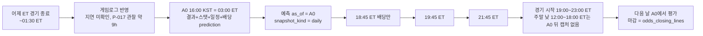

# 모델링 설계안 v1 + 실험 계획 (P-030)

- **작성:** ML Engineer, 2026-10-23
- **상태:** 🧑 사람 승인 대기. 승인 전에는 P-031(모델링 스키마)·P-032(walk-forward 틀)·P-033~P-035(기준선·Elo·피처)·P-037(실험 1차)을 시작하지 않는다.
- **이 문서가 정하는 것:** 무엇을 예측하는지(1장), 어느 시각 기준으로 어떤 데이터를 쓰는지(2장), 피처 후보(3장), 시장 기준선(4장), 단순 기준선과 Elo(5장), 지표와 walk-forward 프로토콜과 보류 시즌(6장), 가설 목록과 실험 등록 양식(7장), P-031에 넘길 모델링 레이어 요구 사항(8장), 누수 자기 점검(9장), 사람이 결정할 지점 M-1~M-11(10장).
- **정하지 않는 것:** DDL(P-031), 코드(P-032~P-035), 실험 결과(P-037), 배당 과거 백필 결제(사람, P-033 때, D-045).
- **확인 방법:** 문서의 모든 숫자는 2026-10-23 개발 DB(`presagio`, 마이그레이션 `0001`)에서 12장의 쿼리로 직접 뽑았거나 `docs/research/backfill-report-stage1.md`에서 옮겼다. 문헌 값은 12-2에 출처가 있고, 1차 출처를 열지 못한 값은 "(2차 출처)" 또는 "(미확인)"으로 표시했다. 외부 API 호출은 0회다.
- **보류 시즌 미접촉 선언:** 이 문서를 쓰면서 2025-26 시즌의 **결과(승패·점수) 관련 새 집계는 하지 않았다.** 2025-26 결과 숫자는 단계 1 보고서 3-2에 이미 있는 값만 인용한다. 일정 구조(시작 시각 분포) 집계에는 전 시즌이 들어간다(결과 정보 없음).

---

## 0. 쉬운 말 요약 (사람용)

1. 우리는 매일 한국시간 16:00, 어제 미국 경기가 다 끝나고 오늘 경기는 하나도 시작하기 전인 시각에 그날 모든 경기의 홈팀 승률과 예상 총점을 낸다.
2. 예측에는 그 시각까지 알 수 있던 것만 쓴다: 어제까지의 팀 기록, 휴식일, 홈/원정, Elo 점수, 그 시각의 배당이며, 같은 날 다른 경기 결과는 절대 섞지 않는다.
3. 가장 센 비교 상대는 모델이 아니라 시장(배당)이라서, 배당을 확률로 바꾸고 수수료를 걷어낸 "시장 확률"보다 우리가 나은지를 log loss와 Brier로 잰다.
4. 시장과 비교할 수 있는 경기는 지금 2026-27 시즌에 쌓이는 것뿐이고, 배당이 없는 지난 세 시즌은 "시장 비교 불가"로 정직하게 표시한다($59 백필은 P-033 때 네가 결정).
5. 단순 기준선(항상 홈, 시즌 승률, Elo)을 먼저 만들고 복잡한 모델은 그다음이며, 기준선을 못 이기면 그것도 결과로 기록한다.
6. 평가는 항상 시간 순서대로 하고(walk-forward), 2023-24로 배우고 2024-25로 확인하며, 2025-26은 끝까지 열어보지 않는 보류 시즌으로 두어 좋은 모델을 사후에 고르는 일을 구조로 막는다.
7. 가설 12개를 번호 붙여 미리 등록하고 성공 판정 숫자도 실험 전에 적어 두었으며, 시뮬레이션 모델·전략 토너먼트·다폴더는 단계 3·4 가설로 자리를 잡았다.
8. 누수(미래 정보 섞임)가 생길 수 있는 길을 9장에 전부 적고 막는 테스트 13개를 제안했지만, "누수 없음"은 내가 선언하지 않고 감사관(P-036)이 판정한다.
9. 네가 답할 결정 11개가 10장에 있고, 가장 중요한 셋은 M-1(예측 시각), M-2(보류 시즌), M-9(주말 낮 경기의 마감 배당 캡처 추가)다.
10. 승인되면 PM이 D-번호로 기록하고 P-031부터 구현이 시작된다.

### 새 용어 풀이

| 용어 | 뜻 |
| --- | --- |
| **as_of (기준 시각)** | "이 시각까지 알 수 있던 정보만 쓴다"의 그 시각. 예측 한 건마다 하나씩 붙는다. 같은 경기에 as_of가 다른 예측이 여러 개 있을 수 있다(스냅숏). |
| **가용 시각(available_at)** | 어떤 경기 결과가 "우리가 알 수 있게 된" 시각. 경기 시작 + 지연(Δ)으로 흉내 낸다(2-3). |
| **동부 날짜(ET date)** | 경기 시작 시각을 미국 동부 시간으로 바꾼 날짜. NBA 일정과 우리 매일 수집이 이 날짜로 돈다. |
| **시장 암시 확률 / 마진 제거** | 배당 2.0 → 1/2.0 = 50%. 양쪽 합이 100%를 넘는 만큼이 북메이커 마진. 그것을 걷어내 합이 100%가 되게 하는 방법이 여러 가지다(비례, Shin, power). |
| **예측 시점 배당 / 마감 배당** | 예측 시점 배당 = as_of 이전 마지막 스냅숏(피처·추천용). 마감 배당 = 경기 시작 전 마지막 스냅숏(평가·CLV 전용). 둘을 섞으면 누수다. |
| **lead_time** | 마감 배당이 경기 시작 몇 시간 전 것인지. 뷰 `odds_closing_lines`가 준다. 너무 오래된 것은 마감으로 치지 않는다(허용치, M-9). |
| **CLV (Closing Line Value)** | 내가 본 가격이 마감 가격보다 유리했는가. 꾸준히 양수면 진짜 우위. |
| **log loss / Brier** | 확률 예측의 품질 점수. 낮을수록 좋다. 둘 다 "정직한 확률"에 보상을 주는 적절한 점수 규칙(proper scoring rule)이다. |
| **보정(calibration) / ECE** | "70%라고 한 경기들이 실제로 70% 이겼나". ECE는 그 차이의 가중 평균. |
| **walk-forward / 재학습 주기** | 시간 순서대로 "여기까지로 학습 → 다음 구간 예측"을 반복. 재학습 주기는 모델을 다시 맞추는 간격(일·주·시즌). |
| **보류 시즌(holdout)** | 개발 중 절대 보지 않는 시즌. 마지막에 한 번만 평가한다. |
| **네스티드 튜닝** | 하이퍼파라미터(Elo K 등)를 고르는 데이터와 성능을 보고하는 데이터를 분리하는 것. 고르는 데는 학습 기간 안쪽만 쓴다. |
| **Elo (K, 홈 어드밴티지, 회귀율)** | 이기면 오르고 지면 내리는 실력 점수. K는 한 경기에 얼마나 움직이는지, 홈 어드밴티지는 홈팀에 더해 주는 점수, 회귀율은 시즌이 바뀔 때 평균 쪽으로 얼마나 되돌리는지. |
| **포제션 / 효율 / 페이스** | 포제션 = 공격권 횟수(추정식). 공격 효율 = 100포제션당 득점, 수비 효율 = 100포제션당 실점, 페이스 = 48분당 포제션. |
| **Four Factors** | 경기를 결정하는 네 요소(Oliver): 슈팅(eFG%), 턴오버(TOV%), 리바운드(ORB%), 자유투(FT/FGA). 기본 박스스코어로 전부 계산된다. |
| **사전 등록(pre-registration)** | 실험 전에 가설·비교 대상·성공 기준 숫자를 적어 두는 것. 결과를 본 뒤 기준을 바꾸지 못하게 한다. |
| **시간 여행 테스트 / 미래 주입 테스트** | 전자: as_of 이후 데이터를 더 넣어도 피처가 안 변하는지. 후자: 미래 결과를 극단값으로 바꿔도 과거 예측이 안 변하는지. 감사관의 검증 방법 2·3. |
| **스냅숏 종류(snapshot_kind)** | 같은 경기의 예측이 어느 시각 규칙으로 만들어졌는지 표시(`daily`=16:00 KST 본 실행, `pre_tip_1845` 등). |

---

## 1. 예측 대상과 대상 경기 (완료 기준 1)

### 1-1. 예측 대상

| 대상 | 입력 | 출력 | 단위 | 정답(평가 라벨) | 단계 |
| --- | --- | --- | --- | --- | --- |
| **T1 승패** | 경기 1개(`game_id`, 홈·원정 팀, `start_time_utc`, `is_neutral`) + `as_of` + 그 시각까지의 피처 | `p_home` = 홈팀(일정상 홈) 승리 확률 | 확률 (0, 1), 소수 4자리 | `home_score > away_score` (NBA는 무승부 없음) | 2 |
| **T2 총점** | 같음 | `total_mean` = 예상 총점. 단계 3부터 `total_sd`(분산) 추가 | 점(소수 1자리) | `home_score + away_score` | 2 (평균), 3 (분산) |
| **T3 오버 확률** | T2 + 기준 라인 `L`(토탈 `point`, 4-3의 기준 북메이커, as_of 이전 마지막 스냅숏) | `over_prob` = P(총점 > L) | 확률 | 총점 > L이면 1, < L이면 0, = L(정수 라인)이면 **push**로 평가 제외 | 2 (정규 근사), 3 (직접 모델·시뮬레이션) |
| (단계 4) 스프레드 커버 확률 | T2의 점수 차 분포 + 스프레드 `point` | P(홈 점수 차 > −spread) | 확률 | 점수 차 vs 스프레드 | 4 |

- 단계 2의 T3는 T2의 정규 근사로 낸다: `over_prob = 1 − Φ((L − total_mean) / σ)`, σ는 학습 기간 잔차 표준편차(출발값은 리그 총점 표준편차, 12-1 Q-D: 2023-24 정규 20.3점, 2024-25 19.8점). 단계 3의 H-10(시뮬레이션)이 분포를 직접 만든다.
- 확률은 항상 홈팀 기준 하나만 저장한다. 원정 승률은 `1 − p_home`.
- 중립 경기(`is_neutral = true`)도 "일정상 홈"을 홈으로 둔다(D-042). 홈 어드밴티지 피처만 0이 된다(3-1 F-09).

### 1-2. 대상 경기 필터

| 조건 | 규칙 | 근거 |
| --- | --- | --- |
| 경기 유형 | 학습·예측·평가 기본 대상 = `game_type IN ('regular', 'playin', 'playoffs')` | D-028 A-4 |
| `cup_final` (006) | **기본: 전부 제외**(학습·예측·평가·Elo 갱신·롤링 창). 팀 스탯이 없고(게임로그 밖, D-023) 시즌당 1경기 | **M-3** |
| `playin` (005) | **기본: 포함**(학습·예측·평가). 시즌당 6경기라 지표는 `playoffs`와 합쳐 "포스트시즌" 구간으로 보고 | **M-3** |
| 팀·시각 미정 | `home_team_id IS NOT NULL AND NOT is_time_tbd`인 경기만 예측 | D-028 A-5 |
| 시작 전 | 예측 시점에 `start_time_utc > as_of`. 저장 시 CHECK 대상(8장) | 원칙 1 |
| 연기·시각 변경 | 예측 당시 `start_time_utc`를 `predictions`에 함께 저장. 실제 시작 시각과 1시간 넘게 다르면 `rescheduled = true`로 표시하고 **시장 비교에서 제외**(마감 배당 규칙 A-8의 1시간과 같은 기준). 모델 지표에는 포함 | A-8 |
| NBA컵 조별·녹아웃 (`game_subtype`) | `regular`에 포함되므로 그대로 포함. 녹아웃 준결승·결승(라스베이거스)은 `is_neutral` | 12-1 Q-B |
| 플레이오프 | 포함하되 **지표는 정규·포스트시즌을 따로** 보고(총점이 10~16점 낮고 홈 승률이 높다, 보고서 3-2) | 보고서 3-2 |

대상 경기 수(개발 DB, 12-1 Q-A): 2023-24 1,318 / 2024-25 1,320 / 2025-26 1,321(보류) / 2026-27 예정 1,192 + 종료 14. 전부 `cup_final` 제외 수다.

### 1-3. 예측 기준 시각(as_of) 후보와 D-038 수집 시각의 관계

D-038의 하루 4회 수집과 경기 시작 시각 분포(12-1 Q-M: 정규·플레이인·플레이오프 종료 경기 3,973개의 동부 시작 시각)는 이렇다.

| 수집 시각(D-038) | 동부 시각 | 무엇이 새로 들어오나 | 그 시각에 시작 전인 오늘 경기 |
| --- | --- | --- | --- |
| **A0** 본 실행 16:00 KST | 03:00 EDT / 02:00 EST(2026-11-01부터) | 어제 결과 + 팀 스탯(게임로그) + 오늘 일정 + 배당(`capture_label = prediction`) | **전부**(가장 이른 시작 12:00 ET, 9시간 뒤) |
| **A1** 18:45 ET | 18:45 | 배당만(`closing`), nba_api 0회 | 87.6% (18:45 이후 시작 3,481경기) |
| **A2** 19:45 ET | 19:45 | 배당만 | 51.2% (2,034경기) |
| **A3** 21:45 ET | 21:45 | 배당만 | 15.1% (598경기) |

| 후보 | 정의 | 장점 | 단점 | 추천 |
| --- | --- | --- | --- | --- |
| **A0 일일 스냅숏(`daily`)** | as_of = 본 실행의 배당 수집 `captured_at`(실제 시각). 백테스트에서는 그 동부 날짜의 **07:00 UTC**(= 16:00 KST, 서머타임 무관) | 스탯이 완전하고 오늘 경기가 전부 시작 전. 하루 1회라 단순. 사람이 오후에 "오늘 예측"을 볼 수 있다 | 배당이 9~20시간 전 값이라 라인업·부상 반영이 덜 됨 | **단계 2의 유일한 as_of. 추천 기준 시각(D-033 5항)도 A0** (**M-1**) |
| A1~A3 경기 전 스냅숏(`pre_tip_*`) | as_of = 그 캡처의 `captured_at`. 스탯 피처는 A0과 같고 시장 피처만 바뀜 | 시장을 피처로 쓸 때(H-09) 가장 신선한 가격. 추천의 CLV가 좋아짐 | 하루 4개 예측 행. 사람이 보기엔 늦은 시각(한국 새벽) | 단계 3(시장 피처 도입)부터 추가 저장. 추천 기준 시각을 "경기 전 마지막"으로 옮길지는 단계 4에서 재결정 |
| 경기별 "시작 X시간 전" | as_of = `start_time_utc − X` | 경기마다 같은 정보 나이 | 수집 시각과 안 맞아 실제로는 그 시각의 배당이 없다(가장 가까운 이전 스냅숏을 써야 함) | 안 고름(11장) |

- as_of는 **UTC timestamptz 하나**다. "그 시각까지 우리 DB에 있던 정보"가 정의다. 백테스트에서는 2-3의 가용 시각 규칙으로 흉내 낸다.
- 같은 날의 모든 경기는 같은 as_of를 갖는다(실행 단위). 경기별 as_of가 아니라 **실행별 as_of**다.
- 2026-27 실시간에서 as_of는 "배당 수집이 끝난 시각"이다. 예측 단계는 수집 단계 뒤에 실행된다(OVERVIEW 3장 4→5단계). 따라서 `odds_snapshots.captured_at ≤ as_of`가 그날 `prediction` 캡처를 포함한다.



---

## 2. 데이터와 시점(as_of) (완료 기준 1·7)

### 2-1. 읽는 표·뷰 (전부 읽기 전용, D-004)

| 표/뷰 | 쓰는 곳 | 쓰는 컬럼 | 안 쓰는 것 |
| --- | --- | --- | --- |
| `games` | 대상 경기, 결과 라벨, 일정 피처, Elo | `game_id`, `season`, `game_type`, `game_subtype`, `start_time_utc`, `is_time_tbd`, `status_code`, `home_team_id`, `away_team_id`, `home_score`, `away_score`, `is_neutral`, `fetched_at`, `created_at` | `status_text`, `postponed_status`(해석 미확인), `source` |
| `team_game_stats_primary` (뷰) | 롤링·누적·Four Factors·포제션 | 전 스탯 컬럼 + `is_home`, `opponent_team_id`, `fetched_at` | 원본 표 `team_game_stats`는 직접 읽지 않는다(D-028 A-6) |
| `odds_snapshots` + `odds_events` | 예측 시점 시장 피처(4-3), 기준 라인 | `captured_at`, `bookmaker_key`, `market_key`, `outcome_side`, `price_decimal`, `point`, `bookmaker_last_update`, `odds_events.game_id` | `capture_label`(참고용, 로직에 쓰지 않음, 7-2) |
| `odds_closing_lines` (뷰) | **평가와 CLV 전용**(P-032 `evaluation/`). 피처·모델 코드는 이 뷰를 읽지 않는다(9장 Q4) | `price_decimal`, `point`, `lead_time`, `event_commence_time`, `game_id` | |
| `raw_api_responses`, `ingestion_runs` | 읽지 않는다 | | 피처가 raw에 결합되면 소스 형식에 묶인다(D-044 대안 기각 이유와 같음) |

`is_neutral`은 컬럼이 있고(D-046) 2023-24 값은 P-025가 채운다. 이 설계는 "P-025 뒤 2023-24 중립 5경기가 true"를 전제한다.

### 2-2. 시각 규칙 (수식)

기호: 예측 대상 경기 g, 후보 입력 경기 h, 동부 날짜 `D(x) = (start_time_utc(x) AT TIME ZONE 'America/New_York')::date`.

**규칙 R1 (동부 날짜 엄격 부등호).** 경기 h의 결과·스탯을 g의 피처에 쓰려면 `D(h) < D(g)`. 같은 동부 날짜의 다른 경기는 그 시각에 끝났더라도 쓰지 않는다. 이유: (a) 16:00 KST 본 실행이 "어제 날짜 전체"를 단위로 받으므로(D-039) 정규 스케줄에서는 실시간 DB에 같은 날짜 경기 결과가 없다(손으로 돌린 백필이 넣었더라도 R1이 막는다). 백테스트도 같은 정보량이어야 한다. (b) off-by-one(당일 결과 포함)을 날짜 하나로 막는다.

**규칙 R2 (가용 시각).** `available_at(h) = start_time_utc(h) + Δ`, `available_at(h) ≤ as_of`, `status_code(h) = 3`, 그리고 h의 팀 행 2개가 `team_game_stats_primary`에 있어야 한다. 출발값 **Δ = 3시간**(경기 길이 2.5시간 + 여유, **M-10**). A0에서는 R1이 R2를 거의 항상 함의한다(어제 23:00 ET 시작 경기도 EST면 04:00 UTC + 3h = 07:00 UTC ≤ as_of, EDT면 06:00 UTC). R2가 따로 필요한 곳은 백테스트의 가정을 **명시**하는 것과, 단계 3의 경기 전 스냅숏(A1~A3)이다. A1~A3에서도 R1이 같은 날짜 경기를 막으므로 "19:00 경기가 끝난 뒤 21:45 스냅숏에 그 결과가 섞이는" 경로는 없다.

**규칙 R3 (배당).** 예측 시점 시장 = `(odds_event_id, bookmaker_key, market_key, outcome_side)`마다 `captured_at ≤ as_of`인 마지막 스냅숏. 기준은 `captured_at`(우리가 받은 시각)이고 `bookmaker_last_update`는 기록만 한다(4-3). 마감 배당은 뷰 `odds_closing_lines`이며 평가에서만 읽는다.

**규칙 R4 (저장 시 검사).** `features.as_of < games.start_time_utc`, `predictions.as_of < games.start_time_utc`, `predictions.train_cutoff ≤ predictions.as_of`, `features.computed_at ≥ features.as_of`. 표를 넘는 조건은 DB CHECK로 못 거니 로더와 품질 체크가 막는다(8장).

### 2-3. 실시간(2026-27)과 백테스트(과거 시즌)의 정보량 차이 (누수 질문 1)

| 항목 | 실시간 2026-27 | 백테스트 2023-24~2024-25 | 다루는 법 |
| --- | --- | --- | --- |
| 어제 결과가 DB에 있나 | 게임로그 반영이 늦으면 `partial`(D-039)이라 그날 피처가 어제 경기를 못 본다 | 전부 있다(백필) | (1) R1·R2로 백테스트의 정보 경계를 명시. (2) 실시간은 `features.input_completeness`에 "두 팀의 어제 경기 중 스탯이 있는 수 / 있어야 할 수"를 기록. 평가는 완전/불완전 구간을 나눠 보고. (3) 운영 첫 2주 partial 일수(D-039)를 보고 Δ 또는 본 실행 시각을 조정 |
| 스탯 정정 | 처음 받은 값 | 2026-10-22에 받은(정정 뒤) 값 | `features`는 계산 당시 값을 저장(D-030). 정정 빈도는 2026-27 raw 버전 수로 측정(데이터 요구 DR-2). 과거 시즌의 정정은 한계로 적는다(schema 1-5) |
| 배당 | `live` 스냅숏 하루 4회, `captured_at` = 수신 시각 | 없음(D-026). $59 백필 시 `historical`, `captured_at` = 스냅숏 `timestamp`(5~10분 간격, odds_api.md 2.1) | 같은 R3. 마감 `lead_time`은 live ≤ 2시간, historical ≤ 10분으로 달라지므로 `evaluations.closing_lead_time`을 저장해 구간별 보고(4-5) |
| 일정 변경 | 예측 뒤 시각이 바뀔 수 있음 | 최종 일정만 | 1-2 `rescheduled` 규칙 |
| `is_neutral` | 일정 플래그 | 2023-24는 P-025 보완 | 전제 명시(2-1) |

백테스트는 "그 당시 DB"가 아니라 "현재 DB에 R1·R2를 적용한 것"이다. 이것이 누수 질문 1의 답이다: **지연을 무시하지 않고 Δ로 흉내 내되, 실시간과의 차이(partial, 정정)는 측정 가능한 값으로 남긴다.**

### 2-4. 콜드 스타트와 시즌 경계 (누수 질문 3)

| 항목 | 규칙 |
| --- | --- |
| 시즌 경계 | `games.season` 컬럼(날짜가 아님). 시즌 첫 경기 = 그 시즌 `regular` 중 `start_time_utc` 최소 |
| 롤링 창(최근 N) | **시즌 안에서만** 센다. 이전 시즌 경기는 창에 넣지 않는다. 시즌 초 k < N 경기면 있는 k경기로 계산하고 `n_games_available = k`를 같이 저장. k = 0이면 NULL |
| 시즌 누적 | 시즌 첫 경기는 NULL(경기 0). `games_played = 0` 저장 |
| 전 시즌 값 | 별도 피처 `prev_season_*`(전 시즌 최종 순득실·승률). 2023-24는 전 시즌 데이터가 없어 NULL → **DR-1(2022-23 수집)**로 해결 가능(**M-11**) |
| Elo | 시즌을 넘어 이어진다. 새 시즌 첫 경기 전에 `R ← carry × R + (1 − carry) × 1505`, 출발값 carry = 0.75(5-2, **M-7**). 2023-24 시작은 전 팀 1500(2022-23가 없으면). DR-1이 되면 2022-23를 워밍업으로 돌리고 2023-24 첫 예측부터 평가 |
| 플레이인·플레이오프 | 롤링 창과 Elo 갱신에 **포함**(가장 최근 경기이므로). 정규 전용 창은 두지 않는다. `cup_final` 제외(M-3) |
| 포스트시즌 → 다음 시즌 | 플레이오프까지 반영된 Elo가 회귀한 값이 다음 시즌 출발값 |

롤링 창이 시즌을 넘지 않는 이유: 오프시즌 로스터 변화가 커서 전 시즌 마지막 20경기는 "같은 팀"이 아니다. 대신 `prev_season_*`를 따로 두어 모델이 가중치를 정하게 한다.

---

## 3. 피처 후보 (완료 기준 2)

### 3-0. 공통 규칙

- 모든 피처 함수는 `(game_id, as_of) → dict`이고, 모든 DB 조회에 2-2의 R1·R2·R3가 걸린다. 홈팀 값 `home_*`, 원정팀 값 `away_*`, 차이 `diff_* = home − away`를 함께 낸다.
- **포제션** = `presagio.ingestion.possessions.team_possessions` (D-035, `FGA − OREB + TOV + 0.44 × FTA`), 경기 단위 = 양 팀 평균 `game_possessions`. 효율의 분모는 경기 포제션(양 팀 평균)을 쓴다(양 팀 포제션은 거의 같고 평균이 한쪽 오차를 줄인다, D-035). 대안 공식은 3-3.
- **합 기반 비율.** 창 안의 비율은 "경기별 비율의 평균"이 아니라 "합의 비율"이다: `ortg_N = 100 × Σ pts / Σ poss`. 경기별 평균은 포제션이 적은 경기에 과대 가중한다.
- **버전 전략.** 피처 집합 전체에 버전 문자열 하나(`fv1`, `fv2`, …). 정의·창 길이·포제션 공식·Δ·가용 규칙 중 하나라도 바뀌면 올린다. 버전별 키 목록·파라미터(`poss_formula`, `availability_lag_hours`, 창 길이)는 코드의 매니페스트(파이썬 dict)에 두고 `model_versions.feature_version`이 가리킨다. `features` 행은 덮어쓰지 않는다(8-1).
- 12-1 Q-P의 규모(정규시즌 팀 행 평균): 포제션 101.5~102.0, 공격 효율 111.7~112.6, 3점 시도 비율 0.395~0.421, 자유투 시도 비율 0.246~0.247. 피처 값이 이 범위를 크게 벗어나면 버그다(품질 체크 후보).

### 3-1. 피처 후보 표 (`fv1` = 단계 2 P-035 대상, `fv2+` = 단계 3 후보)

| ID | 이름 | 정의 (수식 / SQL 의사코드) | 읽는 표·뷰 | as_of 규칙 | 버전 | 근거 |
| --- | --- | --- | --- | --- | --- | --- |
| F-01 | `ortg_{N}` (N=5,10,20) | `100 × Σ pts / Σ game_poss`, 최근 N경기(시즌 안, R1·R2 통과분, `ORDER BY start_time_utc DESC LIMIT N`) | `team_game_stats_primary` ⨝ `games` | R1, R2 | fv1 | OVERVIEW 단계 2. Oliver 2004(효율 = 100포제션당) |
| F-02 | `drtg_{N}` | `100 × Σ opp_pts / Σ game_poss`, 같은 창. `opp_pts`는 상대 행의 `pts` | 같음 | R1, R2 | fv1 | 같음 |
| F-03 | `net_{N}` | `ortg_N − drtg_N` | 계산값 | | fv1 | 순득실(효율 기준) |
| F-04 | `pace_{N}` | `Σ game_poss / Σ (minutes / 240)` = 48분당 포제션(연장 보정) | 같음 | R1, R2 | fv1 | bref Pace = `48 × poss / (MP/5)`(12-2) |
| F-05 | `margin_{N}` | `Σ (pts − opp_pts) / n` 원점수 차 평균 | 같음 | R1, R2 | fv1 | 효율과 다른 축(페이스 포함) |
| F-06 | `std_*` 시즌 누적 | 시즌 시작부터 R1·R2 통과 경기 전체로 F-01~F-05와 승률 `wins / games_played`, `games_played` | 같음 | R1, R2 | fv1 | OVERVIEW 단계 2 |
| F-07 | `prev_season_*` | 전 시즌 최종 `net`, 승률, 포스트시즌 진출 여부. `season`이 바로 앞 시즌인 경기 전체 | 같음 | 시즌 단위(전 시즌은 전부 as_of 이전) | fv1 | 2-4 콜드 스타트. 2023-24는 NULL(DR-1 전) |
| F-08 | `days_rest`, `is_b2b`, `games_last_7d` | `days_rest = D(g) − D(이전 경기)`(같은 시즌, R1 통과), `is_b2b = (days_rest = 1)`, `games_last_7d` = `D(g) − 7 ≤ D(h) < D(g)`인 경기 수. 시즌 첫 경기는 NULL | `games`만 | R1 (일정은 미리 알 수 있으므로 **이전 경기가 끝났는지와 무관**. 단, 결과는 안 씀) | fv1 | 글로서리 "백투백". 12-1 Q-O: 정규시즌 팀-경기의 17.4~18.5%가 백투백 |
| F-09 | `home_adv` | `home_adv = 0 if is_neutral else 1`. 행은 홈팀 관점 하나뿐이라 원정 값은 따로 없다 | `games` | 일정 값 | fv1 | D-042, D-046. 정규 홈 승률 0.543~0.544(Q-D) |
| F-10 | `elo_home`, `elo_away`, `elo_diff_adj`, `elo_prob` | 5-2의 경기 전 레이팅. `elo_diff_adj = elo_home + HCA × home_adv − elo_away`, `elo_prob = 1 / (1 + 10^(−elo_diff_adj / 400))` | `games`(결과 순차 처리) | R1, R2 순서로 갱신. 갱신에 쓰는 경기는 `D(h) < D(g)` | fv1 (Elo 상수는 `model_versions`) | FiveThirtyEight NBA Elo(12-2) |
| F-11 | `mkt_p_home`, `mkt_total_line`, `mkt_spread_home`, `mkt_age_h`, `mkt_n_books`, `mkt_bookmaker` | 4-3 예측 시점 시장. `mkt_p_home` = 마진 제거 홈 확률(합의 또는 기준 북메이커, **M-4**), `mkt_age_h = (as_of − captured_at)`/1h, 24시간 넘으면 전부 NULL | `odds_snapshots` ⨝ `odds_events` | **R3** (`captured_at ≤ as_of`). 뷰 `odds_closing_lines` 금지 | fv1 (값은 있을 때만. 2023-24~2025-26은 NULL) | 사람 메모 1 "시장을 가장 강한 피처로". 단계 2에서는 **기준선으로만** 쓰고 모델 입력으로는 단계 3(H-09) |
| F-12 | Four Factors `efg_{N}`, `tov_pct_{N}`, `orb_pct_{N}`, `ftr_{N}` (공격) + 같은 것의 수비판(`opp_*`) | `efg = (Σfgm + 0.5 Σfg3m) / Σfga`, `tov_pct = Σtov / (Σfga + 0.44 Σfta + Σtov)`, `orb_pct = Σoreb / (Σoreb + Σ opp_dreb)`, `ftr = Σftm / Σfga` | `team_game_stats_primary`(상대 행 조인) | R1, R2 | fv1 | Oliver 2004 Four Factors. bref 정의(12-2: TOV% 분모 0.44) |
| F-13 | 전술 대리 지표(가능한 것) `fg3a_rate_{N}`, `fta_rate_{N}`, `ast_rate_{N}` | `fg3a_rate = Σfg3a / Σfga`, `fta_rate = Σfta / Σfga`, `ast_rate = Σast / Σfgm`, 페이스는 F-04 | 같음 | R1, R2 | fv1 | 사람 메모 3. 기본 박스스코어로 계산 가능(Q-P) |
| F-14 | 상대 성향별 성적 | 상대를 페이스 삼분위로 나눠 각 구간의 `net`. 삼분위 경계는 **as_of 이전 리그 분포**로 | 같음 | R1, R2 + 경계도 as_of 이전 | fv2 (단계 3) | 사람 메모 3 "상대 성향별 성적". 표본이 작아 단계 3 |
| F-15 | 일정 맥락 `season_day`, `game_no`, `is_playoffs`, `series_game_no` | `season_day = D(g) − 시즌 첫 날짜`, `game_no = games_played + 1`, 플레이오프 `game_id` 9~10번째 자리(nba_api.md 3-1) | `games` | 일정 값 | fv1 (`series_game_no`는 fv2) | 시즌 초·플레이오프 분포 차이(1-2) |
| F-16 | `sos_{N}` 일정 강도 | 최근 N경기 상대의 경기 전 Elo 평균 | F-10 | R1, R2 | fv2 | 롤링 효율의 상대 보정 |
| F-17 | 리그 기준값 `league_total_{N}`, `league_home_rate_std` | as_of 이전 리그 전체 최근 N경기 평균 총점, 시즌 누적 홈 승률 | `games` | R1, R2 | fv1 | 총점 기준선 T-B0, 승패 기준선 B0 |

**피처 함수 시그니처(요구):** `compute_features(game_id: str, as_of: datetime, version: str = "fv1") -> FeatureRow`. 내부의 모든 쿼리가 `as_of`와 `D(g)`를 바인드 파라미터로 받는다. 감사 방법 1(시그니처·조건)의 대상이다.

### 3-2. 지금 데이터로 계산할 수 없는 것 → 데이터 요구 (Data Engineer, PM이 티켓화)

| 번호 | 요구 | 왜 | 비용 추정 | 우선순위 |
| --- | --- | --- | --- | --- |
| DR-1 | **2022-23 시즌 수집**(일정 1 + 게임로그 3 = nba_api 4호출) | Elo 워밍업과 `prev_season_*`(F-07). 지금은 2023-24 첫 수십 경기의 Elo가 전 팀 1500에서 출발해 노이즈가 크고, 학습 첫 시즌의 평가가 통째로 오염된다 | 호출 4, 약 20초(보고서 7장 규모) | **높음** (**M-11**) |
| DR-2 | **스탯 정정 빈도 측정**: 같은 경기·팀의 `team_game_stats` 값이 raw 버전 사이에 바뀐 횟수를 세는 품질 체크(2026-27부터) | 누수 질문 5(재현성). 정정이 잦으면 실시간과 백테스트의 입력이 체계적으로 다르다 | 품질 체크 1개 | 중간 |
| DR-3 | 경기장·시간대(`arenaCity`, 시간대) 컬럼 | 이동 거리·시차 피처(fv2 후보). raw에만 있다 | 컬럼 2개 + raw 재적재 | 낮음 (단계 3에서 재검토) |
| DR-4 | 선수 단위 박스스코어(`BoxScoreTraditionalV3.players`) | 로테이션 깊이, 주전 결장(사람 메모 3 "로테이션 깊이") | 경기당 1호출 = 시즌 약 1,320호출 | 단계 7(D-023 "다시 볼 때") |
| DR-5 | 슛 위치(림 근처 비율), 플레이바이플레이 | 사람 메모 3 "림 근처 비율" | 별도 엔드포인트 조사 필요(미확인) | 단계 7 |
| DR-6 | `cup_final` 팀 스탯(`BoxScoreTraditionalV3` 시즌당 1회) | M-3에서 "포함"을 고를 때만 | 시즌당 1호출 | M-3 결과에 따라 |
| DR-7 | 과거 3시즌 배당 백필($59) | 시장 기준선·CLV를 과거 시즌에서 평가 | $59, 하루 ≤ 5스냅숏(odds_api.md 3.2) | 사람 결정, P-033 때(D-045) |
| DR-8 | 주말 낮 경기용 배당 캡처 1회 추가(예: 토·일 11:45 ET, `--odds-only`) | 4-4: 18:45 ET 전 시작 경기(12.4%, 주말 집중)는 A0 뒤 마감 캡처가 없어 `lead_time` 9~15시간 | 월 약 +26크레딧(주 2일 × 3크레딧 × 약 4.4주) → 월 최대 372 + 26 = 398 < 500 | **M-9** (D-038·D-048 변경이라 사람 결정) |

"불가"로 분류한 것(림 근처 비율, 로테이션 깊이, 라인업, 부상)은 피처 표에 넣지 않았다. 단계 7(OVERVIEW)과 D-033 5항대로다.

### 3-3. 포제션 공식 비교 계획 (D-035 "다시 볼 때")

| | 공식 A (D-035, 현재 함수) | 공식 B (basketball-reference `Poss`) |
| --- | --- | --- |
| 식 | `FGA − OREB + TOV + 0.44 × FTA` | `0.5 × ((Tm FGA + 0.4 Tm FTA − 1.07 × (Tm ORB / (Tm ORB + Opp DRB)) × (Tm FGA − Tm FG) + Tm TOV) + (Opp 같은 식))` (12-2에서 2026-10-23 직접 확인) |
| 입력 | 자기 행 4개 | 자기 행 + 상대 행(DREB, FGM) |
| 개발 DB 규모(2023-24 정규, 팀 행 2,460, 12-1 Q-Q) | 평균 101.51 | 평균 99.05. **A − B 평균 2.47, 표준편차 1.59, 상관 0.955** |

- 두 공식은 수준이 약 2.5포제션 다르고 경기별 차이의 표준편차가 1.6이다. 효율·페이스의 **절대값**은 달라지지만 상관 0.955라 **팀 간 순위**는 거의 같다. 즉 승패 모델에는 영향이 작을 것이고, 총점 기준선(T-B1, 5-3)처럼 포제션 수준이 직접 들어가는 곳에서 차이가 날 수 있다. 이것은 가설이지 결과가 아니다.
- **실험 H-05**(7장): `fv1`을 `poss_formula ∈ {d035, bref}` 파라미터로 두 번 계산해 T-B1 총점 MAE와 단일 피처 로지스틱(net_10)의 log loss를 2024-25에서 비교. 사전 판정 기준은 7-1 H-05. 기본은 A(단순, 입력 4개, 이미 코드·결정에 있음). B가 기준을 넘으면 `fv2`에서 B로 바꾸고 D-035를 갱신 제안.
- 0.44의 출처는 Oliver 2004(함수 docstring, D-035). NBA 공식 추정식 `0.96 × (FGA + 0.44 FTA − ORB + TO)`도 있다(2차 출처 APBR 포럼, 12-2) — 실험에 넣지 않는다(상수배라 비율 피처에 영향 없음).

---

## 4. 시장 기준선 (완료 기준 3)

### 4-1. 지금 배당 데이터의 상태 (12-1 Q-E~Q-L, 2026-10-23)

| 항목 | 값 |
| --- | --- |
| `odds_snapshots` | **796행 = 2026-10-22 12:39:21 UTC 호출 1회분** (`capture_kind = live`, `capture_label = p019_check`), 41이벤트 전부 2026-27 |
| `odds_events` | 41, 전부 `game_id` 매핑됨. `commence_time` 2026-10-22 23:10 ~ 2026-12-26 03:30 UTC |
| 북메이커 | 9곳 관찰: draftkings 246행(= 41이벤트 × 3마켓 × 2 = **전 이벤트 커버**), betrivers 114, betmgm 84, bovada 84, fanduel 84, betonlineag 80, lowvig 80, betus 12, mybookieag 12. `us` 지역 11곳(odds_api.md 2.1) 중 2곳은 이 응답에 없었다. **Pinnacle은 없다** |
| 마켓 | h2h 220, spreads 288, totals 288 |
| 마진(overround, 양쪽 있는 마켓) | h2h 110개: 2.98%~5.36%(평균 4.35%). spreads 144개: 2.84%~5.34%(4.55%). totals 144개: 3.63%~6.41%(4.62%) |
| `captured_at − bookmaker_last_update` | 17초~71초, 중앙값 38초 |
| 토탈 라인 북메이커 간 차이 | 41이벤트 중 16개에서 라인이 다름. 최대 6.0점(먼 경기), 평균 0.66점 |
| h2h 홈 암시 확률(마진 포함) | 0.282 ~ 0.855 |
| `odds_closing_lines` | 796행 그대로, `lead_time` 10시간 30분 ~ 64일 14시간. **지금은 "마감"의 뜻이 없다** |
| 지난 세 시즌 배당 | 0 (D-026) |

결론은 브리핑과 같다. 시장 기준선과 CLV는 **2026-27 앞으로 쌓이는 경기**로만 측정된다(P-024 launchd가 돌기 시작하면). 설계는 "있을 때/없을 때"를 모두 다룬다(4-6).

### 4-2. 암시 확률과 마진 제거

두 쪽 소수식 배당 `o_h, o_a`에서 암시 확률 `π_h = 1/o_h`, `π_a = 1/o_a`, 마진 `v = π_h + π_a − 1`(D-036, `presagio.ingestion.odds_math`).

| 방법 | 식 (2-outcome) | 성질 | 출처 |
| --- | --- | --- | --- |
| **비례 배분(basic normalization)** — 출발값 | `p_h = π_h / (π_h + π_a)` | 마진을 양쪽에 같은 비율로. 구현 있음(`remove_margin_proportional`) | D-036. Štrumbelj 2014가 "basic normalization"이라 부름(12-2) |
| **Shin** | 내부자 비율 z를 풀어 `p_i = (sqrt(z² + 4(1−z) π_i² / Σπ) − z) / (2(1−z))`, Σp = 1이 되는 z를 수치로 | 롱샷(약팀) 확률을 비례보다 더 깎는다(favorite-longshot bias 보정). Štrumbelj 2014가 축구 배당에서 basic보다 낫다고 보고(**2차 출처**로 확인, 12-2) | Shin 1993(미확인, 원문 못 열음), Štrumbelj 2014 |
| **power** | `p_i = π_i^k`, Σp = 1이 되는 k를 수치로 | Shin과 비슷하게 롱샷을 더 깎음. 파라미터 1개 | Clarke, Kovalchik & Ingram 2017(제목은 `shin` 패키지 인용으로 확인, 학술지명 미확인) |

- 단계 2 기준선은 **비례 배분**(D-036). **H-02**가 Shin·power를 "시장 확률 자체의 log loss"로 비교한다(모델 없이, 결과가 있는 경기만). 사전 판정 기준 7-1. 바뀌면 `metric_version`을 올린다(8-4).
- 추천(**M-5**): 비례 배분 유지 + H-02로 교체 여부 결정. NBA h2h는 마진이 3~5%로 작고(Q-I) 대부분의 경기가 0.3~0.85 범위(Q-L)라 방법 간 차이는 작을 것으로 본다(가설).

### 4-3. 북메이커 선택과 "예측 시점 배당"

| 쓰임 | 규칙 | 이유 |
| --- | --- | --- |
| **시장 확률 기준선·피처 `mkt_p_home`** | **합의(consensus)**: as_of 이전 마지막 스냅숏이 **같은 `captured_at`**에 양쪽 다 있는 북메이커들의 마진 제거 확률의 **중앙값**. 북메이커 ≥ 3곳일 때만. 3곳 미만이면 기준 북메이커 값, 그것도 없으면 NULL | 한 북메이커의 늦은 갱신·실수에 강하다. 9곳 중 커버리지가 고르지 않다(Q-G) |
| **기준 북메이커(라인·CLV·추천 가격)** | **DraftKings** (`draftkings`). 없으면 FanDuel → BetMGM 순서의 고정 목록 | 관찰 표본에서 유일하게 전 이벤트를 커버(246행). 라인(`point`)과 CLV는 **같은 북메이커·같은 마켓·같은 쪽**끼리 비교해야 뜻이 있다 |
| **토탈 기준 라인 `L`** | 기준 북메이커의 as_of 이전 마지막 `totals` `point` | T3 정의(1-1). 북메이커 간 라인이 다른 이벤트가 41 중 16(Q-K) |
| **예측 시점 배당** | R3: `(이벤트, 북메이커, 마켓, 쪽)`마다 `captured_at ≤ as_of` 마지막 행. `as_of − captured_at ≤ 24시간`, 아니면 "시장 없음" | 하루 4회 수집이면 나이는 최대 약 5시간(A0은 직전 21:45 ET 캡처 또는 자기 `prediction` 캡처) |
| 시각 기준 | **`captured_at`**(우리가 받은 시각). `bookmaker_last_update`는 저장만(지금 데이터에서 둘의 차이 17~71초) | "알 수 있었던 시각"은 우리가 받은 시각이다. 북메이커 시계는 우리 시계와 다를 수 있다(schema 7-2) |
| Pinnacle | **없다**(`us` 지역 응답에 없음, Q-G). 문헌의 "가장 효율적인 마감"(Pinnacle 자체 자료, 12-2)을 그대로 쓸 수 없다 | **M-4** 대안 칸 |

### 4-4. 마감 배당과 `lead_time` 허용치

- 마감 = 뷰 `odds_closing_lines`(이벤트 최신 시작 시각 전 마지막 스냅숏, 일정이 1시간 넘게 바뀐 스냅숏 제외, D-028 A-8).
- **허용치(제안, M-9):** `lead_time ≤ 2시간`이면 "마감 있음". 넘으면 `market_status = no_closing_within_tolerance`로 CLV·마감 비교에서 제외(평가 행은 남기고 사유만 적음).
- 왜 2시간인가 — D-038 캡처 시각과 시작 시각 분포(12-1 Q-M)로 계산한 **기대 lead_time**:

| 시작 시각(ET) | 경기 수(3시즌+14) | 비율 | 마지막 캡처 | 기대 lead_time |
| --- | --- | --- | --- | --- |
| 18:45 이전 (12:00~18:00) | 492 | 12.4% | **A0 (03:00 ET)** | 9~15시간 → 허용치 밖 |
| 18:45~19:44 | 1,447 | 36.4% | 18:45 | 0~59분 |
| 19:45~21:44 | 1,436 | 36.1% | 19:45 | 0~119분 |
| 21:45 이후 (~23:00) | 598 | 15.1% | 21:45 | 0~75분 |

  2시간이면 87.6%가 "마감 있음"이고, 낮 경기(일요일 589경기 중 324, 토요일 521 중 114가 18:45 전 시작)는 마감이 없다. **DR-8**(주말 11:45 ET 캡처 1회 추가)이 이를 메운다. 과거 백필(DR-7)은 5~10분 간격이라 lead_time ≤ 10분으로 훨씬 좋다 → live와 historical의 마감 정의가 달라지므로 `evaluations.closing_lead_time`을 항상 저장하고 구간(≤10분 / ≤2시간)별로 보고한다.

### 4-5. CLV 정의

예측 시점 가격 `o_pred`(기준 북메이커, 쪽 s, 토탈이면 라인 L), 마감 마진 제거 확률 `q_close(s)`(같은 북메이커·마켓·쪽, 같은 라인):

- `clv_prob = q_close(s) − p_fair_pred(s)` (마감 공정 확률 − 예측 시점 공정 확률. 양수면 시장이 우리 쪽으로 움직임)
- `clv_return = o_pred × q_close(s) − 1` (마감 공정 확률로 본 기대 수익률. Pinnacle의 정의와 같은 형태, 12-2)
- `beat_close = o_pred > o_close` (가격만 비교)
- 토탈·스프레드: 라인이 같을 때만 `clv_return`을 계산하고 `line_move = L_close − L_pred`를 따로 저장. 라인이 다르면 `clv_return` NULL + `line_move`만.
- 단위: 추천 1건(단계 4 `recommendations`)마다. 단계 2에서는 추천이 없으므로 CLV는 **"모델이 가치 있다고 본 쪽"(`p_model > p_fair_pred`인 쪽)**에 대해 계산해 분포만 본다(H-03 보조 지표).
- 집계: 평균 `clv_return`, `beat_close` 비율, 부트스트랩 90% 구간(경기 단위 재표집 1,000회).

### 4-6. 배당이 없는 경기·시즌의 처리 (D-026 "정직하게 불가로 표시")

`evaluations.market_status`(8-4) 값과 보고 규칙:

| 값 | 뜻 | 보고 |
| --- | --- | --- |
| `available` | 예측 시점 시장과 마감(허용치 안) 둘 다 있음 | 시장 비교 전 지표 |
| `pred_only` | 예측 시점 시장은 있는데 마감이 허용치 밖 | 예측 시점 시장 비교만, CLV 없음 |
| `no_snapshot_at_as_of` | 2026-27인데 as_of 이전 24시간 안 스냅숏이 없음(수집 결손, D-048 "정직한 결손") | 불가, 사유 |
| `no_odds_season` | 2023-24~2025-26 (DR-7 전) | 불가, 사유 |
| `unmatched_event` | `odds_events.game_id` NULL(D-036 매핑 실패) | 불가, 사유 |
| `rescheduled` | 1-2 연기 규칙 | 불가, 사유 |

- 모든 실험 표는 **두 줄**로 낸다: (a) 전체 경기(모델·기준선만), (b) `market_status = available`인 경기(모델·기준선·시장 모두, **같은 경기 집합**). (b)의 n을 항상 적는다. n < 100이면 시장 비교 숫자를 "참고(표본 부족)"로 표시한다.
- 시장 포함 실험군(H-02, H-03, H-09, H-11, H-12)은 (b)만 쓴다. 시장 미포함 실험군은 (a)를 쓴다.

---

## 5. 단순 기준선과 Elo (완료 기준 2·8)

### 5-1. 승패 기준선

| ID | 이름 | 확률 | 학습 | 비고 |
| --- | --- | --- | --- | --- |
| B0 | 항상 홈 | `p_home = 학습 기간 홈 승률`(F-17 `league_home_rate_std`, as_of 이전 누적. 시즌 초는 전 시즌 값). 중립이면 0.5 | 없음 | 정확도용 "항상 홈 승"도 함께(= p ≥ 0.5) |
| B1 | 시즌 승률 | 시즌 누적 승률이 높은 팀 승(동률·시즌 첫 경기는 홈). 확률판: `0.5 + 0.5 × (win%_h − win%_a)`를 [0.05, 0.95]로 자름 | 없음 | 확률판은 조잡하므로 log loss는 참고. 보정판은 H-06의 로지스틱 |
| B2 | Elo | 5-2 | 상수만(네스티드, 6-4) | 단계 2의 주 기준선 |
| B3 | 시장(예측 시점) | `mkt_p_home`(4-3) | 없음 | 있을 때만. **가장 강한 기준선** |
| B4 | 시장(마감) | `odds_closing_lines` 마진 제거 확률 | 없음 | 평가 전용. 모델이 이것을 이기면 안 되는 게 정상(정보가 더 많음). 참고선 |

### 5-2. Elo 정의와 출발 상수 (M-7)

- 기대 승률: `E_h = 1 / (1 + 10^(−(R_h + HCA × home_adv − R_a) / 400))`, `home_adv = 0 if is_neutral else 1`.
- 갱신(경기 종료 후, R1 순서): `R_h ← R_h + K × m × (S_h − E_h)`, `R_a ← R_a − K × m × (S_h − E_h)`, `S_h ∈ {0, 1}`. v1은 `m = 1`(점수 차 배수 없음). H-04b가 점수 차 배수를 시험한다.
- 시즌 경계: `R ← carry × R + (1 − carry) × 1505`(2-4).
- 초기값: 전 팀 1500(2023-24 시작. DR-1이 되면 2022-23를 먼저 돌린다).

| 상수 | 출발값 | 출처 | 네스티드 탐색 범위(H-04) |
| --- | --- | --- | --- |
| K | **20** | FiveThirtyEight "How We Calculate NBA Elo Ratings"(Silver & Fischer-Baum, 2015). 원문 페이지가 2026-10-23 현재 리다이렉트되어 열리지 않아 검색 요약으로만 확인(12-2) | {10, 15, 20, 25, 30} |
| 홈 어드밴티지 HCA | **100** Elo점(약 3.5점, 같은 글) | 같음. 우리 데이터의 정규시즌 평균 홈 점수 차 +2.15 / +1.63(Q-D)과 방향이 맞다 | {50, 75, 100, 125} |
| 시즌 회귀 carry | **0.75** (1505 쪽으로 25% 회귀) | **2차 출처**(Harvard Sports Analysis Collective 2019가 538 방식으로 서술). 1차 원문 미확인 | {0.6, 0.75, 0.9} |
| 점수 차 배수 m | v1 없음 | 538식 `((MOV + 3)^0.8) / (7.5 + 0.006 × Elo차)`는 **기억으로 쓴 식(미확인)**. H-04b에서 쓰려면 원문 확인 후 | 있음/없음 |
| 평균 1505 | 538 값 | 2차 출처. 1500이어도 뜻은 같다(평균 위치) | 고정 |

### 5-3. 총점 기준선

| ID | 이름 | 식 | 학습 |
| --- | --- | --- | --- |
| T-B0 | 리그 최근 평균 | `league_total_100`(F-17): as_of 이전 리그 최근 100경기 평균 총점. 포스트시즌은 포스트시즌끼리 | 없음 |
| T-B1 | 페이스 × 효율 | `poss = (pace_h,N + pace_a,N) / 2`, `total = poss × ((ortg_h,N + drtg_a,N) / 2 + (ortg_a,N + drtg_h,N) / 2) / 100`, N = 20(시즌 초 k < 20이면 있는 만큼, k < 5면 T-B0로 대체) | 없음 (N은 H-06과 같은 방식으로 2023-24에서 고름) |
| T-B2 | 시장 라인 | 기준 북메이커 토탈 `point`(예측 시점) | 없음. 있을 때만 |
| T-B3 | 시장 마감 라인 | `odds_closing_lines` 토탈 `point` | 평가 참고선 |

T-B1이 "P-034 총점 기준선(최근 N경기 평균)"이다. 평균 총점(2023-24 228.4, 2024-25 227.7)과 표준편차(20.3, 19.8)가 규모 점검 기준이다.

---

## 6. 지표와 walk-forward 프로토콜, 보류 시즌 (완료 기준 4)

### 6-1. 지표 정의와 계산 단위

경기 단위 값은 `evaluations`에 행마다 저장하고(8-4), 집계는 평가 실행기(P-032)가 구간별로 낸다. `y = 1[home_score > away_score]`, `p = p_home`(계산 전 `[1e-6, 1 − 1e-6]`로 자름), `T` = 실제 총점, `μ` = `total_mean`, `L` = 기준 라인.

| 지표 | 식 | 단위 | 비고 |
| --- | --- | --- | --- |
| 정확도 | `mean(1[(p ≥ 0.5) = y])` | 경기 | p = 0.5는 홈 예측. 참고 지표(확률 품질을 못 잰다) |
| log loss | `−mean(y ln p + (1 − y) ln(1 − p))` | 경기 | 자연로그. **주 지표** |
| Brier | `mean((p − y)²)` | 경기 | 보조 주 지표 |
| 보정 구간표 | p를 10개 등간격 구간(`[0, 0.1)`, …, `[0.9, 1]`)으로 나눠 구간별 n, 평균 p, 실제 홈 승률 | 구간 | reliability diagram의 표 형태 |
| ECE | `Σ_b (n_b / N) × abs(mean p_b − obs_b)` | 집계 | 보정 요약. 구간 10개 고정 |
| 총점 MAE / RMSE | `mean(abs(μ − T))`, `sqrt(mean((μ − T)²))` | 경기 | |
| 오버 확률 log loss / Brier | 위 식에 `p = over_prob`, `y = 1[T > L]`. `T = L`(push)은 제외 | 경기 | 예측할 때의 L과 평가할 때의 L이 **같은 값**(저장된 `reference_line`) |
| 시장 대비 Δlog loss, ΔBrier | `LL_model − LL_market`, `Brier_model − Brier_market`, **같은 경기 집합**(`market_status = available`) | 집계 | 음수면 모델이 낫다. 예측 시점 시장(B3)과 마감 시장(B4) 각각 |
| Brier 스킬 점수 | `1 − Brier_model / Brier_market` | 집계 | 양수면 모델이 낫다 |
| CLV | 4-5 | 추천(단계 4) / 경기(단계 2~3 분포) | |
| 불확실성 | 경기 단위 재표집 부트스트랩 1,000회, 90% 백분위 구간. 시드 고정 | 집계 | 모든 "A가 B보다 낫다"에 붙인다 |

log loss·Brier는 적절한 점수 규칙(strictly proper scoring rule)이라 정직한 확률이 기대 점수를 최대화한다(Gneiting & Raftery 2007, 12-2). 정확도는 그렇지 않아 참고로만 둔다.

### 6-2. walk-forward 프로토콜

| 요소 | 규칙 | 이유 |
| --- | --- | --- |
| 반복 단위 | **동부 날짜 d**(예측일). d마다 `as_of = d 07:00 UTC`(백테스트) 또는 그날 실제 A0 `captured_at`(실시간) | 2-2. 매일 흐름과 같은 단위 |
| 학습 집합 | `D(h) < fit_cutoff`이고 R2를 통과한 경기(결과 있음). `fit_cutoff` = d 이전 가장 최근 재학습일 | 미래 결과를 학습에 쓰지 않음(감사 방법 4) |
| 창 | **확장(expanding)**: 학습 시작은 항상 첫 시즌 첫 날 | 표본이 2시즌뿐이라 슬라이딩은 표본을 더 줄인다 |
| 재학습 주기 | 학습이 있는 모델(로지스틱, LightGBM, 보정기)은 **7일마다**(**M-6**). Elo·롤링·시즌 누적·기준선은 학습이 아니라 순차 갱신이라 **매일** | 매일 재학습은 비용 ×7인데 NBA 하루 6~7경기(Q-N)로 모델이 바뀔 이유가 적다. 시즌 단위는 수개월간 낡는다 |
| 최소 학습 | 학습 모델: **2023-24 전체**가 끝난 뒤 첫 예측(2024-25 개막부터). 비학습 기준선: 2023-24 개막부터 예측하되 **2024-01-01 이후**만 보고(워밍업) | 콜드 스타트 구간을 지표에서 분리 |
| 시즌 경계 | 새 시즌 첫 재학습 전까지 전 시즌까지로 맞춘 모델 사용. 피처는 2-4 규칙 | 실제 운영과 같음 |
| 하이퍼파라미터 | 6-4 네스티드 | |
| 결정성 | 시드 고정, `model_versions`에 코드 커밋·피처 버전·파라미터·시드 기록. 같은 명령 두 번 → 같은 `predictions` 값(멱등 upsert가 아니라 **동일 값 검사**) | 원칙 2 |
| 실행 모양(D-043) | `uv run presagio backtest run --experiment H-01 --seasons 2023-24,2024-25` 한 명령 → `predictions`·`evaluations` 저장 + 지표 표(markdown) 출력. 사람도 모델도 손으로 돌리지 않는다 | D-043 |
| 평가 보고 구간 | 시즌 × (정규 / 포스트시즌) × `snapshot_kind` × `market_status` × `input_completeness`(완전/불완전) | 1-2, 2-3, 4-6 |

### 6-3. 보류 시즌(holdout) 규칙 (M-2)

| 안 | 내용 | 장점 | 단점 |
| --- | --- | --- | --- |
| **(a) 2025-26 전체 보류** (PM 제안, **추천**) | 개발·탐색·튜닝은 2023-24(학습)·2024-25(검증)만. 2025-26은 단계 3 끝(H-08~H-10 최종 모델)과 단계 4(H-11 사전 등록 전략)에서 **각 1회** 평가 | 사후 선택을 구조로 막는다. "왜 이 숫자를 믿나"에 답이 된다. 시즌 하나가 통째로 남아 플레이오프까지 포함한 한 번의 정직한 시험이 된다 | 학습 표본 2시즌(2,638경기). 과거 배당이 없으면 보류 시즌에서도 시장 비교는 못 한다(DR-7 뒤에만) |
| (b) 보류 없이 시즌 walk-forward만 | 2025-26도 검증에 사용 | 표본 최대(3,959경기) | 수십 번 실험하면 2025-26 숫자는 사실상 튜닝된 값. 면접에서 방어 불가 |
| (c) 2025-26 후반(2026-01-15 이후)만 보류 | 전반은 개발, 후반은 보류 | 표본 절충 | 같은 시즌 안에서 전반 결과가 후반에 새는 경로가 많다(Elo 상태, 롤링, 시즌 누적). 경계 관리가 복잡 |
| (d) 2026-27 진행 시즌만 보류, 과거 3시즌 전부 개발 | 과거는 모두 쓰고 실전만 시험 | 개발 표본 최대 | 2026-27은 어차피 진짜 시험대다. 별도 보류가 없으면 "배포 전에 검증했다"고 말할 과거 시즌이 하나도 없다 |

**추천 (a)와 집행 규칙:**
1. 평가 실행기의 `--seasons`는 보류 시즌을 거부한다. `--unlock-holdout "<가설 번호와 이유>"`를 붙여야 열리고, 그 사실이 `model_versions.holdout_unlocked_reason`과 `docs/experiments.md`에 남는다. 테스트가 "플래그 없이 2025-26 요청 → 거부"를 단언한다.
2. 2025-26의 **피처·Elo 상태 계산은 허용**(입력이며 결과를 보지 않는다). `evaluations` 생성과 지표 집계만 잠근다.
3. 데이터 설명 통계(이 문서 12-1)도 2025-26 결과 집계는 하지 않았다. 단계 1 보고서 3-2의 값만 인용한다.
4. 보류를 여는 시점: 단계 3 종료 시 1회(H-08·H-09·H-10의 사전 등록 최종 설정), 단계 4 H-11 1회. 결과가 나쁘더라도 그대로 기록하고 **다시 열지 않는다.**
5. 2026-27은 보류가 아니라 **실시간 평가**다. 매일 쌓이며 시장 비교가 가능한 유일한 구간이다.

### 6-4. 네스티드 튜닝 규칙 (누수 질문 6)

| 무엇 | 어디서 고르나 | 어디서 보고하나 |
| --- | --- | --- |
| Elo K·HCA·carry | 2023-24만(2024-01-01 이후 log loss로 격자 탐색, H-04) | 2024-25 |
| 롤링 창 N, 포제션 공식 | 2023-24(H-05, H-06) | 2024-25 |
| 마진 제거 방식 | 시장 있는 경기의 앞 절반(시간 순) | 뒤 절반(H-02) |
| 로지스틱 L2, LightGBM 깊이·학습률 등 | 2023-24 안에서 시간 분할(10월~1월 학습, 2월~6월 검증) | 2024-25 |
| 보정기(Platt/isotonic) | 학습 기간 안 시간 분할 | 2024-25 |
| 추천 임계값·스테이킹(단계 4) | 2026-27 전반(시간 순 앞 절반) 또는 DR-7 과거 배당의 2023-24·2024-25 | 보류 시즌 1회 + 2026-27 후반 |

- 2024-25는 "보고" 시즌이지만 가설마다 한 번씩 보므로 여러 가설을 거치면 약하게 튜닝된다. 그래서 가설마다 **사전 등록된 비교 하나**만 2024-25에서 판정하고, 탐색 변형은 `exploratory`로 표시해 선택 근거로 쓰지 않는다. 최종 방어선이 보류 시즌(6-3)이다.
- 하이퍼파라미터 탐색 결과(격자 전체 표)도 실험 기록에 남긴다(실패 포함).

---

## 7. 가설 목록과 실험 등록 (완료 기준 5)

### 7-1. 가설 H-01 ~ H-12

판정 기준의 숫자는 **실험 전에 정한 값**이다. 결과를 본 뒤 바꾸지 않는다(바꿔야 하면 새 번호로 다시 등록). log loss 0.01은 NBA 승패(기준선 약 0.62~0.69 범위로 알려짐, 미확인 — 우리 값은 P-037이 처음 낸다)에서 의미 있는 차이로 두었고, 0.002~0.003은 "차이 없음"과 구분되는 최소 단위로 두었다.

| 번호 | 가설(한 문장) | 비교 대상 | 지표 | 사전 판정 기준 | 실험군 | 단계 | 평가 데이터 |
| --- | --- | --- | --- | --- | --- | --- | --- |
| **H-01** | 문헌 출발 상수의 Elo(B2)는 항상 홈(B0)·시즌 승률(B1)보다 확률 품질이 좋다 | B2 vs B0, B1 | log loss, Brier, 정확도 | `LL_B2 ≤ LL_B0 − 0.02` **그리고** `Brier_B2 ≤ Brier_B0 − 0.005` **그리고** `acc_B2 ≥ acc_B1`. 하나라도 어기면 구현을 먼저 의심(감사) | 시장 미포함 | 2 | 2024-25 전체 + 2023-24 후반(참고) |
| **H-02** | 마진 제거 방식(Shin, power)은 비례 배분보다 시장 확률의 log loss를 낮춘다 | 비례 vs Shin vs power (모델 없음) | 시장 확률의 log loss, Brier | 대안 채택 조건: `LL_대안 ≤ LL_비례 − 0.002` **그리고** 부트스트랩 90% 구간이 0을 제외 **그리고** n ≥ 500. 아니면 비례 유지 | 시장 포함 | 2 (표본 부족이면 3에서 재판정) | 시장 있는 경기(2026-27 누적, DR-7 시 과거). 6-4 분할 |
| **H-03** | 예측 시점 시장 확률(B3)은 Elo(B2)보다 낫다 — "시장이 가장 강한 기준선"의 확인 | B3 vs B2, 그리고 B4(마감) vs B3 | log loss, Brier, Δ | 확인 조건: `LL_B3 ≤ LL_B2 − 0.01`. **거꾸로**(`LL_B2 < LL_B3`)면 승리 선언이 아니라 **누수·매핑 버그 감사 먼저**. 보조: `LL_B4 ≤ LL_B3`(마감이 더 정보가 많다) | 시장 포함 | 2 | 같은 경기 집합(`available`) |
| **H-04** | 네스티드로 고른 Elo 상수는 538 출발값보다 2024-25에서 낫다 | 격자 최적(2023-24) vs K=20/HCA=100/carry=0.75 | log loss | 채택 조건: `LL_튜닝 ≤ LL_출발 − 0.005`(2024-25). 아니면 출발값 유지 | 시장 미포함 | 2 | 선택 2023-24, 판정 2024-25 |
| **H-04b** | 점수 차 배수(MOV)를 넣은 Elo가 더 낫다 | H-04 결과 Elo ± MOV | log loss | `≤ −0.005` 개선 시 채택. 식은 원문 확인 후(5-2 미확인) | 시장 미포함 | 2 | 같음 |
| **H-05** | basketball-reference 포제션 공식은 D-035 공식보다 총점 기준선을 개선한다 | T-B1(d035) vs T-B1(bref) | 총점 MAE, RMSE | 채택 조건: `MAE_bref ≤ MAE_d035 − 0.10`점(2024-25). 아니면 D-035 유지. 단계 3에서 `net_10` 로지스틱 log loss가 0.001 넘게 나빠지지 않는지 추가 확인 | 시장 미포함 | 2 (총점), 3 (승패) | 2024-25 |
| **H-06** | 롤링 창 길이는 10(승패)·20(총점)이 5보다 낫고 20과 비슷하다 | N ∈ {5, 10, 20}, 단일 피처 로지스틱(`diff_net_N` + `home_adv`)와 T-B1(N) | log loss(승패), MAE(총점) | 2023-24 후반에서 고른 N이 2024-25에서 기본값(10/20)보다 `≥ 0.003` LL 또는 `≥ 0.15`점 MAE 나을 때만 기본값 교체 | 시장 미포함 | 3 | 선택 2023-24, 판정 2024-25 |
| **H-07** | 휴식(`days_rest`, `is_b2b`)은 Elo 위에 작지만 양의 정보를 더한다 | 로지스틱 `[elo_diff_adj]` vs `[elo_diff_adj, diff_days_rest, home_b2b, away_b2b]` | log loss, 계수 부호 | `LL 개선 ≥ 0.002` **그리고** 자기 팀 백투백 계수 < 0(90% 구간이 0 제외). 개선이 0.002 미만이면 "효과 없음(이미 Elo에 흡수)"으로 기록 | 시장 미포함 | 3 | 2024-25 |
| **H-08** | `fv1` 전체 피처의 로지스틱(L2)·LightGBM은 Elo보다 낫고 보정도 좋다 | 로지스틱, LightGBM vs B2 | log loss, Brier, ECE | 채택 조건: `LL ≤ LL_B2 − 0.01`(2024-25, 주 7일 재학습) **그리고** `ECE ≤ 0.03`. 보류 시즌 1회 평가에서 `≤ −0.005` 유지. 둘 중 더 나은 모델을 **2024-25 결과로** 고정한 뒤 보류 시즌을 연다 | 시장 미포함 | 3 | 2024-25 → 보류 시즌 1회 |
| **H-09** | 시장 확률에 모델을 얹으면(스태킹: 로지스틱 `[logit(mkt_p), logit(p_model)]`) 시장 단독보다 낫고, 시장이 체계적으로 틀리는 구간이 있다 | 스태킹 vs B3 | log loss, Brier, 구간별 잔차 | 개선 조건: `LL ≤ LL_B3 − 0.003`, 90% 구간 0 제외. 구간 분석은 **사전 등록 구간만**: 백투백 여부, `days_rest ≥ 3`, 포스트시즌, `season_day < 30`, `mkt_age_h > 12`, 라인 이동 `abs(line_move) ≥ 1`. 구간별 `mean(y − mkt_p)`의 90% 구간이 0을 제외하면 "체계적 오류 후보"로 기록(채택 아님) | 시장 포함 | 3 | 시장 있는 경기(2026-27 누적·DR-7) |
| **H-10** | 포제션 기반 시뮬레이션(페이스 × 효율 + 분산, 경기당 N회)은 총점·오버 확률에서 정규 근사보다 낫다 | 시뮬레이션 vs T-B1 + 정규 근사 | 총점 MAE, 오버 LL, 분포 보정(PIT) | `MAE ≤ MAE_T-B1 − 0.3`점 **그리고** `LL_over ≤ LL_정규 − 0.002` **그리고** PIT 히스토그램 균등성 KS 검정 p > 0.05(2024-25). 입력: D-035 포제션(또는 H-05 결과), F-01~F-04, 포제션당 득점 분산. 출력: 점수 차·총점 분포 → p_home·over_prob | 시장 미포함 | 3 | 2024-25 → 보류 시즌 1회 |
| **H-11** | 사전 등록된 가상 베터(전략) 중 양의 CLV를 꾸준히 내는 전략이 있다 | 전략 집합 S = {H-08/H-09 최종 모델} × 우위 임계값 {2%, 4%, 6%} × 스테이킹 {정액 1%, 1/4 Kelly} × 마켓 {h2h, totals}. **주 전략 1개를 미리 지정**(H-09 모델, 4%, 정액 1%, h2h) | 평균 `clv_return`(주), `beat_close` 비율, ROI, 최대 낙폭 | "우위 있음" 조건: 주 전략의 `mean clv_return > 0`, 90% 구간 0 제외, 베팅 ≥ 300건. 다른 전략은 보고만(사후 최고 선택 금지). ROI는 판정 기준이 아니다(분산이 큼) | 시장 포함 | 4 | 2026-27 후반 + 보류 시즌(DR-7 시) 1회 |
| **H-12** | 우위 있는 레그 2개짜리 다폴더(독립 경기)는 단일 베팅보다 자금 성장에 유리하지 않다(기본 기대: 불리) | 2레그 다폴더 정책 vs 단일, 몬테카를로 시뮬레이션(가상 자금) | 기대 로그 성장률, 최대 낙폭, 분산 | 다폴더 채택 조건: 로그 성장률 ≥ 단일 **그리고** 최대 낙폭 ≤ 단일 × 1.5. 같은 경기 조합(승패 × 토탈)은 독립 가정이 깨지므로 v1 범위 밖으로 명시 | 시장 포함 | 4 | H-11과 같음 |

- 시장 포함 가설(H-02, H-03, H-09, H-11, H-12)은 P-037 시점에 2026-27 표본이 작을 가능성이 크다(10-22 이후 하루 6~7경기). n < 100이면 "참고(표본 부족)"로 적고 판정을 미룬다(4-6). DR-7($59)이 되면 2023-24·2024-25에서 바로 판정할 수 있다.
- H-01, H-03, H-04, H-05는 P-037(실험 1차)의 범위다. H-02는 표본이 되는 대로.

### 7-2. 사람의 방향 메모 → 가설·단계 배정

| 메모 항목 | 어디에 | 지금 범위 밖인 부분과 이유 |
| --- | --- | --- |
| 1. 시장을 기준선으로, 시장 암시 확률을 가장 강한 피처로, 독립 모델은 척도 | B3·B4 기준선(5-1), H-03(확인), H-09(피처로 결합 + 틀리는 구간 탐색), CLV(4-5) | 단계 2에서는 시장을 **피처가 아니라 기준선**으로만 쓴다. 이유: 배당 표본이 2026-27 소량뿐이라 피처로 학습하면 과적합이고, 기준선이 먼저여야 "이겼다"를 말할 수 있다(D-045) |
| 2. 시뮬레이션 모델 | **H-10**(단계 3). 입력·출력·검증 방법을 적었다 | 단계 2에 넣지 않는 이유는 11장 |
| 3. 감독·전술·매치업 대리 지표 | 가능: F-04 페이스, F-12 Four Factors, F-13 3점·자유투 시도 비율·어시스트율 → `fv1`(H-08). F-14 상대 성향별 성적 → `fv2`(단계 3) | 불가: 림 근처 비율(DR-5), 로테이션 깊이(DR-4), 라인업·플레이바이플레이 → 단계 7. 데이터 요구로만 적었다(3-2) |
| 4. 전략 토너먼트 | **H-11**(단계 4). 전략 사전 등록, 주 전략 지정, 보류 시즌 1회, 사후 최고 선택 금지. `recommendations`·`bankroll_ledger`에 `strategy_id` 필요(8-5) | 단계 4 전에는 자리만 |
| 5. 다폴더 | **H-12**(단계 4). 독립 가정 곱, 상관(같은 경기 조합)은 v1 범위 밖 | 단계 4 전에는 자리만 |
| 6. 실험 방식(등록 → walk-forward → 실패 기록, 시장 포함/미포함 분리, 보류 미접촉) | 6-2, 6-3, 7-3 | — |

### 7-3. `docs/experiments.md` 양식에 추가할 항목 (제안. 수정은 P-037에서)

기존 양식(날짜, 가설, 설정, 결과 표, 결론, 다음)에 다음을 **추가**한다.

| 항목 | 내용 | 왜 |
| --- | --- | --- |
| **가설 번호** | `H-NN` (이 문서 7-1). 새 가설이면 설계안 개정 또는 PM 승인으로 번호 추가 | 사전 등록 추적 |
| **사전 판정 기준** | 7-1의 문장을 그대로 복사. 결과 뒤에 `판정: 충족 / 미충족` | 결과 보고 기준 변경 금지 |
| **실험군** | `시장 포함` / `시장 미포함` | 4-6 |
| **보류 시즌 미접촉 선언** | `보류 시즌(2025-26) 미접촉: 예` 또는 `아니오 — 해제 사유: …, 해제 번호: n회째` | 6-3 |
| **경기 집합** | 시즌, 유형, `snapshot_kind`, `market_status`, n(전체 / 시장 있음), `input_completeness` 분포 | 같은 집합 비교 |
| **재현 정보** | 코드 커밋, `feature_version`, `model_version`(이름·버전), 시드, `train_cutoff` 규칙, 실행 명령 한 줄 | 원칙 2 |
| **불확실성** | 주 지표 차이의 부트스트랩 90% 구간 | 6-1 |
| **탐색 변형** | `exploratory`로 표시한 추가 실행 목록(선택 근거 아님) | 6-4 |
| 결과 표 열 | 기존 열 + Brier, ECE, 시장 ΔLL(예측 시점/마감), n | 6-1 |

---

## 8. P-031에 넘길 모델링 레이어 요구 사항 (완료 기준 6)

DDL이 아니라 **요구**다. 컬럼 이름·타입·제약 이름은 P-031이 schema v1 규칙(D-019, D-030)에 맞춰 정한다. 네 표 모두 `created_at`(기본 `now()`)과 `code_version`(git 커밋)을 갖는다. D-004대로 이 표들은 ML ↔ Serving 계약이다.

### 8-1. `features` — 경기 1 × as_of 1 × 피처 버전 1

| 요구 | 내용 | 근거 |
| --- | --- | --- |
| 키 | `UNIQUE (game_id, as_of, feature_version)` + 대리키 `feature_id` | schema-v1 9장 |
| 값 | `values jsonb` 한 칸(키 = 3-1의 이름, `home_*`/`away_*`/`diff_*`). NULL 허용(콜드 스타트). 안정되면 자주 쓰는 열(`elo_home`, `elo_away`, `mkt_p_home`)을 일반 컬럼으로 승격 검토(마이그레이션) | 피처가 자주 바뀌는 단계 |
| 시각 | `as_of timestamptz`, `computed_at timestamptz`(실제 계산 시각, `≥ as_of`), `snapshot_kind text`(`daily`, `pre_tip_1845`, `pre_tip_1945`, `pre_tip_2145`, `backtest`) | 1-3 |
| 입력 지문 | `input_fingerprint jsonb`: `{max_stats_fetched_at, n_prior_games_home, n_prior_games_away, input_completeness: {home: k/n, away: k/n}, odds_captured_at, odds_snapshot_count, availability_lag_hours, poss_formula}` | 2-3, 누수 질문 5 |
| **덮어쓰기 금지** | 적재는 `INSERT ... ON CONFLICT DO NOTHING`. 같은 키로 다시 계산한 값이 저장값과 다르면 **갱신하지 않고** 품질 체크(`feature_drift`)가 건수와 예시를 보고한다. 정의가 바뀌면 `feature_version`을 올려 새 행 | D-030 교훈(clean 표는 최신 값만 가지므로 지난 예측의 재현성은 이 표가 맡는다) |
| 시점 CHECK | `as_of < games.start_time_utc`는 표를 넘는 조건이라 로더가 검사 + 품질 체크 `features_after_tipoff = 0`. `computed_at >= as_of`는 CHECK | R4 |
| 인덱스 | 키 인덱스, `(as_of)`, `(feature_version)` | walk-forward가 날짜 범위로 읽음 |
| 크기 | 경기당 as_of 1~4개 × 버전 수. 4시즌 5,300경기 × 4 × 3버전 ≈ 6만 행, jsonb 2~4KB → 수백 MB 이내 | 부담 없음 |

### 8-2. `model_versions` — 모델 설정 1개

| 요구 | 내용 |
| --- | --- |
| 키 | `UNIQUE (model_name, version)` + `model_version_id` |
| 분류 | `model_family text`: `baseline_home`, `baseline_season_wr`, `elo`, `market`, `logistic`, `lightgbm`, `simulation`, `stacking`, `total_league_mean`, `total_pace_eff` |
| 재현 정보 | `feature_version`, `hyperparameters jsonb`(Elo면 K·HCA·carry·MOV, 로지스틱이면 L2 등), `seed integer`, `code_version`, `training_window jsonb`(`{train_start, refit_every_days, min_train_rule}`), `tuning_data text`(하이퍼파라미터를 고른 데이터 범위, 6-4), `experiment_id text`(`H-01` 등) |
| 보류 시즌 | `holdout_seasons text[]`(선언, 기본 `{2025-26}`), `holdout_unlocked_reason text`(NULL이면 미접촉) |
| 재학습 | walk-forward의 주간 재학습은 **모델 버전을 늘리지 않는다.** 설정 1개 = 1행이고, 각 예측 행이 `train_cutoff`를 갖는다(8-3). 재학습 산출물(계수·트리)은 파일로 두고 경로를 `artifact_path`에 적되 **필수는 아니다**(시드·데이터·코드가 고정이면 재계산 가능) |
| 상태 | `is_recommendation_model boolean`(단계 4에서 추천의 기준 모델 표시), `retired_at` |

### 8-3. `predictions` — 경기 1 × 모델 버전 1 × as_of 1

| 요구 | 내용 | 근거 |
| --- | --- | --- |
| 키 | `UNIQUE (game_id, model_version_id, as_of)` + `prediction_id`. schema-v1 9장의 `predicted_at`을 `as_of`로 바꾼다(정보 경계가 기준). 실제 계산 시각은 `computed_at` | D-033 5항(경기당 여러 스냅숏) |
| 출력 | `p_home numeric(6,4)` CHECK `(0,1)`, `total_mean numeric(6,2)`, `total_sd numeric(6,2)` NULL 허용, `over_prob numeric(6,4)` NULL 허용, `reference_line numeric(6,2)`, `reference_bookmaker text`, `reference_spread numeric(6,2)`(단계 4) | 1-1 |
| 시점 | `as_of`, `snapshot_kind`, `train_cutoff timestamptz`(학습에 쓴 마지막 경기 가용 시각. CHECK `train_cutoff <= as_of`), `scheduled_start_utc`(예측 당시 일정 시각. 평가 때 실제와 비교해 `rescheduled`) | 1-2, 6-2 |
| 참조 | `feature_id` FK(어느 피처 행으로 냈는지), `market_reference jsonb`(`{bookmaker, captured_at, snapshot_ids: [...], method: proportional, n_books}`), `market_status text`(4-6 값) | D-033 "참조 배당 스냅숏" |
| 추천 기준 | `is_recommendation_basis boolean`: 그 경기에서 추천이 기준으로 삼은 스냅숏 1개만 true(단계 2는 `daily`). 부분 유니크 `(game_id, model_version_id) WHERE is_recommendation_basis` | D-033 "추천의 기준 시각 명시" |
| 덮어쓰기 | **없음.** 같은 키 재실행은 값이 같아야 하고(결정성 검사), 다르면 적재 실패 + 보고. 수정은 새 모델 버전 | 원칙 2 |
| 시점 검사 | 로더: `as_of < games.start_time_utc`, 품질 체크 `predictions_after_tipoff = 0` | R4 |
| 인덱스 | 키, `(as_of)`, `(model_version_id, as_of)`, `(game_id)` | 평가·API 조회 |

### 8-4. `evaluations` — 예측 1개의 평가

| 요구 | 내용 |
| --- | --- |
| 키 | `UNIQUE (prediction_id, metric_version)` + `evaluation_id`. `metric_version`은 지표 정의(마진 제거 방식, 허용치, 보정 구간 수)가 바뀌면 올린다 |
| 결과 | `home_won boolean`, `actual_total integer`, `actual_margin integer`, `actual_start_utc`, `rescheduled boolean` |
| 모델 지표(경기 단위) | `log_loss`, `brier`, `correct boolean`, `abs_error_total`, `sq_error_total`, `over_outcome smallint`(1/0/NULL=push), `over_log_loss`, `over_brier` |
| 시장 지표 | `market_status text`(4-6), `market_p_home_pred`(예측 시점, 마진 제거), `market_p_home_close`, `market_log_loss_pred`, `market_log_loss_close`, `market_brier_pred`, `market_brier_close`, `market_total_line_pred`, `market_total_line_close`, `closing_lead_time interval`, `closing_bookmaker`, `line_move numeric(6,2)`. **시장 비교 불가면 전부 NULL + `market_status`에 사유**(D-026) |
| CLV(단계 2~3 분포용, 단계 4 추천용) | `clv_prob`, `clv_return`, `beat_close boolean`(4-5). 단계 4에서는 `recommendations` 쪽에 같은 열 |
| 시각 | `evaluated_at`. 평가는 경기 종료 + 결과 적재 뒤(다음 날 A0) |
| 덮어쓰기 | `metric_version`이 같으면 재평가 값이 같아야 함(결과 정정 시 raw 버전이 바뀌므로 `games.fetched_at`을 `source_fetched_at`으로 저장해 추적) |
| 읽기 규칙 | **`odds_closing_lines`를 읽는 코드는 평가 모듈뿐**(2-1, 9장 Q4). `src/presagio/features`·`models`에서 그 뷰 이름이 나오면 테스트 실패 |

### 8-5. 단계 4에서 추가될 표 (지금은 자리만, 승인 대상 아님)

`recommendations`(예측 FK, `strategy_id`, 마켓, 쪽, 모델 확률, 시장 확률, edge, 스테이크, 추천 시각 = 기준 스냅숏 `as_of`)와 `bankroll_ledger`(`strategy_id`, 추천 FK, 정산, 잔액). `strategy_id`는 H-11의 사전 등록 전략 식별자다. 설계는 단계 4 첫 티켓에서.

### 8-6. P-031이 함께 만들 것

- 마이그레이션 `0002`에 위 4표(+ 인덱스·CHECK)만. `is_neutral` 컬럼 추가 없음(D-046).
- 설계 DDL 일치 테스트 확장(D-030 4항).
- 품질 체크 3개 추가 제안: `features_after_tipoff = 0`, `predictions_after_tipoff = 0`, `feature_drift`(재계산 불일치 건수. 0이 아니어도 실패가 아니라 보고).
- 뷰 제안 1개: `predictions_recommendation_basis`(경기·모델별 `is_recommendation_basis` 행 + 평가 조인). API(단계 5)가 읽는다.

---

## 9. 누수 자기 점검 (완료 기준 7)

이 절은 "as_of 이후 정보가 섞일 수 있는 경로"와 방어책을 적는다. **누수가 없다고 선언하지 않는다.** 판정은 leakage-auditor(P-036)가 한다(D-006).

### 9-1. 경로 표 (피처·기준선·평가별)

| 어디 | 섞일 수 있는 경로 | 방어책 | 감사 방법 |
| --- | --- | --- | --- |
| 롤링·누적 피처(F-01~F-06, F-12, F-13) | 당일 경기 결과 포함(off-by-one), 같은 날 먼저 끝난 경기 포함, 아직 반영 안 된 경기를 백테스트가 "있다"고 봄 | R1 `D(h) < D(g)`, R2 `available_at ≤ as_of` + 스탯 행 존재 | 시간 여행·미래 주입 테스트, 같은 날 두 경기 테스트(9-3) |
| 휴식 피처(F-08) | 없음(일정만 씀). 단, 연기로 "이전 경기"가 바뀔 수 있음 | 일정은 as_of 당시 값이어야 하나 `games`는 최신 일정만 가진다 → 백테스트는 최종 일정 기준(한계로 기록). 실시간은 `features` 저장으로 고정 | 한계 기록 |
| 전 시즌 피처(F-07) | 없음(시즌 경계가 as_of보다 앞) | `season` 비교 | 코드 확인 |
| Elo(F-10, B2) | 갱신 순서가 `start_time_utc`가 아니라 `game_id`면 미래 경기가 먼저 반영됨(ID는 날짜 순이 아님, nba_api.md 3-1). 시즌 회귀를 시즌 **끝**에 하면 플레이오프가 새 시즌에 새지는 않지만 회귀 시점이 어긋남 | 정렬 `ORDER BY start_time_utc, game_id`, 갱신은 R1 통과 경기만, 회귀는 새 시즌 첫 경기 **직전** | 미래 주입 테스트(미래 결과를 바꿔도 as_of 이전 레이팅 불변) |
| 시장 피처(F-11, B3) | 마감 스냅숏을 예측 시점으로 씀, `captured_at > as_of` 스냅숏 사용, `bookmaker_last_update`로 판단해 "우리가 아직 못 받은" 가격을 씀 | R3 `captured_at ≤ as_of`, 뷰 `odds_closing_lines` 금지(모듈 경계 + grep 테스트), `bookmaker_last_update`는 기록만 | 스냅숏 경계 테스트(9-3) |
| 기준 라인 L(T3) | 평가할 때 마감 라인을 쓰면 예측과 다른 문제를 푸는 셈 | `reference_line`을 예측 행에 저장하고 평가도 그 값으로. 마감 라인은 `line_move`로만 | 코드 확인 |
| 학습 집합(6-2) | 재학습 시 `fit_cutoff` 이후 경기 포함, 무작위 분할 | `D(h) < fit_cutoff` 필터, `train_cutoff ≤ as_of` CHECK, 무작위 split 호출 금지(코드 검색) | 감사 방법 4 |
| 하이퍼파라미터(6-4) | 2024-25·보류 시즌으로 고름 | 네스티드 규칙, `tuning_data` 기록 | 기록 대조 |
| 보류 시즌(6-3) | 지표 집계에 2025-26 포함 | 실행기 거부 + 테스트 | 테스트 실행 |
| 평가(8-4) | 결과 정정 후 재평가 값 변화, 연기 경기의 옛 마감 배당 | `source_fetched_at` 기록, `rescheduled` 규칙, 뷰의 1시간 규칙(A-8) | 코드 확인 |
| 문서 자체 | 설계자가 보류 시즌 결과를 보고 가설 기준을 정함 | 12-1 쿼리는 2025-26 결과 집계 없음 | 쿼리 대조 |

### 9-2. 감사관 질문 1~8에 대한 답

**Q1. "as_of 이전"의 기준.** `fetched_at`도 종료 시각도 아니다. 기준은 **동부 날짜 R1 + 가용 시각 R2**(2-2). 실시간에서 `fetched_at ≤ as_of`는 저절로 참이고(as_of = 수집 뒤), 백테스트에서 `fetched_at`은 백필 시각(2026-10-22)이라 쓸 수 없다. 그래서 `start_time_utc + Δ`(Δ = 3시간, M-10)로 가용 시각을 흉내 내고, 실시간과의 차이(partial 날, 정정)는 `input_completeness`와 DR-2로 **측정**한다(2-3). 지연을 무시하지 않고, 흉내 내되 가정을 파라미터(`availability_lag_hours`)로 기록한다.

**Q2. off-by-one.** 수식: 경기 h가 g의 피처에 들어가려면 `D(h) < D(g)` **그리고** `start_time_utc(h) + Δ ≤ as_of` **그리고** `status_code(h) = 3` **그리고** 팀 행 2개 존재. 부등호는 날짜에 **엄격**(`<`), 가용 시각에 `≤`. g 자신은 `D(h) = D(g)`라 자동 제외. 같은 동부 날짜의 다른 경기(최대 15경기, Q-N)도 전부 제외 — 그 시각에 끝났더라도. 이것이 실시간 DB의 실제 정보량과 같다(같은 날짜 결과는 다음 날 A0에 들어온다).

**Q3. 콜드 스타트·시즌 경계.** 2-4 표. 요약: 시즌 경계 = `games.season`; 롤링은 시즌 안에서만(k < N이면 있는 만큼 + `n_games_available`, 0이면 NULL); 누적은 NULL; 전 시즌 값은 별도 피처; Elo는 새 시즌 첫 경기 직전 `0.75 × R + 0.25 × 1505`(출처 2차, M-7); 플레이인·플레이오프는 롤링 창과 Elo에 포함; `cup_final` 제외(M-3).

**Q4. 시장 피처의 시점.** 예측 시점 = `captured_at ≤ as_of`인 마지막 스냅숏(R3). 마감(`odds_closing_lines`)은 평가·CLV 전용. 경계는 세 겹: (1) 모듈: `features/`·`models/`는 `odds_snapshots`만, `evaluation/`만 `odds_closing_lines`. (2) 테스트: `grep -rn odds_closing_lines src/presagio/features src/presagio/models`가 0줄이어야 통과. (3) 데이터: `predictions.market_reference`에 쓴 `captured_at`이 저장되므로 감사관이 `captured_at ≤ as_of`를 쿼리로 검증할 수 있다. 기준 시각은 **`captured_at`**(우리가 받은 시각). `bookmaker_last_update`는 북메이커 시계이고 우리가 받기 전일 수도 있어 기준으로 쓰지 않는다(차이 17~71초, Q-J).

**Q5. 재현성.** `features`에 계산 당시 값 + `input_fingerprint`(최대 `fetched_at`, 경기 수, 완전성, 배당 `captured_at`) + `computed_at` + `code_version`을 저장하고 덮어쓰지 않는다(8-1). 이것으로 "그때 무엇을 보고 예측했나"는 재현된다. **충분하지 않은 것:** 과거 시즌 백테스트는 정정 뒤 값으로 계산되므로 "그 당시 값"이 아니다(schema 1-5가 이미 적은 한계). 보완은 DR-2(정정 빈도 측정)와, 정정이 잦으면 raw 버전으로 "as_of 당시 값"을 재구성하는 단계 7 과제. 피처 버전은 `features.feature_version`, 코드 버전은 `code_version`, 학습 범위는 `predictions.train_cutoff` + `model_versions.training_window`에 기록한다.

**Q6. 튜닝 데이터.** 6-4 표. Elo 상수·마진 제거·창 길이·재학습 주기는 2023-24(또는 시장 있는 경기의 앞 절반)에서 고르고 2024-25에서 보고한다. 보류 시즌은 선택에 쓰지 않는다. 선택에 쓴 데이터 범위를 `model_versions.tuning_data`에 적는다. 재학습 주기(7일)는 비용 판단으로 정했고 데이터로 고르지 않았다(고르려면 2023-24 안에서).

**Q7. 총점 라인의 시점.** L = 기준 북메이커(DraftKings, M-4)의 **예측 시점**(R3) `totals` `point`. 예측 행에 `reference_line`으로 저장하고, 평가의 `over_outcome`도 **그 값**으로 계산한다. 마감 라인은 `market_total_line_close`·`line_move`로 따로 저장한다. 북메이커마다 라인이 다르면(41 중 16 이벤트, 최대 6점, Q-K) 기준 북메이커 하나로 고정하고, 없으면 고정 순서의 다음 북메이커, 그것도 없으면 `over_prob` NULL. 합의 라인(중앙값)은 쓰지 않는다 — 가격과 라인이 한 북메이커 것이어야 CLV가 성립한다.

**Q8. 테스트 설계.** 9-3.

### 9-3. P-035(피처)·P-032(평가 틀)에 넣을 테스트 (감사관이 그대로 실행할 수 있게)

모두 임시 DB(D-030 3항)에 작은 픽스처를 넣고 돌린다. 팀 A, B, C, D 4팀, 같은 시즌.

| 테스트 | 입력(픽스처) | 실행 | 단언 |
| --- | --- | --- | --- |
| **T1 시간 여행** | A·B의 경기 10개(동부 날짜 d1 < … < d10, 결과·스탯 있음), 대상 경기 g = A vs B at d11 | `f1 = compute_features(g, as_of = d11 07:00 UTC)`. 그 뒤 d12~d20 경기 10개(극단 스탯: pts 200, fga 300)를 삽입. `f2 = compute_features(g, 같은 as_of)` | `f1 == f2` (키·값·NULL까지 완전 동일). `input_fingerprint`도 동일 |
| **T2 미래 주입** | T1과 같음 | d11 이후 경기의 `home_score`를 300, 상대 0으로 바꾼 뒤 Elo 순차 계산과 `compute_features(g)` 재실행 | d11 이전 모든 경기의 경기 전 Elo·피처·`p_home`이 바뀌기 전과 동일 |
| **T3 같은 날짜 제외** | d10에 A vs C(15:00 ET, 종료), 대상 g = A vs B(d10 20:00 ET) | `as_of = d10 19:45 ET`(A vs C는 끝났고 R2도 통과) | g의 롤링 피처에 A vs C가 **포함되지 않음**(`n_games_available`이 d9까지 수와 같음) |
| **T4 가용 지연** | d10 22:30 ET 경기(h), as_of = d11 01:00 ET(`start + 2.5h`) | Δ = 3h로 계산 | h 제외. Δ = 2h로 바꾸면 포함(파라미터가 효력을 가짐) |
| **T5 스탯 미반영** | 경기 h가 `status_code = 3`인데 `team_game_stats` 행 없음 | 계산 | h 제외 + `input_completeness`에 0/1 기록 |
| **T6 스냅숏 경계** | 같은 이벤트·북메이커에 `captured_at = as_of − 1분`(가격 1.90), `as_of + 1분`(가격 2.50), 그리고 시작 10분 전(마감, 3.00) | `compute_features(g, as_of)` | `mkt_*`가 1.90 기준. `market_reference.captured_at = as_of − 1분`. 또 `grep -rn odds_closing_lines src/presagio/features src/presagio/models` → 0줄 |
| **T7 시즌 경계** | 시즌 S의 마지막 경기 뒤 시즌 S+1 첫 경기 g | 계산 | 롤링·누적 NULL(`n_games_available = 0`), `prev_season_*`는 S 값, Elo는 `0.75 × R_S + 0.25 × 1505` |
| **T8 walk-forward 순서** | 2시즌 픽스처, 재학습 7일 | 실행기 실행 후 `predictions` 전수 검사 | 모든 행 `train_cutoff ≤ as_of < start_time_utc`. 학습에 쓴 경기 집합의 `max(available_at) ≤ train_cutoff`(실행기가 학습 집합의 지문을 로그로 남김) |
| **T9 무작위 분할 금지** | 코드 | `grep -rnE "train_test_split\|shuffle=True\|random_state" src/presagio/evaluation src/presagio/models` | 0줄(시드는 모델 생성자에만, 분할에는 없음) |
| **T10 보류 시즌 잠금** | 실행기 | `backtest run --seasons 2025-26` | 종료 코드 ≠ 0, 메시지에 `holdout`. `--unlock-holdout "H-08 final"`이면 실행 + `holdout_unlocked_reason` 기록 |
| **T11 덮어쓰기 금지** | `features` 행 1개 | 같은 키로 값이 다른 행 적재 시도 | 행 수 그대로, 품질 체크 `feature_drift = 1` |
| **T12 결정성** | 같은 실험 두 번 | `backtest run` 2회 | `predictions`의 `p_home`·`total_mean` 전 행 동일 |
| **T13 Elo 정렬** | 날짜 순과 `game_id` 순이 다른 경기 3개(개막 경기 ID가 `…00061`인 실제 사례) | Elo 순차 계산 | 갱신 순서가 `start_time_utc` 순 |

감사관은 T1·T2를 **실제 개발 DB**에서도 한 번 돌릴 수 있다: 임의의 2024-25 경기 g를 골라 `as_of`로 계산 → 2025-26 데이터를 그대로 둔 채 재계산(이미 미래가 있는 상태) → 동일 — 보류 시즌 결과는 보지 않고도 가능하다.

---

## 10. 사람이 결정할 지점 (완료 기준 8)

P-011 설계안의 A-1~A-11과 같은 방식이다. 번호로 답해 주면 PM이 D-번호로 기록한다. "추천대로"라고만 해도 된다.

| 번호 | 결정할 것 | 추천안 | 대안 | 영향 |
| --- | --- | --- | --- | --- |
| **M-1** | 예측 기준 시각(as_of)과 추천의 기준 시각 | **A0 일일 스냅숏**(16:00 KST 본 실행의 배당 수집 뒤, `snapshot_kind = daily`). 백테스트는 동부 날짜 07:00 UTC. 단계 2는 A0만 저장. 추천 기준 시각도 A0. 단계 3부터 A1~A3(`pre_tip_*`)를 추가 저장하고, 추천 기준을 "경기 전 마지막"으로 옮길지는 단계 4에서 재결정 | (b) 처음부터 하루 4개 스냅숏 저장(행 4배, 단계 2엔 시장 피처가 없어 값이 같음) / (c) 경기별 "시작 X시간 전"(수집 시각과 어긋남) | 1-3, 2-2, 8-3 `snapshot_kind`. 사람이 "오늘 예측"을 보는 시각 = 한국 오후 |
| **M-2** | 보류 시즌 | **(a) 2025-26 전체 보류.** 개발은 2023-24(학습)·2024-25(검증). 단계 3 끝 1회, 단계 4 1회만 연다. 실행기가 플래그 없이는 거부 | (b) 보류 없음 / (c) 2025-26 후반만 / (d) 2026-27만 보류 (6-3 표) | 학습 표본 2시즌(2,638경기). 6-3 집행 규칙, T10 테스트, experiments 양식의 선언 항목 |
| **M-3** | `cup_final`과 플레이인 포함 여부 | **`cup_final` 전부 제외**(학습·예측·평가·Elo·롤링). **플레이인 포함**(학습·예측·평가, 지표는 플레이오프와 묶어 "포스트시즌") | `cup_final` 포함(DR-6로 박스스코어 수집 필요, 시즌당 1경기라 이득 없음) / 플레이인 제외(시즌당 6경기 손실, 2026-27 실시간 예측에서 6경기가 빠짐) | 1-2, 2-4, DR-6 |
| **M-4** | 북메이커 선택과 기준 라인 | **시장 확률 = 합의 중앙값**(같은 `captured_at`에 양쪽 있는 북메이커 ≥ 3곳, 아니면 기준 북메이커). **기준 북메이커(라인·CLV·추천 가격) = DraftKings**, 없으면 FanDuel → BetMGM. 토탈 기준 라인 L = 기준 북메이커의 예측 시점 `point` | 단일 북메이커만(한 곳의 늦은 갱신에 취약) / Pinnacle(수집 지역 `us`에 없음. `eu` 지역을 추가하면 크레딧 2배, D-027 범위 초과 — **미확인**: The Odds API `eu`에 pinnacle이 있는지) / 합의 라인(중앙값. CLV가 성립하지 않음) | 4-3, F-11, 8-3 `reference_bookmaker` |
| **M-5** | 마진 제거 방식 | **비례 배분 유지**(D-036) + **H-02**로 Shin·power 비교. 교체 조건은 7-1(ΔLL ≥ 0.002, 90% 구간 0 제외, n ≥ 500) | 처음부터 Shin(문헌상 축구에서 우세. NBA h2h는 마진 3~5%로 작아 차이가 작을 가능성) | 4-2, `metric_version` |
| **M-6** | walk-forward 단위 | **확장 창, 학습 모델은 7일마다 재학습, Elo·롤링·기준선은 매일 순차 갱신, 최소 학습 = 2023-24 전체.** 비학습 기준선은 2024-01-01 이후만 보고 | 매일 재학습(비용 ×7, 이득 적음) / 시즌 단위(수개월 낡음) / 슬라이딩 창(표본 감소) | 6-2, 8-3 `train_cutoff` |
| **M-7** | Elo 출발 상수와 출처 | **K = 20, HCA = 100, carry = 0.75(1505 쪽 25% 회귀), MOV 없음, 초기 1500.** 출처: FiveThirtyEight 2015(K·HCA는 검색 요약으로 확인, carry는 2차 출처). H-04로 네스티드 탐색, H-04b로 MOV | 우리 데이터로 처음부터 격자 탐색(출발값 없이. 2023-24만으로 고르면 과적합 위험) / Elo 대신 Glicko(불확실성 포함, 복잡) | 5-2, F-10, H-01·H-04 |
| **M-8** | 시장 비교 불가 기간의 처리 | **`market_status` 6값으로 사유 표시, 시장 지표 NULL, 모든 표를 "전체 / 시장 있음(n)" 두 줄로, n < 100이면 "참고(표본 부족)".** 시장 포함 가설은 표본이 될 때까지 판정 보류. DR-7($59)은 P-033 때 사람 결정(D-045) — 되면 2023-24·2024-25에서 바로 판정 가능 | 시장 없는 경기를 평가에서 아예 제외(모델 지표까지 잃음) / 배당 없는 시즌에 "평균 마진" 가정의 가짜 시장(금지: 추측) | 4-6, 8-4, 7-1 |
| **M-9** | 마감 배당 `lead_time` 허용치와 주말 낮 경기 캡처 | **허용치 2시간**(넘으면 `pred_only`/`no_closing_within_tolerance`). **DR-8: 토·일 11:45 ET `--odds-only` 캡처 1회 추가**(월 약 +26크레딧, 최대 약 398 < 500). D-038·D-048 변경이라 사람 결정 + platform-engineer 소형 티켓 | 허용치 24시간(낮 경기도 "마감"으로 치되 lead_time 9~15시간 — CLV 의미가 약해짐) / 캡처 추가 없이 낮 경기(12.4%)는 마감 없음으로 둠 | 4-4, 8-4 `closing_lead_time`. 2026-27 마감 배당의 커버리지 87.6% → 약 100% |
| **M-10** | 백테스트 가용 지연 Δ | **Δ = 3시간**(`availability_lag_hours = 3`, R2). R1(동부 날짜 엄격)이 주 방어이고 Δ는 가정의 명시. 운영 첫 2주 partial 일수(D-039)로 재검토 | Δ = 24시간(비관적. A0에서는 R1과 같은 효과라 차이 없음. A1~A3에서만 차이) / Δ = 0(경기 시작 = 결과 앎. 비현실) | 2-2, 2-3, T4 |
| **M-11** | 2022-23 시즌 추가 수집(DR-1) | **수집한다**(nba_api 4호출, data-engineer 소형 티켓). 용도는 Elo 워밍업과 `prev_season_*`뿐. 학습·평가 대상에는 넣지 않음(배당 없음, 범위 밖) | 안 함(2023-24 첫 수십 경기의 Elo가 전 팀 1500에서 출발 → 학습 첫 시즌 전반이 오염. 비학습 기준선 보고를 2024-01-01 이후로 미루는 것으로 일부 완화) | 2-4, 5-2, D-023 "다시 볼 때" |

---

## 11. 다른 선택지와 안 고른 이유

| # | 결정할 것 | 고른 것 | 다른 선택지 | 안 고른 이유 |
| --- | --- | --- | --- | --- |
| 1 | 시뮬레이션 모델을 언제 | 단계 3 가설 H-10 | 단계 2에 넣기(사람 메모 2) | 시뮬레이션은 포제션당 득점 **분산** 모델과 분포 보정 검증이 필요하다. 그 전에 평균(T-B1)과 비교 틀이 있어야 "시뮬레이션이 낫다"를 말할 수 있다. D-045 순서(틀 → 기준선 → 모델)와 같다. 입력(D-035 포제션, F-01~F-04)은 단계 2에서 준비된다 |
| 2 | 보류 시즌 방식 | 2025-26 전체 | 없음 / 후반만 / 2026-27만 | 6-3 표. 핵심: 시즌 안 분할은 Elo·롤링 상태가 넘어가 경계가 새고, 보류 없음은 사후 선택을 못 막는다 |
| 3 | 시장 확률의 북메이커 | 합의 중앙값 + 기준 북메이커 | 단일 북메이커만 / Pinnacle | 단일은 그 북메이커가 늦게 갱신한 가격 하나에 흔들린다. 지금 표본에서 DraftKings 외 북메이커는 가까운 경기만 커버해(Q-G) 합의가 항상 되지는 않으므로 기준 북메이커를 보조로 둔다. Pinnacle은 수집 지역에 없다 |
| 4 | as_of를 어디에 붙이나 | 실행별(하루 1~4개) | 경기별 "시작 X시간 전" | 그 시각의 배당 스냅숏이 실제로 없다(하루 4회 수집). "가장 가까운 이전 스냅숏"을 쓰면 정보 나이가 경기마다 달라 비교가 흐려진다. 실행별이면 운영과 백테스트가 같은 모양이다 |
| 5 | 시장 확률을 단계 2 모델 입력으로 | 기준선으로만 | 처음부터 피처(사람 메모 1) | 배당 표본이 2026-27 소량뿐이라 학습하면 과적합. 과거 시즌은 NULL이라 모델이 "NULL = 과거"를 배운다. 단계 3 H-09에서 스태킹으로 결합 |
| 6 | Elo 점수 차 배수 | v1 없음 | 538식 MOV | 식을 1차 출처로 확인하지 못했다(미확인). 승패만으로 시작해 H-04b에서 추가 |
| 7 | 재학습 주기 | 7일 | 매일 / 시즌 | 6-2. 하루 6~7경기로 모델이 바뀔 이유가 적고 비용은 7배 |
| 8 | `features` 값 저장 형태 | `jsonb` 한 칸 + 자주 쓰는 열 승격 검토 | 피처마다 열 | 단계 2~3에서 피처 집합이 자주 바뀐다. 열이면 버전마다 마이그레이션. schema-v1 9장 초안과 같다 |
| 9 | 롤링 창의 시즌 경계 | 시즌 안에서만 | 시즌을 넘겨 이어 세기 | 오프시즌 로스터 변화. 대신 `prev_season_*`를 따로 둬 모델이 가중치를 정한다 |
| 10 | 마감 기준 | 뷰 + 허용치 2시간 | `capture_label = closing` 딱지 | 딱지는 의도일 뿐 틀릴 수 있다(schema 7-2, A-8). 시각 규칙이 과거 백필에도 같은 뜻을 준다 |

---

## 12. 확인한 방법과 확인 못 한 것

### 12-1. 개발 DB 쿼리 원문 (2026-10-23, 컨테이너 `presagio-postgres-1`, 마이그레이션 `0001`)

전부 읽기 전용이다. 레포 루트(또는 어느 worktree)에서 그대로 실행하면 같은 값이 나와야 한다(2026-27 행은 매일 수집이 돌기 시작하면 늘어난다. P-025 뒤 2023-24 `neutral`은 5가 된다).

```bash
# Q-A 시즌·유형별 경기 수, 종료·예정·미정·중립 (1-2, 2-1)
docker compose exec postgres psql -U presagio -d presagio -c "SELECT season, game_type, count(*) AS total, count(*) FILTER (WHERE status_code=3) AS final, count(*) FILTER (WHERE status_code=1) AS scheduled, count(*) FILTER (WHERE is_time_tbd) AS time_tbd, count(*) FILTER (WHERE home_team_id IS NULL) AS team_tbd, count(*) FILTER (WHERE is_neutral) AS neutral FROM games GROUP BY 1,2 ORDER BY 1,2"
# 결과: 2023-24 cup_final 1 / playin 6 / playoffs 82 / regular 1230 (neutral 0). 2024-25 1/6/84/1230 (neutral 1+5). 2025-26 1/6/85/1230 (1+5). 2026-27 cup_final 1(예정, 팀 미정, neutral) / regular 1206(final 14, scheduled 1192, time_tbd 6, team_tbd 6, neutral 3)

# Q-B game_subtype 분포 (1-2)
docker compose exec postgres psql -U presagio -d presagio -c "SELECT season, game_subtype, game_type, count(*) FROM games GROUP BY 1,2,3 ORDER BY 1,2,3"
# 결과: 시즌마다 in-season 60(regular), in-season-knockout 6(regular)+1(cup_final), Global Games 3(2024-25부터), 나머지 NULL

# Q-C 팀 스탯 행 수와 대표 뷰 (2-1)
docker compose exec postgres psql -U presagio -d presagio -c "SELECT (SELECT count(*) FROM team_game_stats) AS tgs, (SELECT count(*) FROM team_game_stats_primary) AS tgs_primary, (SELECT count(*) FROM team_game_stats_primary WHERE source<>'leaguegamelog') AS primary_not_gamelog"
# 결과: 7946 / 7946 / 0

# Q-D 결과 설명 통계, 2023-24·2024-25만 (1-1, 3-0, 5-2, 5-3). 2025-26은 보고서 3-2 인용
docker compose exec postgres psql -U presagio -d presagio -c "SELECT season, CASE substr(game_id,3,1) WHEN '2' THEN 'regular' WHEN '5' THEN 'playin' WHEN '4' THEN 'playoffs' WHEN '6' THEN 'cup_final' END AS type, count(*) AS final_games, round(avg((home_score > away_score)::int), 3) AS home_win_rate, round(avg(home_score + away_score), 1) AS avg_total, round(stddev_samp(home_score + away_score), 1) AS sd_total, round(avg(home_score - away_score), 2) AS avg_margin, round(stddev_samp(home_score - away_score), 1) AS sd_margin FROM games WHERE status_code = 3 AND season IN ('2023-24','2024-25') GROUP BY 1,2 ORDER BY 1,2"
# 결과(regular): 2023-24 1230경기, 홈 승률 0.543, 총점 228.4 ± 20.3, 점수 차 +2.15 ± 15.6. 2024-25 1230, 0.544, 227.7 ± 19.8, +1.63 ± 15.9. playoffs: 0.585/211.2, 0.571/217.5

# Q-E 배당 스냅숏 상태 (4-1)
docker compose exec postgres psql -U presagio -d presagio -c "SELECT capture_kind, capture_label, count(*) AS rows, count(DISTINCT odds_event_id) AS events, min(captured_at), max(captured_at) FROM odds_snapshots GROUP BY 1,2"
docker compose exec postgres psql -U presagio -d presagio -c "SELECT count(*) AS odds_events, count(game_id) AS matched, min(commence_time), max(commence_time) FROM odds_events"
# 결과: live / p019_check / 796행 / 41이벤트 / 2026-10-22 12:39:21 UTC 1회. 이벤트 41, 매핑 41, 2026-10-22 23:10 ~ 2026-12-26 03:30

# Q-F 마감 뷰 lead_time (4-1, 4-4)
docker compose exec postgres psql -U presagio -d presagio -c "SELECT count(*) AS closing_rows, min(lead_time), max(lead_time) FROM odds_closing_lines"
# 결과: 796 / 10:30:38 / 64 days 14:50:38

# Q-G 북메이커별 행 수 (4-1, 4-3)
docker compose exec postgres psql -U presagio -d presagio -c "SELECT bookmaker_key, count(*) FROM odds_snapshots GROUP BY 1 ORDER BY 1"
# 결과: betmgm 84, betonlineag 80, betrivers 114, betus 12, bovada 84, draftkings 246, fanduel 84, lowvig 80, mybookieag 12

# Q-H 마켓별 행 수
docker compose exec postgres psql -U presagio -d presagio -c "SELECT market_key, count(*) FROM odds_snapshots GROUP BY 1 ORDER BY 1"
# 결과: h2h 220, spreads 288, totals 288

# Q-I 마켓별 마진(양쪽이 모두 있는 마켓만) (4-1, 4-2)
docker compose exec postgres psql -U presagio -d presagio -c "SELECT market_key, count(*) AS markets, round(min(ov)::numeric,4) AS min_overround, round(avg(ov)::numeric,4) AS avg_overround, round(max(ov)::numeric,4) AS max_overround FROM (SELECT market_key, odds_event_id, bookmaker_key, captured_at, sum(1/price_decimal)-1 AS ov FROM odds_snapshots GROUP BY 1,2,3,4 HAVING count(*)=2) t GROUP BY 1 ORDER BY 1"
# 결과: h2h 110 / 0.0298 / 0.0435 / 0.0536. spreads 144 / 0.0284 / 0.0455 / 0.0534. totals 144 / 0.0363 / 0.0462 / 0.0641

# Q-J captured_at − bookmaker_last_update (4-3, 9-2 Q4)
docker compose exec postgres psql -U presagio -d presagio -c "SELECT min(captured_at - bookmaker_last_update) AS min_lag, max(captured_at - bookmaker_last_update) AS max_lag, percentile_cont(0.5) WITHIN GROUP (ORDER BY extract(epoch FROM captured_at - bookmaker_last_update)) AS median_lag_s FROM odds_snapshots"
# 결과: 00:00:16.99 / 00:01:10.99 / 37.99초

# Q-K 토탈 라인의 북메이커 간 차이 (4-3, 9-2 Q7)
docker compose exec postgres psql -U presagio -d presagio -c "SELECT count(*) AS events, count(*) FILTER (WHERE n_points > 1) AS events_with_differing_total_lines, max(spread) AS max_line_spread, round(avg(spread),2) AS avg_line_spread FROM (SELECT odds_event_id, count(DISTINCT point) AS n_points, max(point)-min(point) AS spread FROM odds_snapshots WHERE market_key='totals' AND outcome_side='over' GROUP BY 1) t"
# 결과: 41 / 16 / 6.00 / 0.66

# Q-L h2h 홈 암시 확률 범위 (4-2)
docker compose exec postgres psql -U presagio -d presagio -c "SELECT count(*) AS h2h_pairs, round(min(p_home)::numeric,3) AS min_home_implied, round(max(p_home)::numeric,3) AS max_home_implied FROM (SELECT odds_event_id, bookmaker_key, max(CASE WHEN outcome_side='home' THEN 1/price_decimal END) AS p_home FROM odds_snapshots WHERE market_key='h2h' GROUP BY 1,2) t"
# 결과: 110 / 0.282 / 0.855

# Q-M 동부 시작 시각 분포와 D-038 캡처 시각 대비 구간 (1-3, 4-4). 종료 경기 전 시즌(일정 구조, 결과 정보 없음)
docker compose exec postgres psql -U presagio -d presagio -c "SELECT extract(hour FROM start_time_utc AT TIME ZONE 'America/New_York')::int AS et_hour, count(*) FROM games WHERE status_code=3 AND NOT is_time_tbd AND game_type IN ('regular','playin','playoffs') GROUP BY 1 ORDER BY 1"
# 결과: 12h 14, 13h 55, 14h 19, 15h 163, 16h 7, 17h 56, 18h 178, 19h 1448, 20h 1030, 21h 406, 22h 582, 23h 15 (합 3,973)
docker compose exec postgres psql -U presagio -d presagio -c "SELECT CASE WHEN t < time '18:45' THEN '1_before_18:45_ET' WHEN t < time '19:45' THEN '2_18:45-19:44' WHEN t < time '21:45' THEN '3_19:45-21:44' ELSE '4_21:45_or_later' END AS bucket, count(*) AS games, round(100.0*count(*)/sum(count(*)) OVER (),1) AS pct FROM (SELECT (start_time_utc AT TIME ZONE 'America/New_York')::time AS t FROM games WHERE status_code=3 AND NOT is_time_tbd AND game_type IN ('regular','playin','playoffs')) x GROUP BY 1 ORDER BY 1"
# 결과: 492 (12.4%) / 1447 (36.4%) / 1436 (36.1%) / 598 (15.1%)
docker compose exec postgres psql -U presagio -d presagio -c "SELECT extract(dow FROM start_time_utc AT TIME ZONE 'America/New_York')::int AS et_dow, count(*) FILTER (WHERE (start_time_utc AT TIME ZONE 'America/New_York')::time < time '18:45') AS before_1845, count(*) AS games FROM games WHERE status_code=3 AND NOT is_time_tbd AND game_type IN ('regular','playin','playoffs') GROUP BY 1 ORDER BY 1"
# 결과(요일 0=일): 일 324/589, 월 24/567, 화 5/472, 수 9/692, 목 9/449, 금 7/683, 토 114/521

# Q-N 동부 날짜당 경기 수, 2023-24·2024-25 (6-2, 9-2 Q2)
docker compose exec postgres psql -U presagio -d presagio -c "SELECT max(n) AS max_games_per_et_date, round(avg(n),1) AS avg_games_per_et_date, count(*) AS et_dates FROM (SELECT (start_time_utc AT TIME ZONE 'America/New_York')::date AS d, count(*) AS n FROM games WHERE status_code=3 AND game_type IN ('regular','playin','playoffs') AND season IN ('2023-24','2024-25') GROUP BY 1) t"
# 결과: 15 / 6.3 / 420

# Q-O 백투백 비율과 평균 간격, 정규시즌 팀-경기, 2023-24·2024-25 (F-08)
docker compose exec postgres psql -U presagio -d presagio -c "WITH tg AS (SELECT game_id, season, game_type, home_team_id AS team_id, (start_time_utc AT TIME ZONE 'America/New_York')::date AS d FROM games WHERE status_code=3 AND game_type IN ('regular','playin','playoffs') UNION ALL SELECT game_id, season, game_type, away_team_id, (start_time_utc AT TIME ZONE 'America/New_York')::date FROM games WHERE status_code=3 AND game_type IN ('regular','playin','playoffs')), lagged AS (SELECT season, game_type, d, lag(d) OVER (PARTITION BY team_id, season ORDER BY d) AS prev_d FROM tg) SELECT season, count(*) AS team_games, round(avg((prev_d = d - 1)::int),3) AS b2b_share, round(avg(d - prev_d),2) AS avg_rest_days, count(*) FILTER (WHERE prev_d IS NULL) AS season_openers FROM lagged WHERE season IN ('2023-24','2024-25') AND game_type='regular' GROUP BY 1 ORDER BY 1"
# 결과: 2023-24 2460 / 0.174 / 2.12 / 30. 2024-25 2460 / 0.185 / 2.12 / 30

# Q-P 포제션·효율·시도 비율 규모, 정규시즌, 2023-24·2024-25 (3-0, F-13)
docker compose exec postgres psql -U presagio -d presagio -c "SELECT g.season, count(*) AS team_rows, round(avg(t.fga - t.oreb + t.tov + 0.44*t.fta),2) AS poss_d035, round(avg(100.0*t.pts/(t.fga - t.oreb + t.tov + 0.44*t.fta)),2) AS ortg_d035, round(avg(t.minutes),1) AS avg_minutes, round(avg(t.fg3a::numeric/t.fga),3) AS fg3a_rate, round(avg(t.fta::numeric/t.fga),3) AS fta_rate FROM team_game_stats_primary t JOIN games g USING (game_id) WHERE g.season IN ('2023-24','2024-25') AND g.game_type='regular' GROUP BY 1 ORDER BY 1"
# 결과: 2023-24 2460 / 101.51 / 112.57 / 241.4 / 0.395 / 0.247. 2024-25 2460 / 101.95 / 111.73 / 241.3 / 0.421 / 0.246

# Q-Q 포제션 공식 A(D-035) vs B(basketball-reference), 2023-24 정규 (3-3)
docker compose exec postgres psql -U presagio -d presagio -c "WITH p AS (SELECT t.game_id, t.team_id, t.fga - t.oreb + t.tov + 0.44*t.fta AS poss_a, 0.5*((t.fga + 0.4*t.fta - 1.07*(t.oreb::numeric/NULLIF(t.oreb + o.dreb,0))*(t.fga - t.fgm) + t.tov) + (o.fga + 0.4*o.fta - 1.07*(o.oreb::numeric/NULLIF(o.oreb + t.dreb,0))*(o.fga - o.fgm) + o.tov)) AS poss_b FROM team_game_stats_primary t JOIN team_game_stats_primary o ON o.game_id = t.game_id AND o.team_id = t.opponent_team_id JOIN games g ON g.game_id = t.game_id WHERE g.season = '2023-24' AND g.game_type = 'regular') SELECT count(*) AS team_rows, round(avg(poss_a),2) AS mean_d035, round(avg(poss_b),2) AS mean_bref, round(avg(poss_a - poss_b),2) AS mean_diff, round(stddev_samp(poss_a - poss_b),2) AS sd_diff, round(corr(poss_a, poss_b)::numeric,4) AS corr FROM p"
# 결과: 2460 / 101.51 / 99.05 / 2.47 / 1.59 / 0.9551

# Q-R 최근 실행 기록 (4-1: 매일 수집은 아직 안 돌고 있음)
docker compose exec postgres psql -U presagio -d presagio -c "SELECT run_id, job_type, scope_key, status, started_at, api_calls FROM ingestion_runs ORDER BY run_id DESC LIMIT 6"
# 결과: 마지막 run 83, 2026-10-22 14:59:50 UTC (P-021 매일 수집 2회째). 그 뒤 run 없음 → P-024 설치 전

# Q-S 시즌별 첫·마지막 종료 경기 날짜 (6-2)
docker compose exec postgres psql -U presagio -d presagio -c "SELECT season, min(start_time_utc)::date AS first_game, max(start_time_utc)::date AS last_game FROM games WHERE status_code=3 GROUP BY 1 ORDER BY 1"
# 결과: 2023-24 2023-10-24 ~ 2024-06-18. 2024-25 2024-10-22 ~ 2025-06-23. 2025-26 2025-10-21 ~ 2026-06-14. 2026-27 2026-10-20 ~ 2026-10-22
```

보고서에서 옮긴 값: 2025-26 정규 홈 승률 0.554, 평균 총점 231.2, 플레이오프 215.9(`docs/research/backfill-report-stage1.md` 3-2). 게임로그 반영 지연 "약 9시간"(D-038, P-017 관찰 1회).

### 12-2. 문헌과 확인 상태

| 값 | 출처 | 확인 상태(2026-10-23) |
| --- | --- | --- |
| 포제션 `FGA − OREB + TOV + 0.44 × FTA`, 0.44 | Dean Oliver, *Basketball on Paper* (2004). `src/presagio/ingestion/possessions.py` docstring, D-035 | 코드·결정에 기록된 값. 책 원문은 안 열어봄 |
| basketball-reference `Poss` 공식(0.4 FTA, 1.07 ORB 보정), Pace `48 × poss / (MP/5)`, TOV% 분모 `FGA + 0.44 FTA + TOV` | https://www.basketball-reference.com/about/glossary.html | **직접 확인**(WebFetch). ORtg·DRtg 정의 "100포제션당 득점/실점"도 같은 페이지 |
| NBA 공식 추정식 `0.96 × (FGA + 0.44 FTA − ORB + TO)` | APBR 포럼 글(2차) | 2차 출처. 실험에 쓰지 않음 |
| Elo K = 20, 홈 어드밴티지 100 Elo점(≈ 3.5점) | Nate Silver & Reuben Fischer-Baum, "How We Calculate NBA Elo Ratings", FiveThirtyEight, 2015 | 원문 URL이 abcnews로 리다이렉트되어 **열지 못함.** 검색 결과 요약으로 K·HCA 확인(2차) |
| Elo 시즌 회귀 25% → 1505 | Harvard Sports Analysis Collective, "A Simple Improvement to FiveThirtyEight's NBA Elo Model" (2019) | **2차 출처**(HTTP 500으로 본문 못 염. 검색 요약) |
| Elo MOV 배수 식 | 538 같은 글 | **미확인**(기억). H-04b 전 확인 필요 |
| Elo 원형 | Arpad Elo, *The Rating of Chessplayers, Past and Present* (1978) | 표준 참고문헌. 온라인 미확인 |
| 마진 제거: basic normalization·Shin 비교 | Erik Štrumbelj, "On determining probability forecasts from betting odds", *International Journal of Forecasting* 30(4), 934–943 (2014), DOI 10.1016/j.ijforecast.2014.02.008 | 서지는 확인. "Shin이 basic보다 낫다"는 결론은 이를 인용한 논문(Springer 2022, arXiv 2604.17194)의 요약으로 확인(**2차**) |
| Shin 방법 | H. S. Shin, 1993(제목·학술지 **미확인**, 기억) | 미확인 |
| power 방법 | Clarke, Kovalchik & Ingram, "Adjusting Bookmaker's Odds to Allow for Overround" (2017) | 제목은 `shin` 파이썬 패키지와 R `implied` 패키지 글의 인용으로 확인. 학술지명 미확인 |
| CLV 정의와 "마감이 가장 효율적" | Pinnacle Betting Resources, "What is Closing Line Value (CLV) in Sports Betting?" 외(https://www.pinnacle.com/betting-resources/) | 검색 결과 요약으로 확인. **업체 자료**이므로 정의로만 쓰고 "효율성" 주장은 가정으로 둔다. Pinnacle 자체 글도 CLV가 얇은 마켓에서 덜 믿을 만하다고 적음 |
| log loss·Brier가 strictly proper scoring rule | Gneiting & Raftery, "Strictly Proper Scoring Rules, Prediction, and Estimation", *JASA* 102(477), 359–378 (2007) | 서지 확인(검색). 본문 미확인 |
| 분수 Kelly(단계 4) | J. L. Kelly Jr., 1956 | 표준 참고문헌. 온라인 미확인. 단계 4 설계에서 확인 |
| The Odds API 과거 스냅숏 간격(2022-09부터 5분), 과금, 지역 | `docs/research/odds_api.md` 2.1·3 | P-018이 2026-10-22에 확인 |

### 12-3. 확인 못 한 것

- FiveThirtyEight 글 원문(K·HCA·회귀·MOV). 구현 전(P-034) 다른 미러나 아카이브로 확인 권고. 못 하면 H-04 격자 탐색 결과가 출발값을 대체한다.
- 게임로그 반영 지연의 **분포**(관찰 1회 "약 9시간"). 운영 첫 2주 측정(D-039)이 Δ(M-10)와 본 실행 시각의 근거가 된다.
- The Odds API `us` 지역의 북메이커 전체 목록이 응답마다 같은지(이번 1회분은 9곳). `eu` 지역에 Pinnacle이 있는지.
- 과거 배당 백필 시 NBA 2023-24~2025-26 스냅숏이 실제로 5분 간격인지(연구 문서의 일반 기술 기준).
- 2026-27 매일 수집이 실제로 돌기 시작했는지(Q-R 시점에는 아직. P-024 진행 중).
- NBA 승패 log loss의 "알려진 범위"(0.62~0.69라고 적은 것은 기억이며 미확인). 판정 기준은 **차이**(Δ)로 두었으므로 절대 수준에 의존하지 않는다.
- `postponed_status` 값의 뜻(schema 6-1 미확인 그대로). 연기 판단은 1-2의 시각 비교로만 한다.

### 12-4. 완료 기준 1~9가 어디에 있나

| 기준 | 위치 |
| --- | --- |
| 1 예측 대상 표 | 1-1, 1-2, 1-3 |
| 2 피처 후보 표 + 포제션 비교 + 데이터 요구 | 3-1, 3-3, 3-2 |
| 3 시장 기준선 정의 | 4-2 ~ 4-6 |
| 4 지표와 walk-forward, 콜드 스타트, 시즌 경계, 보류 시즌 | 6-1 ~ 6-4, 2-4 |
| 5 가설 8~12개 + 방향 메모 배정 + experiments 양식 제안 | 7-1 (12개), 7-2, 7-3 |
| 6 P-031 요구 사항 | 8-1 ~ 8-6 |
| 7 누수 자기 점검 + 질문 8개 답 | 9-1, 9-2, 9-3 |
| 8 사람이 결정할 지점 M-1~ | 10장 (M-1 ~ M-11) |
| 9 쉬운 말 요약, 용어, 숫자 출처, (미확인) 표시 | 0장, 12-1, 12-2, 12-3 |
