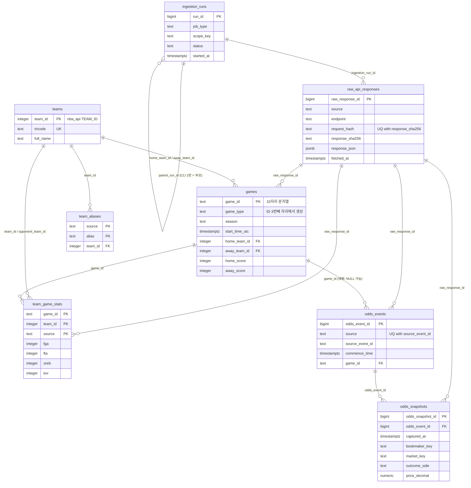
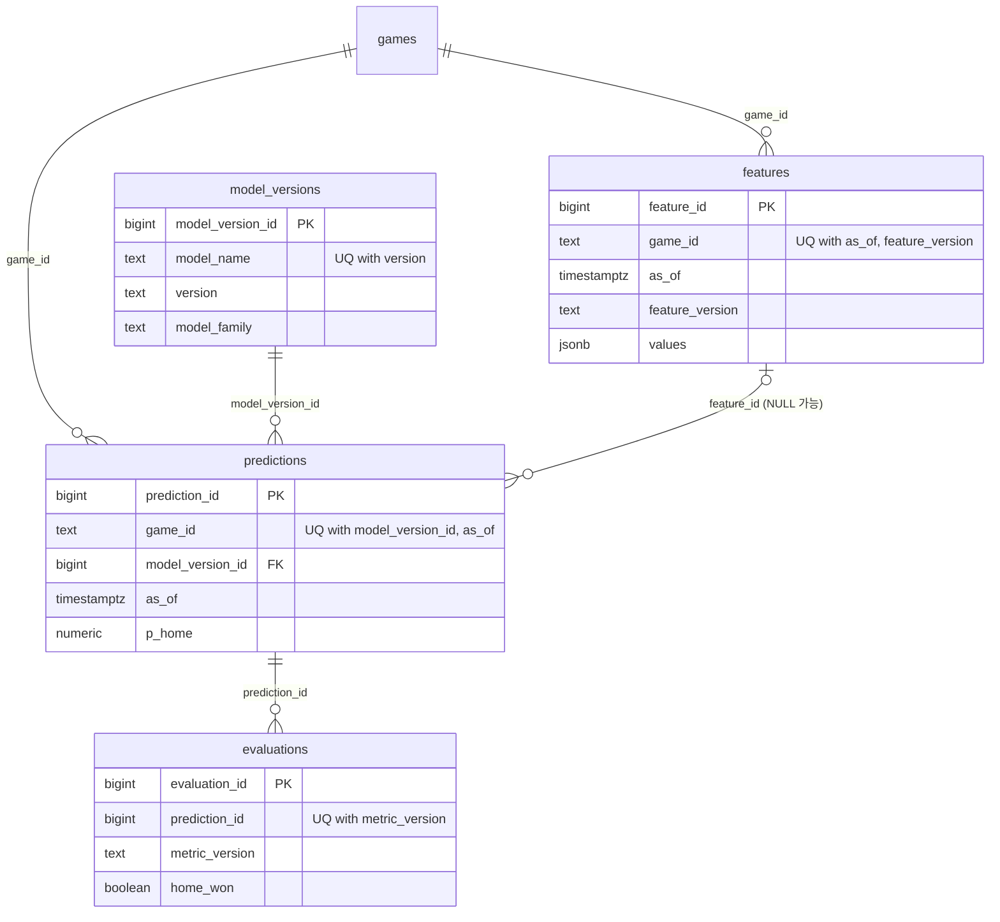

# 스키마 설계안 v1: raw / clean 레이어 + ingestion_runs (P-011)

- **작성:** Data Engineer, 2026-10-22 (v1.1: PR #7 리뷰 반영, v1.2: P-014 게임로그 열 추가, v1.3: P-025 2023-24 `is_neutral` 보완, v1.4: P-031 모델링 레이어 확정, 바뀐 곳은 13장)
- **상태:** 🧑 사람 승인 대기. 승인 전에는 SQLAlchemy 모델도 Alembic 마이그레이션도 만들지 않는다(P-012에서 구현).
- **이번 승인 대상:** `raw_api_responses`, `ingestion_runs`, `teams`, `team_aliases`, `games`, `team_game_stats`, `odds_events`, `odds_snapshots`, 뷰 2개(`team_game_stats_primary`, `odds_closing_lines`).
- **모델링 레이어(v1.4, P-031):** `features`, `model_versions`, `predictions`, `evaluations`와 뷰 `predictions_recommendation_basis`. 요구는 `docs/design/modeling-v1.md` 8장(D-049 승인), DDL은 9장(9-7). 🧑 DDL 승인 = 사람이 9장을 읽고 P-031 PR을 머지하는 것. 마이그레이션 `0002`.
- **근거 자료:** `docs/research/nba_api.md`(P-010), `docs/research/odds_api.md`(P-018), `tests/fixtures/nba_api/` 21개 픽스처, `docs/decisions.md` D-004·D-019·D-023~D-026, `docs/team/risks.md` B1·B3·B5.
- **확인 방법:** 컬럼 이름과 타입은 전부 픽스처에서 직접 읽어 확인했다(12장에 명령). 아래 DDL 스케치(부록 A)는 임시 `postgres:17-alpine` 컨테이너(PostgreSQL 17.11)에 실제로 적용해 제약과 upsert가 의도대로 동작하는지 확인했다. 확인하지 못한 것은 "(미확인)"이라고 적었다.

---

## 0. 한눈에 보기



**쉬운 말 요약**
- 외부에서 받은 응답은 먼저 **원본 그대로** `raw_api_responses`에 넣는다(내용이 바뀔 때만 새 행). 원본이 있으면 정제 규칙이 틀려도 다시 만들 수 있다.
- 정제된 표는 4개다: 팀(`teams`), 경기(`games`), 팀 경기 스탯(`team_game_stats`), 배당(`odds_events` + `odds_snapshots`). ML은 이 표들만 읽는다(D-004).
- 모든 표에는 **"같은 데이터를 두 번 넣어도 행이 늘지 않게 막는 유니크 키"**가 있다. 이것이 멱등성의 근거다(각 표의 "멱등성" 줄).
- 시각은 전부 UTC로 저장하고, 한국시간·미국 동부시간은 **볼 때** 바꾼다.

---

## 1. 공통 규칙

### 1-1. 타입
- PostgreSQL 17 타입만 쓴다(D-019): `text`, `integer`, `bigint`, `boolean`, `numeric(p,s)`, `date`, `timestamptz`, `jsonb`. 모델링 레이어(9장)는 여기에 `interval`, `text[]`, `smallint`를 더해 쓴다(9-1 7번).
- 문자열은 `varchar(n)` 대신 `text`를 쓴다(PG에서 성능 차이가 없고, 길이 제한을 바꾸는 마이그레이션이 필요 없다). 형식이 정해진 값은 `CHECK`로 막는다(예: 경기 ID 정규식).
- 대리키가 필요한 표는 `bigint GENERATED ALWAYS AS IDENTITY`를 쓴다(`serial`보다 표준이고, 실수로 값을 직접 넣는 것을 막는다).

### 1-2. 시각 규칙 (완료 기준 4)
1. **모든 시각은 `timestamptz`, UTC로 저장한다.** 컬럼 이름이 `_utc` 또는 `_at`, `_time`으로 끝나는 것은 전부 `timestamptz`다. `timestamp`(시간대 없음)는 쓰지 않는다.
2. **경기 시각은 nba_api의 `gameDateTimeUTC`(일정), `gameTimeUTC`(스코어보드·요약)만 쓴다.** `gameDateTimeEst`, `gameEt`, `gameTimeEst`, `gameDateEst`는 끝에 `Z`가 붙어 있지만 실제로는 동부 현지 시각이라 저장하지 않는다(D-025, `nba_api.md` 3-4).
3. **한국시간(KST)과 미국 동부시간(ET) 변환은 조회할 때 한다.** DB에 KST/ET 컬럼을 따로 두지 않는다.
   ```sql
   SELECT game_id,
          start_time_utc,
          start_time_utc AT TIME ZONE 'Asia/Seoul'       AS start_kst,
          start_time_utc AT TIME ZONE 'America/New_York' AS start_et
   FROM games;
   -- 확인 결과(부록 A 컨테이너): 0022300061 → UTC 2023-10-24 23:30, KST 2023-10-25 08:30, ET 2023-10-24 19:30
   ```
   파이썬에서는 `dt.astimezone(ZoneInfo("Asia/Seoul"))`로 바꾼다.
4. **"미국 동부 날짜 D의 경기"는 UTC 구간으로 바꿔서 찾는다.** 파이썬에서 `D 00:00 ET`와 `D+1 00:00 ET`를 UTC로 바꾼 뒤 `start_time_utc >= :from AND start_time_utc < :to`로 조회한다. 이러면 `start_time_utc` 인덱스를 그대로 쓴다(식 인덱스가 필요 없다). NBA 일정의 날짜 묶음과 `ScoreboardV3(game_date=...)`가 동부 날짜를 쓰기 때문이다(`nba_api.md` 3-4).
5. 예외 하나: `ingestion_runs.target_date_et`(`date`)는 "시각"이 아니라 **API에 넘긴 요청 파라미터**(동부 날짜)다. 그래서 이름에 `_et`를 붙여 뜻을 드러낸다.
6. 앱의 DB 연결은 세션 시간대를 `UTC`로 둔다(P-012에서 연결 옵션으로). `timestamptz`는 내부적으로 UTC로 저장되지만, 화면에 찍히는 값은 세션 시간대를 따르기 때문이다.

### 1-3. 모든 clean 테이블에 있는 컬럼 (완료 기준 2)

`source`와 `fetched_at`은 clean 테이블 6개 전부에 있다. `created_at`과 `raw_response_id`는 아래 표의 예외가 있다.

| 컬럼 | 타입 | NULL | 뜻 |
| --- | --- | --- | --- |
| `source` | `text` | NOT NULL | 이 행의 현재 값이 어느 소스·엔드포인트에서 왔는지(예: `scheduleleaguev2`, `leaguegamelog`, `the_odds_api`) |
| `fetched_at` | `timestamptz` | NOT NULL | 이 행의 현재 값을 담은 원본 응답을 **우리가 받은 시각**(UTC). `now()`가 아니라 raw 행의 `fetched_at`을 그대로 옮긴다. 그래야 같은 raw를 다시 정제해도 값이 같다(멱등) |
| `created_at` | `timestamptz` | NOT NULL, 기본 `now()` (`odds_snapshots`, `team_aliases` 제외) | 이 행이 우리 DB에 처음 생긴 시각. 예: 현재 시즌에 나중에 추가된 경기가 언제 처음 보였는지. `odds_snapshots`는 행이 갱신되지 않아(`DO NOTHING`) `fetched_at`이 곧 생성 시각이고, `team_aliases`는 `fetched_at`이 그 역할을 한다 |
| `raw_response_id` | `bigint` FK | NOT NULL (`teams`, `team_aliases` 제외) | 현재 값을 만든 원본 응답. "이 숫자 어디서 왔어?"를 한 번에 추적한다 |

### 1-4. upsert 규칙 (멱등성)
- 모든 clean 적재는 `INSERT ... ON CONFLICT (<유니크 키>) DO UPDATE` 또는 `DO NOTHING`이다. 그래서 **같은 입력을 두 번 넣으면 두 번째는 갱신(값 동일) 또는 무시**가 되고 행 수는 같다.
- **값이 뒤로 가지 않게 한다:** `DO UPDATE ... WHERE <표>.fetched_at <= EXCLUDED.fetched_at`. 옛날 raw를 다시 정제해도 더 최근에 받은 값을 덮어쓰지 않는다. 부록 A 컨테이너에서 같은 경기를 두 번 upsert해 행 수가 그대로인 것을 확인했다.
- **소스가 주지 않는 컬럼은 건드리지 않는다.** 여러 엔드포인트가 같은 표를 upsert할 때(예: `games`를 일정과 스코어보드가 같이 채움), 각 소스의 `DO UPDATE SET`에는 **그 소스가 실제로 주는 컬럼만** 넣는다. 결과적으로 `COALESCE(EXCLUDED.x, games.x)`와 같다(없는 값은 기존 값 유지). 컬럼 목록은 표마다 "소스별 갱신 컬럼 표"로 정한다(6-1). 모든 컬럼에 일괄 `COALESCE`를 쓰지 않는 이유: 소스가 "값이 비었다"고 **명시적으로** 준 경우(예: `gameSubtype = ""` → NULL)까지 무시하게 되기 때문이다.
- **INSERT 경로에서 NOT NULL을 채울 수 없는 소스가 있으면, 계산 규칙을 정한다.** 예: 스코어보드에는 `seasonYear`가 없으므로 `games.season`을 `game_id`에서 계산한다(6-1).
- **적재 순서는 FK 순서다:** `raw_api_responses` → `teams`(→ `team_aliases`) → `games` → `team_game_stats`, 그리고 `games` → `odds_events` → `odds_snapshots`. 앞 표에 없는 경기의 스탯·배당 매핑은 실패 목록으로 보고하고 다음 실행에서 다시 한다.
- clean 테이블은 **"가장 최근에 받은 값"**만 가진다. 과거 값의 이력은 raw에 남는다(3장). `source`·`raw_response_id`는 **마지막으로 쓴 소스** 하나만 가리킨다. 컬럼별로 어느 소스가 마지막에 썼는지는 저장하지 않는다(필요하면 raw 버전으로 추적).

### 1-5. 시점 관리(누수 방지)와 이 스키마의 관계
- `games`, `team_game_stats`는 최신 값을 담는다. 피처 함수(단계 2)는 `as_of`보다 **앞에 끝난 경기**만 써야 한다. 경기가 끝난 시각은 따로 저장하지 않으므로(소스에 없음, `BoxScoreSummaryV3.duration`만 있음), ML은 `start_time_utc < as_of - (여유 시간)` 같은 규칙을 단계 2에서 정한다. 이 스키마는 그 규칙에 필요한 `start_time_utc`, `status_code`를 준다.
- 과거 경기 기록이 나중에 고쳐질 수 있다(`meta.time`이 2023 경기에 2025로 찍혀 있었다, `nba_api.md` 6장). clean은 고쳐진 최신 값을 쓰고, 고치기 전 값은 raw에 남는다. 이 정도 차이는 누수로 보지 않는다(경기 결과 자체는 경기 직후 알 수 있는 정보). 필요하면 raw로 "그 당시 값"을 다시 만들 수 있다. **단, 이것은 실시간으로 수집하는 2026-27 시즌부터만 맞다.** 2023-24 ~ 2025-26은 2026년에 백필하므로 raw에도 이미 고쳐진 값만 들어 있다.
- 배당은 시점이 핵심이라 `odds_snapshots`에 시각을 두 개(`captured_at`, `bookmaker_last_update`) 남기고, 경기 시작 후 배당은 DB가 거부한다(7장).

---

## 2. 조회 패턴 (인덱스를 정하기 전에)

인덱스는 "실제로 하는 조회"에 맞춘다. 데이터 양은 작다(시즌당 경기 약 1,400개, `team_game_stats` 약 2,700행, 4시즌 합쳐도 경기 6천 개 안쪽). 그래서 인덱스는 **매일 흐름의 조회, 유니크 제약, 외래키 조인**에 필요한 만큼만 둔다. 인덱스가 많으면 적재가 느려지고 관리할 것이 늘어난다.

| 번호 | 누가, 언제 | 조회 | 쓰는 인덱스 |
| --- | --- | --- | --- |
| Q1 | 매일 1단계: 전날 결과 수집 후 확인 | 동부 날짜 D의 경기 목록 (UTC 구간 조회) | `games (start_time_utc)` |
| Q2 | 매일 4~5단계: 오늘 경기 일정, 예측 대상 | 오늘 동부 날짜의 `status_code = 1`, 팀이 정해진 경기 | `games (start_time_utc)` |
| Q3 | 단계 2 피처: 팀별 최근 N경기 (`as_of` 이전) | `WHERE home_team_id = :t AND start_time_utc < :as_of ORDER BY start_time_utc DESC LIMIT N` + 원정 쪽 같은 조회 | `games (home_team_id, start_time_utc)`, `games (away_team_id, start_time_utc)` |
| Q4 | 단계 2 피처: 그 경기들의 팀 스탯 | `team_game_stats_primary`를 `game_id, team_id`로 조인 | PK `(game_id, team_id, source)` |
| Q5 | 단계 2 학습 데이터: 시즌·유형별 경기 | `WHERE season = :s AND game_type IN (...)` | `games (season, game_type)` |
| Q6 | 매일 2단계: 전날 경기의 마감 배당 | 경기별·북메이커별·마켓별로 `captured_at < commence_time`인 마지막 스냅숏 (`odds_closing_lines` 뷰) | 유니크 `(odds_event_id, market_key, bookmaker_key, outcome_side, captured_at)` |
| Q7 | 예측 저장 시: 예측 시점 배당(modeling-v1 R3) | 위와 같되 `captured_at <= :as_of`(`predictions.as_of`, 9-4. 초안의 `predicted_at`은 `as_of`로 바뀌었다) | 같은 유니크 인덱스 |
| Q8 | 배당 매핑: 아직 `game_id`가 없는 배당 경기 | `WHERE game_id IS NULL` | 부분 인덱스 `odds_events (commence_time) WHERE game_id IS NULL` |
| Q9 | 백필·증분 재개 | 요청 범위 단위 중 `status = 'succeeded'`인 기록이 없는 것(성공 기준은 4장) | 부분 인덱스 `ingestion_runs (job_type, scope_key) WHERE status = 'succeeded'` |
| Q10 | 수집 레이어: 같은 요청의 최신 원본 | `WHERE request_hash = :h ORDER BY last_fetched_at DESC LIMIT 1` | `raw_api_responses (request_hash, last_fetched_at DESC)` |
| Q11 | 운영: 최근 실행 기록 | `ORDER BY started_at DESC LIMIT 20` | `ingestion_runs (started_at DESC)` |

외래키를 가진 쪽 컬럼에도 인덱스를 둔다(PostgreSQL은 외래키 쪽 인덱스를 자동으로 만들지 않는다. 없으면 부모 행 삭제나 조인이 전체 스캔이 된다).

---

## 3. `raw_api_responses`: 외부 응답 원본 보관함

**이 테이블은 무엇을 위해 있나.** 외부 API가 준 응답을 **손대지 않고 그대로** 넣어 두는 창고다. nba_api는 응답 형식이 바뀌거나 막힐 수 있고(risks B1), 우리 정제 코드도 틀릴 수 있다. 원본이 있으면 API를 다시 부르지 않고 clean 표를 언제든 다시 만들 수 있다. 또 "그 당시 API가 뭐라고 했는지"가 남아서, 나중에 기록이 고쳐져도(예: 2023 경기 박스스코어가 2025년에 다시 생성됨) 차이를 볼 수 있다.

| 컬럼 | 타입 | NULL | 뜻 |
| --- | --- | --- | --- |
| `raw_response_id` | `bigint` identity | PK | 대리키 |
| `source` | `text` | NOT NULL | `nba_api` 또는 `the_odds_api` (CHECK) |
| `endpoint` | `text` | NOT NULL | 엔드포인트 이름. nba_api는 클래스 이름 소문자(`scheduleleaguev2`, `leaguegamelog`, `boxscoretraditionalv3`, `scoreboardv3`, `live_scoreboard` 등), The Odds API는 경로(`v4/sports/basketball_nba/odds`) |
| `request_params` | `jsonb` | NOT NULL | 요청 파라미터. 키를 정렬한 정규형. **API 키(`apiKey` 등)는 빼고 저장한다** |
| `request_hash` | `text` | NOT NULL | `sha256(정규형 JSON {source, endpoint, request_params})`의 16진수 64자 (CHECK 정규식) |
| `http_status` | `integer` | NOT NULL | HTTP 상태 코드. 응답 자체가 없는 실패(타임아웃, 연결 오류)는 이 표에 넣지 않고 `ingestion_runs`에 기록한다 |
| `response_json` | `jsonb` | NULL | JSON으로 파싱되고 jsonb가 받아들이는 응답 본문. jsonb는 키를 정렬하고 중복 키는 마지막 값만 남긴다(의미는 보존, 원본 바이트는 보존 안 함) |
| `response_text` | `text` | NULL | JSON이 아니거나 jsonb가 거부하는 본문(예: 403 HTML 차단 페이지(D-024), `\u0000`이 든 문자열). 어댑터는 jsonb 변환이 실패하면 응답을 버리지 않고 여기에 원문을 넣는다. 둘 중 정확히 하나만 채운다 (CHECK `num_nonnulls(...) = 1`) |
| `response_sha256` | `text` | NOT NULL | 응답 **바이트**의 sha256(파싱 전). 내용이 바뀌었는지 판단하는 값. 받은 바이트를 **기록**할 뿐, 저장된 jsonb에서 다시 계산해 같아지지는 않는다 |
| `response_bytes` | `integer` | NOT NULL | 응답 바이트 수(일정 응답은 약 4.4MB) |
| `source_meta_time` | `text` | NULL | 응답의 `meta.time` 문자열 **그대로**(원천 데이터가 만들어진 시각). `LeagueGameLog` 같은 v2 응답에는 `meta`가 없어 NULL |
| `fetched_at` | `timestamptz` | NOT NULL | 이 내용을 **처음** 받은 시각 |
| `last_fetched_at` | `timestamptz` | NOT NULL | 같은 요청에서 같은 내용을 **마지막으로** 받은 시각 (CHECK `>= fetched_at`) |
| `fetch_count` | `integer` | NOT NULL, 기본 1 | 같은 요청에서 같은 내용을 받은 횟수 |
| `ingestion_run_id` | `bigint` | NULL, FK → `ingestion_runs` | 이 내용을 처음 받은 실행 |

- **유니크(멱등성):** `UNIQUE (request_hash, response_sha256)`. 같은 요청을 다시 해서 같은 내용이 오면 새 행을 만들지 않고 `last_fetched_at`, `fetch_count`만 갱신한다(`ON CONFLICT DO UPDATE`). 같은 요청인데 내용이 달라지면(경기 점수 확정, 기록 정정, 새 배당) **새 행(새 버전)**이 생긴다. 부록 A에서 같은 요청·같은 내용을 두 번 넣어 행 1개, `fetch_count` 2를 확인했다.
- **인덱스:** `(request_hash, last_fetched_at DESC)`(Q10), `(source, endpoint, fetched_at DESC)`(운영 조회), `(ingestion_run_id)`(FK).
- **`meta.time`을 `timestamptz`가 아니라 `text`로 두는 이유:** 시간대가 확실하지 않다. stats 응답은 `"2025-02-17T16:54:39.5439Z"`처럼 `Z`가 붙지만, nba_api의 다른 `*Est` 필드도 `Z`를 붙인 동부 시각이었다. 라이브 스코어보드는 `"2026-10-22 03:46:30.4630"`처럼 시간대 표시가 아예 없다. P-010 호출(07:45~07:47 UTC)에서 받은 `scoreboardv3` 응답의 `meta.time`이 `03:40:41Z`였는데, 이것이 "4시간 전 UTC 캐시"인지 "5분 전 동부 시각"인지 픽스처만으로 구분할 수 없다(미확인). 잘못 해석해 시각으로 저장하는 것보다 원문을 남기는 편이 안전하다. 필요해지면 P-013에서 호출 시각과 비교해 확인하고 컬럼을 추가한다.
- **크기:** 일정 응답 4.4MB를 같은 시즌에 매일 다시 받으면, 점수가 매일 바뀌므로 매일 새 버전이 생긴다(시즌 약 240일 × 4.4MB ≈ 1GB, 압축 전). 그래서 매일 흐름(P-017)은 작은 `ScoreboardV3`(5~41KB)로 하고 전체 일정은 주기적으로만 다시 받는 것을 권한다(P-017에서 결정). JSONB는 2KB가 넘으면 TOAST로 압축 저장된다. 이 이미지의 기본 압축은 `pglz`이고 `lz4`도 쓸 수 있음을 확인했다(`SHOW default_toast_compression` → `pglz`, `SET ... 'lz4'` 성공). 실제 압축률은 미확인(P-012에서 진짜 일정 응답으로 재본다).
- **알려진 한계:** 내용이 A → B → A로 돌아가면 세 번째 A는 첫 행의 `last_fetched_at`만 갱신된다(새 행이 안 생김). nba_api 데이터는 점수 확정·정정처럼 앞으로만 바뀌고, The Odds API 응답에는 북메이커별 `last_update`가 들어 있어 바이트가 똑같이 돌아올 가능성은 매우 낮다고 본다(추정). 실제로 문제가 되면 `version_no` 컬럼을 추가하는 방식으로 바꿀 수 있다.
- **`live_scoreboard`는 "같은 내용이면 새 행 없음"이 걸리지 않는다:** 이 엔드포인트의 `meta.time`은 생성 시각이 아니라 **요청 시각**으로 보인다(픽스처 `"2026-10-22 03:46:30.4630"` = P-010 호출 시각 07:46 UTC를 동부 시각으로 쓴 값). 그래서 경기 상태가 그대로여도 바이트가 매번 달라 **부를 때마다 새 행**이 생긴다. 반면 `scoreboardv3`의 `meta.time`은 생성 시각이라 안정적이다(`scoreboardv3__2026-03-05.json`은 `2026-08-04T09:20:59.2059Z`). 그래서 매일 흐름은 `scoreboardv3`를 쓰고 `live_scoreboard`는 대체 소스로만 둔다. "휘발 필드(`meta.time` 등)를 빼고 정규화한 내용으로 해시"하는 대안도 있지만, 엔드포인트마다 휘발 필드 목록을 관리해야 해서 v1에서는 고르지 않았다(A-1 대안).

---

## 4. `ingestion_runs`: 수집 작업 실행 기록

**이 테이블은 무엇을 위해 있나.** 수집 작업이 "언제, 무엇을, 몇 번 호출해서, 성공했는지 실패했는지"를 남기는 일지다. 매일 흐름이 실패했을 때 원인을 찾고(OVERVIEW 3장 6단계), 3시즌 백필이 중간에 끊겼을 때 **이미 끝난 단위는 건너뛰고 이어서** 하기 위해 쓴다(risks B1). 데이터 품질 실패도 여기에 기록하고 멈추지 않고 다음 날짜로 간다(risks B5).

**구조:** CLI를 한 번 실행하면 **부모 행 1개**가 생기고, 그 안의 작업 단위(시즌 1개, 날짜 1개 등)마다 **자식 행**이 생긴다. 재개는 "같은 `job_type`과 `scope_key`에 성공 기록이 있는 단위는 건너뛴다"로 한다.

| 컬럼 | 타입 | NULL | 뜻 |
| --- | --- | --- | --- |
| `run_id` | `bigint` identity | PK | 대리키 |
| `parent_run_id` | `bigint` | NULL, FK → `ingestion_runs` | 부모 실행(CLI 1번). 부모 행 자신은 NULL |
| `job_type` | `text` | NOT NULL | 작업 종류. 예: `backfill`, `incremental`, `schedule`, `gamelog`, `boxscore`, `odds_capture`, `quality_check`. 값 목록은 P-013/P-016에서 확정하고, 바뀌기 쉬워서 CHECK를 걸지 않는다 |
| `source` | `text` | NULL | `nba_api`, `the_odds_api`. 품질 체크처럼 외부 호출이 없으면 NULL |
| `scope_key` | `text` | NOT NULL | 작업 단위를 나타내는 정규 문자열. 예: `season=2025-26`, `season=2025-26;season_type=Playoffs`, `date_et=2026-10-21`, `game_id=0022300061`, 부모는 `cli`. **재개의 기준** |
| `season` | `text` | NULL | 대상 시즌 `"2025-26"` (CHECK 정규식) |
| `season_type` | `text` | NULL | `LeagueGameLog`의 `season_type_all_star` 값(`Regular Season`, `PlayIn`, `Playoffs`) |
| `target_date_et` | `date` | NULL | 대상 동부 날짜(`ScoreboardV3(game_date=...)`에 넘긴 값) |
| `status` | `text` | NOT NULL | `running`, `succeeded`, `partial`(일부 항목 실패), `failed`, `aborted`(403/429 등으로 즉시 중단, D-024) (CHECK) |
| `started_at` | `timestamptz` | NOT NULL, 기본 `now()` | 시작 시각 |
| `finished_at` | `timestamptz` | NULL | 종료 시각. `running`일 때만 NULL (CHECK) |
| `api_calls` | `integer` | NOT NULL, 기본 0 | 외부 호출 수(재시도 포함) |
| `retry_count` | `integer` | NOT NULL, 기본 0 | 그중 재시도 수 |
| `items_total` | `integer` | NULL | 처리할 항목 수(예: 경기 수). 모르면 NULL |
| `items_succeeded` | `integer` | NOT NULL, 기본 0 | 성공한 항목 수 |
| `items_failed` | `integer` | NOT NULL, 기본 0 | 실패한 항목 수 |
| `rows_written` | `integer` | NOT NULL, 기본 0 | clean 테이블에 쓴(삽입+갱신) 행 수 |
| `error_message` | `text` | NULL | 마지막 에러 한 줄 |
| `error_detail` | `jsonb` | NULL | 실패 항목 목록 등(예: `{"failed_game_ids": [...]}`). **비밀값을 넣지 않는다** |
| `code_version` | `text` | NULL | 실행한 코드의 git 커밋 해시(재현성) |

- **유니크(멱등성·동시 실행 방지):** 부분 유니크 `(job_type, scope_key) WHERE status = 'running'`. 같은 단위를 동시에 두 번 돌리지 못한다(부록 A에서 두 번째 `running` 삽입이 거부됨을 확인). 실행 기록 자체는 "일지"라서 다시 돌리면 행이 하나 더 생기는 것이 맞다. 멱등성은 이 표가 아니라 데이터 표에서 지킨다. 프로세스가 죽어 `running`으로 남은 행은 다음 실행이 시작할 때 오래된 것(예: 6시간 초과)을 `aborted`로 바꾼다(P-013에서 구현).
- **인덱스:** 부분 인덱스 `(job_type, scope_key) WHERE status = 'succeeded'`(Q9), `(started_at DESC)`(Q11), `(parent_run_id)`(FK).
- **CHECK:** `(status = 'running') = (finished_at IS NULL)`, `finished_at >= started_at`, 카운트 컬럼 `>= 0`.
- **날짜 단위 증분의 성공 기준:** `scope_key = date_et=D` 단위는 그 날짜 경기가 **전부 `status_code = 3`(종료)이고 스탯까지 적재됐을 때만** `succeeded`로 닫는다. 늦게 끝난 경기, 연기된 경기, 게임로그에 아직 반영되지 않은 경기가 남아 있으면 `partial`로 닫고 `error_detail`에 남은 `game_id`를 적는다. `partial`은 성공이 아니므로 다음 실행이 그 날짜를 다시 받는다. 연기된 경기가 스코어보드에 어떻게 표시되는지는 미확인이라, "며칠째 `partial`인 날짜"는 품질 보고에 올린다(구현은 P-013/P-017).

---

## 5. `teams`, `team_aliases`: 팀과 팀 이름 사전

### 5-1. `teams`

**이 테이블은 무엇을 위해 있나.** NBA 30팀의 기본 정보다. 다른 모든 표가 팀을 nba_api의 `TEAM_ID`(정수)로 가리키므로, 이 표가 "팀 번호 → 이름" 사전 역할을 한다.

| 컬럼 | 타입 | NULL | 뜻 (픽스처 출처) |
| --- | --- | --- | --- |
| `team_id` | `integer` | PK | nba_api 팀 ID (`TEAM_ID`, `teamId`, `id`). 예 `1610612743` (CHECK `> 0`) |
| `tricode` | `text` | NOT NULL, UNIQUE | 세 글자 약어 (`teamTricode`, `ABBREVIATION`, `abbreviation`). 예 `DEN` (CHECK `^[A-Z]{3}$`) |
| `city` | `text` | NOT NULL | 도시 (`teamCity`, `city`). 예 `Denver` |
| `nickname` | `text` | NOT NULL | 팀 별칭 (`teamName`, `nickname`). 예 `Nuggets` |
| `full_name` | `text` | NOT NULL | 전체 이름 (`static.teams`의 `full_name`). 예 `Denver Nuggets` |
| `source` | `text` | NOT NULL | `nba_api.static`(라이브러리 내장 목록). `commonteamyears`는 `TEAM_ID`, `ABBREVIATION`, 연도만 주고 `city`·`nickname`·`full_name`이 없어 이 표를 채우지 못한다. 팀 ID 범위를 검증할 때만 쓴다 |
| `fetched_at` | `timestamptz` | NOT NULL | 이 값을 확인한 시각 |
| `created_at` | `timestamptz` | NOT NULL, 기본 `now()` | 처음 넣은 시각 |

- **유니크(멱등성):** PK `team_id`, `UNIQUE (tricode)`. 30팀을 몇 번 넣어도 30행이다.
- **인덱스:** PK와 UNIQUE가 만드는 것 외에 없음.
- **`raw_response_id`가 없는 이유:** 기본 소스 `nba_api.stats.static.teams.get_teams()`는 라이브러리에 내장된 데이터라 API 응답이 없다(`nba_api.md` 1장).

**팀 이동·이름 변경 확인 (`commonteamyears__00.json`):**
- 45행 중 `MAX_YEAR = "2026"`인 현역 30팀은 `MIN_YEAR`가 전부 2002 이하다(가장 늦은 것: NOP `2002`). 즉 우리 범위(2023-24 ~ 2026-27)에 **새로 생기거나 없어진 팀 ID는 없다.**
- 팀 ID는 연고지 이전에도 유지된다(예: OKC `1610612760`의 `MIN_YEAR = "1967"`은 시애틀 시절부터다). 그래서 "같은 프랜차이즈 = 같은 ID"로 본다.
- 픽스처의 게임로그 `TEAM_NAME`(20팀, 2023-24 ~ 2026-27)에서 같은 ID인데 이름이 다른 경우는 0건이었다. 단, 픽스처가 잘린 샘플이라 30팀 × 4시즌 전수는 아니다. 전수 확인은 P-014에서 일정 원본 전체로 한다.
- 그래서 v1은 **팀-시즌별 이름 이력 표를 만들지 않는다.** 이름이 바뀌면 `teams`는 최신 이름으로 갱신하고, 옛 이름은 `team_aliases`에 남긴다. 필요해지면 나중에 표를 추가하면 된다(추가는 쉽다, D-004).

### 5-2. `team_aliases`

**이 테이블은 무엇을 위해 있나.** 다른 소스가 팀을 **이름 문자열**로 부를 때 우리 `team_id`로 바꾸는 사전이다. The Odds API는 팀 ID 없이 `home_team`, `away_team`을 이름으로 준다(`odds_api.md` 4장). 같은 nba_api 안에서도 이름이 다르다: 게임로그 `TEAM_NAME`은 `"LA Clippers"`, 내장 목록 `full_name`은 `"Los Angeles Clippers"`다(픽스처와 라이브러리로 확인). 이런 차이를 코드에 하드코딩하지 않고 표로 관리한다.

| 컬럼 | 타입 | NULL | 뜻 |
| --- | --- | --- | --- |
| `source` | `text` | PK | 이 이름을 쓰는 소스(`the_odds_api`, `nba_api.leaguegamelog` 등) |
| `alias` | `text` | PK | 그 소스가 쓰는 이름 그대로. 예 `"LA Clippers"` |
| `team_id` | `integer` | NOT NULL, FK → `teams` | 우리 팀 ID |
| `fetched_at` | `timestamptz` | NOT NULL | 이 대응을 확인한 시각(시드 적용 시각 또는 응답에서 처음 본 시각) |
| `note` | `text` | NULL | 사람이 남기는 메모(예: "P-019 첫 `/events` 응답에서 확인") |

- **유니크(멱등성):** PK `(source, alias)`. 같은 시드를 두 번 적용해도 행 수가 같다. 한 소스의 한 이름은 한 팀만 가리킨다.
- **인덱스:** `(team_id)`(FK).
- **The Odds API 이름 목록은 미확인:** NBA 공개 샘플이 없어 실제 팀 이름 문자열을 아직 못 봤다(`odds_api.md` 7장). P-019에서 무료 `/events`(크레딧 차감 없음)를 한 번 불러 30팀 이름을 확인하고 시드로 넣는다. 매핑되지 않는 이름이 오면 적재를 멈추지 않고 해당 경기의 `odds_events.game_id`를 NULL로 두고 품질 보고에 올린다.

---

## 6. `games`, `team_game_stats`: 경기와 팀 경기 스탯

### 6-1. `games`

**이 테이블은 무엇을 위해 있나.** 한 행이 NBA 경기 하나다. 언제(UTC), 누가(홈/원정), 어떤 경기(정규/플레이오프 등), 결과(점수)를 담는다. 예측의 대상이자 피처 계산과 평가의 기준표다. 현재 시즌은 경기가 나중에 추가되고(번호 빈칸 24개, `nba_api.md` 3-1) 시각·팀이 나중에 정해지므로 upsert로 계속 갱신된다.

| 컬럼 | 타입 | NULL | 뜻 (픽스처 출처) |
| --- | --- | --- | --- |
| `game_id` | `text` | PK | 10자리 경기 ID `gameId`/`GAME_ID`, 예 `"0022300061"`. **정수 금지**(앞자리 0이 사라짐). CHECK `^00[1-6][0-9]{7}$` |
| `game_type` | `text` | NOT NULL, **생성 컬럼** | ID 3번째 자리에서 DB가 자동 계산(D-025): `1 preseason`, `2 regular`, `3 allstar`, `4 playoffs`, `5 playin`, `6 cup_final`. `GENERATED ALWAYS AS (CASE substr(game_id,3,1) ...) STORED` |
| `season` | `text` | NOT NULL | `leagueSchedule.seasonYear`, 예 `"2023-24"`. CHECK 형식 + CHECK `substr(game_id,4,2) = substr(season,3,2)`(ID의 시즌 자리와 일치). `seasonYear`가 없는 소스(스코어보드)는 `game_id` 4~5자리에서 계산한다: 시작 연도 y = 2000 + 두 자리, `season = f"{y}-{(y + 1) % 100:02d}"`(예 `23` → `2023-24`). CHECK가 둘의 일치를 강제하므로 계산이 틀리면 적재가 거부된다 |
| `game_subtype` | `text` | NULL | `gameSubtype`. 관찰값 `in-season`, `in-season-knockout`(NBA컵), `Global Games`. 빈 문자열은 NULL로 |
| `start_time_utc` | `timestamptz` | NOT NULL | `gameDateTimeUTC`(일정) 또는 `gameTimeUTC`(스코어보드). 시각 미정이면 소스가 준 자리표시 값(관찰값: 동부 자정 = `05:00Z`) |
| `is_time_tbd` | `boolean` | NOT NULL | `gameStatusText = "TBD"`이면 true. true인 경기의 `start_time_utc`는 진짜 시작 시각이 아니다 |
| `status_code` | `integer` | NOT NULL | `gameStatus`. 관찰값 `1` 예정, `3` 종료. `2`는 진행 중으로 추정(미확인). CHECK `IN (1,2,3)` |
| `status_text` | `text` | NOT NULL | `gameStatusText` 원문. 예 `"Final"`, `"Final/OT2"`, `"7:00 pm ET"`, `"TBD"` |
| `postponed_status` | `text` | NULL | `postponedStatus` 원문. 관찰값 `"A"`(2023-24 일정), `"N"`(이후). 뜻은 미확인이라 해석하지 않고 저장만. **일정만 준다**(스코어보드에는 없음) |
| `home_team_id` | `integer` | NULL, FK → `teams` | `homeTeam.teamId`. 소스가 `0`(팀 미정)이면 NULL |
| `away_team_id` | `integer` | NULL, FK → `teams` | `awayTeam.teamId`. 같은 규칙 |
| `home_score` | `integer` | NULL | `homeTeam.score`. **`status_code = 3`일 때만 채운다.** 예정 경기는 소스가 `0`을 주지만 NULL로 저장(0점과 "아직 없음"을 구분) |
| `away_score` | `integer` | NULL | 같은 규칙 |
| `is_neutral` | `boolean` | NOT NULL | `isNeutral`. 중립 경기장(NBA컵 결승, 해외 경기). v1.3·v1.5: 일정과 스코어보드 모두 `isNeutral` **또는** 보완 목록(`UNFLAGGED_NEUTRAL_GAME_IDS`: 2022-23 2 + 2023-24 5 = 7경기)이면 true. 2022-23·2023-24 응답은 전 경기 `isNeutral=false`라서다(D-046, D-053, P-025·P-026). 2024-25부터는 플래그만 쓴다 |
| `if_necessary` | `boolean` | NOT NULL | `ifNecessary`. 일정에서는 문자열 `"false"`, 스코어보드에서는 불리언으로 와서 어댑터가 불리언으로 통일 |
| `source` | `text` | NOT NULL | 현재 값을 준 엔드포인트(`scheduleleaguev2`, `scoreboardv3`, `live_scoreboard`, `leaguegamelog`) |
| `fetched_at` | `timestamptz` | NOT NULL | 1-3 참고 |
| `created_at` | `timestamptz` | NOT NULL, 기본 `now()` | 1-3 참고 |
| `raw_response_id` | `bigint` | NOT NULL, FK → `raw_api_responses` | 1-3 참고 |

- **유니크(멱등성):** PK `game_id`. 일정을 몇 번 다시 받아도 경기당 1행이고, 바뀐 값(점수, 시각, 팀)만 갱신된다. 갱신은 `WHERE games.fetched_at <= EXCLUDED.fetched_at`일 때만(1-4).
- **인덱스:** `(start_time_utc)`(Q1·Q2), `(home_team_id, start_time_utc)`, `(away_team_id, start_time_utc)`(Q3), `(season, game_type)`(Q5), `(raw_response_id)`(FK).
- **CHECK:** 홈·원정 팀은 둘 다 NULL이거나 둘 다 있음, 홈 ≠ 원정, 홈·원정 점수는 둘 다 NULL이거나 둘 다 있음, `status_code <> 3`이면 점수 NULL, `status_code = 3`이면 점수와 팀이 있음. 부록 A에서 "종료인데 점수 없음", "ID와 시즌 불일치"가 거부되는 것을 확인했다.
- **저장하지 않는 소스 필드:** `gameLabel`, `gameSubLabel`, `seriesText`(시즌마다 문자열이 바뀌어 판단에 쓰면 안 됨, D-025), `*Est`/`gameEt`(가짜 `Z`), `gameCode`, `arenaName`, `broadcasters`, `pointsLeaders` 등. 모델에 필요 없고 raw에 남아 있으니 필요해지면 컬럼을 추가해 raw에서 다시 채운다.

**소스별 갱신 컬럼 표 (1-4 규칙 적용):** `games`는 일정과 스코어보드가 같이 채운다. 스코어보드 응답에는 `seasonYear`와 `postponedStatus`가 없다(`scoreboardv3__*.json`, `live_scoreboard__*.json` 픽스처 확인). 각 소스는 자기가 주는 컬럼만 `DO UPDATE SET`에 넣는다.

| 컬럼 | `scheduleleaguev2` | `scoreboardv3`, `live_scoreboard` | `leaguegamelog` (v1.2) |
| --- | --- | --- | --- |
| `game_id` | 키 | 키 | 키. **갱신만**(시작 시각이 없어 INSERT 불가). `games`에 없는 경기는 실패 항목 |
| `season` | 넣기·갱신 (`seasonYear`) | INSERT 때만 `game_id`에서 계산해 넣음, 갱신 안 함 | 갱신 안 함 |
| `game_subtype` | 넣기·갱신 | 넣기·갱신 (`gameSubtype`) | 갱신 안 함 |
| `start_time_utc`, `is_time_tbd` | 넣기·갱신 (`gameDateTimeUTC`, `gameStatusText`) | 넣기·갱신 (`gameTimeUTC`, `gameStatusText`) | 갱신 안 함 |
| `status_code`, `status_text` | 넣기·갱신 | 넣기·갱신 | 갱신 (`WL`이 있으면 `3`. 문구는 이미 종료면 유지, 아니면 `"Final"`) |
| `postponed_status` | 넣기·갱신 | **소스에 없음 → 갱신 안 함(기존 값 유지).** 스코어보드가 처음 넣은 경기는 NULL로 시작해 다음 일정 재수집 때 채워진다 | 갱신 안 함 |
| `home_team_id`, `away_team_id` | 넣기·갱신 (0이면 NULL) | 넣기·갱신 (0이면 NULL) | 갱신 안 함 (팀이 일정과 다르면 품질 이슈, 그 경기는 갱신 안 함) |
| `home_score`, `away_score` | 넣기·갱신 (종료일 때만) | 넣기·갱신 (종료일 때만) | 갱신 (`PTS`를 **팀 ID 기준**으로. 이미 종료인데 점수가 다르면 품질 이슈, 갱신 안 함) |
| `is_neutral`, `if_necessary` | 넣기·갱신 (`ifNecessary` 문자열 → 불리언. `is_neutral` = `isNeutral` OR `game_id`가 보완 목록(2022-23 2 + 2023-24 5 = 7경기), v1.3) | 넣기·갱신 (불리언. `is_neutral` = `isNeutral` OR `game_id`가 보완 목록(2022-23 2 + 2023-24 5 = 7경기), 일정과 같은 규칙, v1.3) | 갱신 안 함 |
| `source`, `fetched_at`, `raw_response_id` | 넣기·갱신 | 넣기·갱신 | 갱신 |

- 두 소스 모두 `WHERE games.fetched_at <= EXCLUDED.fetched_at` 가드를 쓴다. 그래서 "스코어보드가 더 최근이면 상태·점수를 스코어보드 값으로", "주기적 일정 재수집이 더 최근이면 일정 값으로" 맞춰진다.
- 이 표는 스키마가 아니라 **적재 규칙**이다. 바꿔도 마이그레이션이 필요 없다. P-014/P-017이 이 표대로 구현하고 테스트한다(부록 A 컨테이너에서 "스코어보드가 먼저 넣은 경기", "스코어보드 갱신 후 `postponed_status` 유지"를 확인했다, 12장).

**경기 유형별 저장 규칙 (승인 요청 A-4):**

| 유형 | `games`에 저장 | 모델 학습·평가 기본 대상 | 이유 |
| --- | --- | --- | --- |
| `002` 정규 | 저장 | 대상 | 핵심 |
| `004` 플레이오프 | 저장 | 대상 | 시장 비교 표본 |
| `005` 플레이인 | 저장 | 대상 | 정상적인 두 팀 경기, 게임로그에 스탯 있음 |
| `006` NBA컵 결승 | 저장 | **단계 2에서 결정** (기본: 제외) | 두 팀의 진짜 경기지만 정규·플레이오프 게임로그에 없다. 스탯은 `BoxScoreTraditionalV3`로 시즌당 1번 받는다(D-023의 "필요할 때만") |
| `001` 프리시즌 | **저장 안 함** | 제외 | 주전이 거의 안 뛰어 전력을 반영하지 않는다. 해외 클럽과의 경기가 있다면 팀 ID가 `teams`에 없어 FK가 깨질 수 있다(미확인) |
| `003` 올스타 | **저장 안 함** | 제외 | 팀 대항전이 아니다. 픽스처에 올스타 경기가 없어 팀 ID 형태를 확인하지 못했다(미확인) |

- `game_type` CHECK는 6가지를 다 허용한다. 그래서 나중에 001/003을 넣기로 바꿔도 **스키마 변경 없이** 어댑터 규칙만 바꾸면 된다.
- 학습에서 빼는 방법: ML은 `WHERE game_type IN ('regular', 'playin', 'playoffs')`처럼 **유형으로 거른다.** 별도의 "학습 대상" 플래그 컬럼은 두지 않는다(유형에서 바로 나오는 값이라 중복이고, 기준이 바뀔 때마다 데이터를 고쳐야 한다).

**시각 미정·팀 미정 경기 규칙 (승인 요청 A-5):**
- 관찰: 2026-27 NBA컵 8강 `0022601201`은 `gameStatusText = "TBD"`, `05:00Z`, 팀 ID `0`. NBA컵 결승 `0062600001`은 시각은 정해졌는데(`"8:00 pm ET"`, `2026-12-12T01:00:00Z`) 팀 ID가 `0`이다. 즉 **"시각 미정"과 "팀 미정"은 따로 일어난다.**
- 규칙: 저장한다. 시각 미정은 `is_time_tbd = true`, 팀 미정은 `home_team_id`/`away_team_id` NULL. 나중에 정해지면 같은 `game_id`로 upsert되어 채워진다.
- 이유: 일정 경기 수를 소스와 맞춰 볼 수 있고(품질 체크), "언제 처음 일정에 보였는지"(`created_at`)가 남는다. 저장하지 않으면 팀이 정해진 날 갑자기 나타나서 그 사이에 무슨 일이 있었는지 모른다.
- 사용 규칙: 예측(단계 3)은 `home_team_id IS NOT NULL AND NOT is_time_tbd`인 경기만 대상으로 한다. 피처는 끝난 경기만 쓰므로 영향이 없다.

### 6-2. `team_game_stats`

**이 테이블은 무엇을 위해 있나.** 한 경기에서 한 팀이 낸 기본 스탯(득점, 슈팅 시도·성공, 리바운드, 턴오버 등)이다. 경기당 홈·원정 2행. 단계 2의 피처(최근 N경기 공격·수비 효율, 페이스, 포제션 추정)가 전부 여기서 나온다. 같은 스탯을 두 엔드포인트가 주는데 정의가 조금 다를 수 있어서(`TOV`), 행마다 출처(`source`)를 남긴다(D-023).

| 컬럼 | 타입 | NULL | 뜻 | `leaguegamelog` | `boxscoretraditionalv3` (`statistics`) |
| --- | --- | --- | --- | --- | --- |
| `game_id` | `text` | PK, FK → `games` | 경기 ID | `GAME_ID` | `gameId` |
| `team_id` | `integer` | PK, FK → `teams` | 이 행의 팀 | `TEAM_ID` | `homeTeam/awayTeam.teamId` |
| `source` | `text` | PK | 출처 엔드포인트 (CHECK 두 값) | `leaguegamelog` | `boxscoretraditionalv3` |
| `opponent_team_id` | `integer` | NOT NULL, FK → `teams` | 상대 팀 | 같은 `GAME_ID`의 다른 행 | 반대쪽 `teamId` |
| `is_home` | `boolean` | NOT NULL | 홈 경기 여부 | `MATCHUP`에 `vs.`이면 홈, `@`이면 원정 | `homeTeam` 쪽이면 true |
| `minutes` | `integer` | NOT NULL | 팀 총 출전 시간(분). 연장 판단, 페이스 계산 | `MIN` 정수(240, 265, 290 관찰) | `minutes` `"240:00"` → 분으로 변환(초가 `00`이 아니면 적재 실패) |
| `pts` | `integer` | NOT NULL | 득점 | `PTS` | `points` |
| `fgm` | `integer` | NOT NULL | 야투 성공 | `FGM` | `fieldGoalsMade` |
| `fga` | `integer` | NOT NULL | 야투 시도 (포제션 추정) | `FGA` | `fieldGoalsAttempted` |
| `fg3m` | `integer` | NOT NULL | 3점 성공 | `FG3M` | `threePointersMade` |
| `fg3a` | `integer` | NOT NULL | 3점 시도 | `FG3A` | `threePointersAttempted` |
| `ftm` | `integer` | NOT NULL | 자유투 성공 | `FTM` | `freeThrowsMade` |
| `fta` | `integer` | NOT NULL | 자유투 시도 (포제션 추정) | `FTA` | `freeThrowsAttempted` |
| `oreb` | `integer` | NOT NULL | 공격 리바운드 (포제션 추정) | `OREB` | `reboundsOffensive` |
| `dreb` | `integer` | NOT NULL | 수비 리바운드 | `DREB` | `reboundsDefensive` |
| `reb` | `integer` | NOT NULL | 전체 리바운드 | `REB` | `reboundsTotal` |
| `ast` | `integer` | NOT NULL | 어시스트 | `AST` | `assists` |
| `stl` | `integer` | NOT NULL | 스틸 | `STL` | `steals` |
| `blk` | `integer` | NOT NULL | 블록 | `BLK` | `blocks` |
| `tov` | `integer` | NOT NULL | 턴오버 (포제션 추정). **정의가 소스마다 다를 수 있다(아래)** | `TOV` | `turnovers` |
| `pf` | `integer` | NOT NULL | 개인 파울 합 | `PF` | `foulsPersonal` |
| `plus_minus` | `integer` | NOT NULL | 득실차 | `PLUS_MINUS` (게임로그는 정수, `LeagueGameFinder`는 `4.0` 같은 실수) | `plusMinusPoints` (`12.0` 실수) → 정수로 변환(소수부가 있으면 적재 실패) |
| `fetched_at` | `timestamptz` | NOT NULL | 1-3 | | |
| `created_at` | `timestamptz` | NOT NULL, 기본 `now()` | 1-3 | | |
| `raw_response_id` | `bigint` | NOT NULL, FK → `raw_api_responses` | 1-3 | | |

- **유니크(멱등성):** PK `(game_id, team_id, source)`. 게임로그를 몇 번 다시 적재해도 경기·팀·소스당 1행이다. 같은 경기·팀을 두 소스에서 받으면 2행이 되고, 서로 섞이지 않는다(부록 A에서 같은 경기 DEN 행을 두 소스로 넣고 게임로그를 한 번 더 넣어 `INSERT 0 0` 확인).
- **인덱스:** PK(Q4), `(team_id)`(FK, 팀별 조회), `(raw_response_id)`(FK).
- **CHECK:** 스탯 컬럼 `>= 0`(`plus_minus` 제외), `team_id <> opponent_team_id`. 산술 관계(`reb = oreb + dreb`, `pts = 2*fgm + fg3m + ftm`, 두 팀 `pts` = `games` 점수)는 CHECK가 아니라 **품질 체크(P-020)**로 본다. CHECK는 한 행이라도 어기면 적재 전체를 멈추게 하는데, 소스 데이터 오류 때문에 백필이 멈추는 것보다 실패 목록으로 보고하는 편이 낫기 때문이다(risks B5). 참고로 픽스처 42개 팀 행(게임로그·게임파인더 36 + 박스스코어 6) 전부에서 두 산술 관계가 맞았다.
- **저장하지 않는 소스 필드:** `FG_PCT`, `FG3_PCT`, `FT_PCT`(성공/시도로 계산 가능), `WL`(점수로 계산 가능), `SEASON_ID`, `GAME_DATE`, `TEAM_ABBREVIATION`, `TEAM_NAME`, `MATCHUP`(`games`·`teams`와 중복), `VIDEO_AVAILABLE`. 박스스코어의 `starters`/`bench`(벤치 `minutes`가 선발과 같은 값으로 나오는 버그, `nba_api.md` 6장)와 `players`도 v1에서는 저장하지 않는다.
- **포제션은 저장하지 않는다.** 필요한 입력(FGA, FTA, OREB, TOV, 그리고 상대 행의 같은 값과 DREB, FGM)은 픽스처 두 소스 모두에 빠짐없이 있다. 공식(예: 0.96 계수, 상대 리바운드 반영 여부)은 ML이 피처 버전으로 관리할 일이라 단계 2에서 계산한다. 공식을 DB에 박으면 바꿀 때마다 마이그레이션이 필요하다.

**두 소스와 `TOV` 차이 (승인 요청 A-6):**
- 관찰: `0022300061`에서 게임로그 `TOV`가 DEN 12·LAL 12, 박스스코어 `turnovers`가 DEN 11·LAL 11이었다(박스스코어는 선수 턴오버 합과 같고, 게임로그는 팀 턴오버를 포함한 값으로 추정, `nba_api.md` 6장). 다른 두 경기는 일치했다.
- 규칙 1: `tov`에는 **소스가 준 값을 그대로** 넣는다. 고쳐서 맞추지 않는다. 소스가 키에 들어 있으니 두 정의가 한 행에 섞이지 않는다.
- 규칙 2: **대표 소스 우선순위는 `leaguegamelog` > `boxscoretraditionalv3`.** 백필의 기본 소스가 게임로그이고(D-023) 거의 모든 경기에 있다. ML은 원본 표가 아니라 **뷰 `team_game_stats_primary`**(경기·팀마다 우선순위가 가장 높은 행 1개)를 읽는다. 그래서 ML 코드에 "어느 소스를 고를지"가 흩어지지 않는다.
- 규칙 3 (**전제**): **매일 흐름도 현재 시즌 스탯은 `LeagueGameLog`로 받는다.** 경기가 끝난 다음 날 현재 시즌 게임로그를 시즌 유형당 1번(정규시즌 기간엔 `Regular Season` 1호출, 플레이인·플레이오프 기간엔 해당 유형 추가) 다시 받아 적재한다. 백필과 같은 엔드포인트·같은 방식이다(D-023). `PRESAGIO_OVERVIEW.md` 3장 1단계의 "박스스코어 수집"은 이 **`LeagueGameLog` 팀 박스스코어**를 뜻한다고 정한다. `BoxScoreTraditionalV3` 단독 행은 게임로그에 없는 경기(`006` NBA컵 결승)에만 만든다.
  - 게임로그에 전날 경기가 아직 반영되지 않았으면 박스스코어로 대신 채우지 **않고**, 그 날짜를 `partial`로 남겨 다음 실행에서 다시 받는다(4장). 게임로그가 경기 후 얼마 만에 반영되는지는 미확인(P-017에서 측정).
  - 비용: 정규시즌 게임로그 응답은 약 390KB이고 매일 내용이 바뀌므로 raw가 하루 1행씩 는다(시즌 약 170일 × 390KB ≈ 66MB, 압축 전). 호출은 하루 1~2번이라 차단 위험(B1)에 영향이 거의 없다.
- 결과: 학습(백필)과 실시간 예측의 `tov`가 **같은 정의**(게임로그, 팀 턴오버 포함)가 되고, 나중에 다른 소스가 들어와도 대표 행이 바뀌지 않는다. 예외는 `006`만이고 시즌당 1경기다. P-020 품질 체크에 "`006`이 아닌 경기에서 대표 행 `source = 'boxscoretraditionalv3'`인 수 = 0"을 넣는다.
- **전제가 깨지면(매일 흐름을 박스스코어로 받으면) 생기는 일:** 과거 경기는 게임로그(예 TOV 12), 최근 경기는 박스스코어(TOV 11)가 대표가 되어 **한 팀 한 시즌 안에 두 정의가 섞인다**(리뷰어가 임시 DB에서 재현). 학습과 예측의 `tov`가 경기당 약 1개씩 체계적으로 어긋날 수 있고, 나중에 게임로그가 들어오면 대표 행이 바뀌어 같은 `as_of`로 다시 계산한 피처 값이 달라진다. 그래서 이 전제를 A-6 승인 항목에 함께 올린다. (지난 예측의 피처 재현성 자체는 단계 2 `features`가 계산 당시 값을 저장하는 것으로 지킨다, 9장.)

---

## 7. `odds_events`, `odds_snapshots`: 배당

### 7-1. `odds_events`

**이 테이블은 무엇을 위해 있나.** The Odds API의 "경기"(이벤트)와 우리 `games`를 잇는 다리다. The Odds API는 자기만의 경기 `id`(문자열)와 팀 **이름**, `commence_time`을 준다. 우리 `game_id`와 바로 같지 않으므로, 이벤트를 한 번 저장하고 `game_id`를 찾아 붙인다. 매핑을 이 표 한 곳에서만 하므로, 매핑 규칙이 바뀌면 이 표만 다시 계산하면 된다.

| 컬럼 | 타입 | NULL | 뜻 (`odds_api.md` 4장 구조) |
| --- | --- | --- | --- |
| `odds_event_id` | `bigint` identity | PK | 대리키 |
| `source` | `text` | NOT NULL | `the_odds_api` (CHECK) |
| `source_event_id` | `text` | NOT NULL | 응답의 경기 `id` |
| `home_team_name` | `text` | NOT NULL | `home_team` 원문 |
| `away_team_name` | `text` | NOT NULL | `away_team` 원문 |
| `commence_time` | `timestamptz` | NOT NULL | `commence_time`(UTC, `Z`). 가장 최근 응답의 값 |
| `game_id` | `text` | NULL, FK → `games` | 매핑된 우리 경기. 못 찾으면 NULL |
| `match_method` | `text` | NULL | 어떻게 매핑했는지(예: `alias+time`, `manual`) |
| `matched_at` | `timestamptz` | NULL | 매핑한 시각. `game_id`와 함께 NULL/NOT NULL (CHECK) |
| `fetched_at` | `timestamptz` | NOT NULL | 1-3 |
| `created_at` | `timestamptz` | NOT NULL, 기본 `now()` | 1-3 (처음 본 시각) |
| `raw_response_id` | `bigint` | NOT NULL, FK → `raw_api_responses` | 1-3 |

- **유니크(멱등성):** `UNIQUE (source, source_event_id)`. 같은 이벤트가 하루 4번 응답에 나와도 1행이다.
- **인덱스:** `(game_id)`(FK, 경기 → 배당 조인), 부분 인덱스 `(commence_time) WHERE game_id IS NULL`(Q8).
- **매핑 규칙(P-019에서 구현):** ① `home_team_name`, `away_team_name`을 `team_aliases(source='the_odds_api')`로 `team_id`로 바꾼다. ② `games`에서 같은 홈·원정 팀이고 `start_time_utc`가 `commence_time`과 **±6시간 안**인 경기를 찾는다. ③ 후보가 정확히 1개면 매핑, 0개나 2개 이상이면 NULL로 두고 품질 보고에 올린다. 이 규칙은 "같은 팀이 같은 동부 날짜에 두 경기를 하지 않는다"를 전제로 하므로, 그 전제를 P-020 품질 체크에 넣는다(DB 제약으로는 막지 않는다). ±6시간은 같은 두 팀이 하루에 두 번 붙지 않는다는 점과 두 소스의 시각 차이를 고려한 출발값이다(두 소스 시각이 실제로 얼마나 다른지는 미확인, P-019에서 측정).
- `game_id`에 UNIQUE를 걸지 않는다: 연기된 경기를 The Odds API가 새 `id`로 다시 만들 가능성이 있다(미확인). 한 경기에 이벤트 2개가 붙으면 품질 체크로 잡는다. 유니크는 데이터를 본 뒤에 추가하는 편이 안전하다(추가할 때 위반 데이터가 있으면 바로 드러난다).

### 7-2. `odds_snapshots`

**이 테이블은 무엇을 위해 있나.** "어느 시각에, 어느 북메이커가, 어느 경기의 어느 마켓에 어떤 배당을 걸었는지"를 시각별로 쌓는다. 단계 4에서 우리 예측을 시장과 비교할 때 기준점이 된다. 비교가 공정하려면 **예측 시점에 볼 수 있었던 배당**과 **경기 직전 마지막 배당(마감)**을 구분해야 한다(risks B3). 그래서 시각 정보를 빠짐없이 남기고, 경기가 시작된 뒤 배당은 아예 들어오지 못하게 막는다.

**한 행 = 스냅숏 1개 × 북메이커 1개 × 마켓 1개 × 결과(outcome) 1개** (긴 형식). 예: 2026-10-22 15:00Z에 DraftKings의 `0022600006` 토탈 Over 1.9091, 기준점 228.5.

| 컬럼 | 타입 | NULL | 뜻 (`odds_api.md` 4장 구조) |
| --- | --- | --- | --- |
| `odds_snapshot_id` | `bigint` identity | PK | 대리키 |
| `odds_event_id` | `bigint` | NOT NULL, FK → `odds_events` | 어느 경기의 배당인지 |
| `source` | `text` | NOT NULL | `the_odds_api` (CHECK) |
| `captured_at` | `timestamptz` | NOT NULL | **이 배당이 "그 시각의 시장 상태"인 시각.** 실시간 수집이면 그 응답을 우리가 처음 받은 시각(= raw의 `fetched_at`), 과거 API면 응답의 스냅숏 `timestamp`. 예측 시점·마감 구분의 기준 |
| `capture_kind` | `text` | NOT NULL | `live`(현재 배당 API) 또는 `historical`(과거 API) (CHECK). `captured_at`을 어떻게 정했는지 |
| `capture_label` | `text` | NULL | 수집 작업이 붙인 의도 표시(예: `prediction`, `pre_tip`). **참고용이고 로직에 쓰지 않는다**(아래) |
| `commence_time` | `timestamptz` | NOT NULL | 이 응답이 말한 경기 시작 시각(연기되면 스냅숏마다 다를 수 있다) |
| `bookmaker_key` | `text` | NOT NULL | 북메이커 `key`. 예 `draftkings` |
| `bookmaker_last_update` | `timestamptz` | NOT NULL | 북메이커 `last_update`(UTC). 북메이커가 이 배당을 마지막으로 바꾼 시각 |
| `market_key` | `text` | NOT NULL | `h2h`(머니라인), `spreads`, `totals` (CHECK) |
| `outcome_name` | `text` | NOT NULL | outcome `name` 원문(팀 이름 또는 `Over`/`Under`) |
| `outcome_side` | `text` | NOT NULL | 정규화한 쪽: `home`, `away`(h2h·spreads), `over`, `under`(totals) (CHECK, 마켓과 조합도 CHECK) |
| `price_decimal` | `numeric(10,4)` | NOT NULL | 배당 **소수식**. 미국식이면 어댑터에서 변환(+150 → 2.5000, −110 → 1.9091). CHECK `> 1` |
| `point` | `numeric(6,2)` | NULL | outcome `point`. 스프레드(예 −6.5)·토탈(예 228.5) 기준점. `h2h`이면 NULL, 아니면 필수 (CHECK) |
| `fetched_at` | `timestamptz` | NOT NULL | 우리가 실제로 받은 시각(`live`면 `captured_at`과 같고, `historical`이면 백필한 날) |
| `raw_response_id` | `bigint` | NOT NULL, FK → `raw_api_responses` | 1-3 |

- **유니크(멱등성):** `UNIQUE (odds_event_id, market_key, bookmaker_key, outcome_side, captured_at)`. `captured_at`을 시계(`now()`)가 아니라 **raw 행에서** 가져오므로, 같은 raw를 다시 정제하면 같은 키가 나와 `ON CONFLICT DO NOTHING`으로 무시된다. 부록 A에서 확인.
- **인덱스:** 위 유니크 인덱스가 Q6·Q7(경기·마켓·북메이커별 마지막 스냅숏)을 그대로 처리한다(컬럼 순서를 그 조회에 맞춰 정했다). 추가로 `(captured_at)`(하루치 수집 확인), `(raw_response_id)`(FK).
- **CHECK:** `captured_at < commence_time`(경기 시작 후 배당 거부), `totals` ↔ `over/under`, `h2h` ↔ `point IS NULL`, `captured_at <= fetched_at`. `bookmaker_last_update`에는 시각 CHECK를 걸지 않는다(북메이커 시계와 우리 시계가 몇 초만 어긋나도 적재가 실패하기 때문).

**예측 시점 배당과 마감 배당 구분 (완료 기준 3, 승인 요청 A-8)**
- 저장할 때 "이건 마감"이라고 **딱지를 붙이지 않는다.** 대신 **시각으로 정의**한다.
  - **마감 배당** = 경기·북메이커·마켓·쪽마다 아래 두 조건을 만족하는 스냅숏 중 **가장 늦은 것.** DB 뷰 `odds_closing_lines`로 제공한다(부록 A).
    1. `captured_at < odds_events.commence_time`. 기준은 **이벤트의 최신 시작 시각**이다(스냅숏에 적힌 그 당시 시작 시각이 아니다).
    2. 스냅숏의 `commence_time`이 이벤트 최신 시작 시각과 **1시간 이내**다. 즉 "다른 일정이었을 때 받은 배당"은 마감 후보가 아니다.
  - **연기 예:** 12-05 00:30 경기가 12-07 00:30으로 연기되고 스냅숏이 12-04 23:00(그 당시 `commence_time` 12-05 00:30) 하나뿐이면, 조건 2에서 빠져서 그 경기는 **마감 배당 없음**이 된다. 옛 배당을 마감으로 내주지 않는다. 연기 후 새 스냅숏이 들어오면 그것이 마감 후보가 된다(부록 A 컨테이너에서 두 경우 모두 확인, 12장).
  - 뷰는 스냅숏 컬럼에 더해 `event_commence_time`(이벤트 최신 시작 시각), `game_id`, `lead_time`(= `event_commence_time - captured_at`, 마감 배당이 시작 몇 시간 전 것인지)을 내보낸다. 간격 판단은 스냅숏의 `commence_time`이 아니라 **`lead_time`**으로 한다.
  - 1시간 허용 이유: 연기가 아닌 작은 시각 조정(몇 분)에서 그전 스냅숏이 전부 빠지지 않게 하려는 것이다. 값은 P-019에서 실제 데이터를 보고 바꿀 수 있다(뷰 정의만 바뀐다).
  - **예측 시점 배당** = 예측 하나(`predictions.as_of`, 9-4)에 대해 `captured_at <= as_of`인 스냅숏 중 가장 늦은 것(modeling-v1 R3). 예측 표는 마이그레이션 0002(9장)에 있고, 이 조회는 뷰가 아니라 평가 모듈(P-032, `src/presagio/evaluation/market.py`)이 함수로 한다(같은 유니크 인덱스를 쓴다).
- 이유: 딱지는 수집 작업의 "의도"일 뿐이라 틀릴 수 있다. 마감 수집 작업이 늦게 돌았거나, 경기가 연기되었거나, 나중에 더 늦은 스냅숏이 들어오면 딱지가 거짓이 된다. 과거 API로 백필한 스냅숏에는 의도라는 것이 아예 없다. 시각으로 정의하면 언제나 같은 규칙으로 다시 계산된다.
- `capture_label`은 사람이 운영 기록을 볼 때 편하라고 남기는 참고값이다.
- "마감이 너무 오래전"인 경우(예: 마지막 스냅숏이 경기 6시간 전)는 단계 4에서 허용 간격을 정하고 "마감 배당 없음"으로 처리한다. 스키마는 그 판단에 필요한 `lead_time`을 뷰에서 준다.

**경기 시작 후 배당(live) 처리**
- The Odds API `/odds`는 진행 중인 경기 배당도 준다(`odds_api.md` 3-2). 어댑터가 `captured_at >= commence_time`인 outcome을 버리고, 혹시 새어도 DB CHECK가 거부한다(부록 A에서 거부 확인). 원본은 raw에 그대로 남아 있으니 버려도 잃는 것이 없다.

**과거 스냅숏도 담을 수 있다 (D-026)**
- 과거 백필은 보류지만, 과거 API 응답의 스냅숏 `timestamp`를 `captured_at`에, `capture_kind = 'historical'`로 넣으면 같은 표·같은 규칙으로 처리된다. 나중에 $59 백필을 해도 스키마를 바꿀 필요가 없다.

**같은 응답이 다시 오면:** raw는 같은 내용이면 새 행을 만들지 않으므로(3장), 배당이 하나도 안 바뀐 응답은 새 스냅숏을 만들지 않는다. 시장이 그대로였다는 뜻이라 마감 배당 값은 맞다. 그 배당이 "언제까지 유효했는지"는 raw의 `last_fetched_at`으로 볼 수 있다.

**행 수 추정:** 경기당 스냅숏 1번에 약 66행(북메이커 11곳 × 마켓 3개 × 쪽 2개, `us` 지역 기준). 하루 4번 × 그날 경기 약 7개 × 187일 ≈ 시즌 35만 행. 요청 1번이 앞으로 며칠치 경기를 다 주므로(`odds_api.md` 3-2) 전부 저장하면 몇 배가 된다. 어느 범위까지 저장할지는 P-019에서 정한다. 어느 쪽이든 PostgreSQL에 부담되는 양은 아니다.

---

## 8. 뷰 (계약의 일부)

| 뷰 | 정의 | 왜 |
| --- | --- | --- |
| `team_game_stats_primary` | `team_game_stats`에서 `(game_id, team_id)`마다 소스 우선순위(`leaguegamelog` 1, `boxscoretraditionalv3` 2)가 가장 높은 행 1개 | ML이 "대표 스탯"을 한 가지 규칙으로 읽게 한다(6-2) |
| `odds_closing_lines` | `odds_snapshots`에서 `(odds_event_id, market_key, bookmaker_key, outcome_side)`마다 `captured_at < 이벤트 최신 commence_time`이고 스냅숏 `commence_time`이 이벤트 최신 값과 1시간 이내인 가장 늦은 행. `event_commence_time`, `game_id`, `lead_time`을 함께 내보냄 | 마감 배당 정의를 한 곳에 둔다. 연기 경기에서 옛 배당을 마감으로 주지 않는다(7-2) |

두 뷰 모두 부록 A 컨테이너에서 만들고 조회해 봤다(`team_game_stats_primary` → `leaguegamelog` 행만, `odds_closing_lines` → 23:00Z 스냅숏만, 연기 시나리오 → 행 없음, 연기 후 새 스냅숏 → 그 행).

---

## 9. 모델링 레이어 (P-031 확정, 마이그레이션 0002)

- **요구:** `docs/design/modeling-v1.md`(v1.2) 8장. 사람이 D-049로 승인했다. 이 장은 그 요구를 DDL로 옮긴 것이다.
- **승인:** 🧑 사람이 이 장을 읽고 P-031 PR을 머지하는 것이 DDL 승인이다(P-031 목표). 개발 DB 적용(`alembic upgrade head`)은 머지 뒤 PM이 한다.
- **구현:** `src/presagio/db/models/modeling.py`(SQLAlchemy 모델), `alembic/versions/0002_modeling_layer.py`(마이그레이션). 9-7의 DDL과 마이그레이션의 일치는 `tests/db/test_migrations.py`가 임시 DB 두 개를 카탈로그로 비교해 고정한다(D-030 4항).
- **원본(v1.5 메모):** 확정 DDL의 원본은 `alembic/versions/0002_modeling_layer.py`와 `src/presagio/db/models/modeling.py`다. 9-7은 읽기 편하게 옮긴 사본이고, 둘이 어긋나면 코드가 맞고 이 문서를 고친다. 어긋남은 `tests/db/test_migrations.py`가 잡는다(카탈로그 비교 + 부분 유니크 인덱스의 이름·컬럼·WHERE 절 비교, P-041 M5).
- **v1.3까지의 초안과 바뀐 점(변경 표시):** (1) `model_versions` 한 행 = "학습된 모델 1개" → **"모델 설정 1개"**. 주간 재학습은 버전을 늘리지 않고 `predictions.train_cutoff`로 구분한다(modeling-v1 8-2, 리뷰 발견 13). (2) `predictions`의 키 `predicted_at` → **`as_of`**(정보 경계가 기준, 실제 계산 시각은 `computed_at`). (3) "컬럼은 ML Engineer가 다시 낸다" → 설계안 8장이 그 역할을 했고, 이 장이 DDL이다.



**쉬운 말 요약**
- `features`는 "그 경기를 그 시각(as_of)에 봤을 때의 피처 값"을 **계산한 순간 그대로** 얼려 둔다. clean 표는 최신 값만 갖기 때문에, 지난 예측을 다시 만들 수 있는 근거는 이 표뿐이다. 그래서 한 번 저장한 행은 고치지 않는다.
- `model_versions`는 "어떤 모델을 어떤 설정으로 돌렸나"를 적는 설정 카드다. 매주 다시 학습해도 카드는 그대로이고, 각 예측이 "언제까지의 경기로 학습했나(`train_cutoff`)"를 들고 있다.
- `predictions`는 예측 한 건, `evaluations`는 경기가 끝난 뒤 그 예측의 채점표다. 시장 배당과 비교할 수 없으면 시장 칸은 비우고 `market_status`에 이유를 적는다.
- DB가 직접 막는 것(CHECK)과, 표를 넘나들어 DB가 못 막아 로더·품질 체크가 막는 것을 나눠 적었다(9-1).

### 9-1. 네 표의 공통 규칙

1. **시각.** 시각 컬럼은 전부 `timestamptz`(1-2). `as_of`와 `computed_at`은 **같은 시계(파이썬, raw `fetched_at`과 같은 시계)**로 찍는다. DB `now()` 기본값을 섞으면 Docker Desktop VM 시계 차이로 경계 CHECK가 간헐적으로 실패한다(modeling-v1 R4, D-030 교훈). `created_at`(기본 `now()`)은 "DB에 처음 생긴 시각" 기록용이고 `as_of`·`computed_at`과 비교하지 않는다.
2. **덮어쓰기 금지(적재 규칙, CHECK 아님).** `features`와 `predictions`는 `INSERT ... ON CONFLICT DO NOTHING`으로만 넣는다. 같은 키로 다시 계산한 값이 저장값과 다르면 **갱신하지 않고** 불일치를 보고한다(`features`는 품질 체크 `feature_drift`, `predictions`는 로더의 결정성 검사 실패). 정의가 바뀌면 `feature_version`이나 모델 `version`을 올려 새 행을 만든다. 이 규칙을 지키는 로더는 P-033(기준선)·P-035(피처)가 만든다. `evaluations`는 같은 `metric_version`이면 재평가 값이 같아야 하고, 결과가 정정되면 `source_fetched_at`이 바뀌어 추적된다.
3. **결손 보충 행의 `origin`은 `backtest`다(D-049 후속 메모).** 실시간 수집이 빠진 날을 나중에 채우는 행은 as_of가 과거이고 계산은 지금이라, 실시간(`live`)이 아니라 백테스트와 정보 조건이 같다. `live` 행만 `computed_at - as_of <= 2시간` 상한을 받는다.
4. **값 집합을 어디서 막나(D-037과 비교).** D-037은 `ingestion_runs.job_type`을 "값이 늘 때마다 마이그레이션"이 싫어서 DB CHECK 없이 파이썬에서 거부했다. 같은 기준을 적용했다.

   | 컬럼 | 값 | 어디서 막나 | 이유 |
   | --- | --- | --- | --- |
   | `origin` | `live`, `backtest` | **DB CHECK** | 정의상 두 값뿐(실시간이냐 아니냐). 늘 일이 없다 |
   | `market_status` | 4-6의 6값 | **DB CHECK** | 사람이 승인한 고정 집합(M-8). 값을 바꾸면 보고 규칙(두 줄 표)이 바뀌므로 마이그레이션 + 승인이 맞다. 뜻은 표별로 다르다: 예측 행은 4값만, 평가 행은 6값(9-4·9-5, D-054 2항). 예측 행의 4값 규칙은 로더와 품질 체크 `predictions_market_status`가 지킨다 |
   | `snapshot_kind` | `daily`, `pre_tip_1845`, `pre_tip_1945`, `pre_tip_2145` | **형식만 DB CHECK**(`^(daily\|pre_tip_[0-9]{4})$`), 목록은 파이썬(`SNAPSHOT_KINDS`) | 캡처 시각이 늘 예정이다(P-028 주말 14:45·16:45 ET). 형식 CHECK가 오타는 막고, 새 시각은 마이그레이션 없이 파이썬 목록만 고친다 |
   | `model_family` | 8-2의 10값 | **형식만 DB CHECK**(`^[a-z][a-z0-9_]*$`), 목록은 파이썬(`MODEL_FAMILIES`) | 가설이 늘면 모델 종류도 는다(단계 3) |

   파이썬 목록은 `presagio.db.models.modeling`에 있고 로더(P-033·P-035)가 쓴다.
5. **표를 넘는 시점 조건.** `features.as_of < games.start_time_utc`, `predictions.as_of < games.start_time_utc`는 다른 표의 값이라 CHECK로 걸 수 없다. 로더가 넣기 전에 검사하고, 품질 체크 `features_after_tipoff`·`predictions_after_tipoff`(행 수 = 0, fail)가 뒤에서 확인한다. `predictions`는 예측 당시 시작 시각 `scheduled_start_utc`를 행에 갖고 있으므로 `as_of < scheduled_start_utc`는 CHECK로도 막는다. `predictions.feature_id`가 가리키는 피처 행이 **같은 `game_id`**이고 `features.as_of <= predictions.as_of`인 것도 표를 넘는 조건이라 품질 체크 `prediction_feature_link`(fail. `feature_id`가 NULL인 행은 대상 밖)가 본다(P-041). `input_fingerprint.max_stats_fetched_at <= as_of`(`daily` live 행, 8-1)는 이 티켓의 체크 3개 밖이라 후속이다.
6. **`code_version`은 네 표 모두 NOT NULL.** 어느 코드가 만든 행인지 모르면 재현할 수 없다(원칙 2). 값은 `ingestion_runs`와 같은 함수(`current_code_version()`, git 커밋 → 패키지 버전)로 채운다. 그 함수가 `None`을 돌려주는 환경에서는 저장이 실패한다(의도).
7. **새로 쓰는 타입.** 1-1의 목록에 세 가지를 더한다: `interval`(`closing_lead_time`, 8-4가 지정), `text[]`(`holdout_seasons`, 8-2가 지정), `smallint`(`over_outcome`, 8-4가 지정).
8. **확률 열은 열린 구간 (0, 1).** `p_home`, `over_prob`, `market_p_home_*`는 `numeric(6,4)`이고 CHECK가 0과 1을 거부한다. 반올림하면 0.99996이 1.0000이 되므로 **로더는 저장 전에 [0.0001, 0.9999]로 자른다**(지표 계산의 `[1e-6, 1 − 1e-6]` 자르기(6-1)와는 별개).
9. **`odds_closing_lines`를 읽는 코드는 평가 모듈뿐**(8-4 읽기 규칙)은 코드 규칙이라 DB에 없다. P-032의 테스트(T6 모듈 경계)가 막는다.
10. **`values` 컬럼 이름.** SQL 키워드지만 PostgreSQL 17에서 컬럼 이름으로 따옴표 없이 쓸 수 있다(`SELECT values FROM features` 확인, 9-11). PostgreSQL이 제약 정의를 출력할 때는 `"values"`로 따옴표를 붙인다. SQLAlchemy에서는 `Feature.values`로 쓰고, `Table.c.values`는 메서드와 이름이 겹치므로 `Table.c["values"]`로 쓴다.
11. **jsonb의 파이썬 `None` = SQL NULL.** SQLAlchemy의 기본 `JSONB`는 `None`을 JSON 값 `null`로 저장한다(테스트에서 확인). 그러면 NULL 허용 컬럼(`market_reference`)에 "값 없음"이 아니라 JSON `null`이 들어가고 `*_is_object` CHECK가 거부한다. 그래서 네 표의 jsonb 컬럼은 모델에서 `JSONB(none_as_null=True)`로 선언했다. 로더가 `None`을 넘기면 SQL NULL이다. 날 SQL로 넣을 때는 `NULL`을 쓰고 `'null'`을 쓰지 않는다.

### 9-2. `features` — 경기 1 × as_of 1 × 피처 버전 1

| 컬럼 | 타입 | NULL | 기본값 | 뜻 |
| --- | --- | --- | --- | --- |
| `feature_id` | `bigint` identity | NOT NULL | | 대리키. `predictions.feature_id`가 가리킨다 |
| `game_id` | `text` FK → `games` | NOT NULL | | 대상 경기 |
| `as_of` | `timestamptz` | NOT NULL | | 정보 경계. "이 시각까지 DB에 있던 정보"(modeling-v1 1-3). 실시간 `daily`는 본 실행 `prediction` 배당의 `captured_at`, 백테스트는 동부 날짜 07:00 UTC |
| `feature_version` | `text` | NOT NULL | | 피처 정의 버전(`fv1`, …). 정의가 바뀌면 올린다 |
| `snapshot_kind` | `text` | NOT NULL | | `daily`, `pre_tip_1845`, `pre_tip_1945`, `pre_tip_2145`(9-1 4번) |
| `origin` | `text` | NOT NULL | | `live`(실시간) / `backtest`(백테스트·결손 보충, 9-1 3번) |
| `values` | `jsonb` (객체) | NOT NULL | | 피처 값. 키 = modeling-v1 3-1의 이름(`home_*`, `away_*`, `diff_*`). **개별 값은 JSON `null` 허용**(콜드 스타트: 롤링·누적을 못 낼 때, T7) |
| `input_fingerprint` | `jsonb` (객체) | NOT NULL | | 입력 지문: `{max_stats_fetched_at, n_prior_games_home, n_prior_games_away, input_completeness: {home, away}, odds_captured_at, odds_snapshot_count, availability_lag_hours, poss_formula}`(8-1). 키 목록은 ML 소유라 DB가 검사하지 않는다 |
| `computed_at` | `timestamptz` | NOT NULL | | 실제 계산 시각. `as_of`와 같은 시계(9-1 1번) |
| `code_version` | `text` | NOT NULL | | 계산한 코드의 git 커밋 |
| `created_at` | `timestamptz` | NOT NULL | `now()` | DB에 생긴 시각 |

- 키: `uq_features_game_id_as_of_feature_version UNIQUE (game_id, as_of, feature_version)`.
- CHECK: `ck_features_snapshot_kind_format`, `ck_features_origin_valid`, `ck_features_values_is_object`, `ck_features_input_fingerprint_is_object`, `ck_features_as_of_before_computed`(`as_of <= computed_at`), `ck_features_live_computed_within_2h`(`origin <> 'live' OR computed_at - as_of <= interval '2 hours'`).
- 인덱스: 키 인덱스(유니크가 만든다, `game_id`로 시작하므로 경기별 조회도 이것으로), `ix_features_as_of (as_of)`, `ix_features_feature_version (feature_version)`.
- 학습은 이 표의 **저장 행** `(h, as_of(h), feature_version)`만 읽는다(modeling-v1 6-2). 같은 경기에 `live`·`backtest` 행이 둘 다 있으면 `live` 우선(6-2)이고, 이것은 읽는 쪽(P-032 `training_matrix`) 규칙이다.
- 크기: modeling-v1 8-1 추정 약 6만 행, 행당 jsonb 크기는 미측정.

### 9-3. `model_versions` — 모델 설정 1개

| 컬럼 | 타입 | NULL | 기본값 | 뜻 |
| --- | --- | --- | --- | --- |
| `model_version_id` | `bigint` identity | NOT NULL | | 대리키 |
| `model_name` | `text` | NOT NULL | | 모델 이름(예: `elo_b2`) |
| `version` | `text` | NOT NULL | | 설정 버전. 설정(파라미터·피처 버전·코드 의미)이 바뀌면 올린다. 주간 재학습으로는 올리지 않는다 |
| `model_family` | `text` | NOT NULL | | 8-2의 10값 중 하나(9-1 4번) |
| `feature_version` | `text` | NULL 허용 | | 읽는 `features.feature_version`. **피처 행을 읽지 않는 모델(B0 항상 홈 등)은 NULL** |
| `hyperparameters` | `jsonb` (객체) | NOT NULL | | Elo면 K·HCA·carry·MOV, 로지스틱이면 L2 등. 없으면 `{}` |
| `seed` | `integer` | NOT NULL | | 난수 시드. 난수를 안 쓰는 모델도 실행기가 쓴 고정 시드를 적는다(원칙 2) |
| `code_version` | `text` | NOT NULL | | 설정을 등록한 코드의 git 커밋 |
| `training_window` | `jsonb` (객체) | NOT NULL | | `{train_start, refit_every_days, min_train_rule}`(8-2) |
| `tuning_data` | `text` | NULL 허용 | | 하이퍼파라미터를 고른 데이터 범위(6-4). 튜닝이 없으면 NULL |
| `experiment_id` | `text` | NULL 허용 | | `H-01` 등. 실험에 속하지 않는 설정이면 NULL |
| `holdout_seasons` | `text[]` | NOT NULL | `'{2025-26}'` | 선언한 보류 시즌(M-2) |
| `holdout_unlocked_reason` | `text` | NULL 허용 | | `--unlock-holdout "<사유>"`의 사유. **NULL이면 보류 시즌 미접촉**. 빈 문자열은 거부 |
| `artifact_path` | `text` | NULL 허용 | | 재학습 산출물(계수·트리) 경로. 규칙: **디렉터리**를 적고, 재학습마다 생기는 산출물 파일은 그 안에 `train_cutoff` 기준 파일명으로 둔다(설정 행 1개에 재학습 여러 번, 머리말 (1)). 추천 기준 모델은 필수(CHECK), 실시간 예측에 쓴 모델도 필수(로더 규칙, 표를 넘음) |
| `is_recommendation_model` | `boolean` | NOT NULL | `false` | 단계 4 추천의 기준 모델 표시 |
| `retired_at` | `timestamptz` | NULL 허용 | | 더 이상 쓰지 않게 된 시각 |
| `created_at` | `timestamptz` | NOT NULL | `now()` | 등록 시각 |

- 키: `uq_model_versions_model_name_version UNIQUE (model_name, version)`.
- CHECK: `ck_model_versions_model_family_format`, `ck_model_versions_hyperparameters_is_object`, `ck_model_versions_training_window_is_object`, `ck_model_versions_unlock_reason_not_blank`(`btrim(holdout_unlocked_reason) <> ''`), `ck_model_versions_recommendation_has_artifact`(`NOT is_recommendation_model OR artifact_path IS NOT NULL`).
- 이 표는 `retired_at`, `holdout_unlocked_reason`, `is_recommendation_model`이 나중에 바뀐다(덮어쓰기 금지 대상 아님). 설정 자체(`hyperparameters` 등)를 바꾸려면 새 `version` 행을 만든다(적재 규칙).

### 9-4. `predictions` — 경기 1 × 모델 버전 1 × as_of 1

| 컬럼 | 타입 | NULL | 기본값 | 뜻 |
| --- | --- | --- | --- | --- |
| `prediction_id` | `bigint` identity | NOT NULL | | 대리키 |
| `game_id` | `text` FK → `games` | NOT NULL | | 대상 경기 |
| `model_version_id` | `bigint` FK → `model_versions` | NOT NULL | | 설정 |
| `as_of` | `timestamptz` | NOT NULL | | 정보 경계(`features.as_of`와 같은 뜻) |
| `snapshot_kind` | `text` | NOT NULL | | `features`와 같음 |
| `origin` | `text` | NOT NULL | | `live` / `backtest` |
| `computed_at` | `timestamptz` | NOT NULL | | 실제 계산 시각(`as_of`와 같은 시계) |
| `train_cutoff` | `timestamptz` | NOT NULL | | 학습에 쓴 마지막 경기의 가용 시각(`available_at`, R2). 학습이 없는 모델(B0·B1 등)은 입력으로 쓴 마지막 경기의 가용 시각, 과거 경기를 전혀 안 쓰면(B3 시장) `as_of` |
| `scheduled_start_utc` | `timestamptz` | NOT NULL | | 예측 당시 `games.start_time_utc`. 평가 때 실제 시작과 1시간 넘게 다르면 `rescheduled` |
| `feature_id` | `bigint` FK → `features` | NULL 허용 | | 이 예측을 낸 피처 행. **피처 행을 읽지 않는 모델은 NULL**(9-9 1번) |
| `p_home` | `numeric(6,4)` | NULL 허용 | | 홈 승리 확률, (0, 1). 총점 전용 모델은 NULL |
| `total_mean` | `numeric(6,2)` | NULL 허용 | | 예상 총점(> 0). 승패 전용 모델은 NULL |
| `total_sd` | `numeric(6,2)` | NULL 허용 | | 총점 표준편차(> 0, 단계 3). `total_mean`이 있을 때만 |
| `over_prob` | `numeric(6,4)` | NULL 허용 | | P(총점 > `reference_line`), (0, 1). 라인이 있을 때만 |
| `reference_line` | `numeric(6,2)` | NULL 허용 | | 기준 북메이커의 예측 시점 토탈 `point`(M-4). 평가가 같은 값을 쓴다(6-1). 배당이 없으면 NULL |
| `reference_bookmaker` | `text` | NULL 허용 | | 기준 북메이커(`draftkings` → `fanduel` → `betmgm`). 라인이 있으면 필수 |
| `reference_spread` | `numeric(6,2)` | NULL 허용 | | 기준 북메이커 홈 스프레드 `point`. 단계 4용(지금은 비워 둔다) |
| `market_reference` | `jsonb` (객체) | NULL 허용 | | `{bookmaker, captured_at, snapshot_ids: [...], method: proportional, n_books}`(8-3). 시장을 안 썼으면 NULL |
| `market_status` | `text` | NOT NULL | | **"예측 시점에 시장이 있었나"**: 예측 행은 4값만 쓴다. `available`, `no_snapshot_at_as_of`, `no_odds_season`, `unmatched_event`(D-054 2항). DB CHECK는 `evaluations`와 같은 6값을 허용하지만, 마감에 기대는 `pred_only`·`rescheduled`는 경기 뒤에만 알 수 있어 평가 행(9-5)에만 쓴다. 로더(P-033 `evaluation/store.py`)가 4값만 쓰고 품질 체크 `predictions_market_status`가 4값 밖을 fail로 잡는다 |
| `is_recommendation_basis` | `boolean` | NOT NULL | `false` | 그 경기·모델에서 추천의 기준이 된 스냅숏 1개만 true(단계 2는 `daily`, D-033). 규칙은 **origin별 하나**(`live`·`backtest` 각각 최대 1개, D-054 1항)인데 지금 부분 유니크 키는 origin을 포함하지 않는다. 단계 4 `recommendations` 설계 티켓의 마이그레이션에서 키에 `origin`을 더한다. 그때까지 basis는 전부 false다(P-033) |
| `code_version` | `text` | NOT NULL | | 예측한 코드의 git 커밋 |
| `created_at` | `timestamptz` | NOT NULL | `now()` | DB에 생긴 시각 |

- 키: `uq_predictions_game_id_model_version_id_as_of UNIQUE (game_id, model_version_id, as_of)`.
- 부분 유니크: `uq_predictions_one_recommendation_basis ON (game_id, model_version_id) WHERE is_recommendation_basis`. 단계 4에서 `(game_id, model_version_id, origin)`으로 바뀔 예정(D-054 1항). 이름·컬럼·WHERE 절은 `tests/db/test_migrations.py`(M5)가 9-7과 대조한다.
- CHECK: `ck_predictions_snapshot_kind_format`, `_origin_valid`, `_market_status_valid`, `_p_home_range`, `_over_prob_range`, `_total_mean_positive`, `_total_sd_positive`, `_market_reference_is_object`, `_has_output`(`num_nonnulls(p_home, total_mean) >= 1`), `_train_cutoff_before_as_of`(`train_cutoff <= as_of`), `_as_of_before_computed`, `_as_of_before_start`(`as_of < scheduled_start_utc`), `_sd_needs_mean`, `_over_needs_line`, `_line_has_bookmaker`(이름 앞부분 `ck_predictions` 생략).
- 인덱스: 키 인덱스(`game_id`로 시작), `ix_predictions_as_of (as_of)`, `ix_predictions_model_as_of (model_version_id, as_of)`. 8-3의 `(game_id)` 인덱스는 키 인덱스가 같은 일을 해서 따로 만들지 않았다(9-9 4번).
- 보류 시즌(2025-26) 경기의 예측 행은 해제 전에 쓰지 않는다(M-2). 경기 시즌과 설정의 `holdout_seasons`를 비교해야 해서 표를 넘으므로, 평가 실행기(P-032)가 막는다.

### 9-5. `evaluations` — 예측 1개의 평가

| 컬럼 | 타입 | NULL | 기본값 | 뜻 |
| --- | --- | --- | --- | --- |
| `evaluation_id` | `bigint` identity | NOT NULL | | 대리키 |
| `prediction_id` | `bigint` FK → `predictions` | NOT NULL | | 평가한 예측 |
| `metric_version` | `text` | NOT NULL | | 지표 정의 버전(마진 제거 방식, 허용치, 보정 구간 수가 바뀌면 올린다) |
| `home_won` | `boolean` | NOT NULL | | 홈 승리 |
| `actual_total` | `integer` | NOT NULL | | 실제 총점(≥ 0) |
| `actual_margin` | `integer` | NOT NULL | | 홈 점수 − 원정 점수(≠ 0, NBA는 무승부 없음) |
| `actual_start_utc` | `timestamptz` | NOT NULL | | 실제 `games.start_time_utc` |
| `rescheduled` | `boolean` | NOT NULL | | `actual_start_utc`가 `predictions.scheduled_start_utc`와 1시간 넘게 다름(1-2) |
| `log_loss` | `numeric(9,6)` | NULL 허용 | | 경기 단위 log loss(≥ 0). `p_home`이 없으면 NULL |
| `brier` | `numeric(7,6)` | NULL 허용 | | `(p − y)²`, [0, 1] |
| `correct` | `boolean` | NULL 허용 | | `(p ≥ 0.5) = y` |
| `abs_error_total` | `numeric(6,2)` | NULL 허용 | | `abs(μ − T)`. `total_mean`이 없으면 NULL |
| `sq_error_total` | `numeric(10,2)` | NULL 허용 | | `(μ − T)²` |
| `over_outcome` | `smallint` | NULL 허용 | | 1 오버 / 0 언더 / NULL push 또는 라인 없음 |
| `over_log_loss` | `numeric(9,6)` | NULL 허용 | | 오버 확률의 log loss. push면 NULL |
| `over_brier` | `numeric(7,6)` | NULL 허용 | | 오버 확률의 Brier |
| `market_status` | `text` | NOT NULL | | **"마감까지 비교 가능한가"**: 4-6의 6값 전부(예측 행의 4값 + 경기 뒤에만 알 수 있는 `pred_only`·`rescheduled`, D-054 2항). 시장 비교 불가면 시장 열 전부 NULL(CHECK) |
| `market_p_home_pred` | `numeric(6,4)` | NULL 허용 | | 예측 시점 마진 제거 홈 확률 |
| `market_p_home_close` | `numeric(6,4)` | NULL 허용 | | 마감 마진 제거 홈 확률 |
| `market_log_loss_pred` / `_close` | `numeric(9,6)` | NULL 허용 | | 시장 확률의 log loss |
| `market_brier_pred` / `_close` | `numeric(7,6)` | NULL 허용 | | 시장 확률의 Brier |
| `market_total_line_pred` / `_close` | `numeric(6,2)` | NULL 허용 | | 기준 북메이커 토탈 라인 |
| `closing_lead_time` | `interval` | NULL 허용 | | 마감 스냅숏의 `lead_time`(> 0). `pred_only`에서도 기록할 수 있다(왜 허용치 밖인지 보이게, 9-9 3번) |
| `closing_bookmaker` | `text` | NULL 허용 | | 마감 값을 낸 북메이커 |
| `line_move` | `numeric(6,2)` | NULL 허용 | | `L_close − L_pred`(4-5) |
| `clv_prob` | `numeric(6,4)` | NULL 허용 | | `q_close − p_fair_pred`(4-5) |
| `clv_return` | `numeric(8,4)` | NULL 허용 | | `o_pred × q_close − 1`. 라인이 다르면 NULL |
| `beat_close` | `boolean` | NULL 허용 | | `o_pred > o_close` |
| `evaluated_at` | `timestamptz` | NOT NULL | | 평가 시각(경기 종료 + 결과 적재 뒤, 다음 날 A0) |
| `source_fetched_at` | `timestamptz` | NOT NULL | | 평가에 쓴 결과의 `games.fetched_at`(정정 추적) |
| `code_version` | `text` | NOT NULL | | 평가한 코드의 git 커밋 |
| `created_at` | `timestamptz` | NOT NULL | `now()` | DB에 생긴 시각 |

- 키: `uq_evaluations_prediction_id_metric_version UNIQUE (prediction_id, metric_version)`. `prediction_id`로 시작하므로 FK 조회도 이것으로.
- CHECK(범위): `actual_total_nonnegative`, `log_loss_nonnegative`, `brier_range`, `abs_error_total_nonnegative`, `sq_error_total_nonnegative`, `over_outcome_valid`, `over_log_loss_nonnegative`, `over_brier_range`, `market_status_valid`, `market_p_home_pred_range`, `market_p_home_close_range`, `closing_lead_time_positive`.
- CHECK(관계): `margin_nonzero`, `home_won_matches_margin`(`home_won = (actual_margin > 0)`), `margin_within_total`, `win_metrics_together`(log_loss·brier·correct는 함께 있거나 함께 없음), `total_errors_together`, `over_metrics_together`(오버 지표는 함께, 그리고 `over_outcome`이 있을 때만), `no_market_all_null`(`market_status`가 `available`·`pred_only`가 아니면 시장 열 14개 전부 NULL, D-026), `close_only_when_available`(`available`이 아니면 마감·CLV 열 8개 전부 NULL. 4-6 "pred_only = CLV 없음"), `rescheduled_status`(`market_status = 'rescheduled'`이면 `rescheduled`), `rescheduled_no_market`(`rescheduled`이면 시장 비교 없음, 1-2). 이름 앞부분 `ck_evaluations_` 생략.
- 지표 열의 소수 자리(6자리)는 경기 단위 값의 저장 정밀도다. 집계(평균, 부트스트랩)는 평가 실행기(P-032)가 이 값으로 다시 계산한다.

### 9-6. 뷰 `predictions_recommendation_basis`

`is_recommendation_basis = true`인 예측 행(경기·모델마다 최대 1개)에 그 평가를 `LEFT JOIN`한다. 평가 전이면 평가 열이 NULL이고, `metric_version`이 여럿이면 행이 여럿이다(읽는 쪽이 `metric_version`으로 거른다). 평가 열 중 예측과 이름이 겹치는 셋은 `evaluation_market_status`, `evaluation_code_version`, `evaluation_created_at`으로 바꿔 내보낸다. 단계 5 API가 읽는다(8-6).

### 9-7. 확정 DDL (마이그레이션 0002와 같다)

테스트(`tests/db/test_migrations.py`)가 이 블록을 그대로 꺼내 부록 A 다음에 임시 DB에 적용하고, 마이그레이션 `head`와 카탈로그(컬럼·타입·NULL·기본값·identity·제약 정의·인덱스 정의·뷰 정의)를 비교한다.

```sql
CREATE TABLE features (
    feature_id        bigint GENERATED ALWAYS AS IDENTITY PRIMARY KEY,
    game_id           text        NOT NULL REFERENCES games (game_id),
    as_of             timestamptz NOT NULL,
    feature_version   text        NOT NULL,
    snapshot_kind     text        NOT NULL CHECK (snapshot_kind ~ '^(daily|pre_tip_[0-9]{4})$'),
    origin            text        NOT NULL CHECK (origin IN ('live', 'backtest')),
    values            jsonb       NOT NULL CHECK (jsonb_typeof(values) = 'object'),
    input_fingerprint jsonb       NOT NULL CHECK (jsonb_typeof(input_fingerprint) = 'object'),
    computed_at       timestamptz NOT NULL,
    code_version      text        NOT NULL,
    created_at        timestamptz NOT NULL DEFAULT now(),
    CONSTRAINT uq_features_game_id_as_of_feature_version UNIQUE (game_id, as_of, feature_version),
    CHECK (as_of <= computed_at),
    CHECK (origin <> 'live' OR computed_at - as_of <= interval '2 hours')
);
CREATE INDEX ix_features_as_of ON features (as_of);
CREATE INDEX ix_features_feature_version ON features (feature_version);

CREATE TABLE model_versions (
    model_version_id        bigint GENERATED ALWAYS AS IDENTITY PRIMARY KEY,
    model_name              text        NOT NULL,
    version                 text        NOT NULL,
    model_family            text        NOT NULL CHECK (model_family ~ '^[a-z][a-z0-9_]*$'),
    feature_version         text,
    hyperparameters         jsonb       NOT NULL CHECK (jsonb_typeof(hyperparameters) = 'object'),
    seed                    integer     NOT NULL,
    code_version            text        NOT NULL,
    training_window         jsonb       NOT NULL CHECK (jsonb_typeof(training_window) = 'object'),
    tuning_data             text,
    experiment_id           text,
    holdout_seasons         text[]      NOT NULL DEFAULT '{2025-26}'::text[],
    holdout_unlocked_reason text CHECK (btrim(holdout_unlocked_reason) <> ''),
    artifact_path           text,
    is_recommendation_model boolean     NOT NULL DEFAULT false,
    retired_at              timestamptz,
    created_at              timestamptz NOT NULL DEFAULT now(),
    CONSTRAINT uq_model_versions_model_name_version UNIQUE (model_name, version),
    CHECK (NOT is_recommendation_model OR artifact_path IS NOT NULL)
);

CREATE TABLE predictions (
    prediction_id           bigint GENERATED ALWAYS AS IDENTITY PRIMARY KEY,
    game_id                 text          NOT NULL REFERENCES games (game_id),
    model_version_id        bigint        NOT NULL REFERENCES model_versions (model_version_id),
    as_of                   timestamptz   NOT NULL,
    snapshot_kind           text          NOT NULL CHECK (snapshot_kind ~ '^(daily|pre_tip_[0-9]{4})$'),
    origin                  text          NOT NULL CHECK (origin IN ('live', 'backtest')),
    computed_at             timestamptz   NOT NULL,
    train_cutoff            timestamptz   NOT NULL,
    scheduled_start_utc     timestamptz   NOT NULL,
    feature_id              bigint REFERENCES features (feature_id),
    p_home                  numeric(6, 4) CHECK (p_home > 0 AND p_home < 1),
    total_mean              numeric(6, 2) CHECK (total_mean > 0),
    total_sd                numeric(6, 2) CHECK (total_sd > 0),
    over_prob               numeric(6, 4) CHECK (over_prob > 0 AND over_prob < 1),
    reference_line          numeric(6, 2),
    reference_bookmaker     text,
    reference_spread        numeric(6, 2),
    market_reference        jsonb CHECK (jsonb_typeof(market_reference) = 'object'),
    market_status           text          NOT NULL CHECK (market_status IN ('available', 'pred_only',
        'no_snapshot_at_as_of', 'no_odds_season', 'unmatched_event', 'rescheduled')),
    is_recommendation_basis boolean       NOT NULL DEFAULT false,
    code_version            text          NOT NULL,
    created_at              timestamptz   NOT NULL DEFAULT now(),
    CONSTRAINT uq_predictions_game_id_model_version_id_as_of
        UNIQUE (game_id, model_version_id, as_of),
    CHECK (num_nonnulls(p_home, total_mean) >= 1),
    CHECK (train_cutoff <= as_of),
    CHECK (as_of <= computed_at),
    CHECK (as_of < scheduled_start_utc),
    CHECK (total_sd IS NULL OR total_mean IS NOT NULL),
    CHECK (over_prob IS NULL OR reference_line IS NOT NULL),
    CHECK (reference_line IS NULL OR reference_bookmaker IS NOT NULL)
);
CREATE UNIQUE INDEX uq_predictions_one_recommendation_basis
    ON predictions (game_id, model_version_id) WHERE is_recommendation_basis;
CREATE INDEX ix_predictions_as_of ON predictions (as_of);
CREATE INDEX ix_predictions_model_as_of ON predictions (model_version_id, as_of);

CREATE TABLE evaluations (
    evaluation_id           bigint GENERATED ALWAYS AS IDENTITY PRIMARY KEY,
    prediction_id           bigint         NOT NULL REFERENCES predictions (prediction_id),
    metric_version          text           NOT NULL,
    home_won                boolean        NOT NULL,
    actual_total            integer        NOT NULL CHECK (actual_total >= 0),
    actual_margin           integer        NOT NULL CHECK (actual_margin <> 0),
    actual_start_utc        timestamptz    NOT NULL,
    rescheduled             boolean        NOT NULL,
    log_loss                numeric(9, 6)  CHECK (log_loss >= 0),
    brier                   numeric(7, 6)  CHECK (brier BETWEEN 0 AND 1),
    correct                 boolean,
    abs_error_total         numeric(6, 2)  CHECK (abs_error_total >= 0),
    sq_error_total          numeric(10, 2) CHECK (sq_error_total >= 0),
    over_outcome            smallint       CHECK (over_outcome IN (0, 1)),
    over_log_loss           numeric(9, 6)  CHECK (over_log_loss >= 0),
    over_brier              numeric(7, 6)  CHECK (over_brier BETWEEN 0 AND 1),
    market_status           text           NOT NULL CHECK (market_status IN ('available', 'pred_only',
        'no_snapshot_at_as_of', 'no_odds_season', 'unmatched_event', 'rescheduled')),
    market_p_home_pred      numeric(6, 4)  CHECK (market_p_home_pred > 0 AND market_p_home_pred < 1),
    market_p_home_close     numeric(6, 4)  CHECK (market_p_home_close > 0 AND market_p_home_close < 1),
    market_log_loss_pred    numeric(9, 6),
    market_log_loss_close   numeric(9, 6),
    market_brier_pred       numeric(7, 6),
    market_brier_close      numeric(7, 6),
    market_total_line_pred  numeric(6, 2),
    market_total_line_close numeric(6, 2),
    closing_lead_time       interval       CHECK (closing_lead_time > interval '0'),
    closing_bookmaker       text,
    line_move               numeric(6, 2),
    clv_prob                numeric(6, 4),
    clv_return              numeric(8, 4),
    beat_close              boolean,
    evaluated_at            timestamptz    NOT NULL,
    source_fetched_at       timestamptz    NOT NULL,
    code_version            text           NOT NULL,
    created_at              timestamptz    NOT NULL DEFAULT now(),
    CONSTRAINT uq_evaluations_prediction_id_metric_version UNIQUE (prediction_id, metric_version),
    CHECK (home_won = (actual_margin > 0)),
    CHECK (abs(actual_margin) <= actual_total),
    CHECK (num_nonnulls(log_loss, brier, correct) IN (0, 3)),
    CHECK (num_nonnulls(abs_error_total, sq_error_total) IN (0, 2)),
    CHECK (num_nonnulls(over_log_loss, over_brier) IN (0, 2)
           AND (over_log_loss IS NULL OR over_outcome IS NOT NULL)),
    CHECK (market_status IN ('available', 'pred_only') OR num_nonnulls(market_p_home_pred,
           market_log_loss_pred, market_brier_pred, market_total_line_pred, market_p_home_close,
           market_log_loss_close, market_brier_close, market_total_line_close, line_move, clv_prob,
           clv_return, beat_close, closing_lead_time, closing_bookmaker) = 0),
    CHECK (market_status = 'available' OR num_nonnulls(market_p_home_close, market_log_loss_close,
           market_brier_close, market_total_line_close, line_move, clv_prob, clv_return,
           beat_close) = 0),
    CHECK (market_status <> 'rescheduled' OR rescheduled),
    CHECK (NOT rescheduled OR market_status NOT IN ('available', 'pred_only'))
);

CREATE VIEW predictions_recommendation_basis AS
SELECT p.*,
       e.evaluation_id,
       e.metric_version,
       e.home_won,
       e.actual_total,
       e.actual_margin,
       e.actual_start_utc,
       e.rescheduled,
       e.log_loss,
       e.brier,
       e.correct,
       e.abs_error_total,
       e.sq_error_total,
       e.over_outcome,
       e.over_log_loss,
       e.over_brier,
       e.market_status AS evaluation_market_status,
       e.market_p_home_pred,
       e.market_p_home_close,
       e.market_log_loss_pred,
       e.market_log_loss_close,
       e.market_brier_pred,
       e.market_brier_close,
       e.market_total_line_pred,
       e.market_total_line_close,
       e.closing_lead_time,
       e.closing_bookmaker,
       e.line_move,
       e.clv_prob,
       e.clv_return,
       e.beat_close,
       e.evaluated_at,
       e.source_fetched_at,
       e.code_version AS evaluation_code_version,
       e.created_at AS evaluation_created_at
FROM predictions p
LEFT JOIN evaluations e ON e.prediction_id = p.prediction_id
WHERE p.is_recommendation_basis;
```

### 9-8. 요구 → 구현 대응표 (modeling-v1 8-1~8-4, 8-6)

"로더"는 이 티켓 밖(P-033·P-035)의 적재 코드가 지킬 규칙이고, 이 장(9-1)에 규칙으로 적었다.

**8장 머리말**

| 요구 | 구현 |
| --- | --- |
| 네 표 모두 `created_at`(기본 `now()`) | 네 표 `created_at timestamptz NOT NULL DEFAULT now()` |
| 네 표 모두 `code_version`(git 커밋) | 네 표 `code_version text NOT NULL`(9-1 6번) |
| ML ↔ Serving 계약(D-004) | 표 4개 + 뷰 1개, 마이그레이션 0002 |

**8-1 `features`**

| 요구 | 구현 |
| --- | --- |
| 키 `UNIQUE (game_id, as_of, feature_version)` + 대리키 `feature_id` | `uq_features_game_id_as_of_feature_version`, `feature_id bigint identity PK` |
| `values jsonb` 한 칸, 키 = 3-1 이름, NULL 허용(콜드 스타트) | `values jsonb NOT NULL` + `ck_features_values_is_object`. 개별 값의 JSON `null` 허용(9-9 2번) |
| 자주 쓰는 열 승격 검토 | 지금은 안 함(요구도 "검토"). 승격은 새 마이그레이션 |
| `as_of timestamptz` | `as_of timestamptz NOT NULL` |
| `computed_at timestamptz`, `as_of ≤ computed_at` | `computed_at timestamptz NOT NULL`, `ck_features_as_of_before_computed` |
| 상한 `≤ as_of + 2h`는 `origin = live` 행에만 | `ck_features_live_computed_within_2h`: `origin <> 'live' OR computed_at - as_of <= interval '2 hours'` |
| as_of와 같은 시계(R4) | 9-1 1번(규칙. `computed_at`에 DB 기본값을 두지 않았다) |
| `snapshot_kind text`(4값) | `snapshot_kind text NOT NULL` + 형식 CHECK `ck_features_snapshot_kind_format` + 파이썬 `SNAPSHOT_KINDS`(9-1 4번) |
| `origin text`(`live`, `backtest`) | `origin text NOT NULL` + `ck_features_origin_valid` |
| 결손 보충 행 `origin` = `backtest`(D-049 후속) | 9-1 3번(규칙) |
| `input_fingerprint jsonb`(키 8개) | `input_fingerprint jsonb NOT NULL` + `ck_features_input_fingerprint_is_object`. 키는 ML 소유 |
| 덮어쓰기 금지(`ON CONFLICT DO NOTHING`), 다르면 `feature_drift` 보고, 정의 변경은 `feature_version` 올림 | 9-1 2번(로더 규칙) + 품질 체크 `feature_drift`(틀, 9-9 6번) |
| `as_of < games.start_time_utc`는 로더 + 품질 체크 `features_after_tipoff = 0` | 9-1 5번(로더) + 품질 체크 `features_after_tipoff`(fail) |
| `daily` live 행 `max_stats_fetched_at <= as_of` 품질 체크 | **이 티켓 밖**(완료 기준 4의 체크 3개에 없음). 후속 제안(PR "못 한 것") |
| 인덱스: 키, `(as_of)`, `(feature_version)` | 키 유니크 인덱스, `ix_features_as_of`, `ix_features_feature_version` |
| 크기 약 6만 행(추정) | 반영할 DDL 없음. 9-2에 적음 |
| 학습은 저장 행만 읽는다(6-2) | 읽는 쪽 규칙(P-032). 저장이 두 origin 모두 가능해서 성립한다(상한이 live에만 걸림) |

**8-2 `model_versions`**

| 요구 | 구현 |
| --- | --- |
| 키 `UNIQUE (model_name, version)` + `model_version_id` | `uq_model_versions_model_name_version`, `model_version_id bigint identity PK` |
| `model_family text`(10값) | `model_family text NOT NULL` + 형식 CHECK + 파이썬 `MODEL_FAMILIES`(9-1 4번) |
| `feature_version` | `feature_version text`(NULL 허용: 피처 행을 안 읽는 모델, 9-9 1번) |
| `hyperparameters jsonb` | `hyperparameters jsonb NOT NULL` + `ck_model_versions_hyperparameters_is_object` |
| `seed integer` | `seed integer NOT NULL` |
| `code_version` | `code_version text NOT NULL` |
| `training_window jsonb`(`{train_start, refit_every_days, min_train_rule}`) | `training_window jsonb NOT NULL` + `ck_model_versions_training_window_is_object` |
| `tuning_data text` | `tuning_data text` |
| `experiment_id text` | `experiment_id text` |
| `holdout_seasons text[]`(기본 `{2025-26}`) | `holdout_seasons text[] NOT NULL DEFAULT '{2025-26}'` |
| `holdout_unlocked_reason text`(NULL이면 미접촉) | `holdout_unlocked_reason text` + `ck_model_versions_unlock_reason_not_blank` |
| 주간 재학습은 버전을 늘리지 않음, 한 행 = 설정 1개(초안 변경 표시) | 9장 머리말 변경 표시 + `predictions.train_cutoff` |
| 산출물 경로 `artifact_path` | `artifact_path text` |
| 추천 기준 모델의 산출물 필수 | `ck_model_versions_recommendation_has_artifact` |
| 실시간 2026-27 예측에 쓴 모델의 산출물 필수 | 표를 넘음(`predictions.origin`) → 로더 규칙(9-3) |
| `is_recommendation_model boolean` | `is_recommendation_model boolean NOT NULL DEFAULT false` |
| `retired_at` | `retired_at timestamptz` |

**8-3 `predictions`**

| 요구 | 구현 |
| --- | --- |
| 키 `UNIQUE (game_id, model_version_id, as_of)` + `prediction_id` | `uq_predictions_game_id_model_version_id_as_of`, `prediction_id bigint identity PK` |
| `predicted_at` → `as_of`, 실제 계산 시각 `computed_at` | `as_of timestamptz NOT NULL`, `computed_at timestamptz NOT NULL` + `ck_predictions_as_of_before_computed`(9-9 5번) |
| `p_home numeric(6,4)` CHECK (0,1) | `p_home numeric(6,4)` + `ck_predictions_p_home_range`(NULL 허용: 총점 전용 모델, 9-9 1번) |
| `total_mean numeric(6,2)` | `total_mean numeric(6,2)` + `ck_predictions_total_mean_positive`(NULL 허용: 승패 전용 모델) + `ck_predictions_has_output` |
| `total_sd numeric(6,2)` NULL 허용 | `total_sd numeric(6,2)` + `_total_sd_positive` + `_sd_needs_mean` |
| `over_prob numeric(6,4)` NULL 허용 | `over_prob numeric(6,4)` + `_over_prob_range` + `_over_needs_line` |
| `reference_line numeric(6,2)` | `reference_line numeric(6,2)`(NULL 허용: 배당 없음) |
| `reference_bookmaker text` | `reference_bookmaker text` + `_line_has_bookmaker` |
| `reference_spread numeric(6,2)`(단계 4) | `reference_spread numeric(6,2)`(지금 만들어 두고 단계 4에서 채움, 9-9 7번) |
| `snapshot_kind`, `origin` | `features`와 같은 컬럼·CHECK |
| `train_cutoff timestamptz`, CHECK `train_cutoff <= as_of` | `train_cutoff timestamptz NOT NULL` + `ck_predictions_train_cutoff_before_as_of` |
| `scheduled_start_utc`(예측 당시 일정 시각) | `scheduled_start_utc timestamptz NOT NULL` (+ `ck_predictions_as_of_before_start`) |
| `feature_id` FK | `feature_id bigint REFERENCES features`(NULL 허용, 9-9 1번) |
| `market_reference jsonb`(`{bookmaker, captured_at, snapshot_ids, method, n_books}`) | `market_reference jsonb` + `_market_reference_is_object` |
| `market_status text`(4-6 값) | `market_status text NOT NULL` + `ck_predictions_market_status_valid`(6값). 예측 행은 4값만 쓴다(9-4, D-054 2항, 품질 체크 `predictions_market_status`) |
| `is_recommendation_basis boolean` + 부분 유니크 `(game_id, model_version_id) WHERE is_recommendation_basis` | `is_recommendation_basis boolean NOT NULL DEFAULT false` + `uq_predictions_one_recommendation_basis` |
| 덮어쓰기 없음, 같은 키 재실행은 값이 같아야 함 | 9-1 2번(로더 규칙) |
| 로더 `as_of < games.start_time_utc`, 품질 체크 `predictions_after_tipoff = 0` | 9-1 5번 + 품질 체크 `predictions_after_tipoff`(fail) + 표 안 CHECK `_as_of_before_start` |
| 인덱스: 키, `(as_of)`, `(model_version_id, as_of)`, `(game_id)` | 키 유니크 인덱스, `ix_predictions_as_of`, `ix_predictions_model_as_of`. `(game_id)`는 키 인덱스가 대신함(9-9 4번) |

**8-4 `evaluations`**

| 요구 | 구현 |
| --- | --- |
| 키 `UNIQUE (prediction_id, metric_version)` + `evaluation_id` | `uq_evaluations_prediction_id_metric_version`, `evaluation_id bigint identity PK` |
| 결과 `home_won boolean`, `actual_total integer`, `actual_margin integer`, `actual_start_utc`, `rescheduled boolean` | 다섯 컬럼 전부 NOT NULL + `actual_total_nonnegative`, `margin_nonzero`, `home_won_matches_margin`, `margin_within_total` |
| 모델 지표 `log_loss`, `brier`, `correct boolean`, `abs_error_total`, `sq_error_total`, `over_outcome smallint`(1/0/NULL=push), `over_log_loss`, `over_brier` | 여덟 컬럼(NULL 허용) + 범위 CHECK + `win_metrics_together`, `total_errors_together`, `over_metrics_together` |
| 시장 `market_status`(4-6) | `market_status text NOT NULL` + `ck_evaluations_market_status_valid` |
| `market_p_home_pred`, `market_p_home_close`, `market_log_loss_pred/_close`, `market_brier_pred/_close`, `market_total_line_pred/_close` | 여덟 컬럼(NULL 허용) + 확률 범위 CHECK 2개 |
| `closing_lead_time interval`, `closing_bookmaker`, `line_move numeric(6,2)` | 세 컬럼(NULL 허용) + `closing_lead_time_positive` |
| 시장 비교 불가면 전부 NULL + `market_status`에 사유(D-026) | `ck_evaluations_no_market_all_null` + `ck_evaluations_close_only_when_available`(pred_only는 CLV 없음, 4-6) |
| 연기 경기는 시장 비교에서 제외(1-2) | `rescheduled_status`, `rescheduled_no_market` |
| CLV `clv_prob`, `clv_return`, `beat_close boolean`(4-5) | 세 컬럼(NULL 허용) |
| `evaluated_at` | `evaluated_at timestamptz NOT NULL` |
| 같은 `metric_version`이면 재평가 값 동일, `games.fetched_at`을 `source_fetched_at`으로 저장 | `source_fetched_at timestamptz NOT NULL` + 9-1 2번(규칙) |
| `odds_closing_lines`는 평가 모듈만 읽는다 | 코드 규칙(P-032 테스트, 9-1 9번). DDL 없음 |

**8-6 함께 만들 것**

| 요구 | 구현 |
| --- | --- |
| 마이그레이션 `0002`에 4표 + 인덱스·CHECK만, `is_neutral` 추가 없음 | `alembic/versions/0002_modeling_layer.py`: 표 4개 + 인덱스 5개(부분 유니크 포함) + CHECK 48개 + 뷰 1개. 기존 표 변경 없음 |
| 설계 DDL 일치 테스트 확장(D-030 4항) | `tests/db/test_migrations.py::test_head_matches_design_ddl`(부록 A + 9-7 = head) |
| 품질 체크 3개 | `features_after_tipoff`, `predictions_after_tipoff`(fail), `feature_drift`(warn, 비교 대상 없으면 skip). P-041이 `prediction_feature_link`(fail)·`predictions_market_status`(fail)를 더했다 |
| 뷰 `predictions_recommendation_basis` | 9-6 |

### 9-9. 설계안 8장과 다르게 하거나 8장이 정하지 않아 정한 것

1. **`predictions.p_home`, `total_mean`, `feature_id`와 `model_versions.feature_version`은 NULL 허용.** 8-2의 모델 종류에는 승패만 내는 모델(Elo, 시장)과 총점만 내는 모델(`total_league_mean`, `total_pace_eff`)이 함께 있다. 둘 다 NOT NULL이면 한쪽 모델은 저장할 수 없다. 대신 `ck_predictions_has_output`이 "둘 중 하나는 있다"를 강제한다. `feature_id`는 B0(항상 홈)처럼 피처 행을 읽지 않는 기준선이 있고, P-033(기준선)이 P-035(피처 모듈)보다 먼저 올 수 있어서 NULL을 허용했다. NOT NULL로 두면 P-033이 P-035를 기다려야 한다.
2. **`features.values`는 컬럼 NOT NULL, 안의 값은 JSON `null` 허용.** 8-1의 "NULL 허용(콜드 스타트)"을 "피처 하나하나가 비어 있을 수 있다"로 읽었다(T7 "롤링·누적 NULL"). 값 칸 자체가 없는 피처 행은 뜻이 없다.
3. **`pred_only`에서 `closing_lead_time`·`closing_bookmaker`는 남길 수 있다.** 4-4의 "평가 행은 남기고 사유만 적음"과 "`closing_lead_time`을 저장해 구간별로 보고"를 함께 만족시키려고, 마감 **가격**에서 나오는 값(마감 확률·지표·라인·`line_move`·CLV)만 NULL을 강제했다. 시장 비교가 아예 불가한 4값(`no_*`, `unmatched_event`, `rescheduled`)은 lead time까지 전부 NULL이다.
4. **`predictions (game_id)` 인덱스를 따로 만들지 않았다.** 키 `UNIQUE (game_id, model_version_id, as_of)`의 인덱스가 `game_id`로 시작해서 `game_id` 조회에 그대로 쓰인다. 같은 일을 하는 인덱스를 하나 더 두면 쓰기만 느려진다. 필요하면 새 마이그레이션으로 더한다.
5. **8장에 없는 CHECK를 더했다(전부 표 안의 조건).** `predictions`의 `as_of <= computed_at`(features와 같은 R4 규칙), `as_of < scheduled_start_utc`(R4의 `as_of < start_time_utc`를 예측 당시 시각으로 표 안에서 막음), 출력 열 사이 관계(`sd_needs_mean`, `over_needs_line`, `line_has_bookmaker`), `evaluations`의 결과 관계(`home_won = (actual_margin > 0)` 등), 지표가 함께 있거나 함께 없게 하는 CHECK, `model_versions`의 `recommendation_has_artifact`(8-2 "추천 기준 모델의 산출물 필수"), `unlock_reason_not_blank`. 전부 로더 버그를 DB에서 잡으려는 것이고, 정상 데이터를 막지 않는다(9-11 테스트).
6. **`feature_drift`의 "비교 대상".** 재계산은 피처 모듈(P-035)의 일이라 지금은 비교할 대상이 없다. 체크는 재계산 함수를 `CheckSettings.feature_recompute`로 받는 틀이고, 함수가 없거나 표가 비었거나 **비교한 행이 0이면 skip**(P-041 (b)), 있으면 저장 행마다 다시 계산해 `values`가 다른 행을 warn으로 보고한다(덮어쓰지 않는다, T11). CLI(`presagio quality-check`)는 아직 함수를 넘기지 않으므로 항상 skip이다. P-035가 함수를 만들면 연결한다.
7. **`reference_spread`를 지금 만들었다.** 8-3에 "(단계 4)"로 적혀 있다. 단계 4에서 컬럼 하나 때문에 마이그레이션을 하는 것보다 NULL 컬럼 하나가 싸다고 봤다. 원하면 빼고 단계 4에서 더해도 된다.
8. **타입을 정했다.** 8-4는 지표 컬럼 타입을 정하지 않았다. 1-1의 원칙(정해진 정밀도의 `numeric`)대로 확률 `numeric(6,4)`, log loss `numeric(9,6)`, Brier `numeric(7,6)`, 점수 오차 `numeric(6,2)`/`numeric(10,2)`, CLV 수익률 `numeric(8,4)`로 했다. `double precision`(파이썬 float 그대로)도 가능했지만 1-1 목록 밖이고, 경기 단위 값은 6자리면 집계 오차가 무시할 만하다.
9. **`seed`와 `code_version`을 NOT NULL로 했다.** 8-2는 NULL 여부를 말하지 않았다. 재현 정보가 빠진 행을 DB가 거부하는 쪽을 골랐다(9-1 6번).
10. **모델링 품질 체크는 표가 없을 때 `alembic_version`을 본다(P-041 (c)).** 이 PR이 머지된 뒤 PM이 개발 DB에 0002를 적용하기 전까지, launchd의 `ingest-daily`(P-024)는 새 코드로 품질 체크를 돌리는데 표가 아직 없다. 그때 `error`(종료 코드 1)가 아니라 `skip`이 되게 했다. P-041이 규칙을 좁혔다: `alembic_version`이 0002 전(또는 없음)이면 skip(사유: "table ... does not exist (migration 0002 not applied, alembic_version 0001)"), **0002 이후인데 표가 없으면 error**(있어야 할 표가 사라진 것). 적용 뒤에는 빈 표에서 `features_after_tipoff`·`predictions_after_tipoff`·`prediction_feature_link`·`predictions_market_status`는 pass(0행), `feature_drift`는 skip이다.

### 9-10. 단계 4에서 추가될 표 (자리만, 승인 대상 아님)

`recommendations`(예측 FK, `strategy_id`, 마켓, 쪽, 모델 확률, 시장 확률, edge, 스테이크, 추천 시각 = 기준 스냅숏 `as_of`, CLV 열)와 `bankroll_ledger`(`strategy_id`, 추천 FK, 정산, 잔액). modeling-v1 8-5 그대로이고, 설계는 단계 4 첫 티켓에서 한다.

### 9-11. 확인한 방법

- `values`를 따옴표 없이 컬럼 이름으로 쓸 수 있는지: 개발 컨테이너(`presagio-postgres-1`, PostgreSQL 17)에서 `BEGIN; CREATE TEMP TABLE kw_probe (values jsonb); INSERT INTO kw_probe (values) VALUES ('{}'); SELECT values FROM kw_probe; ROLLBACK;` → 성공(임시 표, 롤백. 개발 DB의 표는 건드리지 않았다).
- 마이그레이션은 임시 DB(`presagio_test_*`)에서 `alembic upgrade head` → `alembic check`(차이 없음) → `alembic downgrade -1` → `alembic upgrade head`로 확인했고, 같은 내용을 `tests/db/`가 매번 돌린다. CHECK가 정상 행은 통과시키고 잘못된 행은 이름으로 거부하는 것은 `tests/db/test_modeling_schema.py`가 확인한다.
- 개발 DB에는 0002를 적용하지 않았다(머지 뒤 PM).

---

## 10. 다른 선택지와 안 고른 이유 (완료 기준 5)

| # | 결정할 것 | 고른 것 | 다른 선택지 | 안 고른 이유 |
| --- | --- | --- | --- | --- |
| 1 | raw 응답 본문 타입 | `jsonb` (JSON 아닌 본문만 `text`) | 전부 `text` / `bytea` | `text`는 원본 바이트를 그대로 지키지만 SQL로 `meta.time`이나 특정 경기를 꺼내 볼 수 없다. 대신 jsonb는 **의미(파싱 결과)는 보존하지만 바이트는 보존하지 않는다**(키 정렬, 중복 키는 마지막 값만, `\u0000` 거부). `response_sha256`은 받은 바이트를 기록할 뿐 저장값과 같다는 증명은 못 한다. 목적이 \"다시 파싱해 clean을 재현\"이라 의미 보존으로 충분하다고 본다. jsonb가 거부하는 본문은 `response_text`로 떨어뜨린다. 4.4MB는 jsonb 한도(약 255MB)에 한참 못 미친다 |
| 2 | raw 응답을 정규화 컬럼으로 펼칠지 | 펼치지 않음(raw는 통째로, 펼치는 건 clean의 일) | raw에서부터 엔드포인트별 표로 펼치기 | 엔드포인트 응답 형식이 바뀌면 raw 적재부터 깨진다. raw의 목적(무엇이 와도 일단 보관)과 반대 |
| 3 | 같은 요청 다시 했을 때 raw | 내용이 같으면 갱신만, 다르면 새 버전 행 | 항상 덮어쓰기 / 매번 새 행 / 휘발 필드를 뺀 정규화 내용 해시 | 덮어쓰기는 정정 전 값을 잃어 "그때 무엇을 보고 예측했는지" 재현이 안 된다(원칙 2). 매번 새 행은 같은 백필을 다시 돌릴 때마다 4MB씩 쌓이고 P-013 기준 3(같은 요청 반복 시 중복 행 없음)을 어긴다. 정규화 해시는 `live_scoreboard`(3장)까지 중복을 막지만 엔드포인트마다 휘발 필드 목록을 관리해야 하고, 목록이 틀리면 진짜 변경을 놓친다 |
| 4 | 키 체계 | 소스에 안정된 ID가 있는 표(`games`, `teams`, `team_game_stats`)는 **자연키**를 PK로, 없는 표(raw, runs, odds)는 **대리키 + 자연키 UNIQUE** | 모든 표에 대리키(`id bigint`) | `game_id`는 NBA 전체가 쓰는 안정된 ID라 대리키를 두면 조인마다 한 번 더 바꿔야 하고, ML·API 코드가 "우리 id"와 "NBA id"를 헷갈린다. 반대로 배당 스냅숏의 자연키는 컬럼 5개라 FK로 쓰기 불편해서 대리키를 둔다. 어느 쪽이든 **멱등성은 자연키 UNIQUE가 보장한다** |
| 5 | 팀 ID 체계 | nba_api `TEAM_ID`(정수) 그대로 PK, 외부 이름은 `team_aliases` | 세 글자 약어(`DEN`)를 키로 / 우리만의 팀 번호 | 약어는 소스마다·시대마다 다를 수 있다(예: 브루클린 `BKN`, 다른 사이트는 `BRK`). 우리만의 번호는 nba_api가 주 소스인데 매번 변환이 필요하다. `TEAM_ID`는 연고지 이전에도 유지된다(5-1) |
| 6 | 같은 경기·팀 두 소스 | `(game_id, team_id, source)` 키로 둘 다 보관 + 대표 뷰 + 매일 흐름도 게임로그 | 대표 행 하나만(`(game_id, team_id)` 키) / 매일 흐름은 박스스코어 | 하나만 두면 `TOV`처럼 정의가 다른 값이 소스 구분 없이 덮어써지고, 어느 정의인지 나중에 알 수 없다. 두 소스를 비교하는 품질 체크도 못 한다. 매일 흐름을 박스스코어로 하면 한 시즌 안에 `TOV` 정의가 섞인다(6-2) |
| 7 | 배당 저장 형식 | 긴 형식(outcome당 1행) | 넓은 형식(스냅숏·북메이커당 1행에 `home_ml`, `away_ml`, `spread_point`, `total_over` ... 컬럼) | 넓은 형식은 마켓이 늘면 컬럼을 추가해야 하고, 응답에 일부 마켓만 있으면 NULL이 많다. 긴 형식은 응답 구조(마켓 → outcome)와 1:1이라 변환이 단순하다 |
| 8 | 예측 시점/마감 구분 | 시각 규칙 + 뷰(이벤트 최신 시작 시각 기준, 일정이 바뀐 스냅숏 제외) | `snapshot_type` 컬럼(`prediction`/`closing`)을 저장 / 스냅숏 자신의 `commence_time` 기준 | 7-2 참고. 딱지는 작업 지연·연기·과거 백필에서 틀리거나 없다. 스냅숏 자신의 시작 시각 기준은 연기된 경기의 옛 배당을 "1시간 30분 전 마감"처럼 보이게 한다 |
| 9 | `game_type` | ID에서 계산하는 **생성 컬럼** | 어댑터가 계산해 일반 컬럼에 저장 / 저장 안 하고 조회 때 계산 | 생성 컬럼은 DB가 항상 ID와 일치시킨다(D-025 규칙이 한 곳). 어댑터가 넣으면 버그로 어긋날 수 있다. 조회 때 계산은 모든 ML 쿼리에 `substr` 식이 퍼진다 |
| 10 | 시각 미정·팀 미정 경기 | 저장 + `is_time_tbd`, 팀 NULL | 저장 안 함(정해지면 넣기) | 6-1 참고 |
| 11 | 한국/동부 시간 컬럼 | 저장 안 함, 조회 때 변환 | `start_time_kst`, `game_date_et` 컬럼 | 같은 사실을 두 곳에 두면 어긋날 수 있다(서머타임 변환 버그 등). UTC 하나만 두고 변환은 `AT TIME ZONE`/`zoneinfo`로 |
| 12 | 포제션 | 저장 안 함, 피처에서 계산 | `team_game_stats.possessions` 컬럼 | 공식은 ML 소유이고 바뀔 수 있다. DB에 두면 공식 변경 = 마이그레이션 |

---

## 11. 승인 요청 사항 (완료 기준 6)

사람이 결정할 지점이다. 승인되면 PM이 `docs/decisions.md`에 D-번호로 기록하고 P-012가 이 문서대로 구현한다. 수정 요청은 번호로 해 주면 된다.

| 번호 | 결정할 것 | 추천안 | 대안 |
| --- | --- | --- | --- |
| A-1 | 같은 요청을 다시 했을 때 raw를 어떻게 하나 | **내용(받은 바이트)이 바뀔 때만 새 버전 행.** `UNIQUE (request_hash, response_sha256)`, 같은 내용이면 `last_fetched_at`·`fetch_count`만 갱신 (3장) | 항상 덮어쓰기(용량 작음, 이력 없음) / 휘발 필드(`meta.time` 등)를 뺀 정규화 내용 해시로 판정(`live_scoreboard`도 중복 제거, 대신 엔드포인트별 휘발 필드 목록 관리) |
| A-2 | P-013 완료 기준 3 "같은 요청을 다시 해도 중복 행이 생기지 않는다"의 뜻 | A-1이 승인되면 **"같은 요청 + 같은 내용이면 새 행 없음"**으로 읽는다고 PM이 확인(문장 보강은 PM 판단). 단 `live_scoreboard`는 `meta.time`이 요청 시각이라 같은 요청이라도 **매번 새 행**이 된다(3장). 그래서 매일 흐름은 `scoreboardv3`를 쓴다 | 문장 그대로 두고 A-1을 "덮어쓰기"로 |
| A-3 | raw 본문 타입 | **`jsonb`**(의미는 보존, 키 순서·중복 키·원본 바이트는 보존 안 함). JSON이 아니거나 jsonb가 거부하는 본문(차단 HTML, `\u0000`)은 `text`. 받은 바이트의 sha256은 기록용 별도 컬럼 | 전부 `text`(조회 때 `::jsonb`) / `text` 원문 + `jsonb` 둘 다(용량 약 2배) |
| A-4 | `games`에 넣을 경기 유형 | **002·004·005·006 저장, 001(프리시즌)·003(올스타) 저장 안 함.** 학습·평가 기본 대상은 002·004·005, 006은 단계 2에서 결정 (6-1) | **001도 저장하고 학습에서만 제외**(CHECK가 이미 허용해 비용이 거의 없고, 나중에 넣으려면 과거 프리시즌을 다시 받아야 함. 해외 클럽 상대 경기는 팀 ID가 `teams`에 없으면 FK로 실패 목록에 빠짐, 미확인. 리뷰어는 이쪽을 더 안전하다고 봄) / 6유형 전부 저장 |
| A-5 | 시각 미정·팀 미정 경기 | **저장한다.** `is_time_tbd = true`, 팀 ID NULL 허용, 예측은 둘 다 정해진 경기만 | 정해질 때까지 저장 안 함 |
| A-6 | 같은 경기·팀의 스탯 두 소스 | **`(game_id, team_id, source)` 키로 둘 다 보관, 대표는 `leaguegamelog` > `boxscoretraditionalv3`, ML은 뷰 `team_game_stats_primary`를 읽는다.** `TOV`는 소스 값 그대로. **전제: 매일 흐름도 현재 시즌 스탯은 `LeagueGameLog`로 받고(하루 1~2호출, OVERVIEW 3장 1단계의 "박스스코어" = 이것), 박스스코어 단독 행은 `006`만.** 게임로그 반영 전이면 박스스코어로 대신하지 않고 `partial` (6-2) | 대표 행 하나만 / 매일 흐름은 박스스코어(호출은 경기 수만큼, 한 시즌 안에 TOV 정의가 섞이고 나중에 대표 행이 바뀜) |
| A-7 | 키와 팀 ID 체계 | **`game_id text`, `team_id integer`(nba_api ID)를 자연키 PK로.** 외부 팀 이름은 `team_aliases` | 전 표 대리키 / 약어 키 |
| A-8 | 배당: 예측 시점·마감 구분과 경기 후 배당 | **시각 규칙 + 뷰 `odds_closing_lines`, `snapshot_type` 저장 안 함.** 마감은 **이벤트 최신 시작 시각** 기준이고, 스냅숏의 `commence_time`이 그와 1시간 넘게 다르면(연기 전 배당) 마감 후보에서 뺀다. 뷰는 `event_commence_time`·`lead_time`을 내보낸다. `captured_at < commence_time` CHECK로 경기 시작 후 배당 거부. 긴 형식, 소수식 `numeric(10,4)` (7-2) | `snapshot_type` 컬럼 저장 / 연기 전 배당도 마감 후보로 두고 `lead_time`만 보여 주기(단계 4가 걸러야 함) |
| A-9 | 배당 경기 ↔ 우리 경기 매핑 | **`odds_events` 표에서 한 번만 매핑**(팀 별칭 + 시작 시각 ±6시간, 후보 1개일 때만). 못 찾으면 NULL + 품질 보고. "같은 팀 같은 날 2경기 없음" 전제는 P-020 품질 체크로 확인 | 스냅숏마다 `game_id` 직접 저장 |
| A-10 | `meta.time` 저장 방식 | **`text` 원문.** 시간대가 확실하지 않아서(3장) | `timestamptz`로 UTC 해석 |
| A-11 | 계약에 뷰 포함 | **뷰 2개(`team_game_stats_primary`, `odds_closing_lines`)를 P-012 마이그레이션에 포함** | 뷰 없이 ML 코드에서 규칙 구현 |

---

## 12. 확인한 방법과 확인 못 한 것

### 확인한 방법
- 픽스처 컬럼·타입·값: `tests/fixtures/nba_api/*.json`을 파이썬 `json`으로 읽어 키와 타입을 출력했다. 이 문서에 적은 소스 필드 이름은 전부 이 출력에서 옮겼다.
  - `leaguegamelog__*`·`leaguegamefinder__*` 헤더, `MIN` 정수(240/265/290), `PLUS_MINUS`(게임로그 정수, 게임파인더 실수)
  - `boxscoretraditionalv3__*`의 `statistics` 키, `minutes = "240:00"`, `plusMinusPoints = 12.0`
  - `scheduleleaguev2__*`의 경기 키, 예정 경기 `score = 0`, TBD·팀 미정 경기, `postponedStatus` `A`/`N`, `ifNecessary` 문자열
  - `commonteamyears__00.json` 45행의 `MIN_YEAR`/`MAX_YEAR`
  - 산술 관계(`REB = OREB + DREB`, `PTS = 2*FGM + FG3M + FTM`)를 42개 팀 행에서 계산: 불일치 0
- 팀 이름 차이: `uv run python -c "from nba_api.stats.static import teams; ..."`로 `full_name = "Los Angeles Clippers"`, 게임로그 픽스처 `TEAM_NAME = "LA Clippers"` 확인.
- DDL과 동작: 부록 A를 임시 컨테이너(`docker run --rm postgres:17-alpine`, PostgreSQL 17.11)에 적용하고, 아래를 직접 실행해 확인한 뒤 컨테이너를 지웠다.
  - raw 같은 요청·같은 내용 2번 → 1행, `fetch_count = 2`
  - `games` 같은 경기 upsert 2번 → 행 수 그대로, `game_type` 생성 컬럼 = `regular`, KST/ET 변환 값
  - TBD·팀 NULL 경기 저장 성공, "ID와 시즌 불일치"·"종료인데 점수 없음" 거부
  - `team_game_stats` 두 소스 2행 저장, 같은 행 재적재 `INSERT 0 0`, 대표 뷰는 게임로그 행
  - `odds_snapshots` 경기 시작 후 배당 거부, `h2h`에 `point` 거부, 마감 뷰는 가장 늦은 경기 전 스냅숏
  - `ingestion_runs` 같은 단위 `running` 2개 거부
  - (v1.1) 스코어보드가 일정보다 먼저 준 경기: `season`을 `game_id`에서 계산해 INSERT 성공. 이어서 일정이 `postponed_status = 'A'`를 넣은 뒤 스코어보드용 `DO UPDATE SET`(그 소스 컬럼만)으로 갱신 → `postponed_status` 'A' 유지, 점수·상태만 바뀜
  - (v1.1) 연기: 이벤트 `commence_time`을 12-05 00:30 → 12-07 00:30으로 바꾸고 스냅숏이 12-04 23:00(그 당시 12-05 00:30) 하나뿐 → `odds_closing_lines` 0행. 연기 후 12-06 20:00 스냅숏 추가 → 그 행이 마감, `lead_time` = `04:30:00`(연기 전 시점의 같은 계산은 `01:30:00`)
  - (v1.1) jsonb: `'{\"b\":1,\"a\":2,\"a\":3}'::jsonb` → `{\"a\": 3, \"b\": 1}`(정렬, 중복 키 소실), `'{\"s\":\"a\u0000b\"}'::jsonb` → 에러(그래서 `response_text`로 떨어뜨림)
  - `SHOW default_toast_compression` → `pglz`, `lz4` 설정 가능

### 확인 못 한 것
- The Odds API NBA 응답의 실제 팀 이름 문자열과 `id` 형식(NBA 공개 샘플 없음) → P-019 첫 `/events` 호출.
- `gameStatus = 2`(진행 중)의 실제 값, `postponedStatus` 값의 뜻 → P-014.
- `meta.time`의 시간대 → P-013.
- 올스타(003)·프리시즌(001) 경기의 팀 ID 형태(픽스처에 올스타 없음, 프리시즌은 NBA 팀끼리 경기만 있음).
- 4.4MB 일정 응답의 실제 jsonb 압축률 → P-012.
- `LeagueGameLog`에 전날 경기가 반영되기까지 걸리는 시간 → P-017(A-6 전제의 운영 조건).
- 연기된 경기가 스코어보드·일정·The Odds API에 어떻게 표시되는지(새 시각으로 바뀌는지, 새 이벤트 `id`가 생기는지) → P-014/P-019.
- 30팀 × 4시즌 전수의 팀 이름 변경 여부(픽스처는 20팀 샘플) → P-014.

---

## 13. 변경 기록

### v1.5 (2026-10-24, P-041)
문서 정정만이고 DDL·마이그레이션 변경은 없다. 9장 머리말에 원본 메모(확정 DDL의 원본은 마이그레이션 0002와 `models/modeling.py`, 9-7은 사본). 9-4·9-5에 `market_status`의 표별 뜻(예측 행 4값 = "예측 시점에 시장이 있었나", 평가 행 6값 = "마감까지 비교 가능한가", D-054 2항)과 추천 기준 행의 origin 규칙(origin별 하나, 단계 4 마이그레이션에서 키에 `origin` 추가, D-054 1항). 9-3 `artifact_path` 경로 규칙(디렉터리 + `train_cutoff` 기준 파일명). 2장 Q7과 7-2의 `predicted_at` → `as_of`(초안 잔존). 1-1에 9-1 7번 포인터(v1.4 기록의 오기 정정). 6-1과 v1.3 기록의 중립 보완 목록 "5경기" → "2022-23 2 + 2023-24 5 = 7경기"(D-053). 품질 체크 2개 추가(`prediction_feature_link`, `predictions_market_status`)와 표 없음 규칙(0002 전 skip, 이후 error), `feature_drift` compared=0 skip을 9-1 5번·9-8·9-9 6·10번에 반영.

### v1.4 (2026-10-23, P-031)
9장을 초안에서 **확정 DDL**로 바꿨다(마이그레이션 `0002`). 요구는 `docs/design/modeling-v1.md` 8장(D-049). 표 4개(`features`, `model_versions`, `predictions`, `evaluations`) + 인덱스 5개 + CHECK 48개 + 뷰 `predictions_recommendation_basis`. 초안과 다른 점: `model_versions` 한 행 = 설정 1개(주간 재학습은 `predictions.train_cutoff`), `predictions`의 키 `predicted_at` → `as_of`. `interval`·`text[]`·`smallint` 세 타입을 1-1 목록에 더하는 규칙은 9-1 7번에 적었다(1-1 본문의 포인터는 v1.5에서 추가. v1.4 원문 "1-1 타입 목록에 더했다"는 오기). 대응표 9-8, 8장과 다르게 한 점 9-9. 머리말·부록 A 설명 갱신. 기존 표(0001)와 `games.is_neutral`은 바뀌지 않았다.

### v1.3 (2026-10-23, P-025)
6-1 `is_neutral` 설명과 소스별 갱신 컬럼 표의 `scheduleleaguev2` 칸에 2023-24 보완 규칙 추가. 2023-24 일정 응답은 1,396경기 전부 `isNeutral=false`라 중립 경기 5개(멕시코시티 `0022300172`, 파리 `0022300527`, 라스베이거스 NBA컵 준결승 `0022301229`·`0022301230`, 결승 `0062300001`)를 raw `arenaCity`·`gameLabel`로 확인해 **game_id 고정 목록**으로 true로 만든다(`sources/nba_api/schedule.py`의 `UNFLAGGED_NEUTRAL_GAME_IDS`. v1.5: P-026이 2022-23 멕시코시티 `0022200439`·파리 `0022200678`을 더해 목록은 2022-23 2 + 2023-24 5 = 7경기다, D-053). `isNeutral=true`는 그대로 true. 스코어보드(`scoreboardv3`)도 `is_neutral`을 넣기·갱신하므로 같은 목록을 적용한다(응답에 `gameId`가 있다). 그러지 않으면 과거 2023-24 날짜로 매일 수집을 돌렸을 때 true가 false로 되돌아간다. 개최지 도시 목록 규칙은 쓰지 않았다: 중립 경기가 NBA 연고 도시에서도 열리고(2026-27 컵 결승 Indianapolis), 라스베이거스 프리시즌 경기는 소스가 중립이 아니라고 하며, 스코어보드 응답에는 `arenaCity`가 없어 도시 규칙을 두 경로에 똑같이 적용할 수 없다. 2024-25부터는 플래그가 모든 중립 경기(해외 경기, 컵 준결승·결승)를 표시하므로 새 개최지는 플래그가 잡는다. 적재 규칙만 바뀌었고 DDL·마이그레이션 변경 없음.

### v1.2 (2026-10-22, P-014 PR #12 리뷰 반영)
6-1 "소스별 갱신 컬럼 표"에 `leaguegamelog` 열 추가(상태·점수·`source`·`fetched_at`·`raw_response_id`만 갱신, INSERT 없음), `games.source` 값 목록에 `leaguegamelog` 추가. 적재 규칙만 바뀌었고 DDL·마이그레이션 변경 없음.

### v1.1 (2026-10-22, PR #7 리뷰 반영)
표 구조와 키는 바꾸지 않았다. 바뀐 DDL은 `odds_closing_lines` 뷰 하나다.

| 리뷰 지적 | 바뀐 곳 |
| --- | --- |
| [중간] 1 연기 경기의 마감 배당 | 7-2 마감 정의(이벤트 최신 시작 시각 기준 + 일정이 바뀐 스냅숏 제외), 8장 뷰 설명, 부록 A 뷰(`event_commence_time`, `game_id`, `lead_time` 추가), 10장 #8, A-8 |
| [중간] 2 `games` 소스별 upsert | 1-4(소스가 주지 않는 컬럼은 갱신 안 함, INSERT 계산 규칙, FK 적재 순서), 6-1(`season` 계산식, `postponed_status`는 일정만, 소스별 갱신 컬럼 표) |
| [중간] 3 `TOV` 정의 섞임 | 6-2 규칙 3(매일 흐름도 `LeagueGameLog`, OVERVIEW 3장 "박스스코어"의 뜻, 반영 전이면 `partial`), 전제가 깨질 때의 trade-off, 10장 #6, A-6, 9장 `features` 메모 |
| [낮음] 4 jsonb 바이트 동일성 과장 | 3장 `response_json`·`response_text`·`response_sha256` 설명(`\u0000` 등은 `text`로), 10장 #1, A-3 |
| [낮음] 5 `live_scoreboard` `meta.time` | 3장 알려진 한계, 10장 #3, A-1 대안, A-2 |
| [낮음] 6 사실 오류 | 머리말(12장), 1-3(`created_at` 예외), 1-5(raw 재현은 2026-27부터), 5-1(`teams.source`는 `nba_api.static`) |
| [낮음] 7 증분 성공 기준 | 4장 "날짜 단위 증분의 성공 기준", 2장 Q9 |
| [낮음] 8 A-4 대안, A-8 연기 | A-4 대안 칸, A-8 |
| (참고) 같은 팀 같은 날 2경기 | 7-1 매핑 규칙, A-9 |
| (작성자 발견) 본문의 "승인 요청 N번"이 11장 번호와 어긋남 | 6-1, 6-2, 7-2를 A-4, A-5, A-6, A-8로 수정 |

---

## 부록 A. 검증용 DDL 스케치

P-012는 이것을 SQLAlchemy 모델 + Alembic으로 옮긴다. **이 파일은 마이그레이션이 아니다.** 제약 이름은 P-012에서 명명 규칙에 맞춰 정한다. 이 블록은 마이그레이션 `0001`과 같다(테스트가 고정). 모델링 레이어(마이그레이션 `0002`)의 DDL은 9-7에 있고, 테스트는 이 블록 다음에 9-7을 적용한 결과를 `head`와 비교한다.

```sql
CREATE TABLE ingestion_runs (
    run_id          bigint GENERATED ALWAYS AS IDENTITY PRIMARY KEY,
    parent_run_id   bigint REFERENCES ingestion_runs (run_id),
    job_type        text        NOT NULL,
    source          text,
    scope_key       text        NOT NULL,
    season          text CHECK (season ~ '^[0-9]{4}-[0-9]{2}$'),
    season_type     text,
    target_date_et  date,
    status          text        NOT NULL CHECK (status IN ('running', 'succeeded', 'partial', 'failed', 'aborted')),
    started_at      timestamptz NOT NULL DEFAULT now(),
    finished_at     timestamptz,
    api_calls       integer     NOT NULL DEFAULT 0 CHECK (api_calls >= 0),
    retry_count     integer     NOT NULL DEFAULT 0 CHECK (retry_count >= 0),
    items_total     integer CHECK (items_total >= 0),
    items_succeeded integer     NOT NULL DEFAULT 0 CHECK (items_succeeded >= 0),
    items_failed    integer     NOT NULL DEFAULT 0 CHECK (items_failed >= 0),
    rows_written    integer     NOT NULL DEFAULT 0 CHECK (rows_written >= 0),
    error_message   text,
    error_detail    jsonb,
    code_version    text,
    CHECK ((status = 'running') = (finished_at IS NULL)),
    CHECK (finished_at IS NULL OR finished_at >= started_at)
);
CREATE UNIQUE INDEX uq_ingestion_runs_one_running ON ingestion_runs (job_type, scope_key) WHERE status = 'running';
CREATE INDEX ix_ingestion_runs_resume ON ingestion_runs (job_type, scope_key) WHERE status = 'succeeded';
CREATE INDEX ix_ingestion_runs_started ON ingestion_runs (started_at DESC);
CREATE INDEX ix_ingestion_runs_parent ON ingestion_runs (parent_run_id);

CREATE TABLE raw_api_responses (
    raw_response_id  bigint GENERATED ALWAYS AS IDENTITY PRIMARY KEY,
    source           text        NOT NULL CHECK (source IN ('nba_api', 'the_odds_api')),
    endpoint         text        NOT NULL,
    request_params   jsonb       NOT NULL,
    request_hash     text        NOT NULL CHECK (request_hash ~ '^[0-9a-f]{64}$'),
    http_status      integer     NOT NULL CHECK (http_status BETWEEN 100 AND 599),
    response_json    jsonb,
    response_text    text,
    response_sha256  text        NOT NULL CHECK (response_sha256 ~ '^[0-9a-f]{64}$'),
    response_bytes   integer     NOT NULL CHECK (response_bytes >= 0),
    source_meta_time text,
    fetched_at       timestamptz NOT NULL,
    last_fetched_at  timestamptz NOT NULL,
    fetch_count      integer     NOT NULL DEFAULT 1 CHECK (fetch_count >= 1),
    ingestion_run_id bigint REFERENCES ingestion_runs (run_id),
    CONSTRAINT uq_raw_request_content UNIQUE (request_hash, response_sha256),
    CHECK (num_nonnulls(response_json, response_text) = 1),
    CHECK (last_fetched_at >= fetched_at)
);
CREATE INDEX ix_raw_latest ON raw_api_responses (request_hash, last_fetched_at DESC);
CREATE INDEX ix_raw_source_endpoint ON raw_api_responses (source, endpoint, fetched_at DESC);
CREATE INDEX ix_raw_run ON raw_api_responses (ingestion_run_id);

CREATE TABLE teams (
    team_id    integer     PRIMARY KEY CHECK (team_id > 0),
    tricode    text        NOT NULL UNIQUE CHECK (tricode ~ '^[A-Z]{3}$'),
    city       text        NOT NULL,
    nickname   text        NOT NULL,
    full_name  text        NOT NULL,
    source     text        NOT NULL,
    fetched_at timestamptz NOT NULL,
    created_at timestamptz NOT NULL DEFAULT now()
);

CREATE TABLE team_aliases (
    source     text        NOT NULL,
    alias      text        NOT NULL,
    team_id    integer     NOT NULL REFERENCES teams (team_id),
    fetched_at timestamptz NOT NULL,
    note       text,
    PRIMARY KEY (source, alias)
);
CREATE INDEX ix_team_aliases_team ON team_aliases (team_id);

CREATE TABLE games (
    game_id          text        PRIMARY KEY CHECK (game_id ~ '^00[1-6][0-9]{7}$'),
    game_type        text        NOT NULL GENERATED ALWAYS AS (
        CASE substr(game_id, 3, 1)
            WHEN '1' THEN 'preseason' WHEN '2' THEN 'regular' WHEN '3' THEN 'allstar'
            WHEN '4' THEN 'playoffs'  WHEN '5' THEN 'playin'  WHEN '6' THEN 'cup_final'
        END) STORED,
    season           text        NOT NULL CHECK (season ~ '^[0-9]{4}-[0-9]{2}$'),
    game_subtype     text,
    start_time_utc   timestamptz NOT NULL,
    is_time_tbd      boolean     NOT NULL,
    status_code      integer     NOT NULL CHECK (status_code IN (1, 2, 3)),
    status_text      text        NOT NULL,
    postponed_status text,
    home_team_id     integer REFERENCES teams (team_id),
    away_team_id     integer REFERENCES teams (team_id),
    home_score       integer CHECK (home_score >= 0),
    away_score       integer CHECK (away_score >= 0),
    is_neutral       boolean     NOT NULL,
    if_necessary     boolean     NOT NULL,
    source           text        NOT NULL,
    fetched_at       timestamptz NOT NULL,
    created_at       timestamptz NOT NULL DEFAULT now(),
    raw_response_id  bigint      NOT NULL REFERENCES raw_api_responses (raw_response_id),
    CHECK ((home_team_id IS NULL) = (away_team_id IS NULL)),
    CHECK (home_team_id IS NULL OR home_team_id <> away_team_id),
    CHECK ((home_score IS NULL) = (away_score IS NULL)),
    CHECK (status_code = 3 OR home_score IS NULL),
    CHECK (status_code <> 3 OR (home_score IS NOT NULL AND home_team_id IS NOT NULL)),
    CHECK (substr(game_id, 4, 2) = substr(season, 3, 2))
);
CREATE INDEX ix_games_start ON games (start_time_utc);
CREATE INDEX ix_games_home_start ON games (home_team_id, start_time_utc);
CREATE INDEX ix_games_away_start ON games (away_team_id, start_time_utc);
CREATE INDEX ix_games_season_type ON games (season, game_type);
CREATE INDEX ix_games_raw ON games (raw_response_id);

CREATE TABLE team_game_stats (
    game_id          text        NOT NULL REFERENCES games (game_id),
    team_id          integer     NOT NULL REFERENCES teams (team_id),
    source           text        NOT NULL CHECK (source IN ('leaguegamelog', 'boxscoretraditionalv3')),
    opponent_team_id integer     NOT NULL REFERENCES teams (team_id),
    is_home          boolean     NOT NULL,
    minutes          integer     NOT NULL CHECK (minutes > 0),
    pts              integer     NOT NULL CHECK (pts >= 0),
    fgm              integer     NOT NULL CHECK (fgm >= 0),
    fga              integer     NOT NULL CHECK (fga >= 0),
    fg3m             integer     NOT NULL CHECK (fg3m >= 0),
    fg3a             integer     NOT NULL CHECK (fg3a >= 0),
    ftm              integer     NOT NULL CHECK (ftm >= 0),
    fta              integer     NOT NULL CHECK (fta >= 0),
    oreb             integer     NOT NULL CHECK (oreb >= 0),
    dreb             integer     NOT NULL CHECK (dreb >= 0),
    reb              integer     NOT NULL CHECK (reb >= 0),
    ast              integer     NOT NULL CHECK (ast >= 0),
    stl              integer     NOT NULL CHECK (stl >= 0),
    blk              integer     NOT NULL CHECK (blk >= 0),
    tov              integer     NOT NULL CHECK (tov >= 0),
    pf               integer     NOT NULL CHECK (pf >= 0),
    plus_minus       integer     NOT NULL,
    fetched_at       timestamptz NOT NULL,
    created_at       timestamptz NOT NULL DEFAULT now(),
    raw_response_id  bigint      NOT NULL REFERENCES raw_api_responses (raw_response_id),
    PRIMARY KEY (game_id, team_id, source),
    CHECK (team_id <> opponent_team_id)
);
CREATE INDEX ix_tgs_team ON team_game_stats (team_id);
CREATE INDEX ix_tgs_raw ON team_game_stats (raw_response_id);

CREATE VIEW team_game_stats_primary AS
SELECT DISTINCT ON (game_id, team_id) *
FROM team_game_stats
ORDER BY game_id, team_id,
         CASE source WHEN 'leaguegamelog' THEN 1 WHEN 'boxscoretraditionalv3' THEN 2 END;

CREATE TABLE odds_events (
    odds_event_id   bigint GENERATED ALWAYS AS IDENTITY PRIMARY KEY,
    source          text        NOT NULL CHECK (source IN ('the_odds_api')),
    source_event_id text        NOT NULL,
    home_team_name  text        NOT NULL,
    away_team_name  text        NOT NULL,
    commence_time   timestamptz NOT NULL,
    game_id         text REFERENCES games (game_id),
    match_method    text,
    matched_at      timestamptz,
    fetched_at      timestamptz NOT NULL,
    created_at      timestamptz NOT NULL DEFAULT now(),
    raw_response_id bigint      NOT NULL REFERENCES raw_api_responses (raw_response_id),
    CONSTRAINT uq_odds_events_source_id UNIQUE (source, source_event_id),
    CHECK ((game_id IS NULL) = (matched_at IS NULL))
);
CREATE INDEX ix_odds_events_game ON odds_events (game_id);
CREATE INDEX ix_odds_events_unmatched ON odds_events (commence_time) WHERE game_id IS NULL;

CREATE TABLE odds_snapshots (
    odds_snapshot_id      bigint GENERATED ALWAYS AS IDENTITY PRIMARY KEY,
    odds_event_id         bigint         NOT NULL REFERENCES odds_events (odds_event_id),
    source                text           NOT NULL CHECK (source IN ('the_odds_api')),
    captured_at           timestamptz    NOT NULL,
    capture_kind          text           NOT NULL CHECK (capture_kind IN ('live', 'historical')),
    capture_label         text,
    commence_time         timestamptz    NOT NULL,
    bookmaker_key         text           NOT NULL,
    bookmaker_last_update timestamptz    NOT NULL,
    market_key            text           NOT NULL CHECK (market_key IN ('h2h', 'spreads', 'totals')),
    outcome_name          text           NOT NULL,
    outcome_side          text           NOT NULL CHECK (outcome_side IN ('home', 'away', 'over', 'under')),
    price_decimal         numeric(10, 4) NOT NULL CHECK (price_decimal > 1),
    point                 numeric(6, 2),
    fetched_at            timestamptz    NOT NULL,
    raw_response_id       bigint         NOT NULL REFERENCES raw_api_responses (raw_response_id),
    CONSTRAINT uq_odds_snapshot UNIQUE (odds_event_id, market_key, bookmaker_key, outcome_side, captured_at),
    CHECK (captured_at < commence_time),
    CHECK ((market_key = 'totals') = (outcome_side IN ('over', 'under'))),
    CHECK ((market_key = 'h2h') = (point IS NULL)),
    CHECK (captured_at <= fetched_at)
);
CREATE INDEX ix_odds_snapshots_captured ON odds_snapshots (captured_at);
CREATE INDEX ix_odds_snapshots_raw ON odds_snapshots (raw_response_id);

CREATE VIEW odds_closing_lines AS
SELECT DISTINCT ON (s.odds_event_id, s.market_key, s.bookmaker_key, s.outcome_side)
       s.*,
       e.commence_time                 AS event_commence_time,
       e.game_id,
       e.commence_time - s.captured_at AS lead_time
FROM odds_snapshots s
JOIN odds_events e USING (odds_event_id)
WHERE s.captured_at < e.commence_time
  AND s.commence_time BETWEEN e.commence_time - interval '1 hour'
                          AND e.commence_time + interval '1 hour'
ORDER BY s.odds_event_id, s.market_key, s.bookmaker_key, s.outcome_side, s.captured_at DESC;
```
